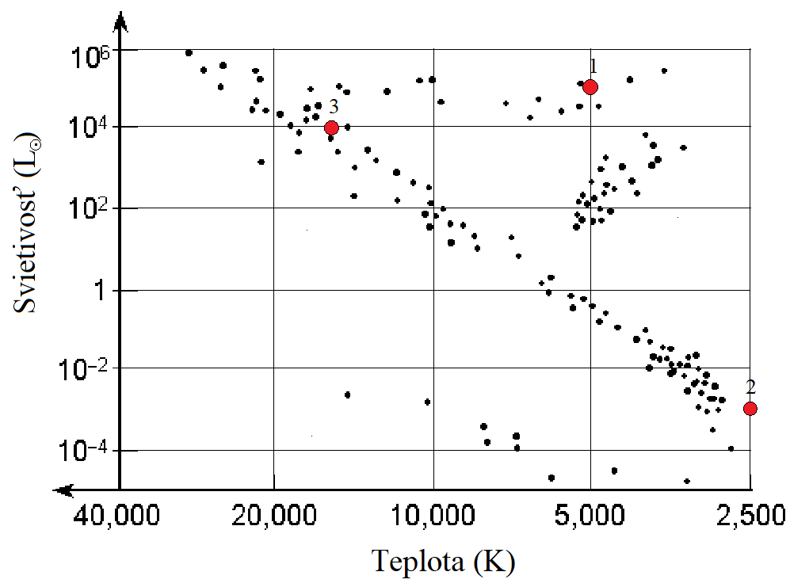
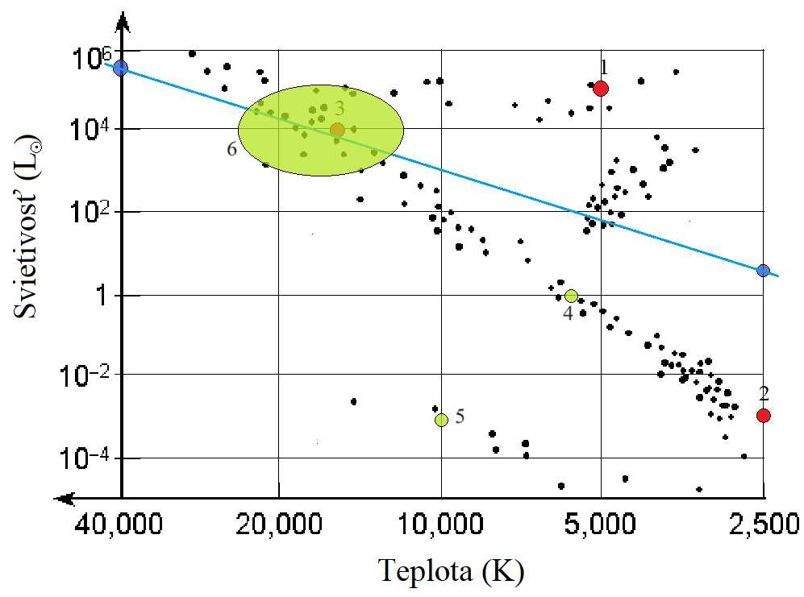

## Zadanie

Na obrázku 1 sa nachádza Hertzsprungov-Russellov diagram, v ktorom sú červenými bodmi vyznačené tri hviezdy. V celej tomto príklade môžete predpokladať, že hviezdy sú sféricky symetrické a žiaria ako absolútne čierne teleso. Vašou úlohou je odhadnúť nasledujúce:

<ol type="a">

<li>

svietivosť a teplotu hviezdy označenej číslom 1,

</li>

<li>

polomer hviezdy označenej číslom 2,

</li>

<li>

hmotnosť hviezdy označenej číslom 3, za predpokladu, že pre hviezdy na hlavnej postupnosti platí približná závislosť $L \sim M^{3,5}$.

</li>

</ol>

Do diagramu následne vyznačte pozíciu, kde sa nachádza:

<ol type="a" start="4">

<li>

Slnko a označte ho číslom 4,

</li>

<li>

biely trpaslík s teplotou $T=10\,000\,\mathrm{K}$ a označte ho číslom 5,

</li>

<li>

hviezda hlavnej postupnosti s polomerom 10-krát väčším ako je polomer Slnka a označte ju číslom 6.

</li>

</ol>

<figure>

<figcaption>

**Obrázok 1:** Hertzsprungov-Russellov diagram.
</figcaption>

</figure>

Riešenie

<ol type="a">

<li>

Svietivosť hviezdy 1 je $L_1=10^{5}\,\mathit{L}_\Sun$, jej teplota je $T_1 = 5000\,\mathrm{K}$.

</li>

<li>

Polomer dopočítame zo Stefanovho-Boltzmannovho zákona 

$$
R_2=\sqrt{\frac{L_2}{4\pi \sigma T_2^4}}\,. \tag{1}
$$

 Svietivosť a teplota hviezdy 2 sú: $L_2 = 10^{-3}\,\mathit{L}_\Sun$ a $T_2=2500\,\mathrm{K}$.\
Dostaneme hodnotu $R_2=0{,}17\,\mathit{R}_\Sun$.

</li>

<li>

Svietivosť tretej hviezdy je $L_3=10^{4}\,\mathit{L}_\Sun$. Zo zadania poznáme úmernosť medzi svietivosťou a hmotnosťou hviezdy hlavnej postupnosti, medzi ktoré patrí aj Slnko. Preto si môžeme spomínanú úmernosť prepísať do nasledujúceho tvaru 

$$
\begin{align*}
\frac{L}{L_\Sun}&=\left(\frac{M}{M_\Sun}\right)^{3,5}\,, \tag{2}\\
M&=\left(\frac{L}{L_\Sun}\right)^\frac{1}{3,5}M_\Sun\,. \tag{3}\end{align*}
$$

 Z toho už dostaneme hmotnosť hviezdy $M=13{,}9\,\mathit{M}_\Sun$.

</li>

<li>

Poloha Slnka je nakreslená na obrázku 2 a označená číslom 4.

<figure>

<figcaption>

**Obrázok 2:** Riešenie – H-R diagram.
</figcaption>

</figure>

</li>

<li>

Vieme, že biele trpaslíky sa nachádzajú pod hlavnou postupnosťou, zhruba v oblasti označenej číslom 5.

</li>

<li>

Na H-R diagrame sa hviezdy s rovnakým polomerom nachádzajú na priamke, ktorej rovnicu získame zlogaritmovaním Stefanovho-Boltzmannovho zákona. Ideálne je vydeliť ho Stefanovým-Boltzmannovým zákonom pre Slnko, aby v argumente logaritmov boli bezrozmerné veličiny. 

$$
\begin{align*}
\log \left(\frac{L}{L_\Sun}\right)&=\log \left(\frac{4\pi R^2 \sigma T^4}{4\pi R_\Sun^2 \sigma T_\Sun^4}\right)\,, \tag{4}\\
\log \left(\frac{L}{L_\Sun}\right)&=2\log \left(\frac{R}{R_\Sun}\right) + 4\log \left(\frac{T}{T_\Sun}\right)\,. \tag{5}\end{align*}
$$

 Stačí, aby sme dopočítali hodnoty $\log \left(\frac{L}{L_\Sun}\right)$ pre $R = 10\,\mathit{R}_\Sun$ a dve hodnoty teploty. Tieto dva body potom zakreslíme do grafu, spojíme priamkou. Všetky hviezdy, ktoré sa nachádzajú na tejto priamke majú polomer $R = 10\,\mathit{R}_\Sun$. Napríklad 

$$
\begin{align*}
    \text{pre } T = 2500\,\mathrm{K} \text{ máme } \log \left(\frac{L}{L_\Sun}\right) &= 0,54 \\
    \text{a pre } T=40\,000\,\mathrm{K} \text{ dostávame } \log \left(\frac{L}{L_\Sun}\right) &= 5,35
\end{align*}
$$

 Tieto dva body sú na obrázku vyznačené modrou farbou a spojené modrou priamkou. V oblasti, kde priamka pretína hlavnú postupnosť sa nachádza šiesta hviezda.

</li>

</ol>

