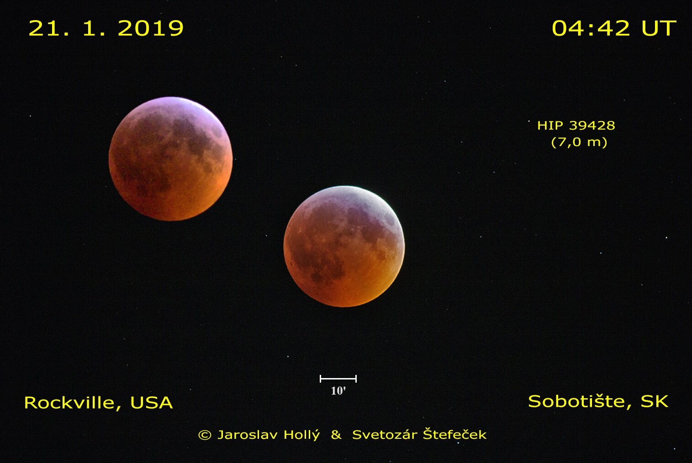
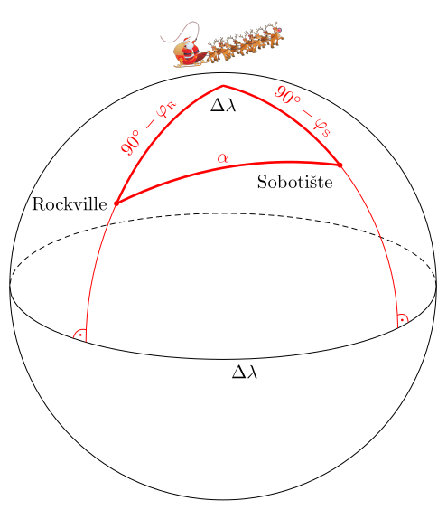

## Zadanie

21\. 1. 2019 nastalo úplné zatmenie Mesiaca, ktoré pozorovali a fotili aj dvaja astronómovia zo Sobotišťa. Jeden z nich sa nachádzal na Slovensku v Sobotišti ($48^{\circ}\,44'$ N, $17^{\circ}\,24'$ E), druhý v USA v Rockville ($39^{\circ}\,5'$ N, $77^{\circ}\,9'$ W). Pri spracovaní fotiek zistili, že zhodou okolností odfotili maximálnu fázu zatmenia takmer naraz.

Fotky poskladali do jednej, a to na základe pozícií hviezd v okolí Mesiaca. Tým pekne ukázali efekt paralaxy na pozorovanú polohu Mesiaca voči hviezdam. Využite výslednú koláž na obr. 1 a odhadnite vzdialenosť Mesiaca od stredu Zeme v deň zatmenia. Predpokladajte, že v Rockville bol Mesiac počas maximálnej fázy zatmenia presne v zenite. Pri výpočte môžete využiť uhlovú mierku na obrázku, polomer Zeme a súradnice miest, kde sa astronómovia nachádzali.

<figure>

<figcaption>

**Obrázok 1:** Fotografia zatmenia Mesiaca.
</figcaption>

</figure>

Riešenie

Pretože v Rockville bol Mesiac presne v zenite, priamka spájajúca stred Zeme so stredom Mesiaca prechádza aj cez Rockville. Stred Zeme, Sobotište a stred Mesiaca potom tvoria trojuholník nakreslený na obrázku 2.

<figure>

<figcaption>

**Obrázok 2:** Paralaxa Mesiaca.
</figcaption>

</figure>

Na obrázku je hľadaná vzdialenosť označená $d$, paralaxa Mesiaca je $p$, a uhlová vzdialenosť Sobotišťa a Rockvillu pri pohľade zo stredu Zeme je $\alpha$. Uhol $\alpha$ dokážeme vypočítať z kosínusovej vety pre sférický trojuholník 

$$
\cos \alpha = \sin \varphi_\mathrm {S} \sin \varphi_\mathrm{R} + \cos \varphi_\mathrm{S} \cos \varphi_\mathrm{R} \cos (\lambda_\mathrm{S}-\lambda_\mathrm{R}) \,. \tag{1}
$$

 kde $\varphi_\mathrm{S}$ a $\varphi_\mathrm{R}$ je zemepisná šírka Sobotišťa a Rockvillu a $\lambda_\mathrm{S}$ a $\lambda_\mathrm{R}$ sú ich zemepisné dĺžky. Pri dosadení za zemepisné dĺžky je potrebné si uvedomiť, že Sobotište je na východnej pologuli, zatiaľ čo Rockville je na západnej pologuli, preto sa číselné hodnoty zemepisných dĺžok budú sčítať a nie odčítať. Po dosadení súradníc Sobotišťa a Rockvillu dostaneme $\alpha \approx 64^{\circ}\,19'\,31''$.

<figure>

<figcaption>

**Obrázok 3:** Sférický trojuholník pre výpočet uhlovej vzdialenosti\
medzi Sobotišťom a Rockvillom.
</figcaption>

</figure>

Paralaxu Mesiaca vieme zmerať z fotky zatmenia. Využijeme pri tom uhlovú mierku. Pri meraní si môžeme všimnúť, že mesačné disky nie sú rovnako veľké, to nám môže zhoršiť presnosť merania. Ak chceme merať čo najpresnejšie, mali by sme nájsť stredy oboch diskov a odmerať ich vzdialenosť. Tú potom pomocou uhlovej mierky prepočítame na paralaxu $p \approx 55'\,20''$.

Už poznáme dva z troch uhlov v trojuholníku na obr. 2. Dopočítame ešte uhol $\beta$ 

$$
\beta = 180^{\circ} - \alpha - p \approx 114^{\circ}\,45'\,9'' \,. \tag{2}
$$

 Vzdialenosť $d$ nakoniec jednoducho vypočítame zo sínusovej vety pre rovinný trojuholník 

$$
\frac{d}{\sin \beta}=\frac{R_\Ea}{\sin p} \ztv d=\frac{\sin \beta}{\sin p}R_\Ea \approx 359\,900\,\mathrm{km} \,. \tag{3}
$$

