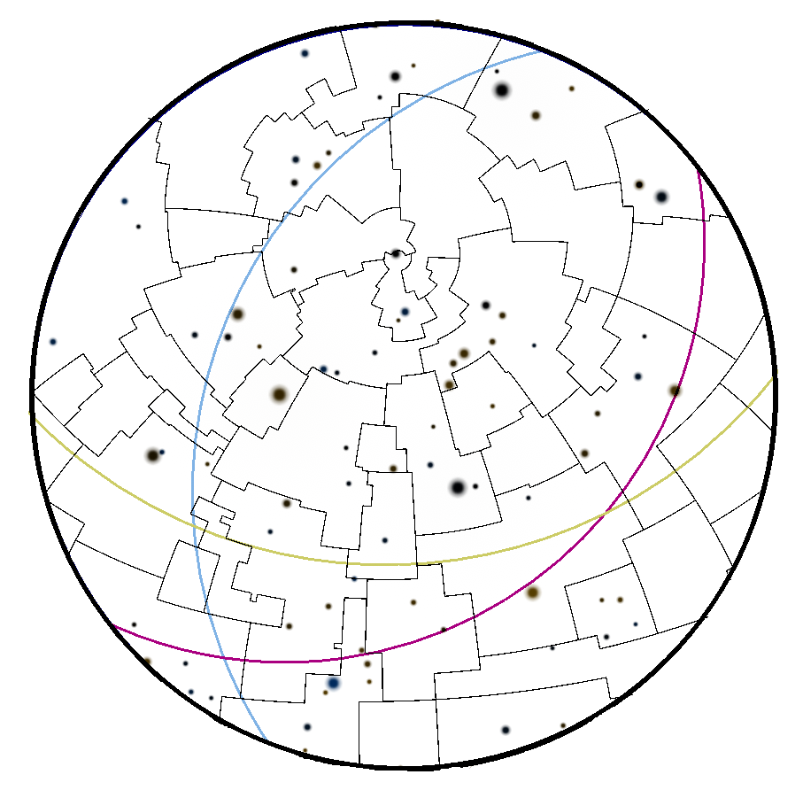
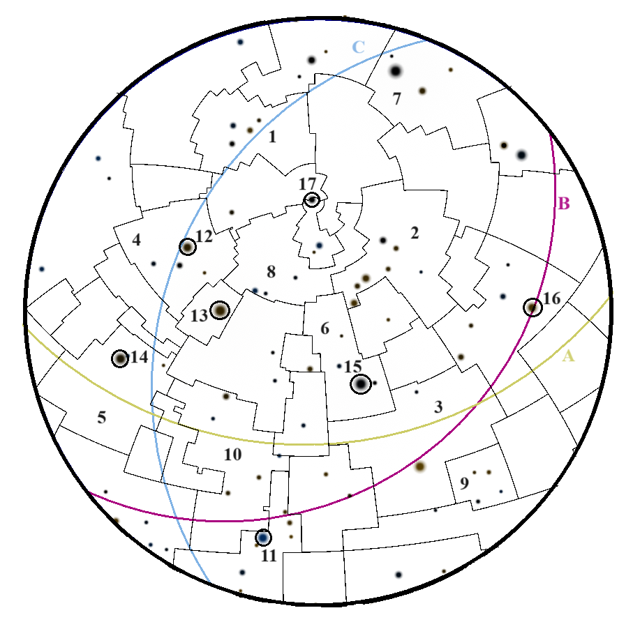

## Zadanie

Predstavte si, že v jednu jarnú noc vyjdete von s úmyslom pozorovať nočnú oblohu. Počasie ale nie je ideálne, po oblohe sa pohybujú riedke mraky, čo spôsobuje, že vidíte iba jasné hviezdy. Pohľad na celú oblohu je znázornený na priložených mapách, obr. 1 a obr. 2, kde vidno iba hviezdy do tretej magnitúdy.

<ol type="a">

<li>

Číslami 1 – 10 sú na mape označené súhvezdia. Napíšte ich slovenské názvy a latinské skratky.

</li>

<li>

Číslami 11 – 17 sú označené jasné hviezdy. Napíšte ich mená alebo Bayerove označenia (napr. Alfa Tau). Ak napíšete oboje, nedostanete žiadne body navyše.

</li>

<li>

V mape sú zakreslené 3 významné kružnice, ktoré sú označené písmenami A, B a C. Napíšte ich názvy.

</li>

</ol>

*Poznámka: mapy sú rovnaké, jedna z nich je kvôli lepšej prehľadnosti bez čísel.*

<figure>

<figcaption>

**Obrázok 1:** Mapa bez čísel.
</figcaption>

</figure>

<figure>

<figcaption>

**Obrázok 2:** Mapa s číslami.
</figcaption>

</figure>

Riešenie

<ol type="a">

<li>

Súhvezdia:

- 1 – Kasiopeja, Cas,

- 2 – Veľká medvedica, UMa,

- 3 – Panna, Vir,

- 4 – Labuť, Cyg,

- 5 – Orol, Aql,

- 6 – Pastier, Boo,

- 7 – Povozník, Aur,

- 8 – Drak, Dra,

- 9 – Havran, Crv,

- 10 – Hadonos, Oph.

</li>

<li>

Hviezdy:

- 11 – Antares ($\alpha$ Sco),

- 12 – Deneb ($\alpha$ Cyg),

- 13 – Vega ($\alpha Lyr$),

- 14 – Altair ($\alpha$ Aql),

- 15 – Arktúr ($\alpha$ Boo),

- 16 – Regulus ($\alpha$ Leo),

- 17 – Polárka ($\alpha$ UMi).

</li>

<li>

Kružnice:

- A – nebeský rovník,

- B – ekliptika,

- C – galaktický rovník.

</li>

</ol>

