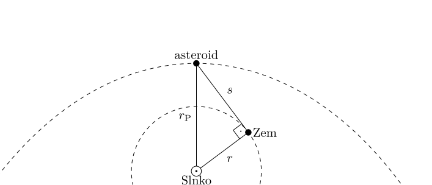

## Zadanie

Predstavte si, že ste objavili nový asteroid. Podarilo sa vám uskutočniť iba jedno pozorovanie, pri ktorom ste zaznamenali asteroid vychádzať na východe presne o polnoci pravého slnečného času. Zároveň sa vám podarilo zmerať jeho vzdialenosť od Zeme v tom čase, $s = 6{,}321\,\mathrm{au}$. Dodatočne ste zistili, že sa vtedy nachádzal v perihéliu. Pri výpočtoch považujte dráhu Zeme za kruhovú.

<ol type="a">

<li>

Určte, či sa jedná o asteroid na vonkajšej alebo vnútornej orbite voči Zemi a presne nazvite aspekt, v ktorom sa nachádzal v čase pozorovania.

</li>

<li>

Vypočítajte ako ďaleko od Slnka sa asteroid v čase pozorovania nachádzal.

</li>

</ol>

Na úplné informácie o asteroide toto jedno pozorovanie nestačilo. Začali ste prehľadávať svoj pozorovateľský denník a zistili ste, že tento asteroid ste v rovnakej pozícií pozorovali pred časom $T = 1{,}046\,\mathrm{roka}$.

<ol type="a">

<li>

Vypočítajte obežnú dobu asteroidu.

</li>

<li>

Vypočítajte veľkú polos jeho dráhy.

</li>

<li>

Zistite ako najďalej od Slnka sa môže dostať od Slnka a určite excentricitu jeho dráhy.

</li>

</ol>

Riešenie

<ol type="a">

<li>

Polnoc pravého slnečného času znamená v iných slovách dolnú kulmináciu Slnka. Východ (západ) objektu v čase kulminácie Slnka znamená, že smery k nim zvierajú pravý uhol. Z toho môžeme usúdiť, že objekt sa nachádza v kvadratúre a nakoľko sa nachádza od Slnka na západ, tak v **západnej kvadratúre**. V kvadratúre sa môže nachádzať iba **vonkajší asteroid**.

</li>

<li>

Situácia je zobrazená na obrázku 1. Keďže sa asteroid nachádza v kvadratúre, môžeme využiť pravouhlý trojuholník, kde prepona je vzdialenosť asteroidu od Slnka (ktorú označíme $r_\textrm{P}$ nakoľko sa nachádza v perihéliu). Odvesny sú vzdialenosť asteroidu od Zeme $s$ a vzdialenosť Zeme od Slnka $r$. Tieto strany sú zviazané Pytagorovou vetou 

$$
r_\textrm{P} = \sqrt{r^2 + s^2} = 6{,}400\,\mathrm{au}\,. \tag{1}
$$

<figure>

<figcaption>

**Obrázok 1:** Schéma dráh Zeme a asteroidu v západnej kvadratúre.
</figcaption>

</figure>

</li>

<li>

Zadaná perióda $T$ je obežná doba z pohľadu zo Zeme, teda synodická obežná doba. Táto je pre vonkajší asteroid so siderickou zviazaná vzťahom 

$$
\frac{1}{T} = \frac{1}{P_\Ea} - \frac{1}{P}\,, \tag{2}
$$

 kde $P_\Ea$ a $P$ sú siderické obežné periódy Zeme a asteroidu. Po vyjadrení $P = 22{,}739\,\mathrm{roka}$.

</li>

<li>

Veľkú polos asteroidu vypočítame z 3. Keplerovho zákona 

$$
a^3 = P^2\,, \tag{3}
$$

 kde veľká polos je v $\mathrm{au}$ a obežná perióda v rokoch. Po dosadení dostaneme 

$$
a = \sqrt[3]{P^2} \approx 8{,}026\,\mathrm{au}\,. \tag{4}
$$

</li>

<li>

Najďalej od Slnka je asteroid v aféliu, pre ktoré platí 

$$
2 a = r_\textrm{A} + r_\textrm{P}\,, \tag{5}
$$

 odkiaľ $r_\textrm{A} = 9{,}652\,\mathrm{au}$. Excentricita dráhy je daná vzťahom 

$$
e = \frac{a - r_\textrm{P}}{a} \approx 0,203\,. \tag{6}
$$

</li>

</ol>

