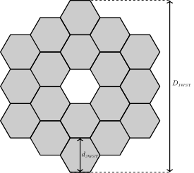

## Zadanie

Na konci roka 2021 bol do vesmíru vypustený Vesmírny ďalekohľad Jamesa Webba (JWST). Ten je v určitom zmysle nasledovník Hublovho vesmírneho ďalekohľadu (HST). Vašou úlohou je preskúmať o koľko je JWST lepší ako HST. Hlavné zrkadlo JWST je zložené z 18 6-uholníkových zrkadiel usporiadaných podľa obrázku 1. Každé z malých zrkadiel má vzdialenosť protiľahlých hrán $d_{\textrm{JWST}} = 1{,}32\,\mathrm{m}$. Pre účely počítania rozlišovacej schopnosti je možné považovať toto zložené zrkadlo za kruhové zrkadlo s priemerom rovným najväčšej vzdialenosti dvoch paralelných hrán $D_{\textrm{JWST}}$. JWST pozoruje vlnové dĺžky v rozmedzí $\lambda_{\textrm{JWST}} = (600;\, 28000)\mathrm{nm}$.

HST má jedno monolitické kruhové zrkadlo s priemerom $D_{\textrm{HST}} = 2{,}4\,\mathrm{m}$, pričom pozoruje vlnové dĺžky $\lambda_{\textrm{HST}} = (100;\, 2500)\mathrm{nm}$.

<ol type="a">

<li>

Vypočítajte a porovnajte maximálnu teoretickú rozlišovaciu schopnosť JWST a HST.

</li>

<li>

Predpokladajte, že na oba ďalekohľady dopadá rovnaký tok fotónov (počet fotónov na meter štvorcový za sekundu) s najmenšou vlnovou dĺžkou, ktorú je daný ďalekohľad zachytiť. Ktorý z nich zachytí viac energie za sekundu?

</li>

</ol>

Na výpočet budete potrebovať vedieť, že energia jedného fotónu s frekvenciou $f$ je 

$$
E=hf \,, \tag{1}
$$

 kde $h$ je Planckova konštanta.

<figure>

<figcaption>

**Obrázok 1:** Znázornenie zloženého zrkadla JWST s popisom jednotlivých veľkostí.
</figcaption>

</figure>

Riešenie

Nultým krokom je vypočítať si aký je efektívny priemer JWST, teda vzdialenosť najvzdialenejších rovnobežných hrán. Podľa nákresu vidíme, že medzi medzi hranami celého JWST je päť šesťuholníkových plôch. Každá má $d_{\textrm{JWST}}=1{,}32\,\mathrm{m}$ a teda celkovo mám 

$$
D_{\textrm{JWST}}=5\cdot d_{\textrm{JWST}} = 6{,}6\,\mathrm{m} \,. \tag{2}
$$

Pre riešenie zadania si ako prvé pripomenieme, že rozlišovacia schopnosť $\varphi$ je daná nasledujúcim vzorcom (ktorého odvodenie je trochu náročná úloha a tak je vhodné si vzorec pamätať) 

$$
\varphi = 1,22\frac{\lambda}{D} \,. \tag{3}
$$

 Kde $\lambda$ je vlnová dĺžka svetla ktoré pozorujeme a $D$ je priemer použitého ďalekohľadu.

Ďalšia dôležitá myšlienka je, že lepšia rozlišovacia schopnosť znamená menší uhol $\varphi$, ktorý vieme rozoznať. To znamená, že ak hľadáme maximálnu teoretickú rozlišovaciu schopnosť pre JWST a HST, tak použijeme ich maximálny priemer ale minimálnu vlnovú dĺžku ($\lambda_{\textrm{HST; min}}$ a $\lambda_{\textrm{JWST; min}}$). Čo pre jednotlivé ďalekohľady predstavuje hodnoty 

$$
\begin{align*}
    \varphi_{\textrm{HST}} &= 1,22\frac{\lambda_{\textrm{HST; min}}}{D_{\textrm{HST}}} = 1,22\frac{100\,\mathrm{nm}}{2{,}4\,\mathrm{m}} = 5 \cdot 10^{-8}\,\mathrm{rad} \,, \tag{4}\\
    \varphi_{\textrm{JWST}} &= 1,22\frac{\lambda_{\textrm{JWST; min}}}{D_{\textrm{JWST}}} = 1,22\frac{600\,\mathrm{nm}}{6{,}6\,\mathrm{m}} = 1{,}1 \cdot 10^{-7}\,\mathrm{rad} \,. \tag{5}\end{align*}
$$

 Takže jasne vidíme, že HST má menší uhol $\varphi$, pod ktorým dokáže rozoznať dva bodové zdroje svetla, teda má lepšiu teoretickú rozlišovaciu schopnosť.

Pre riešenie zadania (b) si musíme upraviť vzťah v zadaní z frekvencií na vlnové dĺžky. Predstavme si, že rýchlosť svetla $c$ je vlastne rýchlosť za ktorú okolo nás prejde celá vlna $c=\lambda / T$. Takže vzdialenosť $\lambda$ za dobu $T$ ktorej trvá prejdenie vlny. Doba $T$ ale priamo súvisí s frekvenciou vlny ako $f=1 / T$. Takže získavame vzťah 

$$
c=f\lambda \,. \tag{6}
$$

 *Poznámka: K rovnakému záveru sa dá dôjsť aj rozmerovou analýzou (zamyslením sa nad jednotkami jednotlivých veličín). Rýchlosť svetla má jednotku $[c] = m\cdot s^{-1}$, vlnová dĺžka $[\lambda] = m$ a frekvencia má $[f]=s^{-1}$. Takže jediná možnosť ako ich spolu dať do jedného vzťahu je $c=\lambda f$.*

Ak túto znalosť spojíme so vzťahom v zadaní, získame 

$$
E=\frac{hc}{\lambda} \,. \tag{7}
$$

 Ak na oba teleskopy dopadá rovnaký tok fotónov $F$, čo je počet fotónov na meter štvorcový za sekundu. Potom je zavhytený výkon, teda množstvo zachytenej energie za sekundu, rovný $P=F\cdot E \cdot S$. Kde $S=(1/4)\pi D^2$ je plocha príslušného ďalekohľadu. To predstavuje 

$$
\begin{align*}
    P_{\textrm{HST}}&=\frac{hc}{\lambda_{\textrm{HST; min}}} \cdot F (1/4)\pi D_{\textrm{HST}}^2 \,, \tag{8}\\
    P_{\textrm{JWST}}&=\frac{hc}{\lambda_{\textrm{JWST; min}}} \cdot F (1/4)\pi D_{\textrm{JWST}}^2 \,. \tag{9}\end{align*}
$$

 Prácu si vieme zjednodušiť ak hľadáme pomer $p=P_{\textrm{HST}}/P_{\textrm{JWST}}$. 

$$
p =\frac{P_{\textrm{HST}}}{P_{\textrm{JWST}}} = \frac{hc}{hc}\frac{\lambda_{\textrm{JWST; min}}}{\lambda_{\textrm{HST; min}}}\frac{F (1/4)\pi D_{\textrm{HST}}^2}{F (1/4)\pi D_{\textrm{JWST}}^2} = \frac{\lambda_{\textrm{JWST; min}}\cdot D_{\textrm{HST}}^2}{\lambda_{\textrm{HST; min}}\cdot D_{\textrm{JWST}}^2} \,. \tag{10}
$$

 Čo po dosadení konkrétnych hodnôt vráti 

$$
p = \frac{\lambda_{\textrm{JWST; min}}\cdot D_{\textrm{HST}}^2}{\lambda_{\textrm{HST; min}}\cdot D_{\textrm{JWST}}^2} \approx 0,8 \,. \tag{11}
$$

 Keďže $p<1$, tak to znamená, že viac energie za sekundu zachytí JWST.

