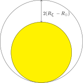
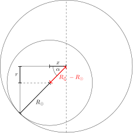
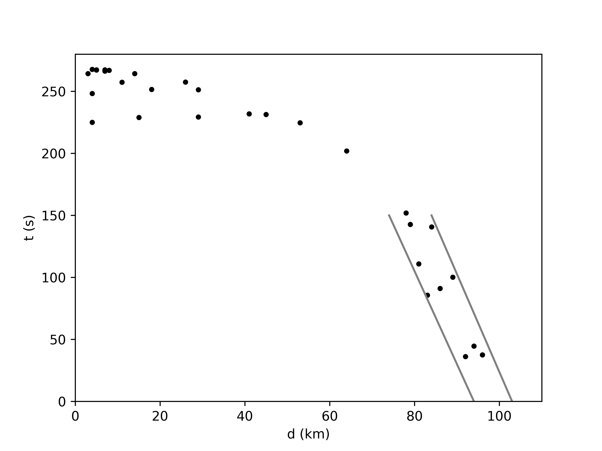
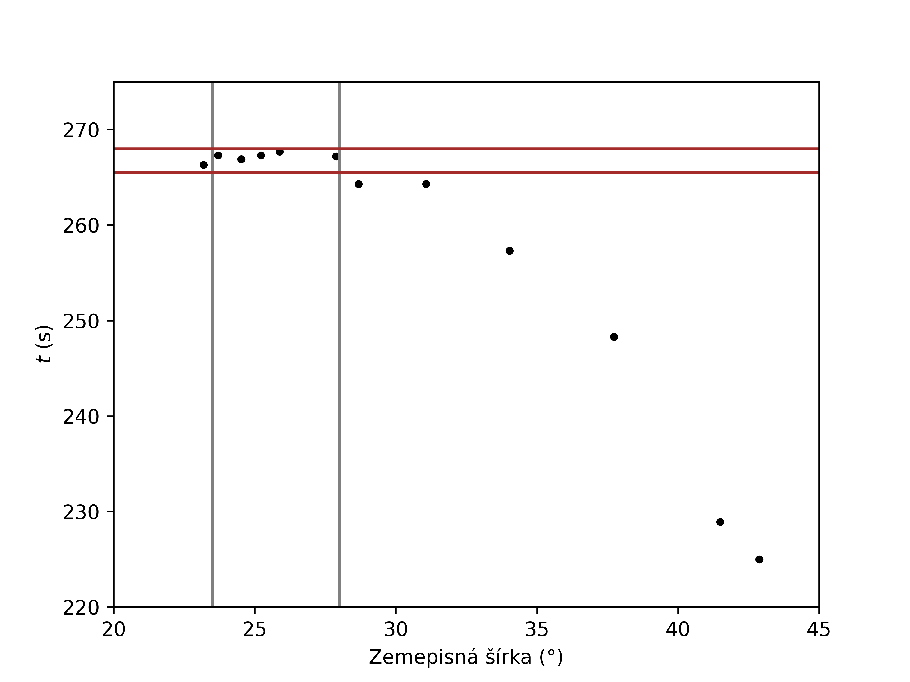
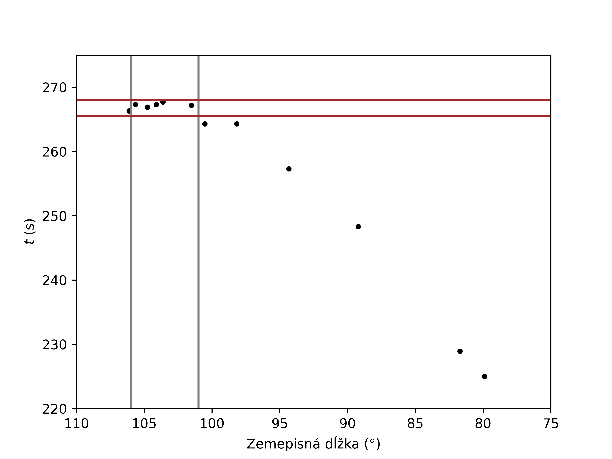

## Zadanie

Výpravu za úplným zatmením Slnka 2024 v Amerike zastihlo nepriaznivé počasie, kedy vo väčšine Texasu (kde pôvodne plánovali pozorovať) bola na deň zatmenia predpovedaná oblačnosť. Preto sa rozhodli vyraziť v noci pred samotným zatmením na sever, smerom k Arkansasu v nádeji, že sa dostanú na miesto, kde budú dobré podmienky na pozorovanie.

Samozrejme, na to, aby mohli pozorovať úplné zatmenie Slnka, museli zostať v páse totality. Dôležitá je ale aj poloha v samotnom páse, pretože v jeho strede je doba zatmenia najdlhšia.

Počas jazdy autom smerom k vytúženému miestu bez oblakov padla otázka, či sa dá nejako jednoducho určiť závislosť dĺžky trvania úplného zatmenia na vzdialenosti od stredu pásu totality. V reálnom prípade to nie je veľmi jednoduché, ale ak urobíme určité zjednodušenia, vieme odvodiť závislosť, ktorá celkom dobre popisuje realitu.

<ol type="a">

<li>

[35 b] Predpokladajte, že povrch Zeme je rovina kolmá na spojnicu Zem-Mesiac-Slnko. Dokážte, že teoretická závislosť dĺžky trvania $t$ úplného zatmenia v závislosti na vzdialenosti od stredu pásu totality má nasledujúci tvar

</li>

</ol>

$$
t = t_{max}\sqrt{1-\frac{d^2}{W^2}} \, , \tag{1}
$$

 kde $t_{max}$ je doba trvania úplného zatmenia v strede pásu totality a $d$ je kolmá vzdialenosť pozorovateľa od stredu pásu a $W$ je pološírka pásu totality.

V tabuľke 1 je 30 miest, v ktorých bolo možné 8. 4. 2024 pozorovať úplné zatmenie Slnka. Ku každému z nich sú uvedené jeho súradnice, vzdialenosť od stredu pásu totality a odmeraná doba trvania úplného zatmenia. Mestá pokrývajú celú dĺžku pásu totality, ktorá sa nachádza na pevnine – od Mexika až po Kanadu.

<ol type="a" start="2">

<li>

[55 b] Nakreslite graf závislosti trvania úplného zatmenia na vzdialenosti od stredu pásu totality. Odhadnite z neho šírku pásu totality aj jej neistotu. Predpokladajte, že šírka pásu nezávisí na zemepisnej polohe.

</li>

<li>

[75 b] V reálnom prípade trvanie úplného zatmenia nezávisí len na vzdialenosti od stredu pásu totality, ale aj na zemepisnej polohe. V tejto časti sa pokúste nájsť zemepisnú polohu ideálnej oblasti na pozorovanie zatmenia – teda miesto, kde bolo pozorované najdlhšie úplné zatmenie. V grafe z predchádzajúcej podúlohy sa zdá, že v miestach, ktoré sú od stredu pásu vzdialené maximálne 15 km, sa funkcia času od vzdialenosti mení už celkom pomaly. Vyberte z tabuľky iba miesta, ktoré spĺňajú túto podmienku a nakreslite pre ne 2 grafy – čas trvania v závislosti od zemepisnej šírky a čas trvania v závislosti od zemepisnej dĺžky. Z týchto grafov potom odhadnite maximálnu pozorovateľnú dĺžku trvania úplného zatmenia a zemepisné súradnice miesta, odkiaľ sa najdlhšie zatmenie bude dať pozorovať. Pre všetky tri údaje odhadnite aj neistoty.

</li>

</ol>

**Tabuľka 1:** Trvanie úplného zatmenia v rôznych mestách Severnej Ameriky.

| Mesto               | $t$ | Zem. šírka  | Zem. dĺžka  | $d$ \[km\] |
|:--------------------|:---------:|:-----------:|:-----------:|:----------------:|
|                     |           |             |             |                  |
| Villa Unión         | $4^{\mathrm{min}}\,26{,}3^{\mathrm{s}}$ | $23^{\circ}\,11'$ N | $106^{\circ}\,13'$ W |        7         |
| Mazatlán            | $4^{\mathrm{min}}\,17{,}5^{\mathrm{s}}$ | $23^{\circ}\,15'$ N | $106^{\circ}\,25'$ W |        26        |
| La Ciudad           | $4^{\mathrm{min}}\,27{,}3^{\mathrm{s}}$ | $23^{\circ}\,42'$ N | $105^{\circ}\,39'$ W |        5         |
| Durango             | $3^{\mathrm{min}}\,46{,}6^{\mathrm{s}}$ | $24^{\circ}\,1'$ N | $104^{\circ}\,40'$ W |        53        |
| Canatlán            | $4^{\mathrm{min}}\,26{,}9^{\mathrm{s}}$ | $24^{\circ}\,31'$ N | $104^{\circ}\,46'$ W |        8         |
| Nazas               | $4^{\mathrm{min}}\,27{,}3^{\mathrm{s}}$ | $25^{\circ}\,13'$ N | $104^{\circ}\,7'$ W |        7         |
| Bermejillo          | $4^{\mathrm{min}}\,27{,}7^{\mathrm{s}}$ | $25^{\circ}\,53'$ N | $103^{\circ}\,37'$ W |        4         |
| Monclova            | $2^{\mathrm{min}}\,17{,}6^{\mathrm{s}}$ | $26^{\circ}\,54'$ N | $101^{\circ}\,25'$ W |        84        |
| Múzquiz             | $4^{\mathrm{min}}\,27{,}2^{\mathrm{s}}$ | $27^{\circ}\,53'$ N | $101^{\circ}\,31'$ W |        5         |
| Piedras Negras      | $4^{\mathrm{min}}\,24{,}3^{\mathrm{s}}$ | $28^{\circ}\,41'$ N | $100^{\circ}\,32'$ W |        14        |
| Devine              | $0^{\mathrm{min}}\,37{,}5^{\mathrm{s}}$ | $29^{\circ}\,8'$ N | $98^{\circ}\,54'$ W |        96        |
| Ciudad Acuña        | $3^{\mathrm{min}}\,21{,}9^{\mathrm{s}}$ | $29^{\circ}\,19'$ N | $100^{\circ}\,58'$ W |        64        |
| Austin              | $1^{\mathrm{min}}\,40{,}2^{\mathrm{s}}$ | $30^{\circ}\,16'$ N | $97^{\circ}\,45'$ W |        89        |
| Lampasas            | $4^{\mathrm{min}}\,24{,}3^{\mathrm{s}}$ | $31^{\circ}\,4'$ N | $98^{\circ}\,11'$ W |        3         |
| Waco                | $4^{\mathrm{min}}\,11{,}3^{\mathrm{s}}$ | $31^{\circ}\,33'$ N | $97^{\circ}\,9'$ W |        29        |
| Fort Worth          | $2^{\mathrm{min}}\,31{,}9^{\mathrm{s}}$ | $32^{\circ}\,45'$ N | $97^{\circ}\,20'$ W |        78        |
| Dallas              | $3^{\mathrm{min}}\,51{,}4^{\mathrm{s}}$ | $32^{\circ}\,47'$ N | $96^{\circ}\,48'$ W |        45        |
| Texarkana           | $2^{\mathrm{min}}\,22{,}7^{\mathrm{s}}$ | $33^{\circ}\,26'$ N | $94^{\circ}\,3'$ W |        79        |
| De Queen            | $4^{\mathrm{min}}\,17{,}3^{\mathrm{s}}$ | $34^{\circ}\,2'$ N | $94^{\circ}\,20'$ W |        11        |
| Hot Springs Village | $3^{\mathrm{min}}\,51{,}9^{\mathrm{s}}$ | $34^{\circ}\,40'$ N | $93^{\circ}\,0'$ W |        41        |
| Russellville        | $4^{\mathrm{min}}\,11{,}5^{\mathrm{s}}$ | $35^{\circ}\,17'$ N | $93^{\circ}\,8'$ W |        18        |
| Barling             | $0^{\mathrm{min}}\,44{,}6^{\mathrm{s}}$ | $35^{\circ}\,20'$ N | $94^{\circ}\,18'$ W |        94        |
| Paducah             | $1^{\mathrm{min}}\,31{,}0^{\mathrm{s}}$ | $37^{\circ}\,5'$ N | $88^{\circ}\,36'$ W |        86        |
| Carbondale          | $4^{\mathrm{min}}\,8{,}3^{\mathrm{s}}$ | $37^{\circ}\,44'$ N | $89^{\circ}\,13'$ W |        4         |
| Indianapolis        | $3^{\mathrm{min}}\,49{,}3^{\mathrm{s}}$ | $39^{\circ}\,46'$ N | $86^{\circ}\,9'$ W |        29        |
| Michigantown        | $0^{\mathrm{min}}\,36{,}1^{\mathrm{s}}$ | $40^{\circ}\,20'$ N | $86^{\circ}\,24'$ W |        92        |
| Toledo              | $1^{\mathrm{min}}\,50{,}9^{\mathrm{s}}$ | $41^{\circ}\,39'$ N | $83^{\circ}\,32'$ W |        81        |
| Cleveland           | $3^{\mathrm{min}}\,48{,}9^{\mathrm{s}}$ | $41^{\circ}\,30'$ N | $81^{\circ}\,42'$ W |        15        |
| Buffalo             | $3^{\mathrm{min}}\,45{,}2^{\mathrm{s}}$ | $42^{\circ}\,53'$ N | $78^{\circ}\,53'$ W |        4         |
| Montreal            | $1^{\mathrm{min}}\,25{,}6^{\mathrm{s}}$ | $45^{\circ}\,30'$ N | $73^{\circ}\,34'$ W |        83        |

Riešenie

<ol type="a">

<li>

Zatmenie trvá len niekoľko minút, preto si môžeme dovoliť počítať s tým, že sa počas neho nemení uhlová rýchlosť Slnka ani Mesiaca na oblohe. Preto sa nemení ani ich vzájomná uhlová rýchlosť $\omega_{\Mo \Sun}$.

</li>

</ol>

Celkový čas úplného zatmenia je maximálny v prípade, že sa nachádzame v strede pásu totality. Vtedy z nášho pohľadu prejde stred Mesiaca presne pred stredom Slnka. Počas úplného zatmenia sa Mesiac posunie voči Slnku o rozdiel ich uhlových priemerov (viď obrázok 1), čo stihne urobiť za čas 

$$
t_{max} = \frac{2(R_\Mo-R_\Sun)}{\omega_{\Mo \Sun}} \,, \tag{2}
$$

 kde $R_\Mo$ je uhlový polomer Mesiaca a $R_\Sun$ uhlový polomer Slnka.

V prípade, že sa nachádzame mimo stredu pásu totality, sa k sebe z nášho pohľadu stredy diskov Mesiaca a Slnka najviac priblížia na vzdialenosť $x$ (viď. obrázok 1), ktorá je priamo úmerná vzdialenosti pozorovateľa od stredu pásu. 

$$
x = \frac{d}{W}x_{max}\, , \tag{3}
$$

 kde $x_{max}$ je maximálna možná hodnota $x$, ktorá je pozorovaná z okraja pásu totality. Na okraji pásu trvá úplné zatmenie efektívne $0\,\mathrm{s}$. Kraj disku Slnka letmo zájde za mesačný disk a hneď potom opäť vyjde. Pre $x_{max}$ platí 

$$
x_{max} = R_\Mo - R_\Sun \, , \tag{4}
$$

 Maximálny čas zatmenia $t=t_{max}$ teda pozorujeme v mieste, kde sa k sebe stredy diskov priblížia na vzdialenosť $x=0$, zatiaľ čo na okraji pásu totality sa k sebe stredy diskov priblížia len na vzdialenosť $x=x_{max}$ a úplné zatmenie tam trvá $t=0$.

<figure>

<figcaption>

**Obrázok 1c:** Schémy úplného zatmenia Slnka.
</figcaption>

</figure>

Obrázok 1 znázorňuje začiatok úplného zatmenia pre ľubovoľnú polohu pozorovateľa v páse totality. Smer vzájomného pohybu mesačného a slnečného disku si orientujeme smerom nahor. Na začiatku totality sa mesačný a slnečný disk presne dotýkajú v jednom bode. Spojnica tohto bodu a stredu mesačného disku zároveň prechádza aj cez stred slnečného disku.

Počas úplného zatmenia sa slnečný disk pohne voči mesačnému disku o uhlovú vzdialenosť $2r$, pričom platí 

$$
\sin \alpha = \frac{r}{R_\Mo - R_\Sun} \, , \tag{5}
$$

a zároveň kosínus uhla $\alpha$ je 

$$
\cos \alpha = \frac{x}{R_\Mo - R_\Sun}\, . \tag{6}
$$

Vyžijeme, že pre ľubovoľný uhol platí goniometrická identita 

$$
\sin ^2 \alpha + \cos ^2 \alpha = 1\, . \tag{7}
$$

Po dosadení za $\sin \alpha$ a $\cos \alpha$ dostaneme 

$$
\frac{r^2}{(R_\Mo - R_\Sun)^2} + \frac{x^2}{(R_\Mo - R_\Sun)^2} = 1 \, , \tag{8}
$$

 

$$
r^2 = \sqrt{(R_\Mo - R_\Sun)^2-x^2} \, , \tag{9}
$$

 

$$
r^2 + x^2 = (R_\Mo - R_\Sun)^2 \, . \tag{10}
$$

Počas úplného zatmenia sa mesačný a slnečný disk voči sebe pohnú o $2r$. Úplné zatmenie preto trvá 

$$
t = \frac{2r}{\omega_{\Mo \Sun}} = \frac{2}{\omega_{\Mo \Sun}}\sqrt{(R_\Mo - R_\Sun)^2-x^2}\, . \tag{11}
$$

Do tohto výrazu dosadíme najskôr za $x$ a následne za $x_{max}$ 

$$
t = \frac{2}{\omega_{\Mo \Sun}}\sqrt{(R_\Mo - R_\Sun)^2-\frac{d^2}{W^2}x_{max}^2}\, , \tag{12}
$$

 

$$
t = \frac{2}{\omega_{\Mo \Sun}}\sqrt{(R_\Mo - R_\Sun)^2-\frac{d^2}{W^2}(R_\Mo - R_\Sun)^2}\, , \tag{13}
$$

 

$$
t = \frac{2(R_\Mo - R_\Sun)}{\omega_{\Mo \Sun}}\sqrt{1-\frac{d^2}{W^2}}\, . \tag{14}
$$

Po vydelení maximálnym možným časom $t_{max}$ dostaneme požadovaný vzťah zo zadania 

$$
\frac{t}{t_{max}} = \frac{2(R_\Mo - R_\Sun)}{\omega_{\Mo \Sun}}\sqrt{1-\frac{d^2}{W^2}}\frac{\omega_{\Mo \Sun}}{2(R_\Mo-R_\Sun)} = \frac{t}{t_{max}} = \sqrt{1-\frac{d^2}{W^2}}\, . \tag{15}
$$

<ol type="a" start="2">

<li>

Graf sa nám bude kresliť jednoduchšie, ak si čas $t$ premeníme buď na sekundy alebo na minúty. V tomto vzorovom riešení sme si zvolili sekundy. Výsledný graf je na obr. 2.

</li>

</ol>

Pri odhadovaní pološírky pásu totality môžeme postupovať napríklad takto: do grafu zakreslíme dve čiary, ktoré ohraničujú údaje v blízkosti okraju pásu totality. Jedna z čiar nám poslúži na odhad minimálnej možnej hodnoty $W$, druhá na odhad maximálnej možnej hodnoty $W$. Výslednú hodnotu pološírky pásu odhadneme ako priemer súradníc, v ktorých tieto dve čiary pretnú vodorovnú os grafu. Vo vzorovom riešení tieto čiary pretínajú os $d$ na rozsahu hodnôt od $W_{min} = 94\,\mathrm{km}$ do $W_{max} = 103\,\mathrm{km}$, ich priemerná hodnota je 

$$
\frac{W_{max}+W_{min}}{2} = 98{,}5\,\mathrm{km}\, . \tag{16}
$$

Neistotu môžeme odhadnúť ako 

$$
\sigma_W = \frac{W_{max}-W_{min}}{2} = 4{,}5\,\mathrm{km}\, . \tag{17}
$$

Odhad pološírky pásu totality teda je $W = 98{,}5 \pm 4{,}5\,\mathrm{km}$. V zadaní sme sa ale pýtali na šírku, tá je $W = 197 \pm 9\,\mathrm{km}$.

Akýkoľvek iný zmysluplný postup bude uznaný za správny.

<figure>

<figcaption>

**Obrázok 2:** Závislosť času trvania úplného zatmenia na vzdialenosti od stredu pásu totality.
</figcaption>

</figure>

<ol type="a" start="3">

<li>

Z tabuľky 1 vyberieme iba miesta, ktoré sú od stredu pásu totality vzdialené o maximálne $15\,\mathrm{km}$. Sú to: Villa Unión, La Ciudad, Nazas, Bermejillo, Múzquiz, Piedras Negras, Lampasas, De Queen, Carbondale, Cleveland a Buffalo. Kvôli jednoduchšej tvorbe grafov si údaje o zemepisnej šírke a dĺžke premeníme na stupne. Čas budeme opäť vynášať v sekundách. Výsledné grafy sú na obr. 3 a 4.

</li>

</ol>

Pri určovaní času a polohy najdlhšieho úplného zatmenia bude postupovať podobným spôsobom ako pri odhade pološírky pásu totality. Vidíme, že najvyššie hodnoty $t$ sú dosiahnuté na juhozápadnom konci pásu (ak by sme sa pozreli na mapu, zistili by sme, že je to blízko pobrežia v Mexiku). Červené čiary v grafe slúžia na odhad času, vertikálnu os pretínajú v bodoch $t_{min} = 266\,\mathrm{s}$ a $t_{max} = 268\,\mathrm{s}$. Priemer týchto hodnôt je 

$$
\frac{t_{max}+t_{min}}{2} = 267\,\mathrm{s}\, . \tag{18}
$$

Neistotu opäť odhadneme ako polovicu ich rozdielu 

$$
\sigma_t = \frac{t_{max}-t_{min}}{2} = 1\,\mathrm{s}\, . \tag{19}
$$

Maximálny čas trvania zatmenia je $t = 267 \pm 1\,\mathrm{s}$.

Obdobne postupujeme pri určení súradníc (na odhad boli použité šedé čiary v grafoch). Minimálne a maximálne hodnoty zemepisnej šírky a dĺžky sú $\varphi_{min} = 23{,}5^{\circ}$, $\varphi_{max} = 28^{\circ}$, $\lambda_{min} = 101^{\circ}$ a $\lambda_{max} = 106^{\circ}$.

Ich priemery a neistoty sú 

$$
\frac{\varphi_{max}+\varphi_{min}}{2} = 25{,}75^{\circ}\, , \tag{20}
$$

 

$$
\frac{\lambda_{max}+\lambda_{min}}{2} = 103{,}5^{\circ}\, , \tag{21}
$$

 

$$
\sigma_\varphi = \frac{\varphi_{max}-\varphi_{min}}{2} = 2{,}25^{\circ}\, , \tag{22}
$$

 

$$
\sigma_\lambda = \frac{\lambda_{max}-\lambda_{min}}{2} = 2{,}5^{\circ}\, . \tag{23}
$$

Najdlhšie úplné zatmenie sa teda dalo pozorovať z oblasti so súradnicami $\varphi = 25{,}8 \pm 2{,}3^{\circ}$ N a $\lambda = 103{,}5 \pm 2{,}5^{\circ}$ W. Opäť, akákoľvek rozumná metóda odhadu či už z grafu alebo tabuľky bude uznaná za správnu.

Pri hľadaní ideálnej polohy $(\varphi, \lambda)$ sme v tejto úlohe $\varphi$ a $\lambda$ skúmali samostatne. Vo všeobecnosti to ale nemusí vždy byť správny postup.

<figure>

<figcaption>

**Obrázok 3:** Závislosť času trvania úplného zatmenia na zemepisnej šírke.
</figcaption>

</figure>

<figure>

<figcaption>

**Obrázok 4:** Závislosť času trvania úplného zatmenia na zemepisnej dĺžke.
</figcaption>

</figure>

## Komentár autora

Ďakujem Dejanovi za inšpiráciu k tejto úlohe. Údaje v tabuľke boli prevzaté z aplikácie *EclipseDroid*.
