## Zadanie

Predstavte si, že pozorujete vzdialenú galaxiu. Ako ďaleko ale vlastne vzdialenú? To je otázka, na ktorú sa pokúsite v tejto úlohe prísť. Existuje viacero spôsobov, ako vo vesmíre odhadovať vzdialenosti. Odhadovať je asi lepší popis ako merať, pretože každá jedna metóda je typicky zaťažená istými chybami. Medzi metódy, ktoré sú použiteľné pre vzdialené galaxie (galaxie mimo Miestnej skupiny galaxií) patria štandardné sviečky, Tullyho-Fisherov vzťah alebo pozorovanie galaktických megamaserov (”mega” ako silný, ”maser” ako mikrovlnný laser). Údaje a konkrétna galaxia sú vymyslené, ale jednotlivé veličiny majú typické, pozorovateľné hodnoty. Jednotlivé metódy sú samozrejme mierne zjednodušené, najmä sú vám prezentované dáta už očistené o väčšinu systematických chýb.

**Funkcia svietivosti pre planetárne hmloviny (PNLF)**

Prvá metóda využíva fotometriu planetárnych hmlovín, tak ako je popísaná v článku [Extragalactic Distances from Planetary Nebulae](#https://arxiv.org/pdf/astro-ph/0301279) [^1]. Veľkou výhodou je, že sa celé meranie dá vykonať s pomocou iba dvojice fotografií. Jedna fotografia (úzkopásmová) sa získa v typickej spektrálnej čiare, v ktorej emitujú planetárne hmloviny. Obvykle je to čiara \[O III\], teda zakázaná čiara dvakrát ionizovaného kyslíka. Druhá fotografia je získaná v kontinuu. Následne sa od úzkopásmovej snímky odčíta snímka v kontinuu. Detaily merania nie sú dôležité, zásadné ale je, že planetárne hmloviny nie sú samé o sebe štandardné sviečky (objekt alebo jav s vyžarovanou energiou, ktorú poznáme alebo vieme určiť). Maximálna teoretická svietivosť planetárnej hmloviny už štandardnou sviečkou je. Ako ale odhaliť túto maximálnu teoretickú svietivosť? Empiricky bolo zistené, že ak si vytvoríme histogram počtu planetárnych hmlovín s konkrétnymi hodnotami absolútnej svietivosti $M$, potom graf vykazuje funkčnú závislosť 

$$
N(M) \;\propto\; \, e^{0,307M}\cdot\,\left(  1 - e^{3(M_{PNLF}-M)} \right) \,. \tag{1}
$$

 Pričom $M_{PNLF}=-4{,}48\,\mathrm{mag}$ je absolútna magnitúda teoreticky najjasnejšej planetárnej hmloviny. Táto hodnota sa zdá byť univerzálna pre všetky galaxie. Ak teda budeme schopní fitovať hodnotu zdanlivej teoreticky maximálnej absolútnej magnitúdy $m_{PNLF}$, potom budeme schopní vypočítať jej vzdialenosť.

**Úloha 1**

[65 b] Narysujte graf, do ktorého vynesiete dáta z tabuľky 1. Vodorovná os predstavuje pozorovanú magnitúdu a vertikálna os predstavuje desiatkový logaritmus množstva planetárnych hmlovín s danou magnitúdou $m \pm 0{,}05\,\mathrm{mag}$. Nezabudnite aj správne vyniesť chybové úsečky (error bary). Na dátach vykonajte fit voľnou rukou. Môžete sa inšpirovať ilustračným obrázkom 1. Odčítajte hodnotu magnitúdy $m_{PNLF}$, na ktorej váš fit prechádza hodnotou početnosti 1. Nezabudnite uviesť aj neistotu tohto výsledku $\sigma_{\hspace{-1pt}\mathit{m}_{\hspace{0.5pt}PNLF}}$. Na základe tohto výsledku vypočítajte vzdialenosť $d_{PNLF}$ ku pozorovanej galaxii aj s predpokladanou chybou merania $\sigma_{\hspace{-1pt}\mathit{d}_{\hspace{0.5pt}PNLF}}$. Váš výsledný graf a najmä fit by mali vyzerať podobne ako na ilustračnom nákrese 1.

**Tabuľka 1:** Tabuľka počtu pozorovaných planetárnych hmlovín v závislosti od zdanlivej magnitúdy. Dáta už sú opravené o medzihviezdnu extinkciu. $n$ je počet planetárnych hmlovín s danou magnitúdou $m \pm 0{,}05\,\mathrm{mag}$. Hodnota $\sigma_{\mathit{m}}$ je pre všetky merania rovnaká a rovná $\sigma_{\mathit{m}}=0,05$.

<table>
<thead>
<tr>
<th style="text-align: center;">m</th>
<th style="text-align: center;">\sigma_{\mathit{m}}</th>
<th style="text-align: center;">n</th>
<th style="text-align: center;">\sigma_{\mathit{n}}</th>
</tr>
</thead>
<tbody>
<tr>
<td style="text-align: center;">25,6</td>
<td rowspan="15" style="text-align: center;">0,05</td>
<td style="text-align: center;">9</td>
<td style="text-align: center;">3</td>
</tr>
<tr>
<td style="text-align: center;">25,7</td>
<td style="text-align: center;">23</td>
<td style="text-align: center;">5</td>
</tr>
<tr>
<td style="text-align: center;">25,8</td>
<td style="text-align: center;">34</td>
<td style="text-align: center;">6</td>
</tr>
<tr>
<td style="text-align: center;">25,9</td>
<td style="text-align: center;">37</td>
<td style="text-align: center;">6</td>
</tr>
<tr>
<td style="text-align: center;">26,0</td>
<td style="text-align: center;">53</td>
<td style="text-align: center;">7</td>
</tr>
<tr>
<td style="text-align: center;">26,1</td>
<td style="text-align: center;">61</td>
<td style="text-align: center;">8</td>
</tr>
<tr>
<td style="text-align: center;">26,2</td>
<td style="text-align: center;">76</td>
<td style="text-align: center;">9</td>
</tr>
<tr>
<td style="text-align: center;">26,3</td>
<td style="text-align: center;">72</td>
<td style="text-align: center;">8</td>
</tr>
<tr>
<td style="text-align: center;">26,4</td>
<td style="text-align: center;">85</td>
<td style="text-align: center;">9</td>
</tr>
<tr>
<td style="text-align: center;">26,5</td>
<td style="text-align: center;">88</td>
<td style="text-align: center;">9</td>
</tr>
<tr>
<td style="text-align: center;">26,6</td>
<td style="text-align: center;">105</td>
<td style="text-align: center;">10</td>
</tr>
<tr>
<td style="text-align: center;">26,7</td>
<td style="text-align: center;">111</td>
<td style="text-align: center;">11</td>
</tr>
<tr>
<td style="text-align: center;">26,8</td>
<td style="text-align: center;">74</td>
<td style="text-align: center;">9</td>
</tr>
<tr>
<td style="text-align: center;">26,9</td>
<td style="text-align: center;">94</td>
<td style="text-align: center;">10</td>
</tr>
<tr>
<td style="text-align: center;">27,0</td>
<td style="text-align: center;">78</td>
<td style="text-align: center;">9</td>
</tr>
</tbody>
</table>

**Funkcia svietivosti pre guľové hviezdokopy (GCLF)**

Obdobne ako pri planetárnych hmlovinách, ani guľové hviezdokopy nemôžeme považovať za štandardné sviečky. Experimentálne sa ale zistilo, že keď urobíme štatistiku na známych vzdialenostiach, zistíme, že najpravdepodobnejšia absolútna svietivosť guľovej hviezdokopy je rovná hodnote $M_{GCLF}=-7{,}56\,\mathrm{mag}$. Niekedy je označovaná aj ako TOM, z anglického ”Turn Over Magnitude”. Práve táto absolútna svietivosť už vykazuje dostatočnú regularitu, aby sme o nej mohli hovoriť ako o štandardnej sviečke, tak ako je popísané v článku [The Globular Cluster Luminosity Function: New Progress in Understanding an Old Distance Indicator](#https://arxiv.org/pdf/astro-ph/0304318) [^2].

**Úloha 2**

[30 b] Z dodaného grafu 4 odčítajte hodnotu $m_{GCLF}$, teda hodnotu najpravdepodobnejšej magnitúdy. Nezabudnite uviesť aj neistotu tohto výsledku $\sigma_{\hspace{-1pt}\mathit{m}\hspace{0.5pt}_{GCLF}}$. Vypočítajte vzdialenosť $d_{GCLF}$ ku pozorovanej galaxii na základe tohto výsledku aj s predpokladanou chybou merania $\sigma_{\hspace{-1pt}\mathit{d}\hspace{0.5pt}_{GCLF}}$.

**Tully-Fisher**

Ďalší spôsob, ako zistiť vzdialenosť galaxií, je na základe merania rotačnej rýchlosti $v_{\hspace{0.5pt}T-F}$ disku galaxie. Táto metóda bola prvykrát predostrená v článku [A new method of determining distances to galaxies](#https://ui.adsabs.harvard.edu/abs/1977A&A....54..661T) [^3] dvojicou autorov R. Brent Tully a J. Richard Fisher, podľa ktorých sa táto metóda dodnes nazýva. Empiricky zistili, že svietivosť galaxie $L$ vykazuje približnú závislosť ako $L\;\propto\; v_{\hspace{0.5pt}T-F}^4$. Samozrejme, je ešte potrebné prejsť do magnitúd a celý vzťah správne nakalibrovať. My budeme používať výraz v tvare 

$$
m-M = 21,1 + 3,7\cdot \log_{10}{\left(  v_{\hspace{0.5pt}T-F} \left[\mathrm{km}\,{\mathrm{s}}^{-1}\right] \right)}    \, . \tag{2}
$$

V prípade skutočných pozorovaní nevieme určiť rotačnú rýchlosť priamo. Vieme ale merať rozštiepenie spektrálnych čiar, spôsobené touto rotáciou. Takéto rozštiepené spektrum vyzerá ako na ilustračnom náčrte 2. Všetky spektrá (obrázky 5, 6, 7, 8, 9) sú už opravené o vlastný pohyb galaxie.

Laboratórne hodnoty pozorovaných vlnových dĺžok sú uvedené v tabuľke 2.

**Tabuľka 2:** Tabuľka laboratórnych vlnových dĺžok.

| Označenie | $\Lambda$ |     |     |
|:---------:|:---------:|:---:|:---:|
| $\mathrm{H}_{\alpha}$ | $6563\,\text {Å}$ |     |     |
| $\mathrm{H}_{\beta}$ | $4861\,\text {Å}$ |     |     |
| $\mathrm{L}_{\alpha}$ | $1216\,\text {Å}$ |     |     |
| $[\mathrm{O} \mathrm{III}]$ | $5007\,\text {Å}$ |     |     |
| $[\mathrm{S} \mathrm{II}]$ | $6717\,\text {Å}$ |     |     |

Zároveň nezabudnite opraviť dané merania o inklináciu galaxie. To je veličina, ktorá je naozaj extrémne náročná na odhad, pretože častokrát len musíme vychádzať z fotografie danej galaxie na obrázku 10 a predpokladu, že disk danej galaxie je v skutočnosti kruhový. Vami získanú inklináciu $i$ nezabudnite uviesť aj s chybou $\sigma_{i}$.

**Úloha 3**

[130 b] Z dodaných grafov spektier (okolo rôznych vlnových dĺžok) 5, 6, 7, 8, 9 zistite rozštiepenie $\Delta\lambda$ daných spektrálnych čiar (posun čiar od laboratórnej čiary v strede) aj s odhadom chyby $\sigma_{\hspace{-1pt}\Delta\lambda}$. Z tohto rozštiepenia, ktoré je spôsobené výlučne dopplerovým posunom, zistite rotačnú rýchlosť danej galaxie $v_{T-F}$ aj s odhadom chyby $\sigma_{\hspace{-1pt}\mathit{v}_{\hspace{1.5pt}T-F}}$. Využite túto rýchlosť so znalosťou Tullyho-Fisherovho vzťahu na výpočet vzdialenosti danej galaxie $d_{\hspace{0.5pt}T-F}$ aj s odhadom chyby $\sigma_{\hspace{-1pt}\mathit{d\hspace{0.5pt}}_{T-F}}$.

**Megamaser**

Veľmi zaujímavým spôsobom merania vzdialeností je analýza spektier žiarenia emitovaného v rádiovej oblasti z okolia aktívnych galaktických centier, tak ako je popísané v článku [The megamaser cosmology project. I. very long baseline interferometric observations of UGC 3789](#https://iopscience.iop.org/article/10.1088/0004-637X/695/1/287) [^4]. Hmota, ktorá sa nabaľuje na supermasívnu čiernu dieru v centre takejto galaxie, sa nachádza vo vybudenom stave (dochádza k tzv. pumping-u) a tak je do okolia schopná vyžarovať ako obrovský mikrovlnný laser. Vyžarovaná energia je obrovská, preto sa maser dá jednoducho pozorovať. Zároveň je jeho emisná čiara úzka a tak ľahko rozoznateľná. Najčastejšie sa pozoruje vyžarovanie na čiare $18\,\mathrm{cm}$ $\mathrm{OH}$, alebo $1{,}35\,\mathrm{cm}$ $\mathrm{H_2O}$. Z tohto spektra vieme zistiť rýchlosť hmoty okolo čiernej diery, a ak získame takéto spektrum pre rôzne pozície v rámci centra galaxie, tak aj veľkosť oblaku tohto materiálu. Z opakovaných pozorovaní vieme zistiť zrýchlenie pádu hmoty na čiernu dieru $a = 15{,}5\,\mathrm{km}\,{\mathrm{s}}^{-1}\,{\mathrm{rok}}^{-1}$. Kombináciou jednoduchých závislostí prichádzame k výslednému vzťahu pre vzdialenosť pozorovanej galaxie 

$$
d_{MM} \left[ \mathrm{m}  \right] = \frac{\left(v_{MM}\left[ \mathrm{m}\,{\mathrm{s}}^{-1}  \right]\right)^2}{a\left[ \mathrm{m}  \mathrm{s}^{-2}  \right] \cdot \Delta\Theta\left[ \mathrm{rad}  \right]}\, . \tag{3}
$$

Kde $v_{MM}$ je maximálna orbitálna rýchlosť a $\Delta\Theta$ je uhlová veľkosť. Namerané hodnoty pre nami vyšetrovanú galaxiu sú v tabuľke 3.

**Úloha 4**

[90 b] Narysujte graf, do ktorého vynesiete dáta z tabuľky 3. Vodorovná os predstavuje pozíciu na oblohe v $\mathrm{mas}$, teda tisícinách oblúkovej sekundy. Vertikálna os predstavuje nameranú rýchlosť rotácie v danom mieste. Vykonajte kombinovaný fit, voľnou rukou mimo disku, pravítkom lineárne v rámci disku, môžete sa inšpirovať náčrtom 3. Odčítajte hodnoty rýchlosti $v_{MM}$ a uhlovej veľkosti $\Delta\Theta$. Nezabudnite uviesť aj neistoty týchto výsledkov $\sigma_{\hspace{-1pt}\mathit{v\hspace{0.5pt}}_{MM}}$ a $\sigma_{\hspace{-1pt}\Delta\Theta}$. Na základe tohto výsledku vypočítajte vzdialenosť $d_{MM}$ k pozorovanej galaxii, aj s predpokladanou chybou merania $\sigma_{\hspace{-1pt}\mathit{d\hspace{0.5pt}}_{MM}}$.

Význam veličín zo vzťahu (3) je vysvetlený v náčrte grafu 3.

**Záver**

[20 b] Keď už máte odhady vzdialeností ku pozorovanej galaxii z rôznych prístupov, môžete sa pokúsiť o ich skombinovanie. Konkrétnu metódu necháme na vás, ale je dôležité odôvodniť jej výber. Aká je teda podľa vás výsledná hodnota vzdialenosti k pozorovanej galaxii $d$ a jej neistota $\sigma_{\hspace{-1pt}\mathit{d}}$?

**Tabuľka 3:** Tabuľka meraní radiálnej rýchlosti hmoty okolo centra galaxie. Dáta nemusíte opravovať o inklináciu ako v prípade použitia Tullyho-Fisherovho vzťahu. Dáta sú centrované na stred galaxie, teda stred galaxie má pozíciu $0\,\mathrm{mas}$ a nameranú radiálnu rýchlosť $0\,\mathrm{km}\,{\mathrm{s}}^{-1}$. Jednotka $\mathrm{mas}$ je anglická skratka z *milliarcsecond*, teda tisícina uhlovej sekundy.

|                   |                             |
|:-----------------:|:---------------------------:|
|                   |                             |
| Pozícia $[\mathrm{mas}]$ | Radiálna rýchlosť $[\mathrm{km}\,{\mathrm{s}}^{-1}]$ |
|       -5.93       |            1300             |
|       -9.25       |             870             |
|       -7.62       |            1000             |
|       4.71        |            -1630            |
|       0.78        |            -350             |
|        2.2        |            -1060            |
|       -9.61       |             890             |
|       0.24        |            -140             |
|       -3.3        |            1510             |
|       -4.65       |            1660             |
|       -1.13       |             440             |
|       -2.01       |             980             |
|       5.69        |            -1370            |
|       0.01        |             -60             |
|       -0.2        |              0              |
|       0.21        |            -100             |
|       -4.1        |            1750             |
|       -5.9        |            1290             |
|       -10.0       |             760             |
|       10.0        |            -730             |

**Ilustračné náčrty**

<figure>

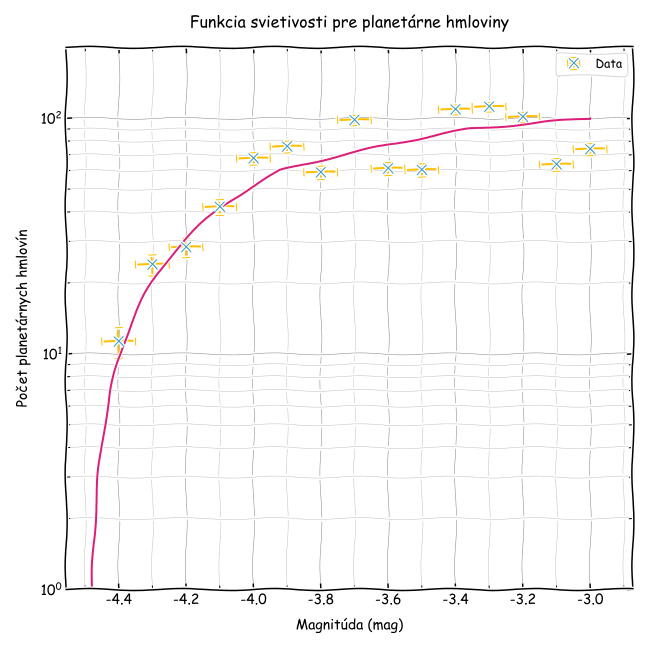

<figcaption>

**Obrázok 1:** Nákres ilustračného grafu a jeho fitu funkciou svietivosti pre planetárne hmloviny.
</figcaption>

</figure>

<figure>

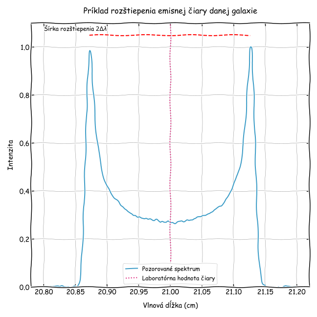

<figcaption>

**Obrázok 2:** Náčrt ako vyzerá rozštiepená spektrálna čiara. Toto rozštiepenie je spôsobené heterogénnym Dopplerovým posunom v rámci rotujúceho disku. Spektrum je už opravené o vlastný pohyb galaxie.
</figcaption>

</figure>

<figure>

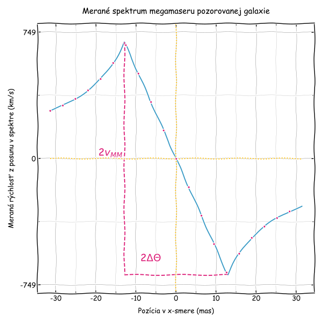

<figcaption>

**Obrázok 3:** Nákres ako by mal vyzerať graf pozorovanej radiálnej rýchlosti rotácie od polohy pre megamaser. Oblasť disku je tá, kde sa rýchlosť vyvíja lineárne. Mimo disku sa vyvíja približne ako prevrátená hodnota polohy.
</figcaption>

</figure>

<figure>

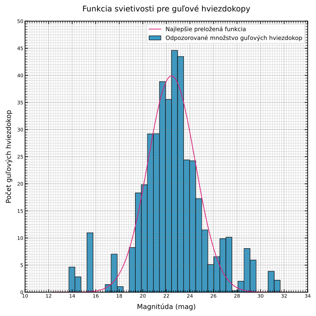

<figcaption>

**Obrázok 4:** Graf početnosti guľových hviezdokôp v závislosti od zdanlivej magnitúdy. Dáta sú pre vaše pohodlie už preložené najlepšie vyhovujúcim fitom.
</figcaption>

</figure>

<figure>

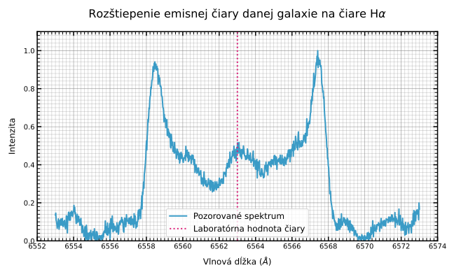

<figcaption>

**Obrázok 5:** Namerané spektrum okolo čiary $\mathrm{H}_{\alpha}$.
</figcaption>

</figure>

<figure>

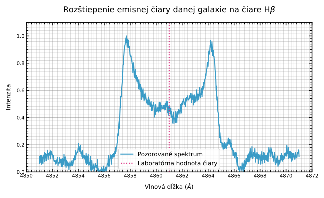

<figcaption>

**Obrázok 6:** Namerané spektrum okolo čiary $\mathrm{H}_{\beta}$.
</figcaption>

</figure>

<figure>

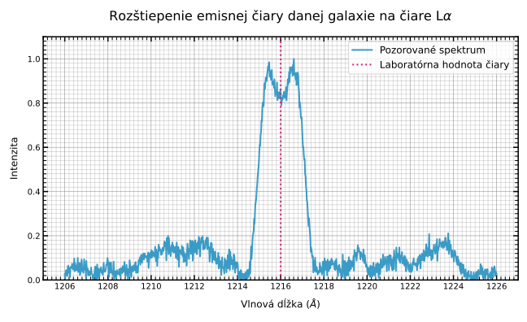

<figcaption>

**Obrázok 7:** Namerané spektrum okolo čiary $\mathrm{L}_{\alpha}$.
</figcaption>

</figure>

<figure>

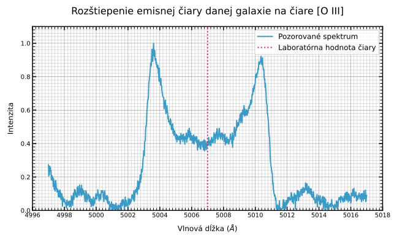

<figcaption>

**Obrázok 8:** Namerané spektrum okolo čiary $[\mathrm{O} \mathrm{III}]$.
</figcaption>

</figure>

<figure>

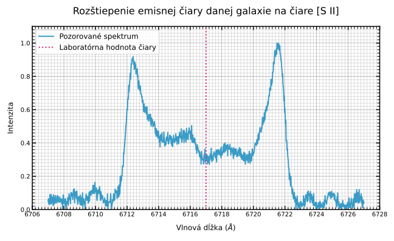

<figcaption>

**Obrázok 9:** Namerané spektrum okolo čiary $[\mathrm{S} \mathrm{II}]$.
</figcaption>

</figure>

<figure>

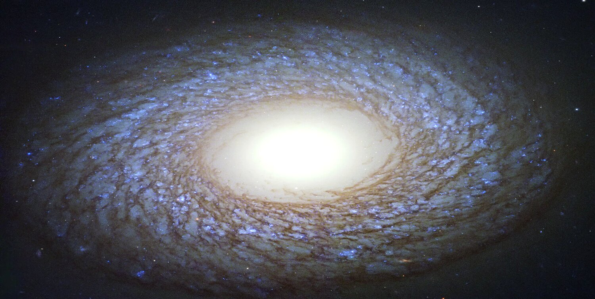

<figcaption>

**Obrázok 10:** Snímka galaxie.
</figcaption>

</figure>

[^1]: <https://arxiv.org/pdf/astro-ph/0301279>

[^2]: <https://arxiv.org/pdf/astro-ph/0304318>

[^3]: <https://ui.adsabs.harvard.edu/abs/1977A&A....54..661T>

[^4]: <https://iopscience.iop.org/article/10.1088/0004-637X/695/1/287>

Riešenie

Napíšeme si definíciu prenesenej chyby (4), na ktorú sa budeme v priebehu celého riešenia odvolávať. Vo vašom riešení môžete použiť aj nejakú jednoduchšiu metódu ako napríklad min-MAX alebo odhad počtu platných cifier. O oboch metódach je možné dozvedieť sa viac v oficiálnom výukovom materiáli na stránke [www.aosk.sk/materialy/](https://www.aosk.sk/materialy/). Pre nás je dôležité poznať, že $\partial$ je označenie parciálnej derivácie. Keďže znalosť infinitezimálneho počtu nie je nutná na národných kolách AO, tak práve aj jednoduchšie metódy prenosu chyby sú brané za plný počet bodov. 

$$
\sigma_{\mathit{y}}^2 = \sum_{\mathit{x}_{\mathit{i}}}\left( \frac{\partial y}{\partial x_{\mathit{i}}}  \right)^2  \sigma_{\mathit{x}_{\mathit{i}}}^2 \,. \tag{4}
$$

V troch zo štyroch nasledujúcich podúloh budeme používať modul vzdialenosti 

$$
m-M = 5\log_{10}\left( d\,\left[pc\right]  \right)  -5\,. \tag{5}
$$

Nám sa bude najmä hodiť z toho odvodený vzťah pre vzdialenosť, 

$$
d\,\left[pc\right] = 10^{(m-M+5)/5} =  10^{1-\linfrac{M}{5}}\cdot10^{\linfrac{m}{5}}\,. \tag{6}
$$

 Kde druhé vyjadrenie je možno trochu menej prehľadné, ale bude sa nám s ním lepšie pracovať v momente, keď budeme musieť derivovať podľa rovnice (4), pretože $10^{1-\linfrac{M}{5}}$ je konštanta a $10^{\linfrac{m}{5}}=\left(\sqrt[5]{10}\right)^{m}$ je jednoduchá mocninová závislosť.

**Riešenie 1:**

Ako prvé si narysujeme graf 11. Zvislá os je logaritmická, vodorovná je lineárna. Fitujeme rukou. Odhadom sme na $m_{PNLF} = 25{,}52\,\mathrm{mag}$ a so štandardnou odchýlkou $\sigma_{\hspace{-1pt}\mathit{m}_{PNLF}}=0{,}1\,\mathrm{mag}$, ktorú sme určili odhadom. Toto určenie je čisto z odhadu, v akom rozsahu asi sme mohli ťahať náš fit. Keďže poznáme $M_{PNLF} = -4{,}48\,\mathrm{mag}$, vypočítať vzdialenosť je jednoduché z modulu vzdialenosti (6). 

$$
d_{PNLF} = 10^{\linfrac{(25,52+4,48+5)}{5}} = 10\,\mathrm{Mpc} \,. \tag{7}
$$

Pre vypočítanie $\sigma_{\hspace{-1pt}\mathit{d}_{PNLF}}$ využijeme vzorec (4), do ktorého vložíme rovnicu (6) pričom jediná veličina s chybou určenia, ktorú poznáme, je $m_{PNLF}$. 

$$
\sigma_{\hspace{-1pt}\mathit{d}_{PNLF}} = 10^{1-\linfrac{M_{PNLF}}{5}}\cdot10^{\linfrac{m_{PNLF}}{5}} \cdot \ln{\left(  10\right)} \cdot \frac{1}{5} \cdot \sigma_{\hspace{-1pt}\mathit{m}_{PNLF}} \approx 0{,}46\,\mathrm{Mpc} \,. \tag{8}
$$

Takto môžeme písať náš prvý zo štyroch medzi-výsledkov 

$$
d_{PNLF} \pm \sigma_{\hspace{-1pt}\mathit{d}_{PNLF}} = 10{,}00 \pm 0{,}46\,\mathrm{Mpc} \,. \tag{9}
$$

<figure>

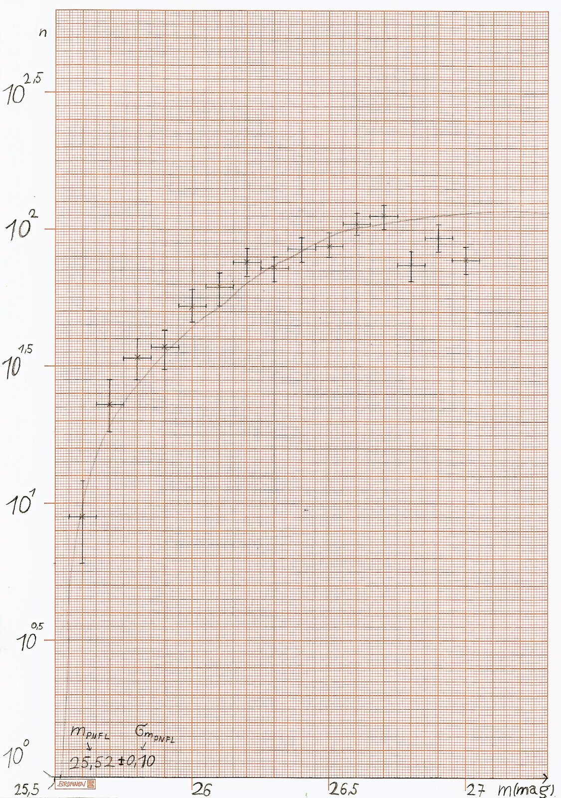

<figcaption>

**Obrázok 11:** Výsledný graf pre PNLF metódu.
</figcaption>

</figure>

**Riešenie 2:**

Druhé zadanie volá po obyčajnom odmeraní hodnôt z grafu. V rámci presnosti grafu je možné vrchol $m_{GCLF}$ odhadnúť celkom jednoducho. Ako odhad smerodajnej odchýlky $\sigma_{\hspace{-1pt}\mathit{m}_{GCLF}}$ zoberieme hodnotu, v ktorej sa javí, že sa pohybujú stĺpce, u ktorých sa zdá, že by mohli byť všetky maximálne. Je pravdepodobné, že takto odhadnutá chyba je mierne nadhodnotená. Výsledné hodnoty sú $m_{GCLF} = 22{,}4\,\mathrm{mag}$ a $\sigma_{\hspace{-1pt}\mathit{m}_{GCLF}} = 0{,}6\,\mathrm{mag}$. Obdobne ako v predchádzajúcej časti, za použitie vzorca (6) a hodnoty absolútnej magnitúdy $M_{GCLF} = -7{,}56\,\mathrm{mag}$ získavame 

$$
d_{GCLF} = 10^{\linfrac{(22,4+7,56+5)}{5}} \approx 9{,}8\,\mathrm{Mpc} \,. \tag{10}
$$

Obdobne vypočítame $\sigma_{\hspace{-1pt}\mathit{d}_{GCLF}}$. Jediná veličina s chybou určenia, ktorú poznáme, je $m_{GCLF}$ 

$$
\sigma_{\hspace{-1pt}\mathit{d}_{GCLF}} = 10^{1-\linfrac{M_{GCLF}}{5}}\cdot10^{\linfrac{m_{GCLF}}{5}} \cdot \ln{\left(  10\right)} \cdot \frac{1}{5} \cdot \sigma_{m_{GCLF}} \approx 2{,}7\,\mathrm{Mpc} \,. \tag{11}
$$

Takto môžeme písať náš druhý zo štyroch medzivýsledkov, u ktorého je ihneď vidieť, že jeho presnosť je výrazne nižšia. 

$$
d_{GCLF} \pm \sigma_{\hspace{-1pt}\mathit{d}_{GCLF}} = 9{,}8 \pm 2{,}7\,\mathrm{Mpc} \,. \tag{12}
$$

<figure>

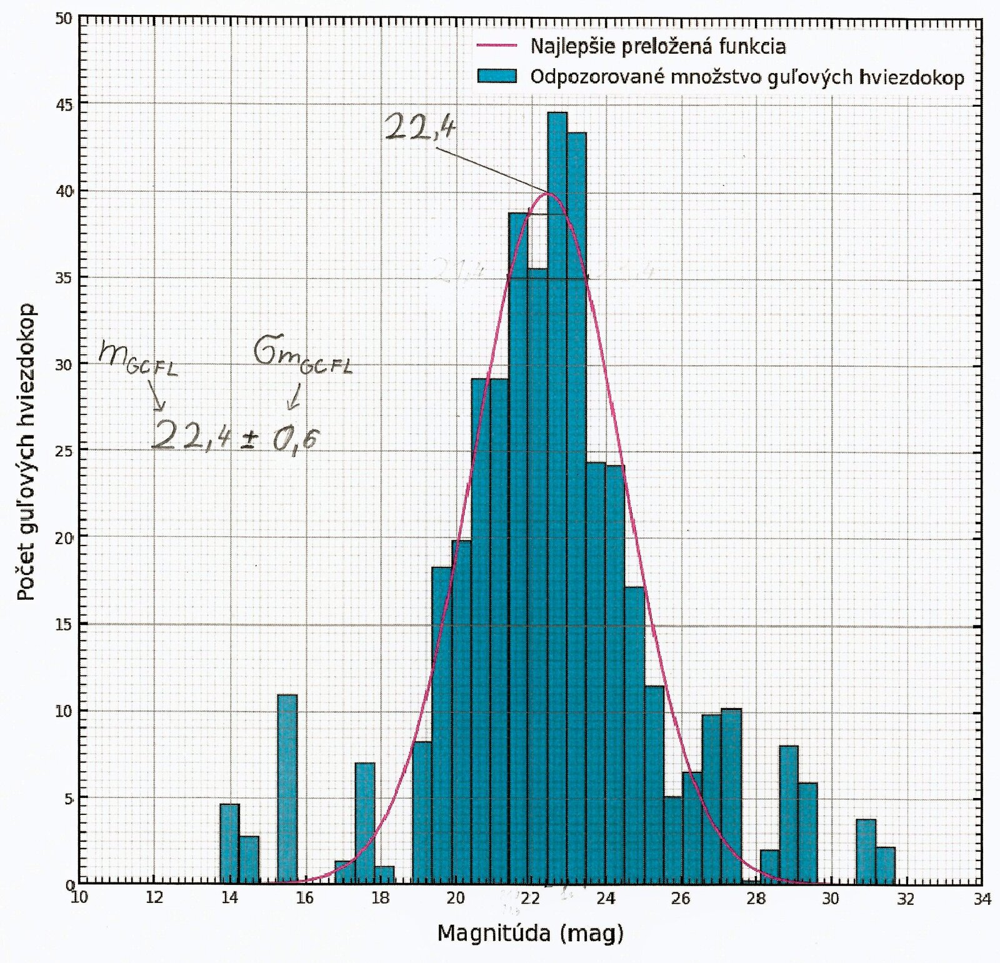

<figcaption>

**Obrázok 12:** GCLF Meranie z grafu
</figcaption>

</figure>

**Riešenie 3:**

V tretej časti už toho odčítavania z grafov je o niečo viac. Musíme odčítať hodnotu rozšírenia emisnej čiary $\Delta\lambda$ aj s jeho chybou $\sigma_{\Delta\lambda}$ pre všetky vlnové dĺžky z tabuľky 2. Samotné merania majú svoj šum, pozorovaná spektrálna čiara je vyžarovaná celým diskom, nie len okrajom a okraj nie je skokový, určenie rozšírenia nie je úplne jednoduché. Samotné naše merania sú v grafoch 13, 14, 15, 16 a 17. Postup nášho merania je, že najprv určíme rozsah hodnôt pre jeden okraj a potom pre druhý okraj. Následne z tohto rozsahu určíme strednú hodnotu pravého a ľavého okraja aj s ich chybami. Stredná hodnota je priemer a chyba je jedna z hodnôt rozsahu mínus stredná hodnota. Rozšírenie určíme ako rozdiel stredných hodnôt okrajov, pričom smerodajná odchýlka je daná kvadratickým súčtom chýb určenia týchto okrajov. Celé je to zhrnuté v tabuľke 4.

**Tabuľka 4:** Merania rozšírení čiar.

|  |  |  |  |  |
|:--:|:--:|:--:|:--:|:--:|
|  |  |  |  |  |
| Názov čiary | $\Lambda \,[\text {Å}]$ | ľavý okraj $\lambda - \Delta{\lambda} \,[\text {Å}]$ | pravý okraj $\lambda + \Delta{\lambda} \,[\text {Å}]$ | rozšírenie **$\Delta{\lambda}\,[\text {Å}]$** |
| $\mathrm{H}_{\alpha}$ | $6563\,$ | $6558{,}45 \pm 0{,}15\,$ | $6567{,}40 \pm 0{,}20\,$ | $4{,}475 \pm 0{,}25\,$ |
| $\mathrm{H}_{\beta}$ | $4861\,$ | $4857{,}80 \pm 0{,}20\,$ | $4864{,}20 \pm 0{,}20\,$ | $3{,}2 \pm 0{,}28\,$ |
| $\mathrm{L}_{\alpha}$ | $1216\,$ | $1215{,}6 \pm 0{,}20\,$ | $1216{,}55 \pm 0{,}25\,$ | $0{,}475 \pm 0{,}32\,$ |
| $[\mathrm{O} \mathrm{III}]$ | $5007\,$ | $5003{,}6 \pm 0{,}20\,$ | $5010 \pm 0{,}15\,$ | $3{,}375 \pm 0{,}25\,$ |
| $[\mathrm{S} \mathrm{II}]$ | $6717\,$ | $6712{,}40 \pm 0{,}20\,$ | $6721{,}45 \pm 0{,}15\,$ | $4{,}525 \pm 0{,}25\,$ |

Teraz z týchto hodnôt rozšírení musíme vypočítať rýchlosť v disku (ešte stále neopravenú o inklináciu) $v_{{T-F}_i}$ cez vzorec 

$$
v_{{T-F}} = c\frac{\Delta\lambda}{\lambda} \, . \tag{13}
$$

A následne chybu určíme cez dosadenie (13) do (4), 

$$
\sigma_{\hspace{-1pt}\mathit{v}_{T-F}} = c\frac{\sigma_{\Delta\lambda}}{\lambda} \, . \tag{14}
$$

Výsledné hodnoty máme zhrnuté v tabuľke 5.

**Tabuľka 5:** Výsledné rozšírenia čiar.

|             |                    |
|:------------|:------------------:|
|             |                    |
| Názov čiary | rýchlosť $v_{T-F}\, [\mathrm{km}\,{\mathrm{s}}^{-1}]$ |
| $\mathrm{H}_{\alpha}$   |     $204 \pm 11\,$      |
| $\mathrm{H}_{\beta}$   |     $197 \pm 17\,$      |
| $\mathrm{L}_{\alpha}$   |     $117 \pm 79\,$      |
| $[\mathrm{O} \mathrm{III}]$   |     $202 \pm 15\,$      |
| $[\mathrm{S} \mathrm{II}]$   |     $202 \pm 11\,$      |

Pričom si môžeme povšimnúť, že hodnota pre $\mathrm{L}_{\alpha}$ je značne mimo ostatných meraní. Toto meranie by sme takto mohli úplne jednoducho vylúčiť. Toto meranie bolo totiž značne zaťažené chybou, naše spektrum okolo danej čiary nemá dostatočnú presnosť. Budeme ďalej pokračovať bez zahodenia tohto merania.

Tieto merania teraz môžeme skombinovať spolu (stále musíme pamätať, že ešte nie sú opravené o inklináciu). Použijeme na to vážený priemer, pričom váhou je druhá mocnina prevrátenej hodnoty smerodajnej odchýlky. Je to klasický postup, ako uprednostniť dáta s lepšou presnosťou a potlačiť dáta so zlou presnosťou. Je to už mierne pokročilá technika a tak nie je vyžadovaná, je uvedená čisto pre edukačné účely. Matematicky je to vyjadriteľné ako 

$$
\bar{x} =  \frac{\displaystyle\sum_{\mathit{i}}^n{\mathit{x}_{\mathit{i}} \cdot \cfrac{1}{\sigma_{\mathit{x}_{\mathit{i}}}^2}}}{\displaystyle\sum_{\mathit{i}}^n{\cfrac{1}{\sigma_{\mathit{x}_{\mathit{i}}}^2}}} \,. \tag{15}
$$

Pričom ďalšou peknou vlastnosťou vzorca  (15) je, že výsledná smerodajná odchýlka je rovná celkom primitívnemu vzorcu 

$$
\bar{\sigma_{\mathit{x}}}^2 =  \frac{1}{\displaystyle\sum_{\mathit{i}}^n{\cfrac{1}{\sigma_{\mathit{x}_{\mathit{i}}}^2}}} \,. \tag{16}
$$

Získavame hodnotu $v_{\mathit{i}} \pm \sigma_{\mathit{v}_{\mathit{i}}} = 201{,}4 \pm 6{,}4\,\mathrm{km}\,{\mathrm{s}}^{-1}$.

Teraz ale musíme zistiť, aká je inklinácia danej galaxie. K tomuto máme k dispozícii obrázok tejto galaxie. Odmeriame najväčšiu a najmenšiu dĺžku, pričom meriame strednú, jasnú časť galaxie, namiesto celej galaxie. I keď sa takto mierne pripravujeme o presnosť, ale hranice sú omnoho lepšie definovateľné. Meranie uskutočňujeme tak, že odhadneme ľavý rozsah okrajov ako aj pravý. To isté platí aj pre horný a dolný. Z toho zistíme $a$ a $b$ ako $a = 28 \pm 1{,}8\,\mathrm{mm}$ a $b = 15{,}5 \pm 1{,}4\,\mathrm{mm}$. Z geometrie problému vieme odvodiť, že inklinácia je vypočítateľná ako 

$$
i = \arccos{\left(  \frac{b}{a} \right)} \approx (56{,}4 \pm 4{,}3)^\circ \approx 0{,}984 \pm 0{,}074\,\mathrm{rad} \,. \tag{17}
$$

Teraz môžeme opraviť orbitálnu rýchlosť o inklináciu. Z geometrie problému je jasné alebo odvoditeľné, že to je dané rovnicou 

$$
v_o = \frac{v_{\mathit{i}}}{\sin i} \approx 242\,\mathrm{km}\,{\mathrm{s}}^{-1} \,. \tag{18}
$$

 Na zistenie smerodajnej odchýlky raz a zas využijeme dosadenie rovnice (18) do (4). Dôležité je, že do výslednej rovnice musíme dosadzovať uhol $i$ v radiánoch. 

$$
\sigma_{\mathit{v}_o}^2 = \left(  \frac{1}{\sin{i}} \right)^2 \cdot \sigma_{\mathit{v}_i}^2+ \left( 
 \frac{v_i \cos{i}}{\sin^2{i}} \right)^2 \cdot \sigma_{\mathit{i}}^2 \ztv \sigma_{\mathit{v}_o} \approx 14\,\mathrm{km}\,{\mathrm{s}}^{-1}\,. \tag{19}
$$

Nasleduje využitie Tullyho-Fisherovho vzťahu zo zadania. V zadaní bol v tvare 

$$
m-M=21,1+3,7\log_{10}{(v_o \, \left[\mathrm{km}\,{\mathrm{s}}^{-1}\right])}  \,. \tag{20}
$$

My síce vieme, že hoci je pre nás $m-M$ nepodstatné, je rovné $m-M = 5-5\log_{10}\left( d\,\left[\text{pc}\right]  \right)$. Teda potrebný vzťah je 

$$
21,1+3,7\log_{10}{(v_o \, \left[\mathrm{km}\,{\mathrm{s}}^{-1}\right])}= 5-5\log_{10}\left( d\,\left[\text{pc}\right]  \right)\,, \tag{21}
$$

 ktorý si upravíme do podoby 

$$
d_{T-F}\,\left[\text{pc}\right] = 10^{\linfrac{(26,1 +3,7\log_{10}{(v_o \, \left[\mathrm{km}\,{\mathrm{s}}^{-1}\right]))}}{5}} = 10^{5,22}\cdot {(v_o \, \left[\mathrm{km}\,{\mathrm{s}}^{-1}\right])}^{0,74} \approx 9{,}64\,\mathrm{Mpc}\,. \tag{22}
$$

Pre určenie smerodajnej odchýlky využijeme dosadenie vzorca (22) do (4). 

$$
\sigma_{d_{T-F}}\,\left[\text{pc}\right] = 10^{5,22}\cdot 0,74 {(v_o \, \left[\mathrm{km}\,{\mathrm{s}}^{-1}\right])}^{-0,26}\cdot \sigma_{\hspace{-1pt}\mathit{v}_o} \approx 0{,}41\,\mathrm{Mpc}\,. \tag{23}
$$

Takto môžeme písať náš tretí zo štyroch medzi-výsledkov ako 

$$
d_{T-F} \pm \sigma_{\hspace{-1pt}\mathit{d}\hspace{1pt}_{T-F}} = 9{,}64 \pm 0{,}41\,\mathrm{Mpc} \,. \tag{24}
$$

<figure>

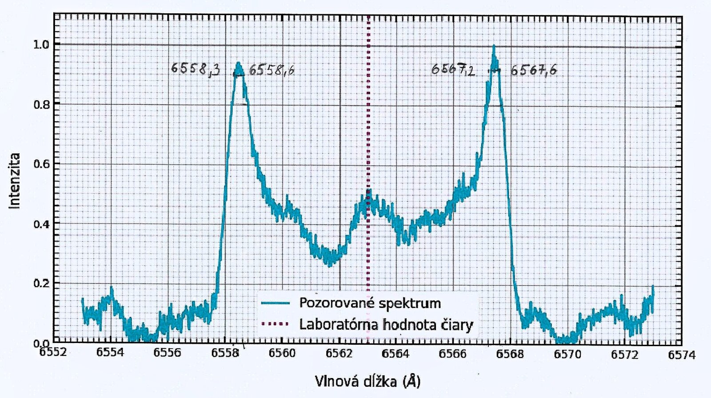

<figcaption>

**Obrázok 13:** Namerané spektrum okolo čiary s vyznačeným odhadom hodnôt na okrajoch vyžarovania $\mathrm{H}_{\alpha}$.
</figcaption>

</figure>

<figure>

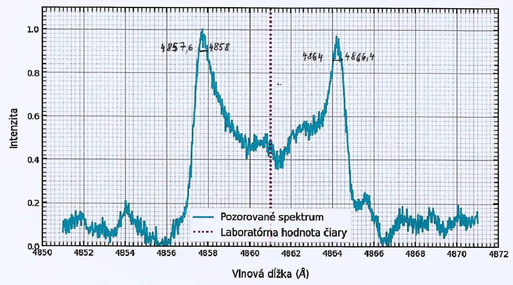

<figcaption>

**Obrázok 14:** Namerané spektrum okolo čiary s vyznačeným odhadom hodnôt na okrajoch vyžarovania $\mathrm{H}_{\beta}$.
</figcaption>

</figure>

<figure>

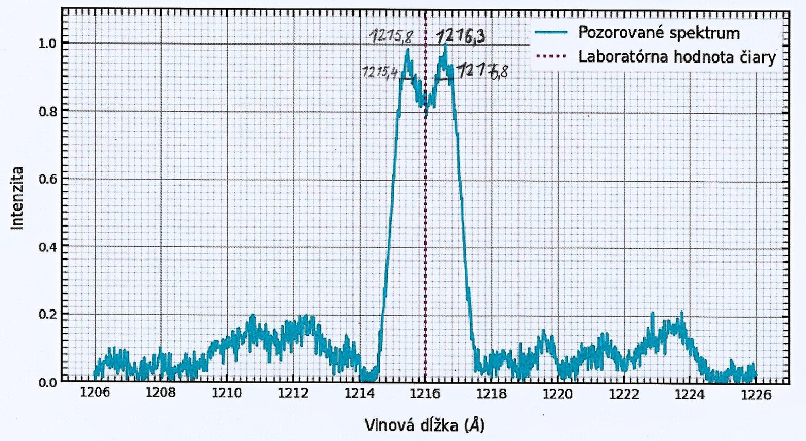

<figcaption>

**Obrázok 15:** Namerané spektrum okolo čiary s vyznačeným odhadom hodnôt na okrajoch vyžarovania $\mathrm{L}_{\alpha}$.
</figcaption>

</figure>

<figure>

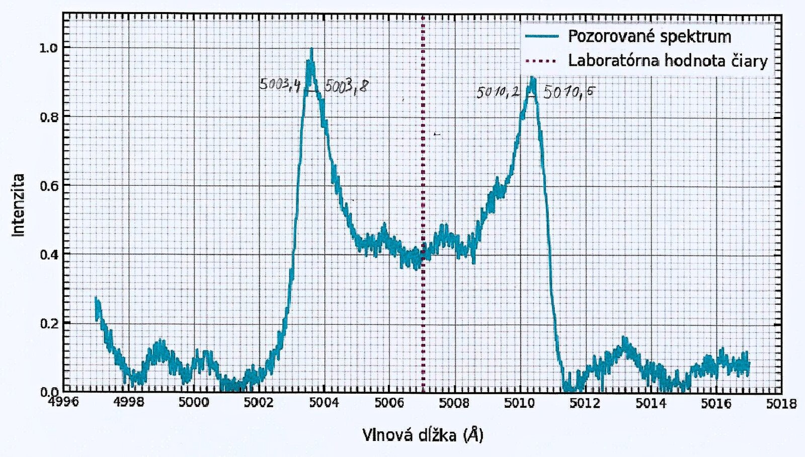

<figcaption>

**Obrázok 16:** Namerané spektrum okolo čiary s vyznačeným odhadom hodnôt na okrajoch vyžarovania $\left[\mathrm{OIII}\right]$.
</figcaption>

</figure>

<figure>

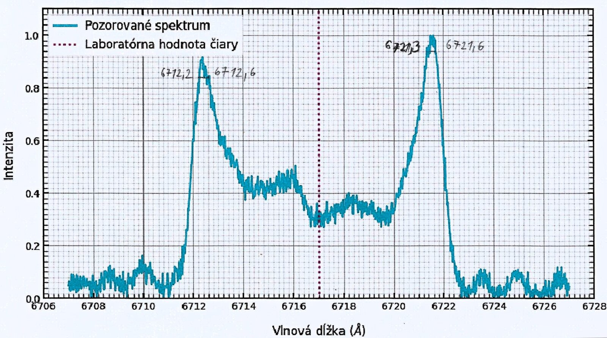

<figcaption>

**Obrázok 17:** Namerané spektrum okolo čiary s vyznačeným odhadom hodnôt na okrajoch vyžarovania $\left[\mathrm{SII}\right]$.
</figcaption>

</figure>

<figure>

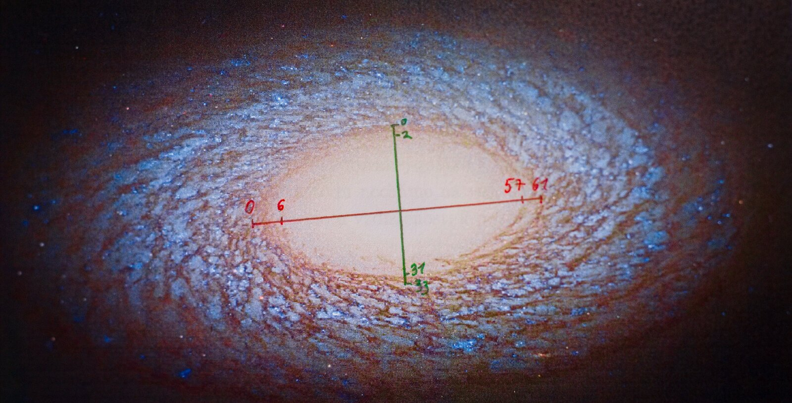

<figcaption>

**Obrázok 18:** Obrázok galaxie s vyznačeným meraním hlavnej a vedľajšej polosi pre zistenie inklinácie $i$.
</figcaption>

</figure>

**Riešenie 4**

Posledná podúloha je zameraná na Megamaser. Musíme narysovať graf 19. Z neho odčítame hodnoty $v_{MM}=1802\,\mathrm{km}\,{\mathrm{s}}^{-1}$, $\sigma_{\mathit{v}_{MM}}=64\,\mathrm{km}\,{\mathrm{s}}^{-1}$, $\Delta \Theta=4{,}10\,\mathrm{mas}$ a $\sigma_{\Delta\Theta}=0{,}18\,\mathrm{mas}$, riadime sa pri tom nákresom 3. Takto máme už všetko potrebné na dosadenie do rovnice zo zadania 

$$
d_{MM} = \frac{v_{MM}^2}{a \cdot \Delta\Theta} \approx 10{,}78\,\mathrm{Mpc} \,. \tag{25}
$$

Dôležitá je najmä premena všetkých jednotiek veličín, ktoré tam dosadzujeme.

Pre zistenie smerodajnej odchýlky výsledku opäť raz dosadíme (25) do (4). 

$$
\sigma_{\hspace{-1pt}\mathit{d}_{MM}}^2 = \left(\frac{2v_{MM}}{a\Theta} \right)^2 \cdot \sigma_{\hspace{-1pt}\mathit{v}_{MM}}^2 + \left(  \frac{v_{MM}^2}{a \cdot \Delta\Theta^2} \right)^2\cdot \sigma_{\Delta\Theta}^2 \ztv \sigma_{\hspace{-1pt}\mathit{d}_{MM}} \approx 0{,}90\,\mathrm{Mpc} \,. \tag{26}
$$

Takto získavame posledný zo štyroch medzi-výsledkov ako 

$$
d_{MM} \pm \sigma_{d_{MM}} = 10{,}78 \pm 0{,}90\,\mathrm{Mpc} \,. \tag{27}
$$

<figure>

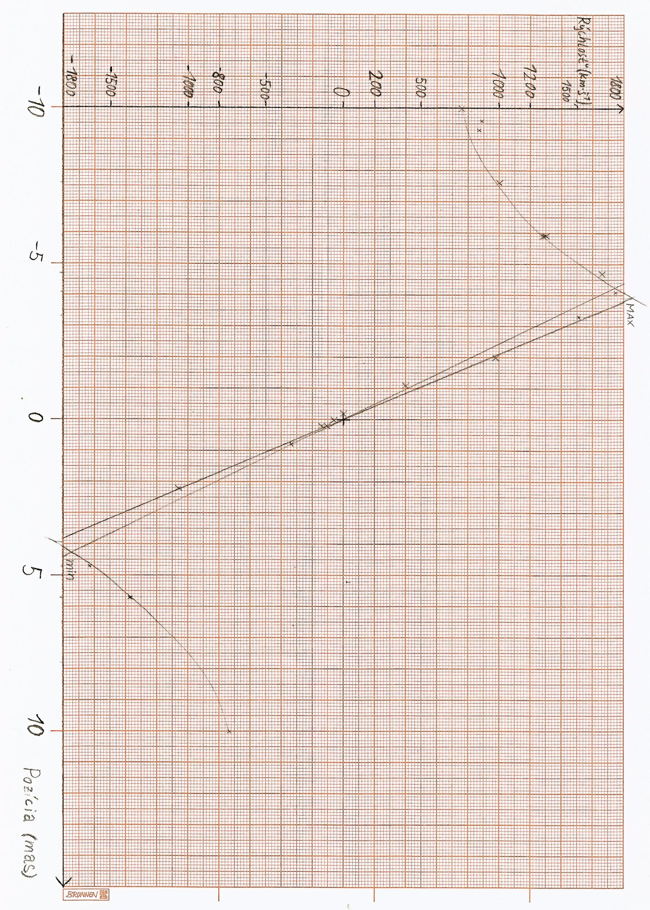

<figcaption>

**Obrázok 19:** Výsledný graf pre merania megamaseru.
</figcaption>

</figure>

**Záver**

Získali sme štyri možné výsledky, alebo skôr povedané, máme štyri výsledky nezávislých meraní vypísané v tabuľke 6. Teraz ich už len skombinovať, teda vyvodiť jeden finálny výsledok. Použijeme na to rovnakú metódu ako sme použili pre kombináciu meraných rýchlostí z rozšírenia čiary. Teda vážený priemer, kde váha je prevrátená hodnota druhej mocniny smerodajnej odchýlky. Opäť je potrebné zdôrazniť, že vo vašom riešení môžete použiť aj jednoduchšiu metódu.

**Tabuľka 6:** Tabuľka všetkých medzi-výsledkov.

|                                             |                            |
|:--------------------------------------------|---------------------------:|
|                                             |                            |
| Metóda                                      | Výsledná hodnota $[\mathrm{Mpc}]$ |
| Funkcia svietivosti pre planetárne hmloviny |                  $d_{PNLF} \pm \sigma_{\hspace{-1pt}\mathit{d}_{PNLF}} = 10{,}00 \pm 0{,}46\,$ |
| Funkcia svietivosti pre guľové hviezdokopy  |                  $d_{GCLF} \pm \sigma_{\hspace{-1pt}\mathit{d}_{GCLF}} = 9{,}8 \pm 2{,}7\,$ |
| Tullyho-Fisherova závislosť                 |                  $d_{T-F} \pm \sigma_{\hspace{-1pt}\mathit{d}_{T-F}} = 9{,}64 \pm 0{,}35\,$ |
| Megamaser                                   |                  $d_{MM} \pm \sigma_{\hspace{-1pt}\mathit{d}_{MM}} = 10{,}78 \pm 0{,}90\,$ |

Na základe výsledkov z jednotlivých meraní dochádzame k finálnemu výsledku, že daná galaxia je od nás vzdialená $d=9{,}86\,\mathrm{Mpc}$ so smerodajnou odchýlkou $\sigma_{\mathit{d}}=0{,}26\,\mathrm{Mpc}$. Pri porovnaní s hodnotou, ktorá sa použila na generovanie dát $d_{GEN}=10\,\mathrm{Mpc}$ to predstavuje veľmi dobrý výsledok. 

$$
9{,}86 \pm 0{,}26\,\mathrm{Mpc} \cong10\,\mathrm{Mpc} \,. \tag{28}
$$

Stále je ale dobré si všimnúť, že aj za použitia štyroch rôznych meraní, je náš výsledok presný iba na dve platné cifry. V realite by bol tento výsledok ešte menej presný, pretože jednotlivé metódy musia byť nakalibrované (určenie $M_{PNLF}, \, M_{GCLF} ,\, ...$), taktiež nie všetkým meraniam sme v tomto zadaní uviedli chybu ($\sigma_{a}$). Najmä kalibrácie sú medzi sebou často prepojené, teda sa nám tam propagujú systematické chyby.

## Komentár autora

Rád v dátovkách kombinujem viacero metód a spôsobov ako sa dopracovať k výsledku, pričom najpresnejší výsledok človek dostane, ak správne skombinuje všetky. Konkrétna podoba je odvodená od mojej skúšky z predmetu ”Entfernungsbestimmung im Kosmos” (určovanie vzdialeností vo vesmíre) na vysokej škole. Vo výsledku je potrebné poprepájať vlastné znalosti so všetkým, čo je ponúknuté v zadaní úlohy.
