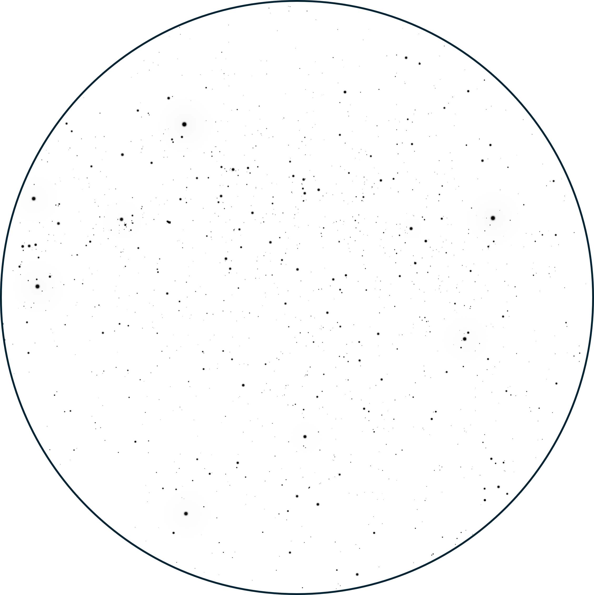
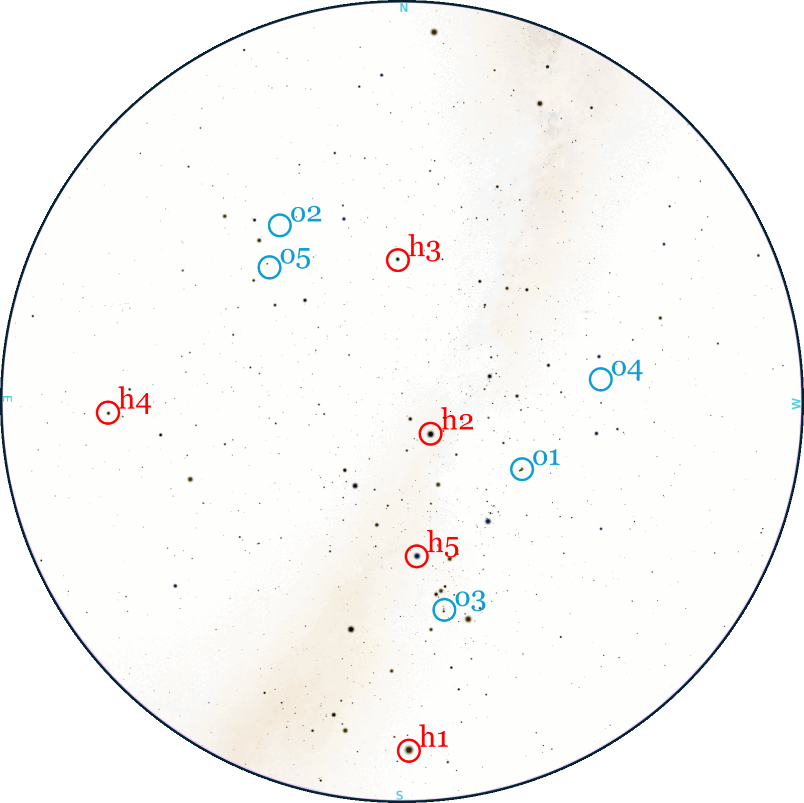
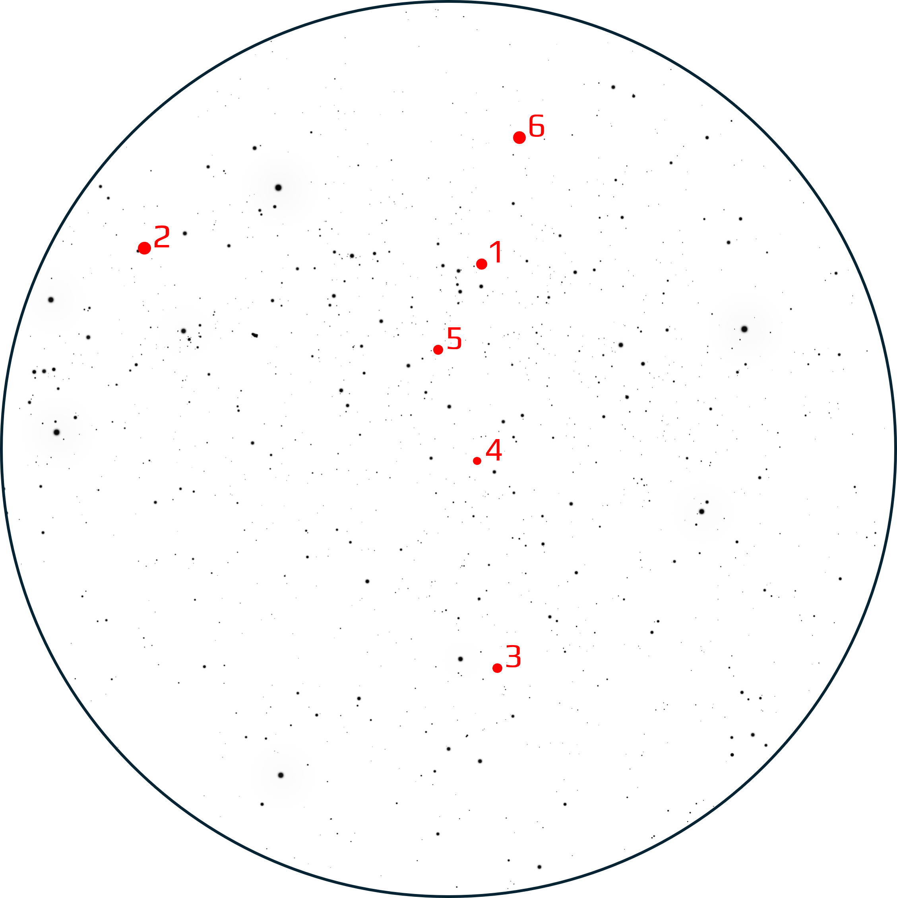

## Zadanie

Po vstupe do planetária bude zobrazená obloha č. 1 (ako je na obrázku 1). Dostanete 8 minút na adaptáciu očí a orientáciu.

<ol type="a">

<li>

[90 b] Na oblohe sa postupne bude zobrazovať 6 supernov, zakreslite ich polohy do priloženej mapy a pripíšte k nim poradové číslo, tak ako sa za sebou zobrazovali. Každá supernova bude na oblohe 1 minútu – dohromady táto úloha trvá 6 minút.

</li>

<li>

[35 b] Po tom, čo zhasne posledná supernova, sa na oblohe zobrazí jedna významná kružnica. Vašou úlohou je vypísať všetky súhvezdia, cez ktoré prechádza ekliptika, a ktoré sa zároveň nachádzajú úplne alebo čiastočne nad obzorom. Okrem toho odhadnite miestny hviezdny čas. Tolerancia presnosti výsledku je 5 minút. Na túto úlohu máte 8 minút.

</li>

</ol>

<figure>

<figcaption>

**Obrázok 1:** Obloha č. 1.
</figcaption>

</figure>

Ďalej bude nasledovať zmena na oblohu č. 2 (ako je na obrázku 2 spolu s označeniami hviezd a objektov, ku ktorým sa vzťahujú úlohy nižšie) a posun o 51 600 rokov (2 Platónske roky) do budúcnosti (podarilo sa vám vylepšiť stroj času z regionálneho kola). Máte 3 minúty na zorientovanie a následne sa začne úloha popísaná nižšie.

Postupne bude zakrúžkovaných 5 hviezd, každá na 90 sekúnd. Napíšte názov tejto hviezdy alebo jej Bayardove označenie [3 b], ako aj latinskú skratku súhvezdia, v ktorom sa nachádza v roku 2025 [3 b]. Okrem toho vyriešte ku každej hviezde jednu dodatkovú úlohu (h1) až (h5) [6 b].

<figure>

<figcaption>

**Obrázok 2:** Obloha č. 2 s označenými hviezdami a objektami.
</figcaption>

</figure>

<ol type="a">

<li>

Aká je magnitúda 1. hviezdy?

</li>

<li>

O koľko stupňov sa približne posunula 2. hviezda voči dnešnej polohe?

</li>

<li>

Zistite, o akom čase túto noc zapadne 3. hviezda.

</li>

<li>

Odhadnite azimut 4. hviezdy.

</li>

<li>

Vyberte z ponúknutých možností správne vývojové štádium 5. hviezdy v súčasnosti:

<ol type="i">

<li>

protohviezda

</li>

<li>

hnedý trpaslík

</li>

<li>

hviezda hlavnej postupnosti

</li>

<li>

červený obor

</li>

<li>

supernova

</li>

<li>

biely trpaslík

</li>

<li>

neutrónová hviezda

</li>

<li>

čierna diera

</li>

</ol>

</li>

</ol>

Ďalej bude postupne zakrúžkovaných 5 objektov hlbokého vesmíru, opäť každý na 90 sekúnd. Napíšte Messierove označenie tohto objektu alebo jeho názov [4 b], ako aj latinskú skratku súhvezdia [3 b], v ktorom sa nachádza v roku 2025. Okrem toho vyriešte ku každému objektu dodatkovú úlohu (o1) až (o5) [6 b].

<ol type="a">

<li>

Patrí 1. objekt na severnú alebo južnú oblohu (voči nebeskému rovníku)?

</li>

<li>

Odhadnite výšku nad obzorom 2. objektu.

</li>

<li>

Aký iný objekt z Messierovho katalógu sa nachádza na tomto mieste?

</li>

<li>

Odhadnite ekliptikálnu šírku 4. objektu.

</li>

<li>

Vyberte z ponúkaných možností správny typ tohto objektu:

<ol type="i">

<li>

galaxia

</li>

<li>

planetárna hmlovina

</li>

<li>

oblasť HII

</li>

<li>

otvorená hviezdokopa

</li>

<li>

guľová hviezdokopa

</li>

<li>

pozostatok po supernove

</li>

<li>

asterizmus

</li>

<li>

dvojhviezda

</li>

</ol>

</li>

</ol>

Riešenie

**1. časť**

\
V prvej časti je obloha zobrazená na Mumbai, 12. 11. 2025, 15:40 UTC. Nachádzame sa teda na severnej pologuli, čo je ľahko zistiteľné z mapy (v jej hornej časti sa nachádza Polárka).

<ol type="a">

<li>

Supernovy sú zakreslené na obrázku 3.

</li>

<li>

Významná kružnica, ktorá bola zobrazená je meridián, pričom prechádza cez jarný bod v súhvezdí Ryby nad juhom (na opačnej strane ako Polárka). Keďže sme na severnej pologuli, tak to znamená, že hodinový uhol jarného bodu je $0^{\mathrm{h}}$, teda aj hviezdny čas je $0^{\mathrm{h}}$. Ekliptika prechádza cez nasledovné aspoň čiastočne viditeľné súhvezdia: Blíženci (Gem), Býk (Tau), Baran (Ari), Ryby (Psc), Vodnár (Aqr), Kozorožec (Cap) a Strelec (Sgr).

**2. časť**

\
V druhej časti je obloha zobrazená na Hurbanovo, 5. 5. 53 300, 21:00 UTC. Posun o 2 platónske roky znamená, že poloha jarného bodu a nebeských pólov sú skoro rovnaké ako dnes, avšak prejavili sa vlastné pohyby hviezd, a teda nie sú presne na pozíciach ako dnes (v roku 2025). Najsilnejšie sa to prejavuje na najjasnejších hviezdach, keďže tie sú v priemere k nám najbližšie.

<figure>

<figcaption>

**Obrázok 3:** Obloha č. 1 so zakreslenými supernovami.
</figcaption>

</figure>

</li>

<li>

Sírius, $\alpha\,\text{CMa}$ (Veľký pes), magnitúda $-1{,}45\,\mathrm{mag}$.

</li>

<li>

Capella, $\alpha\,\text{Aur}$ (Povozník), posunie sa približne o 6 až 7 stupňov.

</li>

<li>

Polárka, $\alpha\,\text{UMi}$ (Malý medveď), nezapadne.

</li>

<li>

Denebola, $\beta\,\text{Leo}$ (Lev), azimut je $93{,}5^{\circ}$.

</li>

<li>

Betelgeuse, $\alpha\,\text{Ori}$ (Orión), červený obor (iv.).

</li>

<li>

M 45 (Plejády), Tau (Býk), patrí na severnú pologuľu.

</li>

<li>

M 101 (Veterník), UMa (Veľká medvedica), výška nad obzorom je skoro $27^{\circ}$.

</li>

<li>

M 42 (Veľká hmlovina v Orióne), Ori (Orión), M43 (de Mairova hmlovina).

</li>

<li>

M 33 (Galaxia v Trojuholníku), Tri (Trojuholník), ekliptikálna šírka je približne $20^{\circ}$.

</li>

<li>

M 40 (Winnecke 4), UMa (Veľká medvedica), dvojhviezda (viii.).

</li>

</ol>

