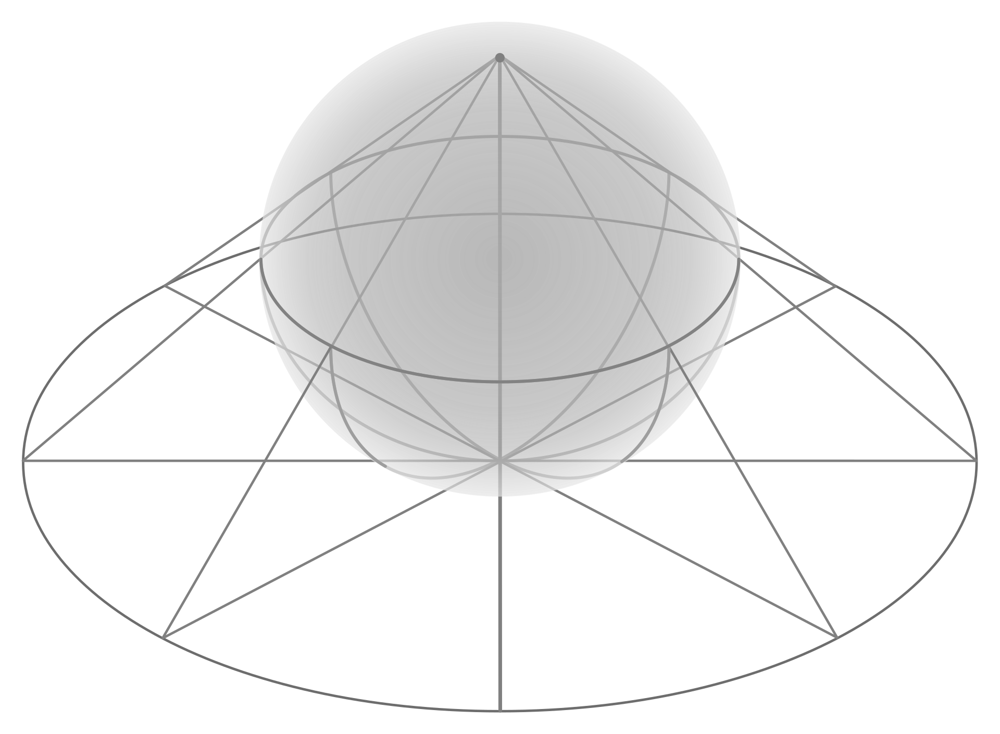
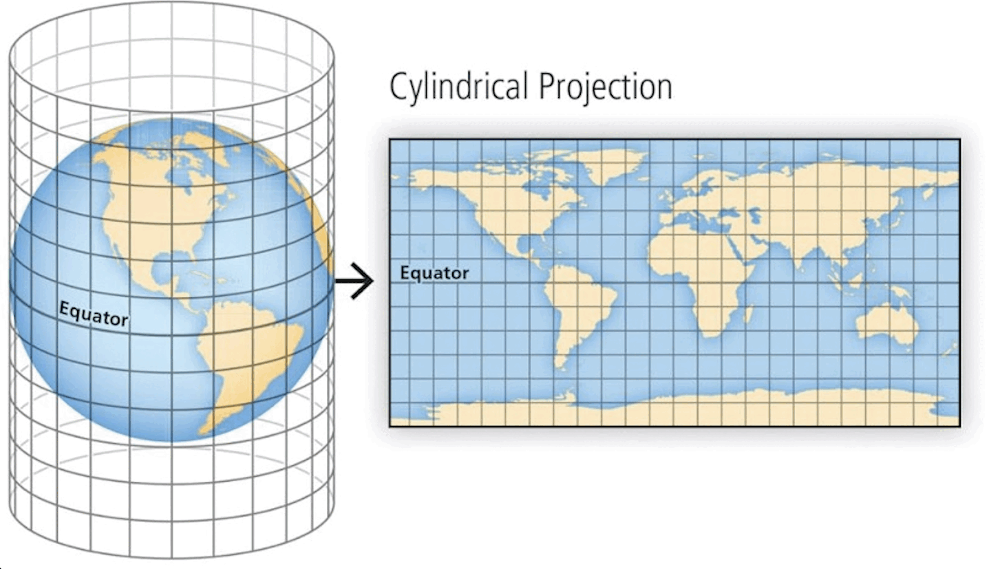
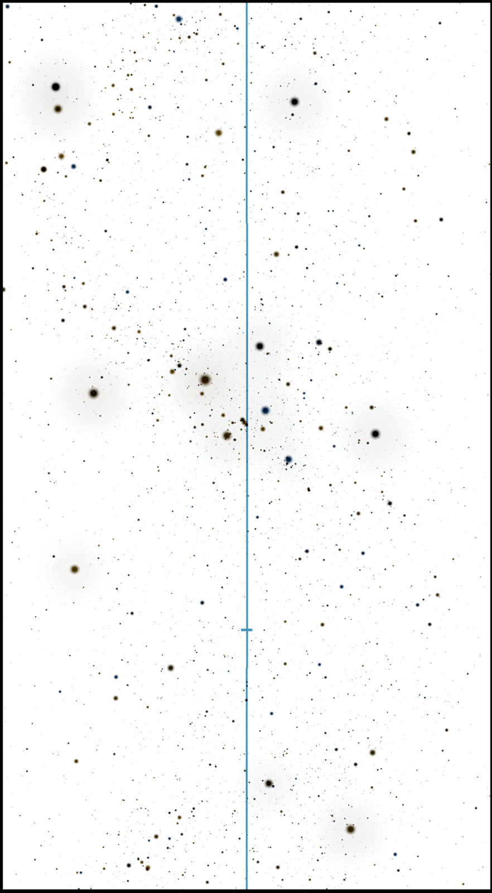
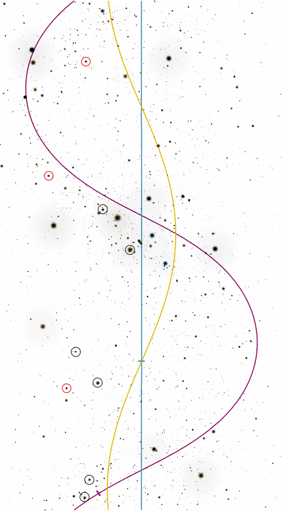
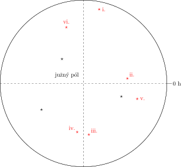

## Zadanie

V astronómii pri tvorbe máp často narazíme na problém, že plocha sféry, na ktorej sa hviezdy zdanlivo nachádzajú, sa nedá jednoducho zobraziť do roviny. V tejto úlohe sa pozrieme na dve populárne možnosti zobrazovania hviezdnej oblohy.

Veľmi praktická je stereografická projekcia, s ktorou sa stretnete najčastejšie práve pri práci s hviezdnymi mapami. Stereografická projekcia dokáže zobraziť práve jednu pologuľu bez skreslenia vzájomných uhlov a tvarov súhvezdí. Vzniká perspektívnou projekciou z bodu na sfére (najčastejšie z jedného z pólov) na rovinu dotyčnicovú k sfére alebo prechádzajúcu stredom sféry ako na obr. 1.

V tejto úlohe sa zameriame aj na Mercatorovu projekciu, ktorá je o niečo viac používaná pri zobrazovaní máp zemského povrchu. Ako môžete vidieť na obr. 1 vzniká projektovaním bodov sféry na cylindrickú plochu, ktorá sa dotýka sféry, väčšinou na rovníku. Výhodná vlastnosť tejto projekcie je, že zachováva smery a deklinačné kružnice aj kružnice rektascenzie sú zobrazené ako priamky (v smeroch „zľava-doprava“, resp. „hore-dole“); naopak nevýhodou je veľké skreslenie v oblasti pólov. Pri pohľade na spôsob projekcie si ľahko viete rozmyslieť, že mapa nedokáže zobraziť celú sféru a nejaká časť v okolí pólov je vynechaná.

<figure>

<figcaption>

**Obrázok 1c:** Schémy spôsobov tvorby máp v stereografickej projekcii a Mercatorovej projekcii.
</figcaption>

</figure>

Na obr. 2 je mapa nočnej oblohy v Mercatorovej projekcii v rozmedzí deklinácií od $-70 ^\circ$ do $70 ^\circ$. Je na nej vyznačený jarný bod a svetový rovník. Na obr. 3 je (takmer) prázdna mapa v stereografickej projekcii. Vašou úlohou bude:

<ol type="a">

<li>

[50 b] čo najpresnejšie do mapy na obr.2 zakresliť ekliptiku a galaktický rovník a označiť miesto, na galaktickom rovníku, ktoré má galaktickú dĺžku $0^\circ$,

</li>

<li>

[90 b] pomenovať nasledujúce hviezdy ich vlastnými menami a zakresliť ich do mapy v stereografickej projekcii na obr. 3:

<ol type="i">

<li>

$\beta\;$Ori,

</li>

<li>

$\alpha\;$Phe,

</li>

<li>

$\varepsilon\;$Sgr;

</li>

</ol>

a pomenovať Bayerovým označením a zakresliť na mapy na obr. 3 nasledujúce hviezdy:

<ol type="i" start="4">

<li>

Shaula,

</li>

<li>

Fomalhaut,

</li>

<li>

Wezen,

</li>

</ol>

</li>

<li>

[50 b] vypočítať uhlovú vzdialenosť medzi hviezdami $\beta\;$Ori a $\alpha\;$Per a odhadnúť, s akou presnosťou ste určili súradnice na mape,

</li>

<li>

[60 b] zakrúžkovať na mape v Mercatorovej projekcii tri hviezdy magnitúdy približne 2, ktoré sú zakreslené v mape na obr. 3 a napísať, v akom sú súhvezdí.

</li>

</ol>

**Poznámka**: Pre mapu v stereografickej projekcii vzdialenosť od stredu nie je priamo úmerná deklinácii. V skutočnosti je to komplikovanejšia závislosť funkcie tangens, ktorá je ale pre deklinácie od $90^\circ$ do $0^\circ$ blízko lineárnej. Preto uvažujte pre zjednodušenie pri riešení tejto úlohy, že **vzdialenosť od stredu mapy v stereografickej projekcii je priamo úmerná deklinácii**.

**Pomôcka**: Pre vertikálnu súradnicu na mape v Mercatorovej projekcii platí vzťah 

$$
y = R \, \ln \left( \tan \left(\frac{\pi}{4} + \frac{\delta}{2} \right)\right), \tag{1}
$$

 kde $R$ je polomer zobrazovanej sféry a $\delta$ je deklinácia. Môžete si všimnúť, že aj keď teoreticky môžeme zobrazovať aj nekonečne veľkú sféru, tak v našom praktickom prípade má svetový rovník na mape konečnú dĺžku.

<figure>

<figcaption>

**Obrázok 2:** Mapa nočnej oblohy v Mercatorovej projekcii. Na mape je zobrazený svetový rovník a jarný bod.
</figcaption>

</figure>

<figure>

<figcaption>

**Obrázok 3:** Prázdna mapa južnej oblohy v stereografickej projekcii. Na mape je označená priamka zodpovedajúca rektascenzii $0^{\mathrm{h}}$ a rektascenzia rastie v protismere chodu hodinových ručičiek. Predpokladajte lineárnu závislosť medzi vzdialenosťou od stredu a deklináciou.
</figcaption>

</figure>

Riešenie

<ol type="a">

<li>

Ekliptika je zakreslená na obrázku 5.

</li>

<li>

Možné názvy uvedených hviezd sú

<ol type="i">

<li>

Rigel,

</li>

<li>

Ankaa,

</li>

<li>

Kaus Australis,

</li>

<li>

$\lambda$ Sco,

</li>

<li>

$\alpha$ PsA,

</li>

<li>

$\delta$ CMa.

</li>

</ol>

Samozrejme, každý správne uvedený alternatívny názov bude uznaný. Tieto hviezdy sú zakrúžkované na mape na obrázku 4.

Pre zakreslenie do mapy v stereografickej projekcii potrebujeme zistiť rektascenziu a deklináciu danej hviezdy. Tieto hodnoty využijeme tak, že si ľahko rozmyslíme, že pri mape v stereografickej projekcii vzdialenosť objektu od stredu mapy prislúcha deklinácii a veľkosť uhlu voči priamke smerujúcej do jarného bodu prislúcha rektascenzii.

Deklináciu určíme odmeraním $y$-ovej súradnice a dosadením do invertovaného vzorca (1), ktorý má tvar 

$$
\delta = 2 \left[ \arctan \left( e^{\,\linfrac{y}{R}}\right) - \frac{\pi}{4} \right]. \tag{2}
$$

Hodnotu, ktorú dosadzujeme za $R$ zistíme z toho, že dĺžka rovníka na mape (od okraja mapy po okraj) je rovná $2\pi R$. Samozrejme si musíme dať pozor na to, že náš vzorec v tomto tvare očakáva hodnotu deklinácie v radiánoch (čo vidíme podľa výrazu $\frac{\pi}{4}$ v argumente funkcie tangens. Ak chceme dosadzovať, resp. dostať hodnotu v stupňoch, musíme zameniť $\frac{\pi}{4}$ za $45^\circ$. Rektascenziu určíme odmeraním $x$-ovej súradnice a nie je ťažké si rozmyslieť, že $1^{\mathrm{h}}$ je rovná vzdialenosti na mape $2\pi R / 24^{\mathrm{h}}$, teda platí vzťah 

$$
\alpha = 24^{\mathrm{h}} \cdot \frac{x-x_0}{2\pi R}, \tag{3}
$$

kde $x_0$ je súradnica jarného bodu na mape. Po prevedení súradníc si ľahko rozmyslíme, že na mape v stereografickej projekcii prislúcha vzdialenosť $r$ od stredu uhlovej súradnici $90^\circ - \delta$ (pričom deklinácii $0^\circ$ zodpovedá vzdialenosť rovná polomeru mapy), pričom využívame zjednodušenie uvedené v zadaní, že vzťah vzdialenosti od stredu a deklinácie je lineárny. Uhol voči smeru $0^{\mathrm{h}}$ priamo zodpovedá rektascenzii (v stupňoch).

Hviezdy sú zakreslené na mape na obrázku 4.

</li>

<li>

V podzadaní (b) sme zistili súradnice hviezdy $\beta$ Ori, rovnako zistíme súradnice hviezdy $\alpha$ Per. Následne ich vzdialenosť vypočítame jednoducho konštrukciou sférického trojuholníka tvoreného týmito hviezdami a napríklad severným pólom a ich vzdialenosť získame pomocou kosínusovej vety 

$$
\cos d = \cos (90-\delta_1) \, \cos (90-\delta_2) + \sin (90-\delta_1)\,\sin (90-\delta_2) \,\cos(\alpha_1-\alpha_2). \tag{4}
$$

 Úpravou využitím goniometrických vzťahov dostaneme výraz 

$$
d = \arccos \big[ \sin \delta_1 \, \sin \delta_2 + \cos \delta_1 \, \cos \delta_2 \, \cos(\alpha_1-\alpha_2) \big]. \tag{5}
$$

 Dosadením dostávame $d \doteq 63,6625 ^\circ \doteq 63^\circ 39' 45''$. Dosadzovali sme súradnice dvoch hviezd $\alpha_{\beta Ori} = 5^{\mathrm{h}}\,15^{\mathrm{min}}\,45^{\mathrm{s}}$ , $\delta_{\beta Ori} = -8^{\circ}\,10'\,28''$ a $\alpha_{\alpha Per} = 3^{\mathrm{h}}\,26^{\mathrm{min}}\,8^{\mathrm{s}}$ , $\delta_{\alpha Per} = 49^{\circ}\,57'\,13''$.

Samozrejme po odmeraní súradníc na mape a ich prepočítaní dostaneme iné hodnoty, čo je spôsobené chybami merania. Pri meraní klasickým pravítkom môžeme za chybu merania považovať polovicu najmenšieho dielika, ktorá je pri pravítku $0,5\,\mathrm{mm}$. Dobrým odhadom je, ak hodnotu tejto chyby dosadíme do vzorca pre deklináciu (2). Po dosadení dostaneme $\sigma_\delta = 0,8^\circ$, kde za $R$ sme dosadzovali hodnotu $3,5\,\mathrm{cm}$, ktorú sme zistili ako šírku mapy podelenú $2\pi$, pričom šírku sme merali pre mapu vytlačenú na papier formátu A4. Samozrejme, aj meranie šírky tejto mapy je zaťažené chybou, tú v tomto odhade zanedbáme. Pokročilejšími metódami, ktoré presahujú stredoškolskú matematiku by sme dostali správny odhad chyby, ktorý ale závisí na veľkosti deklinácie (vzdialenosti od rovníka) $\sigma_\delta = 0,009^\circ$ pre vzdialenosť od rovníka rovnú $R$ (s uvážením chyby určenia polomeru $\sigma_\delta = 0,013^\circ$).

Chybu rektascenzie dostaneme rovnako dosadením chyby pravítka do vzorca na prepočet medzi súradnicami, teda $\sigma_\alpha = 24^{\mathrm{h}} \cdot \sigma_x/(2\pi R)$. Po dosadení dostaneme $\sigma_\alpha = 0{,}05^{\mathrm{h}} = 0^{\mathrm{h}}\,3^{\mathrm{min}}$. Toto je už korektný odhad chyby, keďže vzťah pre rektascenziu je jednoduchý, lineárny.

</li>

<li>

Súradnice na mape v Mercatorovej projekcii získame obráteným procesom popísaným v podzadaní (b). Ako sme opísali vyššie, vzdialenosť od stredu prislúcha uhlovej vzdialenosti $90^\circ-\delta$, teda odmeraním vzdialenosti od stredu a prepočtom získame deklináciu. Súradnicu $y$ získame dosadením do vzťahu (1). Rektascenziu odmeriame pomocou uhlomeru ako uhol od smeru $0^{\mathrm{h}}$ a x-ovú súradnicu získame ako $x = x_0 + 2\pi R \cdot \alpha/24^{\mathrm{h}}$. Hviezdy sú zakreslené na obrázku 5. Po správnom zakreslení zistíme, že ide postupne o hviezdy $\beta$ Gru, $\theta$ Cen a $\delta$ Vel, teda sa nachádzajú v súhvezdiach Žeriav a Centaurus a v súhvedí Plachty.

</li>

</ol>

<figure>

<figcaption>

**Obrázok 4:** Mapa nočnej oblohy v Mercatorovej projekcii s rovníkom (modrá), ekliptikou (žltá), galaktickým rovníkom (ružová) a počiatkom galaktických súradníc (malá značka v súhvezdí strelca), ktorý je význačný tým, že smeruje do galaktického centra. Takisto sú označené tri hviezdy, polohy ktorých boli zadané v podzadaní (d) označené červeným krúžkom a 6 hviezd, názvy ktorých boli zadané v podzadaní (b).
</figcaption>

</figure>

<figure>

<figcaption>

**Obrázok 5:** Slepá mapa oblohy v stereografickej projekcii. Čiernymi symbolmi sú označené hviezdy z podzadania (d) a červenou sú vyznačené zakreslené hviezdy z podzadania (b).
</figcaption>

</figure>

## Komentár autora

Aj keď práca s papierovou mapou, pravítkom a ceruzkou sa môže zdať v astronómii zbytočná, môže nám aspoň ukázať genialitu tvorcov rôznych máp a projekcií, ktorí sa rozhodli popasovať s neľahkou úlohou mapovania plochy trojrozmernej sféry na dvojrozmerný papier.
