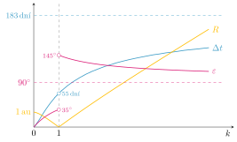
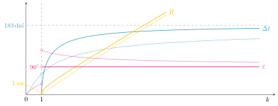

## Zadanie

Rado si prezeral spoľahlivé internetové zdroje a dozvedel sa, že *retrográdny pohyb planét a ich umiestnenie v danom čase má mimoriadny vplyv na zostavenie horoskopu*. To ho veľmi zaujalo, no nevedel, ako na to. Pomôžete Radovi pripraviť sa na jeho budúcnosť?

V tejto úlohe považujte dráhy Zeme a Marsu za kružnice, ktoré spolu so Slnkom ležia v jednej rovine. Pre polomery dráh $r_\Ea, r_\Ma$ použite hodnoty ich veľkých polos zo zoznamu konštánt, teda $r_\Ea \equiv a_\Ea \,,\, r_\Ma \equiv a_\Ma$. V príklade sa môžete rozhodnúť použiť predpoklad, že sa Mars nepohybuje okolo Slnka, teda je pevne umiestnený v priestore vo vzdialenosti $r_\Ma$ od Slnka, avšak za každé podzadanie vypočítané s týmto predpokladom získate maximálne $20\,\%$ bodov.

<ol type="a">

<li>

[60 b] Počas akého času $\Delta t$ sa planéta Mars pri pohľade zo Zeme pohybuje po oblohe medzi hviezdami zdanlivo retrográdne (opačným smerom)?

</li>

<li>

[30 b] Určte vzdialenosť $R$ Marsu a Zeme na konci retrográdneho pohybu Marsu (v momente zdanlivého zastavenia pri pohľade zo Zeme). Ak sa vám v podzadaní (a) nepodarilo vypočítať $\Delta t$, použite hodnotu $\Delta t = 100\,\mathrm{dní}$.

</li>

<li>

[30 b] Vypočítajte zmenu ekliptikálnej dĺžky Marsu $\Delta \lambda$ počas času $\Delta t$, teda medzi začiatkom a koncom retrográdneho pohybu. Ak sa vám v podzadaní (a) nepodarilo určiť $\Delta t$, použite hodnotu $\Delta t = 100\,\mathrm{dní}$.

</li>

<li>

[30 b] Zistite elongáciu Marsu $\varepsilon$ na konci retrográdneho pohybu. Ak sa vám v podzadaní (a) nepodarilo vypočítať $\Delta t$, použite hodnotu $\Delta t = 100\,\mathrm{dní}$.

</li>

<li>

[50 b] Pomocou pomeru polomerov dráh Marsu a Zeme $k := r_\Ma/r_\Ea$ a obežnej doby Zeme okolo Slnka $P_\Ea = 1\,\mathrm{rok} = 365{,}25\,\mathrm{dní}$ napíšte čo najjednoduchšie všeobecné vyjadrenia veličín $\Delta t,\ R,\ \varepsilon$, ktoré ste vypočítali v podzadaniach (a), (b), (d).

</li>

<li>

[20 b] Aké hodnoty nadobúdajú veličiny $\Delta t,\ R,\ \varepsilon$ pre $k$ blízke nule a nekonečnu?

</li>

</ol>

***Pomôcka:*** Môžu sa vám hodiť nasledovné trigonometrické vzťahy pre uhly $\alpha,\ \beta$;

- $\sin^2 \alpha + \cos^2 \alpha = 1 \,,$

- $\sin(\alpha-\beta) = \sin \alpha \, \cos \beta - \cos \alpha \, \sin \beta \,,$

- $\cos(\alpha-\beta) = \cos \alpha \, \cos \beta + \sin \alpha \, \sin \beta \,.$

<ol type="a" start="7">

<li>

[2 b] Na základe vašich výsledkov určte, aké má Rado znamenie. Keďže ešte nesúťažíme na medzinárodnej úrovni, dáme vám na výber z možností:

<ol type="i">

<li>

Býk,

</li>

<li>

Mečiar,

</li>

<li>

Veľký voz.

</li>

</ol>

</li>

</ol>

Riešenie

Úlohu budeme riešiť nástrojmi analytickej vektorovej geometrie. Upozorňujeme však, že existujú aj iné spôsoby, napríklad klasická geometria vo vhodne nakreslenom obrázku. Tieto riešenia môžu viesť k jednoduchším tvarom rovníc, ale zvyknú mať viac neintuitívne kroky. Zjednodušenému prístupu s priestorovo zafixovaným Marsom sa budeme venovať až na záver tohto vzorového riešenia. Rovnako aj v tomto prípade použijeme analytickú geometriu.

Začneme vyjadrením zložiek polohového vektoru $\vec{r} = (x, y)$ a vektoru rýchlosti $\vec{v} = (v_x, v_y)$ na kruhovej dráhe s polomerom $r$ v závislosti na čase $t$. Pre $t = 0$ položíme $\vec{r}(0) = r\,(1,0)$. Rýchlosť $\vec{v}$ je kolmá na $\vec{r}$, teda $\vec{v}(0) = v\,(0,1)$, kde $v=\konst$. Po zavedení uhlovej rýchlosti $\omega = v/r$ a uvážením, že $\vec{v} \perp \vec{r}$ pre všetky $t$, tak z definícií trigonometrických funkcií plynie[^1] 

$$
\begin{align*}
    x &= r \cos(\omega t) \,, \tag{1}\\
    y &= r \sin(\omega t) \,, \tag{2}\\
    v_{\mathit{x}} &= - v \sin(\omega t) = - r \omega \sin(\omega t) \equiv - \omega y \,, \tag{3}\\
    v_{\mathit{y}} &= v \cos(\omega t) = r \omega \cos(\omega t) \equiv \omega x \,. \tag{4}\end{align*}
$$

 Takúto sadu rovníc si vieme napísať pre Zem ($\Ea$) a Mars ($\Ma$). Získavame tak časové vyjadrenia polohy $\vec{r}_\Ea,\  \vec{r}_\Ma$ a rýchlosti $\vec{v}_\Ea,\  \vec{v}_\Ma$ oboch planét. V riešení príkladu bude kľúčový relatívny polohový vektor $\vec{R}$ a relatívny vektor rýchlosti $\vec{V}$ Marsu voči Zemi. Konkrétne s využitím rovníc vyššie 

$$
\begin{align*}
    \vec{R} := \vec{r_\Ma} - \vec{r_\Ea} =
    \begin{pmatrix} x_\Ma \\ y_\Ma \end{pmatrix}
    - \begin{pmatrix} x_\Ea \\ y_\Ea \end{pmatrix} &=
    \begin{pmatrix}
        r_\Ma \cos(\omega_\Ma t) - r_\Ea \cos(\omega_\Ea t) \\
        r_\Ma \sin(\omega_\Ma t) - r_\Ea \sin(\omega_\Ea t)
    \end{pmatrix} \,, \tag{5}\\
    \vec{V} := \vec{v_\Ma} - \vec{v_\Ea} =
    \begin{pmatrix} v_{\Ma,\mathit{x}} \\ v_{\Ma,\mathit{y}} \end{pmatrix}
    - \begin{pmatrix} v_{\Ea,\mathit{x}} \\ v_{\Ea,\mathit{y}} \end{pmatrix} &=
    \begin{pmatrix}
        - r_\Ma \, \omega_\Ma \sin(\omega_\Ma t) + r_\Ea \, \omega_\Ea \sin(\omega_\Ea t) \\ 
        r_\Ma \, \omega_\Ma \cos(\omega_\Ma t) - r_\Ea \, \omega_\Ea \cos(\omega_\Ea t)
    \end{pmatrix} \,. \tag{6}\end{align*}
$$

Pre zjednodušenie matematických úprav sa nám budú hodiť skrátené zápisy 

$$
\vec{R} =
    \begin{pmatrix} x_\Ma - x_\Ea \\ y_\Ma - y_\Ea \end{pmatrix} \a
    \vec{V} =
    \begin{pmatrix} -\omega_\Ma \, y_\Ma + \omega_\Ea \, y_\Ea \\
    \omega_\Ma \, x_\Ma - \omega_\Ea \, x_\Ea \end{pmatrix} \,. \tag{7}
$$

Teraz sa pustíme do riešenia jednotlivých podzadaní.

<ol type="a">

<li>

**Retrográdny čas $\bm{\Delta t}$**

Pohyb planéty Mars medzi hviezdami je riadený relatívnymi vektormi $\vec{R}$ a $\vec{V}$. Poloha Marsu je daná priamo vektorom $\vec{R}$, avšak jeho uhlová rýchlosť na oblohe pri pozorovaní zo Zeme závisí nie len na vektore $\vec{V}$, ale aj na jeho relatívnom natočení vzhľadom na vektor $\vec{R}$.

Pre $\vec{V} \perp \vec{R}$ vypočítame uhlovú rýchlosť $\vartheta$ jednoduchým podielom, $\vartheta = |\vec{V}|\,/\,|\vec{R}| \equiv V/R$. Ak ale $\vec{V} \not\perp \vec{R}$, potom sa do pozorovaného uhlového pohybu zaráta iba tangenciálna (kolmá) zložka $\vec{V}$ voči $\vec{R}$. Z toho, ale vyplýva, že ak táto tangenciálna zložka vymizne, tak $\vartheta = 0$, čo znamená, že sa Mars vzhľadom na hviezdy zastaví. V tomto momente dochádza k začiatku alebo ku koncu retrográdneho pohybu.

Podmienka, ktorá ohraničuje retrográdny úsek, je preto nulovosť kolmej zložky $\vec{V}$ voči $\vec{R}$. Inak povedané: $\vec{V} \parallel \vec{R}$, čiže pohyb Marsu relatívne na Zem je výhradne radiálny. Vektory $\vec{V}$ a $\vec{R}$ sú rovnobežné vtedy, keď majú $x,\ y$ zložky v rovnakom pomere. Zároveň majú rovnaký uhol voči osi $x$ (v rovine $xy$), označme ho $\phi$. Podmienku $\vec{V} \parallel \vec{R}$ teda zapíšeme rovnicou ako 

$$
\frac{V_{\mathit{y}}}{V_{\mathit{x}}} = \tan \phi_{\hspace{-0.5pt}\mathit{V}}
    = \tan \phi_{\hspace{-0.5pt}\mathit{R}} = \frac{R_{\mathit{y}}}{R_{\mathit{x}}} \,. \tag{8}
$$

 Našou úlohou bude túto rovnicu vyriešiť pre čas $t$ ako premennú schovanú vo vyjadrení $\vec{V}$ a $\vec{R}$. Musíme však správne interpretovať aký, je vzťah času $t$ a hľadaného retrográdneho času $\Delta t$. Pri zavedení $\vec{r}$ a $\vec{v}$ vo vzťahoch (1) až (4) sme položili $\vec{r}(0) = r\,(1,0)$, teda pre nulový čas je poloha čisto v smere $x$. Zavedenie bolo rovnaké pre Zem aj Mars, čo znamená, že sa obe planéty v $t=0$ nachádzajú na osi $x$. Mars je teda v opozícii.

Retrográdny pohyb je symetrický okolo opozície a ohraničený časom $t$, ktorý získame riešením rovnice (8). Mars sa teda prvýkrát zastaví v čase $-t$, potom sa začne hýbať retrográdne, v nulovom čase prejde opozíciou a nakoniec sa v čase $t$ zastaví druhýkrát, čím ukončí retrográdny pohyb. Dokopy sa hýbe retrográdne počas času 

$$
\Delta t = 2t \,. \tag{9}
$$

 Pustime sa teraz do riešenia rovnice (8). Začnime dosadením z (7) a upravme. 

$$
\begin{align*}
    \frac{\omega_\Ma \, x_\Ma - \omega_\Ea \, x_\Ea}{-\omega_\Ma \, y_\Ma + \omega_\Ea \, y_\Ea}
    &= \frac{y_\Ma - y_\Ea}{x_\Ma - x_\Ea} \,, \tag{10}\\
    (\omega_\Ma \, x_\Ma - \omega_\Ea \, x_\Ea)(x_\Ma - x_\Ea)
    &= (-\omega_\Ma \, y_\Ma + \omega_\Ea \, y_\Ea)(y_\Ma - y_\Ea) \,, \tag{11}\\
    \omega_\Ma \, x_\Ma^2 - \omega_\Ma \, x_\Ma x_\Ea - 
    \omega_\Ea \, x_\Ea x_\Ma + \omega_\Ea \, x_\Ea^2
    &= -\omega_\Ma \, y_\Ma^2 + \omega_\Ma \, y_\Ma y_\Ea + 
    \omega_\Ea \, y_\Ea \, y_\Ma - \omega_\Ea \, y_\Ea^2 \,, \tag{12}\\
    \omega_\Ma \, y_\Ma^2 + \omega_\Ma \, x_\Ma^2 +
    \omega_\Ea \, y_\Ea^2 + \omega_\Ea \, x_\Ea^2
    &= (\omega_\Ma + \omega_\Ea) x_\Ma x_\Ea +
    (\omega_\Ma + \omega_\Ea) y_\Ma y_\Ea \,, \tag{13}\\
    \omega_\Ma (y_\Ma^2 + x_\Ma^2) +
    \omega_\Ea (y_\Ea^2 + x_\Ea^2)
    &= (\omega_\Ma + \omega_\Ea)(x_\Ma x_\Ea + y_\Ma y_\Ea) \,. \tag{14}\end{align*}
$$

 Teraz použijeme trigonometrické identity z nápovedy v zadaní. S využitím (1) a (2) 

$$
\begin{align*}
    y_\Ma^2 + x_\Ma^2 
    &\equiv r_\Ma^2 \sin^2(\omega_\Ma t) + r_\Ma^2 \cos^2(\omega_\Ma t) 
    = r_\Ma^2 \, \big( \sin^2(\omega_\Ma t) + \cos^2(\omega_\Ma t) \big) = r_\Ma^2 \,, \tag{15}\\
    y_\Ea^2 + x_\Ea^2 
    &\equiv r_\Ea^2 \sin^2(\omega_\Ea t) + r_\Ea^2 \cos^2(\omega_\Ea t)
    = r_\Ea^2 \, \big( \sin^2(\omega_\Ea t) + \cos^2(\omega_\Ea t) \big) = r_\Ea^2 \,, \tag{16}\\
    x_\Ma x_\Ea + y_\Ma y_\Ea 
    &\equiv r_\Ma \cos(\omega_\Ma t) \, r_\Ea \cos(\omega_\Ea t)
    + r_\Ma \sin(\omega_\Ma t) \, r_\Ea \sin(\omega_\Ea t)
    = r_\Ma r_\Ea \cos(\Delta\omega t) \,, \tag{17}\end{align*}
$$

kde $\Delta \omega := |\omega_\Ma - \omega_\Ea|$.

Na znamienku $\Delta\omega$ v tomto prípade nezáleží, keďže kosínus je symetrický okolo nuly. Dosadením do (14) a vyjadrením času $t$ dostávame 

$$
\begin{align*}
    \omega_\Ma r_\Ma^2 +
    \omega_\Ea r_\Ea^2
    &= (\omega_\Ma + \omega_\Ea) r_\Ma r_\Ea \cos(\Delta\omega t) \,, \tag{18}\\
    \cos(\Delta\omega t) 
    &= \frac{\omega_\Ma r_\Ma^2 + \omega_\Ea r_\Ea^2}{(\omega_\Ma + \omega_\Ea) r_\Ma r_\Ea} \,, \tag{19}\\
    t &= \frac{1}{\Delta \omega} \arccos\left(
    \frac{\omega_\Ma r_\Ma^2 + \omega_\Ea r_\Ea^2}{(\omega_\Ma + \omega_\Ea) r_\Ma r_\Ea}
    \right) \,. \tag{20}\end{align*}
$$

Potrebujeme teda už len dopočítať uhlové rýchlosti Marsu a Zeme. Uhlovú rýchlosť sme zaviedli ako $\omega = v/r$, pričom rýchlosť na kruhovej dráhe je $v=2\pi r/P$, kde $P$ je perióda obehu. Pomocou 3. Keplerovho zákona máme navyše určený vzťah medzi $P$ a $r$. V astronomických jednotkách a rokoch platí v zjednodušenej verzii, $P^2 = r^3$, dostávame 

$$
\omega = \frac{v}{r} = \frac{2\pi r}{P r}
    = \frac{2\pi}{r^{3/2}} \,. \tag{21}
$$

 Dosadením konkrétnych hodnôt $r$ pre Mars a Zem ($r_\Ma = 1{,}524\,\mathrm{au}\, ;\, r_\Ea = 1\,\mathrm{au}$) máme 

$$
\omega_\Ma \approx \frac{3{,}340}{\mathrm{rok}} \a
    \omega_\Ea = \frac{2\pi}{\mathrm{rok}} \a
    \Delta \omega \approx \frac{2{,}944}{\mathrm{rok}} \ztv 
    t \approx 0{,}0995\,\mathrm{roka} \approx 36{,}3\,\mathrm{dní} \,. \tag{22}
$$

 Na záver nesmieme zabudnúť na vzťah $\Delta t$ a $t$ zhrnutý rovnicou (9), finálne teda 

$$
\boxed{\Delta t = 2t \approx 73\,\mathrm{dní}} \,. \tag{23}
$$

</li>

<li>

**Vzdialenosť $\bm{R}$**

Vzdialenosť $R$ Marsu a Zeme v momente zdanlivého zastavenia Marsu medzi hviezdami je rovná veľkosti relatívneho polohového vektora $\vec{R}$ za platnosti podmienky (8), čiže po uplynutí času $t$ od opozície. Veľkosť $\vec{R}$ určíme z Pytagorovej vety ako 

$$
R \equiv |\vec{R}| = \sqrt{R_{\mathit{x}}^2 + R_{\mathit{y}}^2} \,. \tag{24}
$$

 Na vyčíslenie zložiek $R_{\mathit{x}}, R_{\mathit{y}}$ budeme potrebovať hodnoty $x_\Ma, x_\Ea, y_\Ma, y_\Ea$. Tie určíme pomocou vyčíslení v (22), zavedení (1), (2). 

$$
\begin{align*}
    x_\Ma = r_\Ma \cos(\omega_\Ma t) \approx 1{,}441\,\mathrm{au} &\a 
    y_\Ma = r_\Ma \sin(\omega_\Ma t) \approx 0{,}497\,\mathrm{au} \,, \tag{25}\\
    x_\Ea = r_\Ea \cos(\omega_\Ea t) \approx 0{,}811\,\mathrm{au} &\a 
    y_\Ea = r_\Ea \sin(\omega_\Ea t) \approx 0{,}585\,\mathrm{au} \,, \tag{26}\\
    R_{\mathit{x}} = x_\Ma - x_\Ea \approx 0{,}630\,\mathrm{au} &\a
    R_{\mathit{y}} = y_\Ma - y_\Ea \approx -0{,}088\,\mathrm{au} \,. \tag{27}\end{align*}
$$

 Dosadením $R_{\mathit{x}}, R_{\mathit{y}}$, spolu s časom $t=\Delta t/2$ do (24), dostávame vzdialenosť 

$$
\boxed{R \approx 0{,}636\,\mathrm{au}} \,. \tag{28}
$$

</li>

<li>

**Zmena ekliptikálnej dĺžky $\bm{\Delta \lambda}$**

Ekliptikálnu dĺžku $\lambda$ meriame pozdĺž ekliptiky od jarného bodu, čo je fixné miesto na nebeskej sfére medzi hviezdami. Ak by sme uvážili, že jarný bod je presne v smere osi $x$, potom je ekliptikálna dĺžka Marsu v momente zdanlivého zastavenia medzi hviezdami totožná s uhlom $\phi_{\hspace{-0.5pt}\mathit{R}}$ zavedeným v podmienke (8). Je to preto, lebo tento uhol vyjadruje sklon relatívneho polohového vektora $\vec{R}$ voči osi $x$ v rovine $xy$, pričom rovina $xy$ je práve rovina ekliptiky a osi $x$ a $y$ ostávajú v priestore nehybné rovnako ako nebeská sféra.

Jarný bod ale nemusí byť práve v smere osi $x$, čo spôsobí posun hodnôt $\phi_{\hspace{-0.5pt}\mathit{R}}$ voči hodnotám $\lambda$. Avšak nás nezaujímajú konkrétne hodnoty ekliptikálnej dĺžky, iba jej zmena. No a pre tú platí, že je rovnaká ako zmena $\phi_{\hspace{-0.5pt}\mathit{R}}$. Čiže 

$$
\Delta \lambda = \Delta \phi_{\hspace{-0.5pt}\mathit{R}} = 2 |\phi_{\hspace{-0.5pt}\mathit{R}}| \,, \tag{29}
$$

 kde druhá rovnosť opäť plynie zo symetrie retrográdneho pohybu okolo osi $x$ (okolo opozície). Potrebujeme teda spočítať uhol $\phi_{\hspace{-0.5pt}\mathit{R}}$, čiže uhol medzi $\vec{R}$ a osou $x$. To spravíme pomocou (8). 

$$
\tan \phi_{\hspace{-0.5pt}\mathit{R}} = \frac{R_y}{R_x} \,, \tag{30}
$$

 čo vyplýva z pravouhlého trojuholníka zloženého z odvesny $R_x$ v smere osi $x$, odvesny $R_y$ v smere osi $y$ a prepony $\vec{R}$. Po dosadení z (27) a vyčíslení $\phi_{\hspace{-0.5pt}\mathit{R}}$ dostávame $\phi_{\hspace{-0.5pt}\mathit{R}} \approx -8{,}0^{\circ}$. Záporná hodnota je očakávaná, pretože sa Mars hýbe medzi hviezdami retrográdne. Finálne 

$$
\boxed{
    \Delta \lambda
    = 2 |\phi_{\hspace{-0.5pt}\mathit{R}}|
    \approx 16^{\circ}
    } \,. \tag{31}
$$

</li>

<li>

**Elongácia $\bm{\varepsilon}$**

Pri výpočte elongácie (uhlovej vzdialenosti od Slnka) Marsu si musíme dať pozor na to, že medzi opozíciou (kedy je elongácia $180^{\circ}$) a momentom, kedy sa Mars zdanlivo medzi hviezdami zastaví, sa navyše na oblohe posunie aj Slnko. Preto 

$$
\varepsilon \neq 180^{\circ} - \phi_{\hspace{-0.5pt}\mathit{R}} \approx 164^{\circ} \,. \tag{32}
$$

 Očakávame, že elongácia bude menšia ako $164^{\circ}$, pretože Mars počas retrográdneho pohybu ide Slnku ”naproti”.

Čo potrebujeme spočítať, je uhol medzi relatívnym polohovým vektorom $\vec{R}$ a zdanlivým polohovým vektorom Slnka pri pohľade zo Zeme, ktorý označíme $\vec{r}_{\Sun\Ea}$. Jeho vzťah ku polohovému vektoru Zeme je jednoduchý; 

$$
\vec{r}_{\Sun\Ea} = - \vec{r}_\Ea \,. \tag{33}
$$

 Uhol medzi $\vec{R}$ a $\vec{r}_{\Sun\Ea}$ je priamo hľadaná elongácia $\varepsilon$ a vypočítame ho pomocou skalárneho súčinu 

$$
\vec{R} \cdot \vec{r}_{\Sun\Ea} 
    = |\vec{R}|\,|\vec{r}_{\Sun\Ea}| \cos \varepsilon \,. \tag{34}
$$

 Dosadením $\vec{r}_{\Sun\Ea} = -\vec{r_\Ea}$ a $|\vec{R}| \equiv R$, rozpísaním a úpravou máme 

$$
\begin{align*}
    \vec{R} \cdot (-\vec{r}_\Ea)
    &= |\vec{R}|\,|-\vec{r}_\Ea| \cos \varepsilon \,, \tag{35}\\
    - (R_{\mathit{x}} x_\Ea + R_{\mathit{y}} y_\Ea)
    &= \sqrt{R_{\mathit{x}}^2 + R_{\mathit{y}}^2} \; r_\Ea \cos \varepsilon \,, \tag{36}\\
    \cos \varepsilon
    &= - \frac{R_{\mathit{x}} x_\Ea + R_{\mathit{y}} y_\Ea}
    {\sqrt{R_{\mathit{x}}^2 + R_{\mathit{y}}^2} \; r_\Ea} \,. \tag{37}\end{align*}
$$

 Po finálnom dosadení z (26) a (27) získavame 

$$
\boxed{\varepsilon \approx 136^{\circ}} \,. \tag{38}
$$

 Vidíme, že vskutku je elongácia menšia ako $164^{\circ}$, ako sme predpokladali, a teda vplyv pohybu Slnka medzi hviezdami, respektíve obehu Zeme okolo neho, je nezanedbateľný.

</li>

<li>

**Všeobecné vyjadrenia**

Na záver vyjadríme $\Delta t,\ R,\ \varepsilon$ pomocou $k := r_\Ma/r_\Ea$ a $P_\Ea = 1\,\mathrm{rok}$. Jednoduché všeobecné vyjadrenia sú užitočné pre skúmanie správania veličín na malom počte premenných. V našom prípade bude stačiť pomer polomerov dráh $k$ a referenčná časová škála (perióda obehu Zeme). Týmto spôsobom vieme následne naše výsledky extrapolovať na ľubovoľnú inú dvojicu planét (či iných objektov) na kruhových dráhach okolo Slnka s nulovou inklináciou.

$\boxed{\bm{\Delta t}\,}\,$\
Pre vyjadrenie $\Delta t$ výjdeme z rovnice (19), kde dosadíme za $\omega$ z (21) a upravíme.

$$
\begin{align*}
\begin{split}
    \cos(\Delta\omega t) 
    &= \frac{\omega_\Ma r_\Ma^2 + \omega_\Ea r_\Ea^2}{(\omega_\Ma + \omega_\Ea) r_\Ma r_\Ea}
    = \frac{\cfrac{2\pi}{r_\Ma^{3/2}} \; r_\Ma^2 
    +       \cfrac{2\pi}{r_\Ea^{3/2}} \; r_\Ea^2}
    {\left(\cfrac{2\pi}{r_\Ma^{3/2}} + \cfrac{2\pi}{r_\Ea^{3/2}}\right) r_\Ma r_\Ea}
    = \frac{r_\Ma^{1/2} + r_\Ea^{1/2}}
    {\cfrac{r_\Ea^{3/2} + r_\Ma^{3/2}}{r_\Ea^{3/2} r_\Ma^{3/2}} \; r_\Ma \, r_\Ea}
    \\[3mm]
    &= \frac{r_\Ma^{1/2} + r_\Ea^{1/2}}
    {r_\Ea^{3/2} + r_\Ma^{3/2}} \, r_\Ea^{1/2} r_\Ma^{1/2}
    = \frac{r_\Ea^{1/2} \left(\cfrac{r_\Ma^{1/2}}{r_\Ea^{1/2}} + 1 \right)}
    {r_\Ea^{3/2} \left( 1 + \cfrac{r_\Ma^{3/2}}{r_\Ea^{3/2}} \right)} \; r_\Ea^{1/2} r_\Ma^{1/2}
    = \frac{r_\Ma^{1/2} \left(\cfrac{r_\Ma^{1/2}}{r_\Ea^{1/2}} + 1 \right)}
    {r_\Ea^{1/2} \left( 1 + \cfrac{r_\Ma^{3/2}}{r_\Ea^{3/2}} \right)} \,.
\end{split} \tag{39}\end{align*}
$$

 Výraz sme vyberaním pred zátvorku upravili do vhodnej formy, kde vieme ľahko využiť definíciu $k := r_\Ma/r_\Ea$. Po nahradení dostávame 

$$
\cos(\Delta\omega t)
    = k^{1/2} \; \frac{k^{1/2} + 1}{1 + k^{3/2}}
    = \frac{k + k^{1/2}}{1 + k^{3/2}} \,. \tag{40}
$$

Ostáva ešte vyjadriť $\Delta \omega$ pomocou $k$ a $P_\Ea$. Výjdeme z definície a upravíme obdobne ako predtým. 

$$
\begin{align*}
\begin{split}
    \Delta \omega &:= |\omega_\Ma - \omega_\Ea| 
    = \left| \frac{2\pi}{r_\Ma^{3/2}} - \frac{2\pi}{r_\Ea^{3/2}} \right|
    = 2\pi \left| \frac{r_\Ea^{3/2} - r_\Ma^{3/2}}{r_\Ma^{3/2} r_\Ea^{3/2}} \right|
    = 2\pi \left| \frac{\cfrac{r_\Ea^{3/2}}{r_\Ma^{3/2}} - 1}{r_\Ea^{3/2}} \right|
    \\[0mm]
    &= \frac{2\pi}{r_\Ea^{3/2}} \, \left| \frac{1}{k^{3/2}} - 1 \right|
    = \frac{2\pi}{P_\Ea} \, \left| \frac{1 - k^{3/2}}{k^{3/2}} \right|
    = \frac{2\pi |1 - k^{3/2}|}{P_\Ea \, k^{3/2}} \,,
\end{split} \tag{41}\end{align*}
$$

 kde sme využili 3. Keplerov zákon $r_\Ea^{3/2} = P_\Ea$ (v $\mathrm{au}$ a rokoch). Posledná rovnosť platí vďaka tomu, že $k$ je kladné. Absolútnu hodnotu sme ponechali v čitateli, aby sme týmto vyjadrením pokryli aj vnútorné planéty, pre ktoré je $1 - k^{3/2}$ záporné.

Ako posledné započítame (9), teda $\Delta t = 2t$; čiže dokopy dostávame 

$$
\boxed{\Delta t = \frac{P_\Ea \, k^{3/2}}{\pi |1 - k^{3/2}|} \arccos\left(
    \frac{k + k^{1/2}}{1 + k^{3/2}} \right) } \,. \tag{42}
$$

$\boxed{\bm{R}\,}\,$\
Ďalej budeme vyjadrovať vzdialenosť $R$. Začneme z Pytagorejského vyjadrenia (24) kam dosadíme za $R_{\mathit{x}}, R_{\mathit{y}}$ pomocou (7) a (1), (2). Po úprave máme 

$$
\begin{align*}
\begin{split}
    R &= \sqrt{R_{\mathit{x}}^2 + R_{\mathit{y}}^2}
    = \sqrt{(x_\Ma - x_\Ea)^2 + (y_\Ma - y_\Ea)^2}
    \\[1mm]
    &= \sqrt{x_\Ma^2 - 2 x_\Ma x_\Ea + x_\Ea^2 + y_\Ma^2 - 2 y_\Ma y_\Ea + y_\Ea^2}
    \\[1mm]
    &= \sqrt{x_\Ma^2 + y_\Ma^2 + x_\Ea^2 + y_\Ea^2 - 2(x_\Ma x_\Ea + y_\Ma y_\Ea)} \,.
\end{split} \tag{43}\end{align*}
$$

Teraz vieme použiť vzťahy (15), (16), (17) vyplývajúce z trigonometrických identít a následne 3. Keplerov zákon. Tým sa vyjadrenie $R$ zjednoduší na 

$$
\begin{align*}
\begin{split}
    R &= \sqrt{r_\Ma^2 + r_\Ea^2 - 2 r_\Ma r_\Ea \cos(\Delta \omega t)}
    \\[3mm]
    &= r_\Ea \sqrt{\frac{r_\Ma^2}{r_\Ea^2} + 1 - 2 \frac{r_\Ma}{r_\Ea} \cos(\Delta \omega t)}
    \\[3mm]
    &= P_\Ea^{2/3} \sqrt{k^2 + 1 - 2 k \cos(\Delta \omega t)} \,,
\end{split} \tag{44}\end{align*}
$$

 pričom počas vyjadrovania $\Delta t$ sme vyjadrili $\cos(\Delta \omega t)$ ako medzivýsledok v (40).

Preto 

$$
\begin{align*}
\begin{split}
    R &= P_\Ea^{2/3} \sqrt{k^2 + 1 - 2 k \frac{k + k^{1/2}}{1 + k^{3/2}}}
    = P_\Ea^{2/3} \sqrt{\frac{k^2 + 1 + k^{7/2} + k^{3/2} - 2k^2 - k^{3/2}}{1 + k^{3/2}}}
    \\[3mm]
    &= P_\Ea^{2/3} \sqrt{\frac{k^{7/2} - k^2 - k^{3/2} + 1}{1 + k^{3/2}}}
    = P_\Ea^{2/3} \sqrt{\frac{k^2 (k^{3/2} - 1) - (k^{3/2} - 1)}{1 + k^{3/2}}} \,,
\end{split} \tag{45}\end{align*}
$$

 teda finálne 

$$
\boxed{R = P_\Ea^{2/3} \sqrt{\frac{(k^2 - 1) (k^{3/2} - 1)}{1 + k^{3/2}}}} \,. \tag{46}
$$

$\boxed{\bm{\varepsilon}\,}\,$\
Ako posledné vyjadríme elongáciu $\varepsilon$. Vychádzať budeme zo vzťahu (37) pre $\cos \varepsilon$. Využitím (7), (16), (17) pre čitateľ máme 

$$
\begin{align*}
    R_{\mathit{x}} x_\Ea + R_{\mathit{y}} y_\Ea 
    &= (x_\Ma - x_\Ea) x_\Ea + (y_\Ma - y_\Ea) y_\Ea
    = x_\Ma x_\Ea - x_\Ea^2 + y_\Ma y_\Ea - y_\Ma^2 \tag{47}\\
    &= x_\Ma x_\Ea + y_\Ma y_\Ea - (x_\Ea^2 + y_\Ma^2)
    = r_\Ma r_\Ea \cos(\Delta \omega t) - r_\Ea^2 \,. \tag{48}\end{align*}
$$

 Dosadením do (37) spolu s definíciou $R$ a $k$, všeobecnými vyjadreniami (40), (46) pre $\cos(\Delta \omega t)$ a $R$ a 3. Keplerovým zákonom dostaneme 

$$
\begin{align*}
\begin{split}
    \cos \varepsilon
    &= - \frac{R_{\mathit{x}} x_\Ea + R_{\mathit{y}} y_\Ea}
        {\sqrt{R_{\mathit{x}}^2 + R_{\mathit{y}}^2} \; r_\Ea}
    = - \frac{r_\Ma r_\Ea \cos(\Delta \omega t) - r_\Ea^2}
        {R \, r_\Ea}
    = - r_\Ea \, \frac{k \cos(\Delta \omega t) - 1}
        {R}
    \\[4mm]
    &= - P_\Ea^{2/3} \, \frac{k \, \cfrac{k + k^{1/2}}{1 + k^{3/2}} - 1}
        {P_\Ea^{2/3} \sqrt{\cfrac{(k^2 - 1) (k^{3/2} - 1)}{1 + k^{3/2}}}}
    = - \frac{\cfrac{k^2+k^{3/2} - 1-k^{3/2}}{1+k^{3/2}}}
        {\cfrac{\sqrt{(k^2 - 1) (k^{3/2} - 1)}}{\sqrt{1 + k^{3/2}}}}
    \\[4mm]
    &= - \frac{k^2 - 1}{\sqrt{(k^2 - 1) (k^{3/2} - 1)(1 + k^{3/2})}}
    = - \frac{\sign(k^2 - 1) \sqrt{|k^2 - 1|} \sqrt{|k^2 - 1|}}
    {\sqrt{(k^2 - 1) (k^3 - 1)}} \,,
\end{split} \tag{49}\end{align*}
$$

 kde funkcia $\sign(\,)$ vracia znamienko vloženého výrazu. Ošetríme takto prípad $k < 1$ (vnútorné planéty).

Následne vieme výsledok napísať ako 

$$
\boxed{\varepsilon = \arccos\left( 
    - \sign(k^2 - 1) \, \sqrt{\frac{k^2 - 1}{k^3 - 1}}
    \right)} \,. \tag{50}
$$

</li>

<li>

**Malé a veľké $\bm{k}$**

Využijeme všeobecné vyjadrenia (42), (46), (50) zistené v (e). Na určenie veličín $\Delta t,\ R,\ \varepsilon$ pre malé $k$ bude stačiť do nich dosadiť nulu. 

$$
\begin{align*}
    \Delta t(k=0) &= \frac{P_\Ea \, 0^{3/2}}{\pi |1 - 0^{3/2}|} \arccos\left(
    \frac{0 + 0^{1/2}}{1 + 0^{3/2}} \right)
    = \frac{0}{\pi \, |1|} \arccos(0)
    = 0 \,, \tag{51}\\
    R(k=0) &= P_\Ea^{2/3} \sqrt{\frac{(0^2 - 1) (0^{3/2} - 1)}{1 + 0^{3/2}}}
    = P_\Ea^{2/3} \sqrt{\frac{1}{1}}
    = P_\Ea^{2/3}
    = 1\,\mathrm{au} \,, \tag{52}\\
    \varepsilon(k=0) &= \arccos\left( 
    - \sign(0^2 - 1) \, \sqrt{\frac{0^2 - 1}{0^3 - 1}}
    \right)
    = \arccos\left( 
    + \sqrt{1}
    \right)
    = 0^{\circ} \,. \tag{53}\end{align*}
$$

 Tieto výsledky dávajú zmysel, keď sa zamyslíme nad tým, že malé $k$ znamená teleso obiehajúce veľmi blízko Slnka, čiže vo vzdialenosti skoro $R = 1\,\mathrm{au}$ od Zeme. Takéto teleso obieha na maličkej kružnici, teda jeho elongácia $\varepsilon$ je skoro nulová a takisto musí obiehať veľmi rýchlo, čo znamená, že jeho perióda je veľmi krátka, a preto aj $\Delta t$ sa blíži nule.

Pre veľké $k$ využijeme aproximácie v tvare $k \pm 1 \approx k$ s rôznymi kladnými mocninami $k$, ktoré vyplývajú z toho, že ak k veľkému číslu pripočítame alebo odpočítame 1, tak dostaneme skoro to isté veľké číslo. Taktiež využijeme to, že $1/k \approx 0$, opäť pre rôzne kladné mocniny $k \gg 1$. 

$$
\begin{align*}
    \begin{split}
    \Delta t(k\gg 1) &= \frac{P_\Ea \, k^{3/2}}{\pi |1 - k^{3/2}|} \arccos\left(
    k^{1/2} \, \frac{k^{1/2} + 1}{1 + k^{3/2}} \right)
    \approx \frac{P_\Ea \, k^{3/2}}{\pi k^{3/2}} \arccos\left(
    k^{1/2} \, \frac{k^{1/2}}{k^{3/2}} \right)
    \\[1.5mm]
    &= \frac{P_\Ea}{\pi} \arccos\left( \frac{1}{k^{1/2}} \right)
    \approx \frac{P_\Ea}{\pi} \arccos\left( 0 \right)
    = \frac{P_\Ea}{\pi} \cdot \frac{\pi}{2}
    = \frac{P_\Ea}{2} \approx 183\,\mathrm{dní} \,,
    \end{split} \tag{54}\\
    R(k\gg 1) &= P_\Ea^{2/3} \sqrt{\frac{(k^2 - 1) (k^{3/2} - 1)}{1 + k^{3/2}}}
    \approx P_\Ea^{2/3} \sqrt{\frac{k^2 \, k^{3/2}}{k^{3/2}}}
    = P_\Ea^{2/3} \, k \;\to\; \infty \,, \tag{55}\\
    \begin{split}
    \varepsilon(k\gg 1) &= \arccos\left( 
    - \sign(k^2 - 1) \, \sqrt{\frac{k^2 - 1}{k^3 - 1}}
    \right)
    \approx \arccos\left( 
    - \sign(k^2) \, \sqrt{\frac{k^2}{k^3}}
    \right)
    \\
    &= \arccos \left( -\sqrt{\frac{1}{k}} \right)
    \approx \arccos(-0)
    = +90^{\circ} \,.
    \end{split} \tag{56}\end{align*}
$$

Tieto výsledky sú opäť rozumné. Objekt s $k\gg 1$ je na veľmi vzdialenej orbite okolo Slnka, teda prirodzene $R\to \infty$. Zároveň sa pohybuje extrémne pomaly, čiže v prvom priblížení môžeme povedať, že objekt ostáva pevne na jednom mieste v priestore. To znamená, že vzdialenosť $R$ daného objektu od Zeme je približne konštantná, keďže $R \gg 1\,\mathrm{au}$, čiže pohyby Zeme okolo Slnka sú voči $R$ zanedbateľné. Potom ale samozrejme $\Delta t = P_\Ea/2$, teda objekt sa pri pohľade zo Zeme pol roka pohybuje jedným smerom a pol roka smerom opačným. Najrýchlejšie sa hýbe v opozícii a konjunkcii. Zastaví sa v kvadratúrach, čo je v súlade so spočítanou elongáciou $90^{\circ}$.

</li>

</ol>

**Bonus**

Ako bonus sem pridávame grafické znázornenie funkcií $\Delta t,\ R,\ \varepsilon$ v závislosti na $k$ (obrázok 1) a napočítané hodnoty týchto veličín pre jednotlivé planéty v slnečnej sústave. Do grafu sú vynesené asymptotické hodnoty $\Delta t \to 183\,\mathrm{dní} \,,\; \varepsilon \to 90^{\circ}$, ktoré sa nadobúdajú pre $k\to \infty$. Vzdialenosť $R$ najskôr klesá až na nulu a následne pre veľké $k$ rastie do nekonečna. Vidíme, že toto správanie $\Delta t, R, \varepsilon$ je pozorovateľné aj v tabuľke 1.

<figure>

<figcaption>

**Obrázok 1:** Graf znázorňujúci priebeh veličín $\Delta t$ (časová dĺžka retrográdneho pohybu), $R$ (vzdialenosť od Zeme v momente zdanlivého zastavenia sa medzi hviezdami), $\varepsilon$ (elongácia v momente zdalnivého zastavenia sa medzi hviezdami) na $k$ (polomer dráhy v $\mathrm{au}$) pri pozorovaní zo Zeme. Čiarkovane sú vynesené asymptotické hodnoty $\Delta t,\ \varepsilon$, ku ktorým sa tieto veličiny blížia pre $k \to \infty$. Hodnota $k=1$ oddeľuje vnútorné a vonkajšie planéty (telesá) a nastáva tu nespojitosť v $\Delta t$ a $\varepsilon$. V grafe sú uvedené limitné hodnoty, pričom pre $\varepsilon$ sa líši limita sprava a zľava. Vzdialenosť $R$ rastie do nekonečna a blíži sa lineárnej funkcii $R(k\gg 1) = P_\Ea^{2/3} k = 1\,\mathrm{au} \cdot k$.
</figcaption>

</figure>

**Tabuľka 1:** Vypočítané hodnoty $\Delta t,\ R,\ \varepsilon$ pre jednotlivé planéty v slnečnej sústave. Pozorujeme trend nárastu času $\Delta t$ do asymptotickej hodnoty $183\,\mathrm{dní}$, trend prvotného poklesu vzdialenosti $R$ a následného rastu do nekonečna, a takisto trend asymptotického približovania elongácie $\varepsilon$ do $90^{\circ}$.

|          |           |           |           |           |
|:--------:|:---------:|:---------:|:---------:|:---------:|
|          |           |           |           |           |
| Planéta  | $k$ | $\Delta t \, (\mathrm{dní})$ | $R \, (\mathrm{au})$ | $\varepsilon$ |
|  Merkúr  |   0,387   |    23     |   0,72    | $18^{\circ}$ |
|  Venuša  |   0,723   |    42     |   0,34    | $29^{\circ}$ |
| **Mars** | **1,524** |  **73**   | **0,64**  | $\bm{136}^{\circ}$ |
| Jupiter  |   5,204   |    121    |   4,69    | $116^{\circ}$ |
|  Saturn  |   9,583   |    138    |   9,21    | $109^{\circ}$ |
|   Urán   |  19,191   |    152    |   18,94   | $103^{\circ}$ |
|  Neptún  |  30,069   |    158    |   29,87   | $101^{\circ}$ |

Takisto sa budeme venovať situácii $k=1$ (polomer dráhy telesa je rovnaký ako polomer dráhy Zeme), kedy nastáva nespojitosť vo funkciách pre $\Delta t$ a $\varepsilon$. V takýchto situáciách je zaujímavé prešetriť limitné správanie sprava (vonkajšie teleso) a zľava (vnútorné teleso). Pre $\varepsilon$ je situácia jednoduchá. Stačí prepísať čitateľ a menovateľ odmocniny pomocou vzorcov $a^2 - b^2$ a $a^3 - b^3$. Konkrétne pre situáciu sprava 

$$
\begin{align*}
\begin{split}
    \lim_{k\to 1^+} \varepsilon &= \lim_{k\to 1^+} \arccos\left( 
    - \sign(k^2 - 1) \, \sqrt{\frac{k^2 - 1}{k^3 - 1}} \, \right)
    \\[2mm]
    &= \lim_{k\to 1^+} \arccos \left( - \sqrt{\frac{(k-1)(k+1)}{(k-1)(k^2 + k + 1)}} \, \right)
    \\[2mm]
    &= \lim_{k\to 1^+} \arccos \left( - \sqrt{\frac{k+1}{k^2 + k + 1}} \, \right)
    \\[2mm]
    &= \arccos \left( -\sqrt{\frac{1+1}{1+1+1}} \, \right)
    = \arccos \left( -\sqrt{\frac{2}{3}} \, \right) \approx 145^{\circ} \,.
\end{split} \tag{57}\end{align*}
$$

Zľava je postup analogický, jedine sa zmení znamienko $\sign(k^2-1)$, teda 

$$
\lim_{k\to 1^-} \varepsilon
    = \arccos \left( +\sqrt{\frac{2}{3}} \, \right) \approx 35^{\circ} \,. \tag{58}
$$

Pre $\Delta t$ je limitný výpočet zložitejší a ide nad rámec stredoškolských znalostí. Jednou z možností je aplikácia L’Hospitalovho pravidla, ktoré využíva derivovanie. Zaujímavé je ale to, že po prevedení limitného výpočtu z oboch strán (sprava aj zľava) prichádzame k rovnakému číslu, 

$$
\lim_{k\to 1} \Delta t
    = \frac{\sqrt{2}P_\Ea}{3\pi} \approx 55\,\mathrm{dní} \,. \tag{59}
$$

**Priestorovo zafixovaný Mars**

Na záver sa pozrieme na aproximatívne riešenie, pri ktorom uvažujeme, že Mars (či všeobecné teleso s $k$) je pevne umiestnené v priestore. V takomto prípade sa situácia významne zjednodušuje a úlohu je možné riešiť priamočiarou geometriou. Pre statický Mars platí, že v momente, kedy zdanlivo na oblohe zastaví pri pohľade zo Zeme, tak je spojnica Zem–Mars dotyčnica k obežnej dráhe Zeme. Inými slovami: Zem je pri pohľade z Marsu v najväčšej elongácii. Tým nám vzniká pravouhlý trojuholník Slnko–Zem–Mars s pravým uhlom pri Zemi, v ktorom platí 

$$
\cos(\omega_\Ea t) = \frac{r_\Ea}{r_\Ma} \equiv k^{-1} \,, \tag{60}
$$

 kde $\omega_\Ea = 2\pi / P_\Ea$ je uhlová rýchlosť Zeme a $t$ je polovica retrográdnej doby Marsu $\Delta t$.

Dosadením a úpravou dostávame všeobecné vyjadrenie a numerický výsledok 

$$
\Delta t = 2t = \frac{P_\Ea}{\pi} \arccos\left(k^{-1}\right) \approx 99\,\mathrm{dní} \,, \tag{61}
$$

 ktorý je o približne $26\,\mathrm{dní}$ väčší ako v skutočnosti.

Vzdialenosť $R$ určíme z Pytagorovej vety 

$$
r_\Ma^2 = r_\Ea^2 + R^2
    \ztv R = \sqrt{r_\Ma^2 - r_\Ea^2}
    \approx 1{,}150\,\mathrm{au} \,. \tag{62}
$$

 Dostávame takmer dvojnásobok reálnej hodnoty. Pre všeobecné vyjadrenie vyberieme pred zátvorku $r_\Ea^2$ a využijeme 3. Keplerov zákon $r_\Ea^3 = P_\Ea^2$; 

$$
R = \sqrt{r_\Ea^2\left( \frac{r_\Ma^2}{r_\Ea^2} - 1 \right)}
    = r_\Ea \sqrt{k^2 - 1}
    = P_\Ea^{2/3} \sqrt{k^2 - 1} \,. \tag{63}
$$

Zmena ekliptikálnej dĺžky $\Delta \lambda$ bude dvojnásobok uhla Slnko–Mars–Zem. Keďže tieto telesá tvoria pravouhlý trojuholník, tak 

$$
\sin \left( \frac{\Delta \lambda}{2} \right) = \frac{r_\Ea}{r_\Ma} \equiv k^{-1}
    \ztv \Delta \lambda \approx 82^{\circ} \,, \tag{64}
$$

 čo je výrazne viac ako neaproximovaných $16^{\circ}$.

Elongácia $\varepsilon$ zodpovedá uhlu Slnko–Zem–Mars, ktorý je ale triviálne $90^{\circ}$, a to pre všetky $k$. V plnom riešení nám vychádzalo $\varepsilon \to 90^{\circ}$ asymptoticky pre veľké $k$. To indikuje, že tento aproximovaný prístup je tým presnejší, čím ďalej od Zeme sa pozorované teleso nachádza. Takýto pohľad dáva zmysel, pretože veľmi vzdialené telesá obiehajú okolo Slnka natoľko pomaly, že predpoklad ich statickosti v priestore je relevantný.

Pozrime sa na správanie $\Delta t$ a $R$ pre $k\gg 1$. Využitím toho, že pre veľké $k$ platí $k^{-1}\approx 0$ a $k^2-1 \approx k^2$ máme 

$$
\begin{align*}
    \Delta t(k \gg 1) &= \frac{P_\Ea}{\pi} \arccos\left(k^{-1}\right)
    \approx \frac{P_\Ea}{\pi} \arccos(0)
    = \frac{P_\Ea}{\pi} \cdot \frac{\pi}{2}
    = \frac{P_\Ea}{2} \approx 183\,\mathrm{dní} \,, \tag{65}\\
    R(k \gg 1) &= P_\Ea^{2/3} \sqrt{k^2 - 1}
    \approx P_\Ea^{2/3} \sqrt{k^2}
    = P_\Ea^{2/3} k \; \to \; \infty \,. \tag{66}\end{align*}
$$

 Dostávame rovnaké limitné hodnoty (a funkciu pre $R$) ako v plnom riešení, čiže naozaj sa statická aproximácia k plnému riešeniu blíži asymptoticky pre veľké $k$.

Ostáva nám vyšetriť prípad $k \ll 1$. Stačí si však uvedomiť, že pre ľubovoľnú vnútornú planétu (či iné teleso), pri ktorej predpokladáme, že je priestorovo zafixovaná, nikdy nedochádza ku zdanlivému zastaveniu medzi hviezdami, a teda rovnako nedochádza k retrográdnemu pohybu. Preto $\Delta t = 0$ a $R, \Delta \lambda, \varepsilon$ nie sú definované.

Na záver ešte ako bonus vyšetrime prípad pre $k \to 1^+$ a nakreslime porovnávaci graf medzi aproximáciou a plným riešením. 

$$
\begin{align*}
    \lim_{k \to 1^+} \Delta t &= \lim_{k \to 1^+} \frac{P_\Ea}{\pi} \arccos\left(k^{-1}\right) = \frac{P_\Ea}{\pi} \cdot 0 = 0 \,, \tag{67}\\
    \lim_{k \to 1^+} R &= P_\Ea^{2/3} \sqrt{k^2 - 1} = P_\Ea^{2/3} \cdot 0 = 0 \,, \tag{68}\\
    \lim_{k \to 1^+} \varepsilon &= 90^{\circ} \,. \tag{69}\end{align*}
$$

<figure>

<figcaption>

**Obrázok 2:** Porovnanie riešení pre $\Delta t, R, \varepsilon$ s aproximáciou (plná čiara) a bez nej (bodkovaná čiara). Môžeme pozorovať trend asymptotického približovania týchto dvoch riešení pre $k\gg 1$. Pre podrobnejšie vysvetlenie správania plného riešenia bez aproximácie odkazujeme na graf na obrázku 1.
</figcaption>

</figure>

<ol type="a" start="7">

<li>

Rado je samozrejme znamenie Býka $\Taurus$.

</li>

</ol>

[^1]: Takisto to plynie z derivovania polohového vektoru podľa času, $\odv*{\vec{r}}{t} = \vec{v}$.

## Komentár autora

Retrográdny pohyb straší v snoch mnohých súťažiacich po IOAA 2023. Čo teda môže byť lepšie, ako na túto tému pripraviť príklad na AO?
