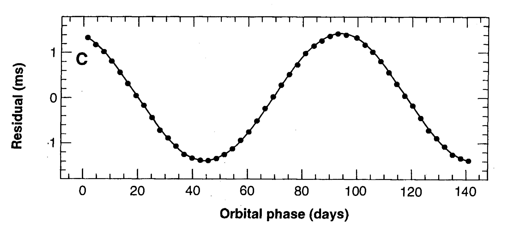

## Zadanie

V praxi poznáme viacero metód objavovania nových exoplanét. Dve najznámejšie sú metódy tranzitov a radiálnych rýchlostí. Hneď prvá exoplanéta bola však objavená inou metódou, „pulsar timing method“. Ak planéta obieha pulzar (alebo v princípe akúkoľvek hviezdu, ktorá vykazuje periodický jav), tak vplyvom obehu planéty okolo neutrónovej hviezdy budú pulzy v pravidelných intervaloch prichádzať v predstihu alebo v oneskorení. Dôvod týchto zmien je to, že pri obehu nielen planéta, ale aj pulzar obieha spoločné ťažisko. To znamená, že raz je k nám pulzar fyzicky bližšie a raz ďalej, čo presne korešponduje s tým, že pulz dorazí skôr alebo neskôr ako by sme očakávali, z dôvodu, že svetlo z pulzaru musí prejsť väčšiu, prípadne menšiu, vzdialenosť smerom k nám.

V tejto úlohe sa pozrieme na objav prvej exoplanéty (systému exoplanét), a to pri pulzare PSR B1257+12. Objav uskutočnil poľský astronóm A. Wolszczan v roku 1994. V úlohe predpokladajte (typickú) hmotnosť pulzaru $M_{psr} = 1{,}4\,\mathit{M}_\Sun$.

K úlohe je priložený graf časového vývoja O – C (obr. 1), teda rozdiel pozorovaných a vypočítaných časov príchodov pulzov spôsobený planétou PSR B1257+12c s hmotnosťou $m_p$. Pri výpočte využite aproximáciu $m_p << M_{psr}$, čo zároveň znamená, že pulzar je k ťažisku oveľa bližšie než planéta. Zistite nasledujúce parametre planéty a pulzaru:

<ol type="a">

<li>

[10 b] obežnú dobu planéty okolo pulzaru,

</li>

<li>

[12 b] vzdialenosť pulzaru od ťažiska sústavy,

</li>

<li>

[14 b] veľkú polos planéty,

</li>

<li>

[12 b] hmotnosť planéty.

</li>

</ol>

<figure>

<figcaption>

**Obrázok 1:** O – C (”Observed-minus-calculated”) diagram oneskorení príchodov pulzov spôsobených planétou PSR B1257+12c. Zdroj: Wolszczan 1994
</figcaption>

</figure>

Riešenie

Ako prvé sa zamyslíme nad mechanikou danej situácie. V prípade, že sa nachádza pulzar k  Zemi bližšie ako planéta, tak svetelný pulz dorazí skôr než by mal. Naopak, ak bude planéta bližšie ako pulzar, tak pulz dorazí neskôr než by mal. Jeden z týchto prípadov teda samozrejme zodpovedá maximu a jeden minimu O – C krivky. Približným odmeraním z grafu zisťujeme, že minimum sa nachádza v bode \[$45\,\mathrm{dní}$; $-1{,}4\,\mathrm{ms}$\] a maximum \[$94\,\mathrm{dní}$; $1{,}4\,\mathrm{ms}$\].

<ol type="a">

<li>

Z predchádzajúce úvahy už je jednoduché odvodiť, že perióda obehu planéty okolo pulzaru je zhodná s periódou zmien príchodov pulzov v priloženom grafe. Perióda sínusoidy teda bude dvojnásobok vzdialenosti medzi maximom a minimom, $P \approx 98\,\mathrm{dní} \approx 8{,}5 \cdot 10^{6}\,\mathrm{s}$.

</li>

<li>

Z počiatočnej úvahy plynie že v maxime funkcie na O – C diagrame je pulzar od Zeme najďalej a v minime najbližšie. Čo znamená, že toto maximum (minimum) zodpovedá vzdialenosti pulzaru od ťažiska. V grafe je táto vzdialenosť udaná v časových jednotkách, stačí ju teda prenásobiť rýchlosťou svetla. Vzdialenosť pulzaru od ťažiska v časových jednotkách je teda $1{,}4\,\mathrm{ms}$ a po prevedení do metrov $a_{\mathrm{psr}} = c \cdot 1{,}4\,\mathrm{ms} = 420\,000\,\mathrm{m}$.[^1]

</li>

<li>

Je nutné si uvedomiť, že veľká polos planéty pri obehu okolo je hviezdy je $a = a_{\mathrm{psr}} + a_{\mathrm{p}}$, ale vďaka aproximácii $a_p >> a_{psr}$ môžeme ďalej pri výpočtoch uvažovať $a \approx a_{\mathrm{p}}$. Veľkú polos planéty zistíme z 3. Keplerovho zákona v tvare 

$$
\frac{a^3}{P^2} = \frac{G (M + m)}{4 \pi^2} \,, \tag{1}
$$

 kde $a$ je veľká polos planéty v metroch, $P$ obežná doba planéty v sekundách, $G$ gravitačná konštanta, $M$ hmotnosť pulzaru a $m$ hmotnosť planéty. Z rovnice si vyjadríme veľkú polos a využijeme $m_p \ll m_{psr}$ (planéta je omnoho menej hmotná než pulzar), teda $M+m \approx M$. Dostaneme výraz pre veľkú polos 

$$
a = \sqrt[3]{\frac{G M P^2}{4 \pi^2}} \approx 6{,}96 \cdot 10^{10}\,\mathrm{m} \,. \tag{2}
$$

</li>

<li>

Na určenie hmotnosti exoplanéty môžeme využiť vzťah na určenie ťažiska, tzv. ” hojdačku”, 

$$
m a = M a_{\mathrm{psr}} \,, \tag{3}
$$

 odkiaľ po vyjadrení dostaneme pomer hmotnosti planéty a pulzaru 

$$
\frac{m}{M} = \frac{a_{\mathrm{psr}}}{a} \doteq  6,03\cdot10^{-6} \,. \tag{4}
$$

 Po vynásobení hmotnosťou pulzaru dostaneme hmotnosť planéty $m_p = 1{,}68 \cdot 10^{25}\,\mathrm{kg}$.

</li>

</ol>

[^1]: Inak povedané, $a_{psr}$ je vzdialenosť, ktorú prejde svetlo za dobu $1{,}4\,\mathrm{ms}$.

