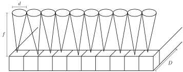
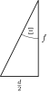
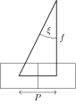

## Zadanie

V súčasnosti takmer všetky veľké ďalekohľady využívajú adaptívnu optiku (nezamieňať s aktívnou optikou). Tá má za účel kompenzovať turbuletné pohyby atmosféry (tzv. seeing), ktoré by inak spôsobovali rozmazanie obrazu. K oprave seeingu je ale potrebné vedieť, aké je aktuálne narušenie atmosféry (merané v uhlových sekundách). Pre tento účel môže napríklad slúžiť Shackov-Hartmannov senzor.

Shackov-Hartmannov senzor je v základoch veľmi jednoduchý prístroj. Nie je to nič iné ako veľký CCD snímač, na ktorý premieta obraz sústava šošoviek usporiadaná do mriežky. To znamená, že každá takáto šošovka (malý okulár) vytvára na svojej časti snímača (”plôške”) obraz hviezdy z inej časti primárneho zrkadla. Ak je optický systém dokonalý a ovplyvnenie svetla atmosférou nulové, potom hviezdy vytvárajú bodový obraz presne v strede tejto plôšky. Ak však svetlo prechádza cez nerovnomerné prostredie (napr. cez zemskú atmosféru), tieto obrazy hviezd sa posunú. Meraním týchto posunov dokážeme určiť, ako sa dráha svetla zdeformovala a následne informáciu vieme využiť na korekciu obrazu pomocou terciárneho, deformovateľného zrkadla.

Tieto snímače ale majú svoje obmedzenia a jedno z nich je maximálny seeing, ktorý sú schopné zaznamenať. Tento maximálny seeing je moment, kedy už niektorá zo šošoviek premieta obraz hviezdy mimo svoju časť snímača.

$$
\begin{align*}
     \text{Veľkosť strany snímača}&\!: \quad D  = 8\,\mathrm{cm} \,. \tag{1}\\
     \text{Počet pixelov na snímači}&\!: \quad N = 4\,\mathrm{Mpx} \,. \tag{2}\\
     \text{Veľkosť strany plôšky}&\!: \quad d  = 5\,\mathrm{mm} \,. \tag{3}\\ 
     \text{Ohnisková vzdialenosť šošoviek}&\!: \quad f = 12\,\mathrm{cm} \, . \tag{4}\end{align*}
$$

<figure>

<figcaption>

**Obrázok 1:** Nákres jedného riadku Shackovho-Hartmannovho senzora s vyznačenými všetkými dôležitými parametrami, ktorých hodnoty sú uvedené vyššie.
</figcaption>

</figure>

**Úlohy**

<ol type="a">

<li>

[10 b]Koľko pixelov (označme $n^2$) pripadá na jednu štvorcovú plôšku (so stranou $n$ pixelov), ktorá je vyhradená pre jednu šošovku a teda slúži na zachytávanie obrazu z jednej časti primárneho zrkadla? Snímač, ako aj pixely, sú štvorcové.

</li>

<li>

[30 b] Vypočítajte maximálny seeing v uhlových sekundách, označme ho $\Xi$, ktorý je schopný zaznamenať Shackov-Hartmannov senzor s parametrami uvedenými nižšie.

</li>

<li>

[30 b] Vypočítajte aj teoreticky najmenší zachytiteľný seeing $\xi$. Pre jednoduchosť predpokladajte, že obraz hviezdy je menší ako veľkosť pixelu, a teda, že svetlo hviezdy vždy dopadá iba do jedného konkrétneho pixelu. Zároveň neuvažujte ďalšie matematické spracovanie obrazu.

</li>

</ol>

Riešenie

Ako prvé je potrebné si uvedomiť niekoľko faktov. Prvým je, že počet pixelov $N$ je celkový počet pixelov. Nám sa ale viac bude hodiť informácia o počte pixelov v jednom riadku/stĺpci; ten je rovný $\sqrt{N}=2000\,\mathrm{px}$. Zároveň, treba mať na pamäti, že každá šošovka premieta obraz na malú (štvorcovú) časť snímača, tak ako je na obrázku 1, ktorá má veľkosť strany 

$$
n=\sqrt{N}\frac{d}{D} = 125\,\mathrm{px} \,. \tag{5}
$$

Teda na jednu plôšku jednej šošovky pripadá 

$$
n^2=15\,625\,\mathrm{px}\, . \tag{6}
$$

Pozrime sa na prvý problém, aký maximálny seeing $\Xi$ je opraviteľný. Prístup k tomuto problému je v nejakom pohľade značne priamočiary. Šošovka, ktorá kolimuje svetlo na snímač, je ekvivalentná dierkovej komore, takže nákres problému na obrázku 2 môže teraz dávať väčší zmysel. Dôležité je uvedomenie si, že maximálna fyzická výchylka na snímači je $d/2$ od stredu, pretože hoci by mohol ísť nás vychýlený lúč aj po diagonále ku vrcholu časti snímača, je to prípad, ktorý nie je všeobecný. Fyzickému posunu na snímači zodpovedá práve maximálny opraviteľný seeing $\Xi$, viď nákres na obrázku  2.

Vzorec pre $\Xi$ je teda očividne odvoditeľný ako 

$$
\tan{\Xi}=\frac{d/2}{f} \ztv \Xi=\arctan{\left( \frac{d}{2f}\right)} \approx 1{,}2^{\circ} \approx 1^{\circ}\,12' \,. \tag{7}
$$

<figure>

<figcaption>

**Obrázok 2c:** Schémy maximálneho opraviteľného seeingu.
</figcaption>

</figure>

K nájdeniu najmenšieho opraviteľného seeingu $\xi$ si musíme uvedomiť jednu základnú pravdu, ktorá je zobrazená aj na obrázku 2, teda že obraz hviezdy sa musí posunúť zo stredu jedného pixelu do stredu susedného. Oplatí sa nám teda poznať akú veľkosť $P$ má jeden pixel. To je jednoducho rovné 

$$
P=\frac{D}{\sqrt{N}} =0{,}04\,\mathrm{mm} = 40\,\mu\mathrm{m} \,. \tag{8}
$$

Rovnica pre $\xi$ je tak ľahko odvoditeľná ako 

$$
\tan{\xi}=\frac{P}{f} \ztv \xi=\arctan{\left( \frac{P}{f}\right)} \approx 0^{\circ}\,1'\,09'' \,. \tag{9}
$$

Záverom teda vieme písať, že na jednu plôšku pripadá $n^2=15\,625\,\mathrm{px}$, maximálny opraviteľný seeing je $\Xi \approx 1^{\circ}\,12'$ a minimálny zachytiteľný je $\xi \approx 0^{\circ}\,1'\,09''$.

## Komentár autora

Hoci možno na prvý pohľad dlhší a ťažšie pochopiteľný príklad, v útrobách veľmi jednoduchý. Predsa len je z neho možné pochopiť, ako funguje adaptívna optika a ako rátať príklady, v ktorých sa pracuje s nejakým typom snímača.
