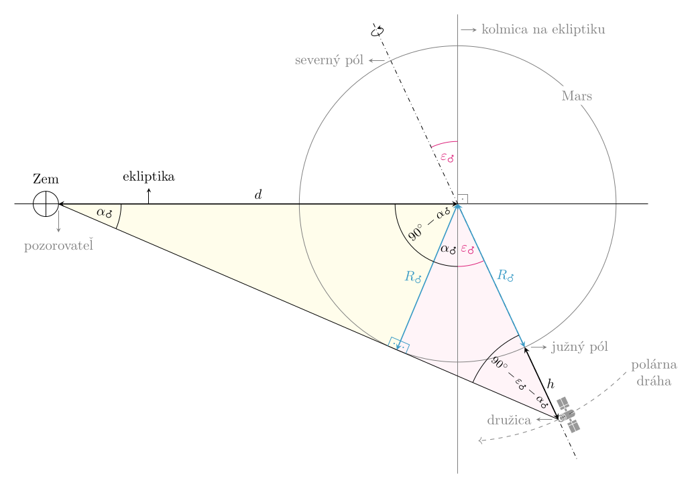
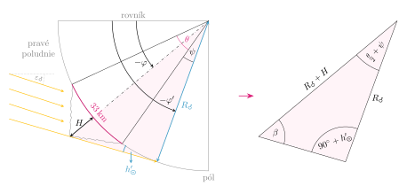

## Zadanie

Sonda, ktorá obieha Mars na polárnej dráhe vo výške $h=357\,\mathrm{km}$ zistila, že najdlhší tieň počas roka, ktorý vrhá vrch Apollinaris na pravé poludnie, má dĺžku až $119\,\mathrm{km}$. Dĺžka tohto tieňa sa merala od päty vrchu, ktorý má priemer $33\,\mathrm{km}$. V čase, kedy sonda zaznamenala dĺžku tieňa, sme zo Zeme pozorovali, ako sa táto sonda vynorila spoza kotúča Marsu práve v čase, keď sa nachádzala presne nad pólom Marsu. Mars sa vtedy voči Zemi nachádzal v opozícii a miesto, z ktorého sme pozorovali, sa nachádzalo v rovine ekliptiky.

Na základe týchto informácií určte najväčšiu výšku v strede Apollinarisu, ak sa nachádza na $62^{\circ}\,18'$ S areografickej šírky a $175^{\circ}\,45'$ E areografickej dĺžky. Predpokladajte, že Mars sa nachádza v rovine ekliptiky a dráhy Marsu aj Zeme sú kruhové.

Riešenie

Podobne ako na Zemi, sa aj na Marse deklinačný uhol Slnka mení v dôsledku naklonenia rotačnej osi voči kolmici na rovinu obehu. Preto si ako prvé musíme vypočítať uhol sklonu osi Marsu – nazvime si ho $\varepsilon_\Ma$. Vieme ho vypočítať na základe informácií zo sondy.

<figure>

<figcaption>

**Obrázok 1:** Schéma Marsu, družice nad jeho južným pólom a pozorovateľom na Zemi.
</figcaption>

</figure>

Na obrázku 1 poznáme polomer Marsu $R_\Ma$ a výšku sondy nad povrchom Marsu $h$. Uhol $\alpha_\Ma$ je uhlový polomer Marsu pozorovaný zo Zeme vo vzdialenosti $d$, ktorá sa vypočíta ako $d = a_\Ma - a_\Ea$. Inklinácia je nulová.

Pomocou vyznačeného ružového trojuholníka si už vieme vypočítať uhol $\varepsilon_\Ma$. Najskôr však potrebujeme vedieť uhol $\alpha_\Ma$, ktorý určíme zo žltého trojuholníka ako 

$$
\sin \alpha_\Ma = \frac{R_\Ma}{d} = \frac{R_\Ma}{a_\Ma - a_\Ea} \,, \tag{1}
$$

 

$$
\alpha_\Ma = \arcsin \left( \frac{3393\,\mathrm{km}}{(1{,}524-1)\cdot 149{,}6 \cdot 10^{6}\,\mathrm{km}} \right) \approx 8{,}93'' \,. \tag{2}
$$

A teraz použijeme sínusovú vetu v ružovom trojuholníku 

$$
\frac{\sin90^{\circ}}{\sin (90^{\circ} - \varepsilon_\Ma - \alpha_\Ma)} = \frac{R_\Ma + h}{R_\Ma} \,,\enspace \text{kde} \enspace \sin90^{\circ} = 1 \,. \tag{3}
$$

Odtiaľto si vyjadríme $\varepsilon_\Ma$ 

$$
90^{\circ} - \alpha_\Ma - \varepsilon_\Ma = \arcsin \left ( \frac{R_\Ma}{R_\Ma + h} \right ) \,, \tag{4}
$$

 

$$
\varepsilon_\Ma = 90^{\circ} - \alpha_\Ma - \arcsin \left ( \frac{R_\Ma}{R_\Ma + h} \right ) \approx 25{,}2^{\circ} \,. \tag{5}
$$

Pre zjednodušenie výpočtu sme mohli tiež uvažovať, že uhol $\alpha_\Ma \approx 0$, čím by sa výpočet zjednodušil a vychádzali by sme zo vzťahu 

$$
\begin{align*}
    \cos \varepsilon_\Ma = \frac{R_\Ma}{R_\Ma + h} \,, \tag{6}\end{align*}
$$

 a vyšla by nám rovnaká hodnota pre $\varepsilon_\Ma$.

Teraz, keď už poznáme uhol sklopenia marťanskej rotačnej osi, tak sa môžeme ďalej zamýšľať nad príkladom. Ak by tento uhol $\varepsilon_\Ma$ bol rovný nule, znamenalo by to, že Slnko by malo vždy deklináciu nulovú. Toto sklopenie však zapríčiňuje to, že deklinačný uhol Slnka je počas roku na Marse stále rozdielny, a tým pádom vrhá Apollinaris rôzne dlhý tieň. Najdlhší tieň na južnej pologuli vrhá Apollinaris počas marťanského ”zimného slnovratu” pre južnú pologuľu (na severnej pologuli je vtedy ”letný slnovrat”). Je to preto, lebo Slnko je vtedy počas kulminácie nad obzorom najnižšie za celý rok.

Nebeský rovník kulminuje vo výške 

$$
h_r = 90^{\circ} - \varphi = 90^{\circ} - 62^{\circ}\,18' = 27^{\circ}\,42' \,. \tag{7}
$$

 Ďalej pomocou vzťahu 

$$
h_\Sun = h_r - \varepsilon_\Ma \tag{8}
$$

 určíme výšku kulminácie Slnka nad obzorom počas ”zimného slnovratu” ako $h_\Sun = 2{,}5^{\circ}$.

Mohli sme to zistiť aj nasledujúcou úvahou: Ak sa Apollinaris nachádza na južnej pologuli a najdlhší tieň vrhá počas ”zimného slnovratu”, tak na severnej pologuli je ”letný slnovrat”. To znamená, že Slnko sa nachádza na marťanskom ”obratníku Raka”, t.j. na areografickej šírke $\varepsilon_\Ma$ = $25{,}2^{\circ}$. Ak je Apollinaris na areografickej šírke $-62^{\circ}\,18'$, znamená to, že je od Slnka vzdialený $62^{\circ}\,18' + 25{,}2^{\circ} = 87{,}5^{\circ}$. Ak chceme vypočítať, ako vysoko je Slnko nad Apollinarisom, treba túto hodnotu odpočítať od $90^{\circ}$, čiže $h_\Sun = 90^{\circ} - 87{,}5^{\circ} = 2{,}5^{\circ}$.

Teraz sa musíme opäť zamyslieť. V jednoduchom prípade by sme vychádzali už len z geometrie pravouhlého trojuholníka. Problém však je v tom, že Apollinaris a jeho tieň sú tak rozľahlé, že musíme uvažovať aj zakrivenie Marsu.

Na obrázku 2 je zemepisná šírka $\varphi$ záporná (lebo sa nachádzame na južnej areografickej šírke) a označuje areografickú šírku stredu Apollinairu. Areografická šírka $\varphi'$ označuje koniec tieňa. Tiež vidíme, že slnečné lúče prichádzajú k Marsu z oblasti rovníka. Na to môžeme prísť úvahou, že ak by bol sklon rotačnej osi Marsu nulový, teda rovina rovníka Marsu by bola totožná s rovinou ekliptiky, tak potom by lúče prichádzali zarovno s rovníkom.

<figure>

<figcaption>

**Obrázok 2:** Geometria dopadu slnečných lúčov na horu Apollinaris. Pre výpočet výšky hory $H$ bude dôležitý vyznačený ružový trojuholník a sínusová veta v ňom.
</figcaption>

</figure>

Z vyznačeného trojuholníka si vieme postupne určiť výšku $H$, vychádzajúc zo sínusovej vety 

$$
\frac{\sin(90^{\circ} + h_\Sun')}{\sin \beta} = \frac{R_\Ma + H}{R_\Ma} \,. \tag{9}
$$

V tomto vzťahu však nepoznáme uhol $\beta$, ktorý si musíme vyčísliť na základe ďalších uhlov v trojuholníku: $\theta$ a $\psi$.

Uhol $\theta$ a $\psi$ zistíte na základe obvodu Marsu $o_\Ma$. Vieme, že 

$$
o_\Ma = 2 \pi R_\Ma = 21\,318{,}85\,\mathrm{km} \,. \tag{10}
$$

Uhol $\theta$ nám vyjadruje uhlovú veľkosť hory, ktorá je široká $33\,\mathrm{km}$. To znamená, že $\theta$ predstavuje $33/21318,85$ z kruhu, teda $\theta = 33/21318,85 \cdot 360^{\circ} = 0^{\circ}\,33'\,26{,}11''$.

Uhol $\psi$ nám vyjadruje uhlovú veľkosť tieňa Marsu, ktorý je dlhý $119\,\mathrm{km}$. Čiže $\psi$ predstavuje $119/21318,85$ z kruhu, teda $\psi = 119/21318,85 \cdot 360^{\circ} = 2^{\circ}\,0'\,34{,}16''$.

Ďalej si musíme ale uvedomiť, že miesto, kde končí tieň, je na inej areografickej šírke ako stred Apollinarisu. Musíme si túto areografickú šírku zistiť pomocou areografickej šírky Apollinarisu $\varphi$ a uhlov $\theta$ a $\psi$, ktoré už máme spočítané. 

$$
\varphi' = \varphi - \frac{\theta}{2} - \psi \,, \tag{11}
$$

 

$$
\varphi' \approx -64{,}6^{\circ} \,. \tag{12}
$$

Teraz potrebujeme zistiť výšku Slnka $h_\Sun'$ na tomto mieste, na areografickej šírke $-64{,}6^{\circ}$. To zistíme na základe výšky kulminácie rovníka $h_r'$ rovnako ako predtým 

$$
h_r' = 90^{\circ} - |\varphi'| = 25^{\circ}\,24'\,42{,}78'' \,, \tag{13}
$$

 

$$
h_\Sun' = h_r' - \varepsilon_\Ma = 0^{\circ}\,12'\,43'' \,. \tag{14}
$$

Keďže už všetko poznáme, tak na záver môžeme vyčísliť uhol $\beta$ z obrázku pomocou 

$$
\beta = 180^{\circ} - 90^{\circ} - h_\Sun' - \frac{\theta}{2} - \psi \,, \tag{15}
$$

 

$$
\beta \approx 87^{\circ}\,30' \,. \tag{16}
$$

Pomocou sínusovej vety (9) si už teraz vieme vypočítať výšku Apollinarisu $H$ ako 

$$
H = R_\Ma \cdot \left ( \frac{\sin (90^{\circ} + h_\Sun')}{\sin \beta} -1   \right ) \approx 3{,}2\,\mathrm{km} \,. \tag{17}
$$

## Komentár autora

Na Marse sa nachádza cez 70 hôr, pričom takmer 30 z nich sú sopečného pôvodu a päť z nich majú výšku väčšiu ako Mount Everest.
