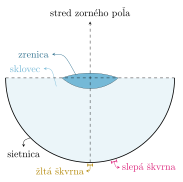
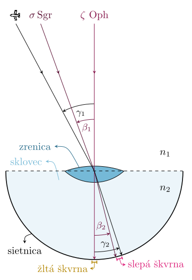
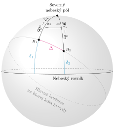

## Zadanie

Na zdravej očnej sietnici človeka sa nachádza dvojica takmer protikladných oblastí a to slepá a žltá škvrna. Slepá škvrna je miesto, cez ktoré je vedený zrakový nerv zvnútra oka do mozgu, čo znamená, že v tomto mieste nie sú žiadne fotocitlivé bunky. Naopak, žltá škvrna je miesto s najhustejším zastúpením čapíkov, ktoré sú schopné farebného videnia. Žltá škvrna je postavená presne naproti očnej šošovke a používa sa pri priamom pohľade. V tomto príklade sa pozrieme bližšie na rozmiestnenie a veľkosť týchto oblastí.

David sa pripravoval na Astronomickú olympiádu. Pozoroval pri tom jedným okom (druhé mal zatvorené) hviezdu $\zeta$ Oph (RA $16^{\mathrm{h}}\,37^{\mathrm{min}}\,10^{\mathrm{s}}$, DEC $-10^{\circ}\,34'\,01'')$ priamym pohľadom. (Nepoužíval trik s bočným pohľadom na videnie slabších objektov.) Pred pozorovanou hviezdou mu preletelo lietadlo vo vzdialenosti $12\,\mathrm{km}$ od neho. O chvíľu, v momente, keď lietadlo preletí popred hviezdu $\sigma$ Sgr (RA $18^{\mathrm{h}}\,55^{\mathrm{min}}\,49^{\mathrm{s}}$, DEC $-26^{\circ}\,17'\,50'')$, tak ho prestane vidieť, a objaví sa znova po $13{,}2\,\mathrm{s}$.

<ol type="a">

<li>

[60 b] Vypočítajte priemer slepej škvrny v $\mathrm{mm}$.

</li>

<li>

[60 b] Vypočítajte vzdialenosť slepej a žltej škvrny v $\mathrm{mm}$.

</li>

</ol>

<figure>

<figcaption>

**Obrázok 1:** Schéma oka.
</figcaption>

</figure>

Ľudské oko je vyplnené kvapalinou (sklovec) s indexom lomu $1{,}336$. Svetlo do neho vstupuje cez šošovku, o ktorej budeme predpokladať, že je tenká a zobrazuje ideálne. Rovnobežné lúče koncentruje do bodu na sférickej sietnici v zadnej časti oka. Polomer krivosti sietnice je $10{,}5\,\mathrm{mm}$ a jej stred je v strede šošovky. Slepú a žltú škvrnu považujeme za dokonale kruhové a ich vzdialenosťou rozumieme vzdialenosť ich stredov.

Rýchlosť lietadla je $850\,\mathrm{km}\,{\mathrm{h}}^{-1}$, pričom pre jednoduchosť predpokladajte, že celé pozorovanie sa deje v blízkosti zenitu (hviezda $\zeta$ Oph sa nachádza priamo v zenite a oko je počas celého pozorovania nasmerované priamo na ňu), lietadlo je bodový zdroj svetla, prechádza presne stredom slepej škvrny a nemení vzdialenosť od Davida.

Riešenie

<figure>

<figcaption>

**Obrázok 2:** Schematické zobrazenie oka, lúčov a ich lomu na rozhraní vzduchu a sklovca od $\zeta$ Oph, $\sigma$ Sgr a miesta kde sa znovu objaví lietadlo. Uhly lúčov vstupujúcich do oka značíme indexom 1 a lomené lúče vnútri oka značíme indexom 2.
</figcaption>

</figure>

Na začiatok si treba rozmyslieť, ako sa budú uhly na oblohe premieňať na uhly na sietnici. Na prepočet uhlov použijeme Snellov zákon pri dopade lúča na rozhranie dvoch prostredí, v našom prípade vzduch a sklovec. Napíšeme si Snellov zákon 

$$
n_1 \sin{\alpha_1} = n_2 \sin{\alpha_2} \,, \tag{1}
$$

 kde $n_1 = 1$ je index lomu vzduchu, $n_2 = 1{,}336$ index lomu sklovca, $\alpha_1$ uhol dopadu zo vzduchu na sklovec a $\alpha_2$ výstupný uhol v sklovci (na sietnici). Uhly meriame od kolmice na rozhranie optických prostredí (vzduchu a sklovca). Po dosadení $n_1 = 1$ vyjadríme uhol na sietnici ako 

$$
\alpha_2 = \arcsin{\left(\frac{\sin{\alpha_1}}{n_2}\right)} \,. \tag{2}
$$

 Zo zadania si premyslíme, čomu zodpovedajú jednotlivé uhly. Uhol, ktorý prejde lietadlo počas zmiznutia, zodpovedá priemeru slepej škvrny. Ďalší uhol, ktorý máme k dispozícií, je uhol medzi hviezdami. Už podľa zadania smer k hviezde $\zeta$ Oph je smer k žltej škvrne. Jednotlivé uhly sú znázornené na obrázku 2.

<figure>

<figcaption>

**Obrázok 3:** Sférický trojuholník na všeobecný výpočet uhlovej vzdialenosti $\Delta$ dvoch ľubovoľných hviezd $H_1, H_2$ s deklináciami $\delta_1, \delta_2$ a rozdielom rektascenzií $\alpha_2 - \alpha_1$. Trojuholník je tvorený hlavnými kružnicami: dvoma ”poludníkmi” a sivou kružnicou, ktorej ružový úsek o dĺžke $\Delta$ je najkratšia spojnica medzi hviezdami.
</figcaption>

</figure>

**Vstupné uhly**

: Než sa pustíme do výpočtu rozmerov škvŕn, určíme vstupné uhly $\beta_1$ a $\gamma_1$. Uhol $\beta_1 \equiv \Delta$ určíme zo sférického trojuholníka na Obr. 3 a z kosínusovej vety v tvare 

$$
\cos{a}=\cos{b} \cdot \cos{c} + \sin{b} \cdot \sin{c} \cdot \cos{\alpha} \, , \tag{3}
$$

 kde $a$ je protiľahlá strana k uhlu $\alpha$ a $b$, $c$ sú zvyšné dve strany. Po dosadení hodnôt z trojuholníka dostaneme rovnicu 

$$
\cos{\beta_1} = \cos{(90^{\circ} - \delta_1)} \cdot \cos{(90^{\circ} - \delta_2)} + \sin{(90^{\circ} - \delta_1)} \cdot \sin{(90^{\circ} - \delta_2)} \cdot \cos{(\alpha_2 - \alpha_1)} \, , \tag{4}
$$

 ktorú môžeme prepísať do tvaru 

$$
\cos{\beta_1} = \sin{\delta_1} \cdot \sin{\delta_2} + \cos{\delta_1} \cdot \cos{\delta_2} \cdot \cos{(\alpha_2 - \alpha_1)} \, , \tag{5}
$$

 odkiaľ po dosadení dostaneme uhol $\beta_1 \approx 36^{\circ}\,16'\,49'' \approx 0{,}633\,\mathrm{rad}$.

Uhol $\gamma_1$ určíme ako uhol $\beta_1$ plus uhol, ktorý prešlo lietadlo počas zmiznutia. Za predpokladu zo zadania, že lietadlo nemenilo vzdialenosť od pozorovateľa, vypočítame uhol, ktorý prešlo na oblohe pomocou lietadlom prejdenej vzdialenosti $v\cdot t = 850\,\mathrm{km}\,{\mathrm{h}}^{-1} \cdot 13{,}2\,\mathrm{s} \approx 3{,}12\,\mathrm{km}$ a vzdialenosťou k lietadlu $r = 12\,\mathrm{km}$ ako 

$$
\gamma_1 = \beta_1 + \frac{v \cdot t}{r} \,. \tag{6}
$$

Po dosadení dostaneme $\gamma_1 \approx 0{,}893\,\mathrm{rad} \approx 51^{\circ}\,9'\,41''$.

**Výstupné uhly**

: Využijeme Snellov zákon v tvare (2) a vypočítame uhol $\beta_2 \approx 26^{\circ}\,17'\,24''$ a uhol $\gamma_2 \approx 35^{\circ}\,39'\,47''$. Teraz sa už môžeme pustiť do samotného výpočtu fyzických veľkostí a vzdialeností škvŕn. V riešení nasledujúcich úloh budeme uhly dosádzať len v radiánoch.

<ol type="a">

<li>

Fyzický priemer slepej škvrny na sietnici,, označme ho $D$, zodpovedá uhlu $\gamma_2 - \beta_2$ vo vzdialenosti polomeru sietnice $R=10{,}5\,\mathrm{mm}$. Teda v radiánoch platí 

$$
D = R \cdot (\gamma_2 - \beta_2) \,. \tag{7}
$$

 Po dosadení dostaneme $D \approx 1{,}72\,\mathrm{mm}$.

</li>

<li>

Uhlová vzdialenosť stredov škvŕn je $\beta_2 + \frac{\gamma_2 - \beta_2}{2} = \frac{\beta_2 + \gamma_2}{2}$, takže pre fyzickú vzdialenosť škvŕn na sietnici $\Delta$ môžeme písať 

$$
\Delta = R \cdot \frac{\beta_2 + \gamma_2}{2}\,, \tag{8}
$$

 odkiaľ po dosadení dostaneme $\Delta \approx 5{,}68\,\mathrm{mm}$.

</li>

</ol>

## Komentár autora

Konceptuálne možno trochu náročnejšia úloha, ktorá prepája optiku, biológiu a trigonometriu.
