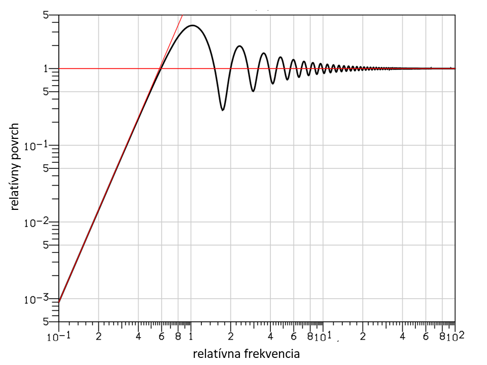
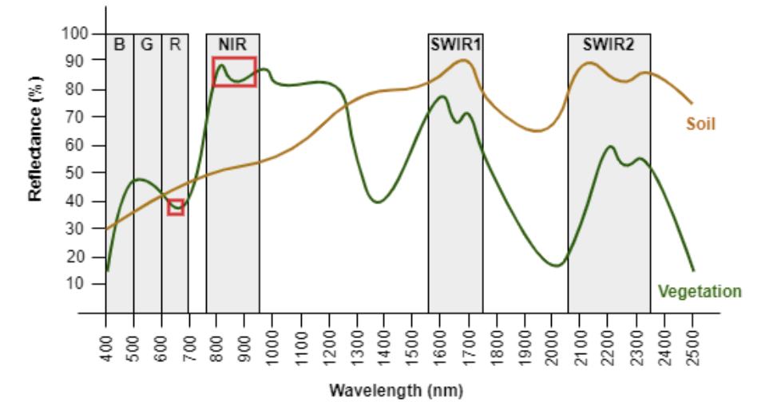
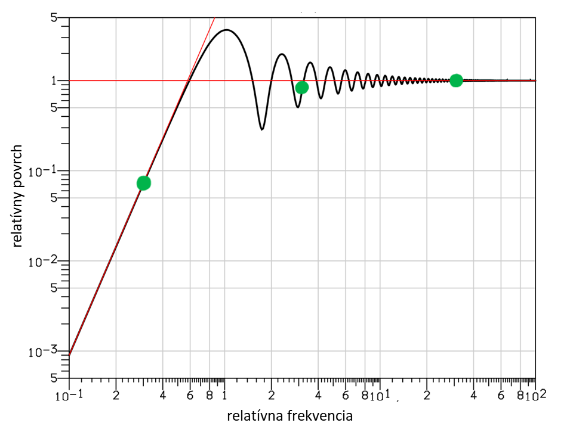

## Zadanie

<figure>

<figcaption>

**Obrázok 1:** Rekonštrukcia dvojice dinosaurov z rodu *theropoda*.
</figcaption>

</figure>

V regionálnom kole sme fyzický polomer častice sadze $r_s$ považovali za rovný polomeru s akým častica rozptyľuje svetlo, čo je intuitívne logické, no v skutočnosti to tak v dôsledku vlnovej povahy svetla nemusí platiť. Efektívny polomer častice pre interakciu so svetlom $r_{ef}$ môže byť v závislosti na vlnovej dĺžke $\lambda$ iný než $r_s$.

Ak vezmeme do úvahy túto skutočnosť, vzťah pre kolmú projekciu povrchu častice sadze bude $\pi r_{ef}^2$ a pre jej skutočný objem $\frac{4}{3}\pi r_{s}^3$. Všeobecný výsledok z regionálneho kola bude mať alternatívnu podobu: 

$$
F_{povrch} = F_0 \exp\left(-\frac{3M r_{ef}^2}{16\pi R_\Ze^2  \rho_s r_{s}^3}\right) \,. \tag{1}
$$

Táto rovnica popisuje útlm priameho (nerozptýleného) svetla pri prechode z hornej hranice atmosféry ($F_0$) na zemský povrch ($F_{povrch}$). V rovnici je $M = 3 \cdot 10^{11}\,\mathrm{kg}$ celková hmotnosť sadzí (homogénne rozptýlených v atmosfére), $\rho_s = 2000\,\mathrm{kg}\,{\mathrm{m}}^{-3}$ hustota každej častice sadze a $R_\Ze$ polomer Zeme.

Keďže sa v tejto úlohe budeme zaoberať závislosťou $r_{ef}$ a toku žiarenia na $\lambda$, namiesto toku žiarenia v celom spektre, predtým značeného písmenom $F$ $[\mathrm{W}\,{\mathrm{m}}^{-2}]$, budeme používať veličinu spektrálny tok žiarenia $F_\lambda(\lambda)$ $[\mathrm{W}\,{\mathrm{m}}^{-2}\,{\mathrm{nm}}^{-1}]$, ktorý vyjadruje $F$ v jednotkovom intervale vlnových dĺžok $[\lambda, \lambda + 1\,\mathrm{nm}]$. Analogicky, $F_{\lambda,povrch}(\lambda)$ bude hodnota spektrálneho toku na povrchu Zeme a $F_{\lambda,0}(\lambda)$ jeho hodnota vstupujúca do atmosféry. Útlm $F_\lambda$ budeme počítať rovnako ako $F$, teda podľa exponenciálneho vzťahu (1), s prihliadnutím na $r_{ef}(\lambda)$.

Existujú dva režimy rozptylu:

- Rayleighov rozptyl $(r_s \ll \lambda)$: $r_{ef}$ sa výrazne mení s $\lambda$ (presnejšie s pomerom $r_s$ a $\lambda$).

- Mieov rozptyl $(r_s \gtrsim \lambda)$: $r_{ef} \approx r_s$, nezávisle na $\lambda$.

So silným prípadom Mieovho rozptylu pre $r_s \gg \lambda$ ste sa stretli v RK, keď spôsobovali častice sadzí s polomerom $r_s =$ $3000\,\mathrm{nm}$ rozptyl viditeľného svetla s $\lambda$ v rozmedzí $400$ – $700\,\mathrm{nm}$.

Oba režimy rozptylu vidno na dekadicky logaritmickom grafe 2 (krivka vľavo), kde na vodorovnej osi je tzv. relatívna frekvencia, definovaná ako $2\pi r_s / \lambda$, a na zvislej osi je tzv. relatívny povrch, definovaný ako $(r_{ef} / r_s)^2$. V celej úlohe budete môcť vo výpočtoch aproximovať Mieov rozptyl jeho asymptotou pre $r_s \gg \lambda$, a za hranicu medzi Rayleighovým a Mieovým režimom môžete považovať priesečník ich asymptót viditeľný na grafe.

<figure>

<figcaption>

**Obrázok 2c:** Grafy potrebné na vypracovanie úlohy. Prevzaté 20. 4. 2025,\
<https://en.wikipedia.org/wiki/Mie_scattering>, <https://www.mathworks.com/help/images/spectral-indices.html>.
</figcaption>

</figure>

**Úlohy**

<ol type="a">

<li>

[15 b] Vyznačte polohy častíc s polomermi $r_s =$ $30\,\mathrm{nm}$, $300\,\mathrm{nm}$, $3000\,\mathrm{nm}$ na krivke v grafe 2 (vľavo) pre viditeľné svetlo s $\lambda =$ $550\,\mathrm{nm}$. Stačí len veľmi schematicky načrtnúť krivku a jasne vyznačiť číselné hodnoty súradníc (napr. netrápte sa, či v tej vlnitej časti krivky leží bod na vrchu či v údolí). Do ktorých režimov tieto body patria?

</li>

<li>

[40 b] Z daného grafu (obr. 2) nájdite funkčnú závislosť pre efektívny polomer v **Rayleighovom** režime v tvare 

$$
r_{ef}(\lambda, r_s) = C r_s^A \lambda^B \tag{2}
$$

 a určte číselné hodnoty $A, B, C$. Aký je fyzikálny rozmer $C$? **Pre výpočty v ďalších úlohách prosím použite číselné hodnoty** $A = 3 , B = -2, C = 125$. Na získanie bodov za túto úlohu je nutné jasne ukázať postup.

</li>

<li>

[25 b] Odvoďte spektrálny tok $F_{\lambda,0}(\lambda)$, ktorý dopadá do zemskej atmosféry zo Slnka. Vyčíslite na vlnových dĺžkach $\lambda =$ $400\,\mathrm{nm}$, $500\,\mathrm{nm}$, $600\,\mathrm{nm}$, $700\,\mathrm{nm}$.

</li>

</ol>

***Pomôcka:*** Planckov zákon pre spektrálny tok žiarenia na povrchu Slnka ako absolútne čierneho telesa (AČT) je: 

$$
F_{\lambda,\Sun}(\lambda) = 10^{-9} \cdot \frac{2 \pi h c^2}{\lambda^5}\frac{1}{\exp{\left(\frac{hc}{\lambda k_B T_\Sun}\right)}-1} \,, \tag{3}
$$

 kde $h$ je Planckova konštanta, $c$ je rýchlosť svetla vo vákuu, $k_B$ je Boltzmannova konštanta a $T_\Sun$ je efektívna povrchová teplota Slnka. $F_{\lambda,\Sun}(\lambda)$ je v jednotkách $\mathrm{W}\,{\mathrm{m}}^{-2}\,{\mathrm{nm}}^{-1}$ (ale $\lambda$ ako také je stále v metroch!)

Graf 2 (vpravo) zobrazuje spektrálnu reflektanciu $\mathcal{R}(\lambda)$, teda pomer odrazeného a dopadajúceho žiarenia, pre rôzne typy povrchu: rastliny (”vegetation”) a zeminu (”soil”), vo viditeľnej a infračervenej oblasti spektra. Na riešenie nasledujúcej úlohy (d) využite vzťah pre Rayleighov rozptyl z úlohy (b).

<ol type="a" start="4">

<li>

[70 b] Ak majú všetky sférické častice sadzí v atmosfére rovnaké hodnoty $r_s$, buď $30\,\mathrm{nm}$ alebo $300\,\mathrm{nm}$, alebo $3000\,\mathrm{nm}$, vypočítajte na vlnových dĺžkach z predošlej úlohy tieto veličiny (t.j. všetkých 12 kombinácií):

- spektrálny tok nerozptýleného svetla na povrchu Zeme pohlcovaného rastlinami $F_{\lambda,\text{absorb}}(\lambda)$ \[$\mathrm{W}\,{\mathrm{m}}^{-2}\,{\mathrm{nm}}^{-1}$\],

- pomer spektrálneho toku, ktorý dopadne na povrch Zeme a ktorý sa dostane do atmosféry $F_{\lambda,\text{povrch}}(\lambda)/F_{\lambda,0}(\lambda)$.

Interpretujte nájdené trendy v závislosti od $r_s$ a $\lambda$, predovšetkým pre $F_{\lambda,\text{povrch}}(\lambda)/F_{\lambda,0}(\lambda)$. Uvažujte, že Slnko je v zenite, a že už nič iné v atmosfére, okrem zmienených častíc sadzí, so svetlom neinteraguje.

</li>

</ol>

Pre získanie čiastkových bodov dbajte na dôkladné vysvetlenie svojho postupu a predpokladov, odporúčame odvodiť aj všeobecné vzťahy. Konečné numerické výsledky (d) odporúčame uviesť v prehľadnej tabuľke so stĺpcami $r_s, \, \lambda, \, \text{relatívna frekvencia}$, , $F_{\lambda,\text{povrch}}(\lambda)/F_{\lambda,0}(\lambda)$, $F_{\lambda, absorb}$, vo vhodných jednotkách.

<ol type="a" start="5">

<li>

[10 b] Aj pri správnom postupe je nepravdepodobné, že vaša tabuľka bude presne zodpovedať tej v oficiálnom riešení. Asi akú priemernú chybu očakávate za predpokladu, že máte správny postup a odkiaľ táto chyba pochádza?

</li>

</ol>

Riešenie

<ol type="a">

<li>

Využijúc definíciu relatívnej frekvencie ako $\linfrac{2\pi r_s}{\lambda}$ a $\lambda = 550\,\mathrm{nm}$ budú časticiam s polomermi $r_s = \{30\,;\, 300\,;\, 3000\} \mathrm{nm}$ prislúchať relatívne frekvencie $\{0,343\,;\, 3,43\,;\, 34,3\}$. Na obrázku 3 sú znázornené tieto častice na grafe zo zadania. Vzhľadom na popis režimov zo zadania leží 30 nm častica v Rayleighovom režime a zvyšné dve v Mieovom režime.

<figure>

<figcaption>

**Obrázok 3:** Poloha častíc s polomermi $r_s = \{30, 300, 3000\} \mathrm{nm}$ na krivke rozptylu.
</figcaption>

</figure>

</li>

<li>

Vidíme, že Rayleighov režim zodpovedá lineárnemu vzťahu medzi $x$ a $y$ na log-log grafe, 

$$
\log(y) = a \log(x) + b \,. \tag{4}
$$

 Parametre $a$ a $b$ vypočítame z dvoch bodov na krivke. Ľahko identifikovateľné body sú priesečník krivky a priamky $y = 1$ so súradnicami $(x_1; y_1) =(0,6 \,;\, 1)$, a ľavý okraj grafu so súradnicami $(x_2 \,;\, y_2) = (0,1 \,;\, 9 \cdot 10^{-4})$. Odtiaľ 

$$
\begin{align*}
    a &= \frac{\log y_2 - \log y_1}{\log x_2 - \log x_1} = 3,914 \,, \tag{5}\\
    b &= \log y_2 - a \log x_2 = \log y_1 - a \log x_1 = 0,8683 \,. \tag{6}\end{align*}
$$

 Vyjadrime $r_{ef}$ využijúc definície osí $x = \linfrac{2\pi r_s}{\lambda}$ a $y =\left(\linfrac{r_{ef}}{r_s} \right) ^2$, začnime s odlogaritmovaním pôvodnej rovnice a následnou úpravou. 

$$
\begin{align*}
    y &= 10^b \, x^a \,, \tag{7}\\
    \left(\frac{r_{ef}}{r_s} \right) ^2 &= 10^b \left(\frac{2\pi r_s}{\lambda}\right)^a \,, \tag{8}\\
    r_{ef} &= (2\pi)^{a/2} \, 10^{b/2} \, r_s^{1 + a/2} \, \lambda^{-a/2} \,. \tag{9}\end{align*}
$$

 Odtiaľ $A = 1 + \frac{a}{2} \approx 2{,}957$ , $B = -\frac{a}{2} \approx -1,957$ , $C = (2\pi)^{a/2} \, 10^{b/2} \approx 99,139$.

V skutočnosti z elektromagnetickej teórie vyplýva, že $a$ musí byť celočíselné ($a = 4$), a preto $A = 3 \,,\; B = -2 \,,\; C \approx 125$. $C$ je bezrozmerné, čo je možné vďaka tomu, že $A + B = 1$.

</li>

<li>

Využijúc Planckov zákon vypočítame spektrálny tok na povrchu Slnka $F_\Sun(\lambda)$. Tento údaj zahŕňa vyžarovanie do celého polpriestoru nezakrytého Slnkom. Pri guľovo symetrickom šírení žiarenia diktuje zákon zachovania energie kvadratický pokles toku s polomerom guľovej plochy, ktorá bola na začiatku povrch Slnka ($r = R_\Sun$) a na konci vzdialenosť Zeme od Slnka ($r = a_\Earth$). Preto spektrálny tok na vrchu atmosféry bude 

$$
\begin{align*}
    F_{\lambda, 0}(\lambda) = \left(\frac{R_\Sun}{a_\Earth}\right)^2 F_{\lambda, \Sun}(\lambda)
    = \left(\frac{R_\Sun}{a_\Earth}\right)^2 \frac{2 \pi h c^2}{\lambda^5}\frac{10^{-9} }{e^{\frac{hc}{\lambda k_B T}}-1} \,. \tag{10}\end{align*}
$$

 Na vlnových dĺžkach $\{400 \,;\, 500 \,;\, 600 \,;\, 700\}\, \mathrm{nm}$ máme $\{ 1,57 \,;\, 1,79 \,;\, 1,67 \,;\, 1,41 \} \, \mathrm{W}\,{\mathrm{m}}^{-2}\,{\mathrm{nm}}^{-1}$.

</li>

<li>

V tejto úlohe si treba uvedomiť a do jedného výrazu spojiť 3 rôzne závislosti na $\lambda$:

<ol type="i">

<li>

rôzne vyžarovanie Slnka (ako AČT) z predošlej úlohy,

</li>

<li>

závislosť reflektancie $\mathcal{R}(\lambda)$ z grafu v zadaní,

</li>

<li>

rôzne režimy rozptylu v závislosti na $r_s$ a $\lambda$. Pre Rayleigho rozptyl navyše rôznu úroveň rozptylu na tých istých časticiach sadze, t.j. závislosť $r_{ef}(\lambda)$ z úlohy (b).

</li>

</ol>

Reflektancia $\mathcal{R}(\lambda)$ vplýva na absorpciu nasledovným spôsobom: 

$$
F_{\lambda, absorb}(\lambda, r_s) = \big(1 - \mathcal{R}(\lambda)\big) \, F_{\lambda, povrch}(\lambda, r_s) \,. \tag{11}
$$

 Faktor $(1 - \mathcal{R})$ vyjadruje, že všetko, čo sa neodrazí, sa pohltí. Využitím rovnice zo zadania je 

$$
\begin{align*}
    F_{\lambda, povrch}(\lambda, r_s) &=  F_{\lambda, 0}(\lambda) \exp\left(-\frac{3M r_{ef}(\lambda, r_s)^2}{16\pi R_\Ze^2  \rho_s r_s^3 }\right) \tag{12}\end{align*}
$$

 a dosadením odvodeného vzťahu pre $r_{ef}(\lambda, r_s)$ máme 

$$
F_{\lambda, povrch}(\lambda, r_s) = F_{\lambda, 0}(\lambda) \cdot \begin{cases} \exp\left(-\cfrac{3M C^2 r_s^3}{16\pi R_\Ze^2  \rho_s \lambda^4}\right) &(\text{Rayleigh}) \\[6mm]
    \exp\left(-\cfrac{3M}{16\pi R_\Ze^2  \rho_s r_s}\right) &(\text{Mie})\end{cases}\,, \tag{13}
$$

 kde $F_{\lambda, 0}(\lambda)$ bol odvodený aj vyčíslený v predošlej úlohe. Hranicu medzi Rayleighovým a Mieovým režimom vieme z pomôcky zo zadania určiť ako hodnotu relatívnej frekvencie 0,6. Túto dlhú rovnicu treba vyčísliť až 12-krát, preto je dobré postupovať obozretne. Začneme prvými troma stĺpcami, pričom relatívna frekvencia nám prezradí, ktorú rovnicu máme pre ktorý režim použiť. Nasleduje komplikovaný výpočet $\linfrac{F_{\lambda, povrch}}{F_{\lambda, 0}}$ pre rôzne $\lambda$ a $r_s$ . Z neho už vieme získať $F_{\lambda, absorb}$ pomerne jednoducho.

Častice s $r_s = 30\,\mathrm{nm}$ rozptyľujú všetky vlnové dĺžky v Rayleigho režime (rel. frekv. \< 0,6), v ktorom $r_{ef} \sim \lambda^{-2}$. Častice s $r_s = 300\,\mathrm{nm}$ a $300\,\mathrm{nm}$ rozptyľujú všetky vlnové dĺžky v Mieovom režime (rel. frekv. \> 0,6), v ktorom $r_{ef} = r_{s}$. To vysvetľuje, prečo sa pre tridsaťnanometrové častice dostane z modrého svetla na povrch iba okolo $3\,\%$, ale z červeného až okolo $68\,\%$. Častice s $r_s = 300\,\mathrm{nm}$ a $3000\,\mathrm{nm}$ už rozptyľujú v Mieovom režime, preto sú všetky vlnové dĺžky rozptýlené rovnako.

**Tabuľka 1:** Konečné numerické výsledky úlohy (d).

| $r_s$ \[nm\] | $\lambda$ \[nm\] | relatívna frekvencia | režim rozptylu | $\cfrac{F_{\lambda, povrch}}{F_{\lambda, 0}}$ | $F_{\lambda, absorb}$ \[$\mathrm{W}\,{\mathrm{m}}^{-2}\,{\mathrm{nm}}^{-1}$\] |
|:--:|:--:|:--:|:--:|:--:|:--:|
| 30 | 400 | 0,47 | Rayleigh | 0,027 | 0,035 |
| 30 | 500 | 0,38 | Rayleigh | 0,226 | 0,215 |
| 30 | 600 | 0,31 | Rayleigh | 0,489 | 0,472 |
| 30 | 700 | 0,27 | Rayleigh | 0,679 | 0,586 |
| 300 | 400 | 4,71 | Mie | 0,480 | 0,625 |
| 300 | 500 | 3,77 | Mie | 0,480 | 0,456 |
| 300 | 600 | 3,14 | Mie | 0,480 | 0,464 |
| 300 | 700 | 2,69 | Mie | 0,480 | 0,414 |
| 3000 | 400 | 47,12 | Mie | 0,929 | 1,210 |
| 3000 | 500 | 37,7 | Mie | 0,929 | 0,883 |
| 3000 | 600 | 31,42 | Mie | 0,929 | 0,899 |
| 3000 | 700 | 26,93 | Mie | 0,929 | 0,802 |

Medzi $r_s = 300\,\mathrm{nm}$ a $r_s = 3000\,\mathrm{nm}$ je badateľný vyše dvojnásobný rozdiel v prepustenom žiarení, čo je kvôli faktoru $r_s^3$ v menovateli v exponenciále rovnice pre extinkciu 1. Keďže v Mieovom režime $r_{\text{ef}} = r_s$, tak sa $r_{\text{ef}}^2$ v čitateli čiastočne vykráti s $r_s^3$ v menovateli (pomer povrch-objem), čiže využitím (13) sa pomer $0{,}929/0{,}480$ dá odvodiť ako 

$$
\frac{F_{\lambda, povrch}(3000\,\mathrm{nm})}{F_{\lambda, povrch}(300\,\mathrm{nm}}) = \exp\left(-\frac{3M}{16\pi R_\Ze^2  \rho_s} \, \left( \frac{1}{3000\,\mathrm{nm}} - \frac{1}{300\,\mathrm{nm}} \right)\right) \,. \tag{14}
$$

 Pre častice s $r_s = 30\,\mathrm{nm}$ by podľa tejto úvahy mala byť hodnota $\linfrac{F_{\lambda, povrch}}{F_{\lambda, 0}}$ ešte menšia než pre $r_s = 300\,\mathrm{nm}$. To je aj zväčša pravda, s výnimkou veľkých vlnových dĺžok, pre ktoré znížená efektivita Rayleighovho rozptylu (zmenšený $r_{ef}$) prekoná efekt väčšieho celkového povrchu v dôsledku zvýšeného pomeru povrch-objem.

Čo sa týka posledného stĺpca ($F_{\lambda, absorb}$), výsledky tu sú jednoducho výsledky $\linfrac{F_{\lambda, povrch}}{F_{\lambda, 0}}$ vynásobené $F_{\lambda, 0}$ a doplnkom do jednotky k hodnotám reflektancie $\mathcal{R}(\lambda)$, ktorá je odčítaná z grafu 2. $F_{\lambda, 0}$ a $\mathcal{R}(\lambda)$ nevykazujú vo viditeľnom spektre také silné závislosti, ako meniaci sa pomer povrch-objem častíc a meniaca sa efektivita rozptylu.

</li>

<li>

Nepresnosti v riešení nastávajú pri odčítaní z grafov. Pri tvorbe tabuľky preto očakávame najväčšie chyby v hodnotách reflektancie $\mathcal{R}(\lambda)$, tak do 5 až 10 %.

</li>

</ol>

