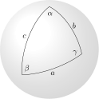

<table>
<tbody>
<tr>
<td colspan="4" style="text-align: left;"><strong>Základné konštanty</strong></td>
</tr>
<tr>
<td style="text-align: left;">rýchlosť svetla vo vákuu</td>
<td style="text-align: right;">c</td>
<td style="text-align: center;">=</td>
<td style="text-align: left;">299\,792\,458\,\mathrm{m}\,{\mathrm{s}}^{-1}</td>
</tr>
<tr>
<td style="text-align: left;">gravitačná konštanta</td>
<td style="text-align: right;">G</td>
<td style="text-align: center;">=</td>
<td style="text-align: left;">6{,}674 \cdot 10^{-11}\,{\mathrm{m}}^{3}\,{\mathrm{kg}}^{-1}\,{\mathrm{s}}^{-2}</td>
</tr>
<tr>
<td style="text-align: left;">elementárny elektrický náboj</td>
<td style="text-align: right;">e</td>
<td style="text-align: center;">=</td>
<td style="text-align: left;">1{,}602 \cdot 10^{-19}\,\mathrm{C}</td>
</tr>
<tr>
<td style="text-align: left;">permitivita vákua (elektrická konštanta)</td>
<td style="text-align: right;">\varepsilon_0</td>
<td style="text-align: center;">=</td>
<td style="text-align: left;">8{,}854 \cdot 10^{-12}\,\mathrm{F}\,{\mathrm{m}}^{-1}</td>
</tr>
<tr>
<td style="text-align: left;">Planckova konštanta</td>
<td style="text-align: right;">h</td>
<td style="text-align: center;">=</td>
<td style="text-align: left;">6{,}626 \cdot 10^{-34}\,\mathrm{J}\,\mathrm{s}</td>
</tr>
<tr>
<td style="text-align: left;">univerzálna plynová konštanta</td>
<td style="text-align: right;">\bar{R}</td>
<td style="text-align: center;">=</td>
<td style="text-align: left;">8{,}314\,\mathrm{J}\,{\mathrm{K}}^{-1}\,{\mathrm{mol}}^{-1}</td>
</tr>
<tr>
<td style="text-align: left;">Boltzmannova konštanta</td>
<td style="text-align: right;">k_B</td>
<td style="text-align: center;">=</td>
<td style="text-align: left;">1{,}381 \cdot 10^{-23}\,\mathrm{J}\,{\mathrm{K}}^{-1}</td>
</tr>
<tr>
<td style="text-align: left;">Stefanova-Boltzmannova konštanta</td>
<td style="text-align: right;">\sigma</td>
<td style="text-align: center;">=</td>
<td style="text-align: left;">5{,}670 \cdot 10^{-8}\,\mathrm{W} . \mathrm{m}^{-2} . \mathrm{K}^{-4}</td>
</tr>
<tr>
<td style="text-align: left;">Wienova posunovacia konštanta</td>
<td style="text-align: right;">b</td>
<td style="text-align: center;">=</td>
<td style="text-align: left;">2{,}898 \cdot 10^{-3}\,\mathrm{m}\,\mathrm{K}</td>
</tr>
<tr>
<td style="text-align: left;">Hubblova konštanta</td>
<td style="text-align: right;">H_0</td>
<td style="text-align: center;">=</td>
<td style="text-align: left;">70\,\mathrm{km} \, \mathrm{s}^{-1} \mathrm{Mpc}^{-1}</td>
</tr>
<tr>
<td style="text-align: left;"></td>
<td style="text-align: right;"></td>
<td style="text-align: center;"></td>
<td style="text-align: left;"></td>
</tr>
<tr>
<td colspan="4" style="text-align: left;"><strong>Astronomické jednotky</strong></td>
</tr>
<tr>
<td style="text-align: left;">stredný slnečný deň</td>
<td style="text-align: right;">\mathrm{deň}</td>
<td style="text-align: center;">=</td>
<td style="text-align: left;">24\,\mathrm{h}</td>
</tr>
<tr>
<td style="text-align: left;">siderický (hviezdny) deň</td>
<td style="text-align: right;">\mathrm{deň}^{\text{(sid)}}</td>
<td style="text-align: center;">=</td>
<td style="text-align: left;">23\,\mathrm{h}\;56\,\mathrm{min}\;4{,}1\,\mathrm{s}</td>
</tr>
<tr>
<td style="text-align: left;">juliánsky rok</td>
<td style="text-align: right;">\mathrm{rok}</td>
<td style="text-align: center;">=</td>
<td style="text-align: left;">365{,}25\,\mathrm{dní}</td>
</tr>
<tr>
<td style="text-align: left;">siderický rok</td>
<td style="text-align: right;">\mathrm{rok}^{\text{(sid)}}</td>
<td style="text-align: center;">=</td>
<td style="text-align: left;">365{,}2564\,\mathrm{dní}</td>
</tr>
<tr>
<td style="text-align: left;">tropický rok</td>
<td style="text-align: right;">\mathrm{rok}^{\text{(trop)}}</td>
<td style="text-align: center;">=</td>
<td style="text-align: left;">365{,}2422\,\mathrm{dní}</td>
</tr>
<tr>
<td style="text-align: left;">anomalistický rok</td>
<td style="text-align: right;">\mathrm{rok}^{\text{(anom)}}</td>
<td style="text-align: center;">=</td>
<td style="text-align: left;">365{,}2596\,\mathrm{dní}</td>
</tr>
<tr>
<td style="text-align: left;">astronomická jednotka</td>
<td style="text-align: right;">\au</td>
<td style="text-align: center;">=</td>
<td style="text-align: left;">149\,597\,870\,700\,\mathrm{m}</td>
</tr>
<tr>
<td style="text-align: left;">svetelný rok</td>
<td style="text-align: right;">\ly</td>
<td style="text-align: center;">=</td>
<td style="text-align: left;">63\,241\,\mathrm{au}</td>
</tr>
<tr>
<td style="text-align: left;">parsek</td>
<td style="text-align: right;">\pc</td>
<td style="text-align: center;">=</td>
<td style="text-align: left;">(360\cdot60^2/\,2\pi) \, \mathrm{au}</td>
</tr>
<tr>
<td style="text-align: left;">Jansky</td>
<td style="text-align: right;">Jy</td>
<td style="text-align: center;">=</td>
<td style="text-align: left;">10^{-26}\,\mathrm{W}\,{\mathrm{m}}^{-2}\,{\mathrm{Hz}}^{-1}</td>
</tr>
<tr>
<td style="text-align: left;"></td>
<td style="text-align: right;"></td>
<td style="text-align: center;"></td>
<td style="text-align: left;"></td>
</tr>
<tr>
<td style="text-align: left;"><strong>Slnko a Zem</strong></td>
<td style="text-align: right;"></td>
<td style="text-align: center;"></td>
<td style="text-align: left;"></td>
</tr>
<tr>
<td style="text-align: left;">hmotnosť Slnka</td>
<td style="text-align: right;">M_\Sun</td>
<td style="text-align: center;">=</td>
<td style="text-align: left;">1{,}989 \cdot 10^{30}\,\mathrm{kg}</td>
</tr>
<tr>
<td style="text-align: left;">polomer Slnka</td>
<td style="text-align: right;">R_\Sun</td>
<td style="text-align: center;">=</td>
<td style="text-align: left;">6{,}957 \cdot 10^{8}\,\mathrm{m}</td>
</tr>
<tr>
<td style="text-align: left;">svietivosť (žiarivý výkon) Slnka</td>
<td style="text-align: right;">\mathit{L}_\Sun</td>
<td style="text-align: center;">=</td>
<td style="text-align: left;">3{,}828 \cdot 10^{26}\,\mathrm{W}</td>
</tr>
<tr>
<td style="text-align: left;">povrchová (efektívna) teplota Slnka</td>
<td style="text-align: right;">\mathit{T}_\Sun</td>
<td style="text-align: center;">=</td>
<td style="text-align: left;">5772\,\mathrm{K}</td>
</tr>
<tr>
<td style="text-align: left;">farebná teplota Slnka nad atmosférou</td>
<td style="text-align: right;">\mathrm{T}_{\Sun}^{(C)}</td>
<td style="text-align: center;">=</td>
<td style="text-align: left;">5900\,\mathrm{K}</td>
</tr>
<tr>
<td style="text-align: left;">zdanlivá vizuálna magnitúda Slnka</td>
<td style="text-align: right;">m_\Sun</td>
<td style="text-align: center;">=</td>
<td style="text-align: left;">-26{,}74\,\mathrm{mag}</td>
</tr>
<tr>
<td style="text-align: left;">zdanlivá bolometrická magnitúda Slnka</td>
<td style="text-align: right;">m_{\Sun bol}</td>
<td style="text-align: center;">=</td>
<td style="text-align: left;">-26{,}83\,\mathrm{mag}</td>
</tr>
<tr>
<td style="text-align: left;">absolútna vizuálna magnitúda Slnka</td>
<td style="text-align: right;">M_{\Sun}^{(\mathrm{mag})}</td>
<td style="text-align: center;">=</td>
<td style="text-align: left;">4{,}83\,\mathrm{mag}</td>
</tr>
<tr>
<td style="text-align: left;">absolútna bolometrická magnitúda Slnka</td>
<td style="text-align: right;">M_{\Sun bol}^{(\mathrm{mag})}</td>
<td style="text-align: center;">=</td>
<td style="text-align: left;">4{,}74\,\mathrm{mag}</td>
</tr>
<tr>
<td style="text-align: left;">rovníkový polomer Zeme</td>
<td style="text-align: right;">R_\Ea</td>
<td style="text-align: center;">=</td>
<td style="text-align: left;">6378{,}1\,\mathrm{km}</td>
</tr>
<tr>
<td style="text-align: left;">hmotnosť Zeme</td>
<td style="text-align: right;">M_\Ea</td>
<td style="text-align: center;">=</td>
<td style="text-align: left;">5{,}9724 \cdot 10^{24}\,\mathrm{kg}</td>
</tr>
<tr>
<td style="text-align: left;">veľká polos dráhy Zeme</td>
<td style="text-align: right;">a_\Ea</td>
<td style="text-align: center;">=</td>
<td style="text-align: left;">1\,\mathrm{au}</td>
</tr>
<tr>
<td style="text-align: left;">excentricita dráhy Zeme</td>
<td style="text-align: right;">e_\Ea</td>
<td style="text-align: center;">=</td>
<td style="text-align: left;">0{,}0167</td>
</tr>
<tr>
<td style="text-align: left;">inklinácia rotačnej osi Zeme</td>
<td style="text-align: right;">\varepsilon</td>
<td style="text-align: center;">=</td>
<td style="text-align: left;">23^{\circ}\,26'</td>
</tr>
<tr>
<td style="text-align: left;"></td>
<td style="text-align: right;"></td>
<td style="text-align: center;"></td>
<td style="text-align: left;"></td>
</tr>
<tr>
<td style="text-align: left;"><strong>Slnečná sústava</strong></td>
<td style="text-align: right;"></td>
<td style="text-align: center;"></td>
<td style="text-align: left;"></td>
</tr>
<tr>
<td style="text-align: left;">polomer Merkúru</td>
<td style="text-align: right;">R_{\Me}</td>
<td style="text-align: center;">=</td>
<td style="text-align: left;">2440\,\mathrm{km}</td>
</tr>
<tr>
<td style="text-align: left;">veľká polos dráhy Merkúru</td>
<td style="text-align: right;">a_{\Me}</td>
<td style="text-align: center;">=</td>
<td style="text-align: left;">0{,}387\,\mathrm{au}</td>
</tr>
<tr>
<td style="text-align: left;">polomer Venuše</td>
<td style="text-align: right;">R_{\Ve}</td>
<td style="text-align: center;">=</td>
<td style="text-align: left;">6052\,\mathrm{km}</td>
</tr>
<tr>
<td style="text-align: left;">veľká polos dráhy Venuše</td>
<td style="text-align: right;">a_{\Ve}</td>
<td style="text-align: center;">=</td>
<td style="text-align: left;">0{,}723\,\mathrm{au}</td>
</tr>
<tr>
<td style="text-align: left;">polomer Mesiaca</td>
<td style="text-align: right;">R_\Mo</td>
<td style="text-align: center;">=</td>
<td style="text-align: left;">1737\,\mathrm{km}</td>
</tr>
<tr>
<td style="text-align: left;">veľká polos dráhy Mesiaca</td>
<td style="text-align: right;">a_\Mo</td>
<td style="text-align: center;">=</td>
<td style="text-align: left;">3{,}844 \cdot 10^{8}\,\mathrm{m}</td>
</tr>
<tr>
<td style="text-align: left;">siderická obežná doba Mesiaca</td>
<td style="text-align: right;">P_{\Mo,si}</td>
<td style="text-align: center;">=</td>
<td style="text-align: left;">27{,}32\,\mathrm{dní}</td>
</tr>
<tr>
<td style="text-align: left;">synodická obežná doba Mesiaca</td>
<td style="text-align: right;">P_{\Mo,sy}</td>
<td style="text-align: center;">=</td>
<td style="text-align: left;">29{,}53\,\mathrm{dní}</td>
</tr>
<tr>
<td style="text-align: left;">inklinácia dráhy Mesiaca voči ekliptike</td>
<td style="text-align: right;">i_\Mo</td>
<td style="text-align: center;">=</td>
<td style="text-align: left;">5{,}14^{\circ}</td>
</tr>
<tr>
<td style="text-align: left;">polomer Marsu</td>
<td style="text-align: right;">R_\Ma</td>
<td style="text-align: center;">=</td>
<td style="text-align: left;">3393\,\mathrm{km}</td>
</tr>
<tr>
<td style="text-align: left;">veľká polos dráhy Marsu</td>
<td style="text-align: right;">a_\Ma</td>
<td style="text-align: center;">=</td>
<td style="text-align: left;">1{,}524\,\mathrm{au}</td>
</tr>
<tr>
<td style="text-align: left;">polomer Jupitera</td>
<td style="text-align: right;">R_{\Ju}</td>
<td style="text-align: center;">=</td>
<td style="text-align: left;">69\,911\,\mathrm{km}</td>
</tr>
<tr>
<td style="text-align: left;">veľká polos dráhy Jupitera</td>
<td style="text-align: right;">a_{\Ju}</td>
<td style="text-align: center;">=</td>
<td style="text-align: left;">5{,}204\,\mathrm{au}</td>
</tr>
<tr>
<td style="text-align: left;">polomer Saturnu</td>
<td style="text-align: right;">R_{\Sa}</td>
<td style="text-align: center;">=</td>
<td style="text-align: left;">58\,232\,\mathrm{km}</td>
</tr>
<tr>
<td style="text-align: left;">veľká polos dráhy Saturnu</td>
<td style="text-align: right;">a_{\Sa}</td>
<td style="text-align: center;">=</td>
<td style="text-align: left;">9{,}583\,\mathrm{au}</td>
</tr>
<tr>
<td style="text-align: left;">polomer Uránu</td>
<td style="text-align: right;">R_{\Ur}</td>
<td style="text-align: center;">=</td>
<td style="text-align: left;">25\,362\,\mathrm{km}</td>
</tr>
<tr>
<td style="text-align: left;">veľká polos dráhy Uránu</td>
<td style="text-align: right;">a_{\Ur}</td>
<td style="text-align: center;">=</td>
<td style="text-align: left;">19{,}191\,\mathrm{au}</td>
</tr>
<tr>
<td style="text-align: left;">polomer Neptúna</td>
<td style="text-align: right;">R_{\Ne}</td>
<td style="text-align: center;">=</td>
<td style="text-align: left;">24\,764\,\mathrm{km}</td>
</tr>
<tr>
<td style="text-align: left;">veľká polos dráhy Neptúna</td>
<td style="text-align: right;">a_{\Ne}</td>
<td style="text-align: center;">=</td>
<td style="text-align: left;">30{,}069\,\mathrm{au}</td>
</tr>
<tr>
<td style="text-align: left;">polomer Pluta</td>
<td style="text-align: right;">R_{\Pl}</td>
<td style="text-align: center;">=</td>
<td style="text-align: left;">1188\,\mathrm{km}</td>
</tr>
<tr>
<td style="text-align: left;">veľká polos dráhy Pluta</td>
<td style="text-align: right;">a_{\Pl}</td>
<td style="text-align: center;">=</td>
<td style="text-align: left;">39{,}481\,\mathrm{au}</td>
</tr>
<tr>
<td style="text-align: left;"></td>
<td style="text-align: right;"></td>
<td style="text-align: center;"></td>
<td style="text-align: left;"></td>
</tr>
<tr>
<td colspan="4" style="text-align: left;"><strong>Vzťahy pre sférický trojuholník</strong></td>
</tr>
<tr>
<td style="text-align: left;"></td>
<td colspan="3" rowspan="7" style="text-align: center;"></td>
</tr>
<tr>
<td style="text-align: left;"></td>
</tr>
<tr>
<td style="text-align: left;"></td>
</tr>
<tr>
<td style="text-align: left;"></td>
</tr>
<tr>
<td style="text-align: left;"></td>
</tr>
<tr>
<td style="text-align: left;">E = \alpha+\beta+\gamma-\pi</td>
</tr>
<tr>
<td style="text-align: left;">\phantom{E} = \text{plocha trojuholníka na jednotkovej sfére.}</td>
</tr>
</tbody>
</table>
