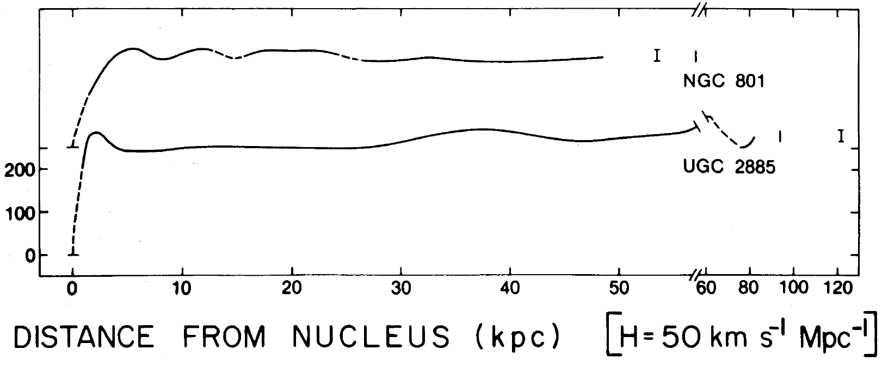
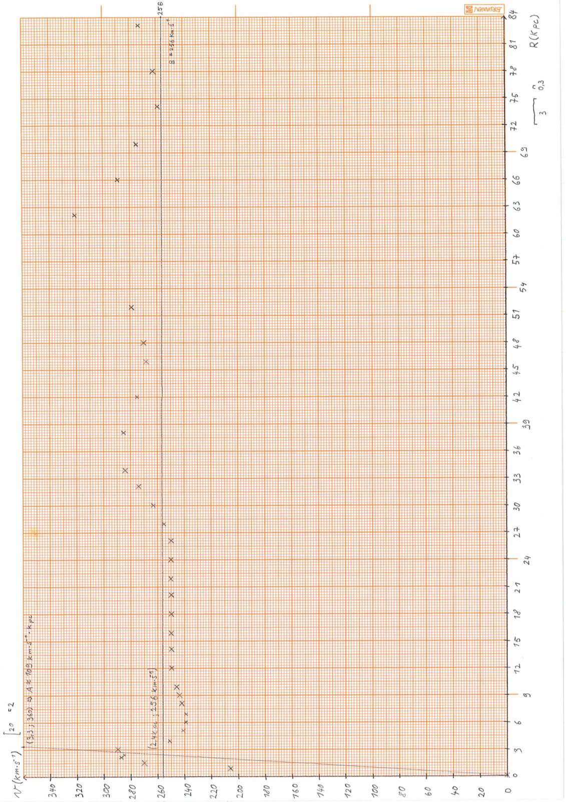

## Zadanie

V roku 1979 bol podaný článok do časopisu [The Astrophysical Journal](https://adsabs.harvard.edu/full/1980apj...238..471r) od astronómky Very Florence Cooper Rubin a jej kolegov. Článok je prevratný z dôvodu, že v ňom Vera Rubin na základe meraní zo spektrografov odhaľuje jednu zo základných vlastností galaxií, ktorú už v súčasnosti považujeme za nerozporovateľnú, ich ploché rotačné krivky.

Viac o význame tohto objavu je možné nájsť v jej neskoršom článku v Science z roku 1983 [The Rotation of Spiral Galaxies by Vera C. Rubin](https://sci-hub.se/10.1126/science.220.4604.1339). My sa ale pozrieme iba na jednu konkrétnu galaxiu a pokúsime sa zreprodukovať rovnaký postup odhaľovania výsledkov, akým prechádzala Vera Rubin v sedemdesiatych rokoch.

V tabuľke 1 nižšie sú uvedené merania rotačnej rýchlosti v závislosti od vzdialenosti od centra galaxie UGC 2885 na obrázku 1, ktorá patrí medzi najväčšie pozorované špirálové galaxie a zvykne sa niekedy označovať aj ako Rubin’s Galaxy (Rubinovej galaxia).

Vyriešte nasledujúce úlohy.

<ol type="a">

<li>

[30 b] Narysujte všetky tieto merania do grafu na milimetrový papier.

</li>

<li>

[20 b] Pomocou pravítka a rysovania do grafu určte na akej konštantnej hodnote $y(x)=B$ sa ustaľuje orbitálna rýchlosť galaxie.

</li>

<li>

[20 b] Pomocou pravítka a rysovania do grafu určte parametre lineárneho predpisu funkcie $y(x)=A\cdot x$, podľa ktorého sa vyvíja orbitálna rýchlosť v centrálnej časti galaxie.

</li>

<li>

[10 b] Určte v akej vzdialenosti od centra galaxie dochádza k splošteniu krivky rotačnej rýchlosti galaxie, pomocou priesečníka konštantnej funkcie z (a) a lineárnej funkcie z (b).

</li>

</ol>

Pripomínam, že úlohu riešte iba pomocou ručného vynášania bodov do grafu na milimetrový papier a neprogramovateľnej kalkulačky. Pod riešením sa rozumie ručné nakreslenie grafu na milimetrový papier aj s trendovou spojnicou, ktorá sa určuje priamo z bodov na papieri, tak ako je to zvykom na medzinárodnom kole. Analýzou chýb sa nemusíte tentokrát trápiť.

Ak je pre vás úloha na dátovú analýzu doteraz neznáma novinka, môže vám pomôcť videonávod na [www.datova-analyza.aosk.eu](https://www.datova-analyza.aosk.eu) alebo riešenie minuloročnej dátovej analýzy domáceho kola v [archíve úloh](https://www.astronomickaolympiada.sk/wp-content/uploads/2024/03/AO_2024_DK-SS.pdf), prípadne skriptá pre [dátovú analýzu](https://www.astronomickaolympiada.sk/wp-content/uploads/2024/09/Datova_analyza.pdf) na stránke AO.

**Tabuľka 1:** Merania rotačnej rýchlosti $v$ galaxie UGC 2885 v závislosti od vzdialenosti od galaktického centra $R$. Hodnoty sú prevzaté priamo z článku V. Rubinovej a kol. v [Astrophysical Journal, Part 1, vol. 238, June 1, 1980, p. 471-487](https://adsabs.harvard.edu/full/1980apj...238..471r).

|       |           |           |       |           |           |
|:-----:|:---------:|:---------:|:-----:|:---------:|:---------:|
|       |           |           |       |           |           |
| Index | $R \, \left[\mathrm{kpc} \right]$ | $v \, \left[\mathrm{km}\,{\mathrm{s}}^{-1} \right]$ | Index | $R \, \left[\mathrm{kpc} \right]$ | $v \, \left[\mathrm{km}\,{\mathrm{s}}^{-1} \right]$ |
|   1   |     0     |     0     |  20   |    22     |    250    |
|   2   |    0,5    |    \-     |  21   |    24     |    250    |
|   3   |    1,0    |    208    |  22   |    26     |    250    |
|   4   |    1,5    |    272    |  23   |    28     |    255    |
|   5   |     2     |    287    |  24   |    30     |    263    |
|   6   |    2,5    |    285    |  25   |    32     |    274    |
|   7   |     3     |    270    |  26   |    34     |    283    |
|   8   |     4     |    251    |  27   |    38     |    285    |
|   9   |     5     |    241    |  28   |    42     |    275    |
|  10   |     6     |    239    |  29   |    46     |    268    |
|  11   |     7     |    239    |  30   |    48     |    270    |
|  12   |     8     |    242    |  31   |    52     |    279    |
|  13   |     9     |    244    |  32   |    56     |    \-     |
|  14   |    10     |    246    |  33   |    62     |    321    |
|  15   |    12     |    250    |  34   |    66     |    289    |
|  16   |    14     |    250    |  35   |    70     |    275    |
|  17   |    16     |    250    |  36   |    74     |    259    |
|  18   |    18     |    250    |  37   |    78     |    262    |
|  19   |    20     |    250    |  38   |   82,3    |    273    |

<figure>

<figcaption>

**Obrázok 1:** Galaxia UGC 2885, HST.
</figcaption>

</figure>

Riešenie

Napísať konkrétny návod, ako postupovať pri dátovej analýze, je náročné a môže byť až kontraproduktívne, dá sa ale povedať, že musíme začať grafom. Ideálne je rozmyslieť si, v akom rozsahu sa nachádzajú hodnoty polomeru a rýchlostí. Taktiež si zistíme veľkosť nášho milimetrového papiera. V našom prípade 

$$
R\in \left\langle 0 \,;\,82,3 \right\rangle\mathrm{kpc} \a v\in \left\langle 0\,;\,321 \right\rangle\mathrm{km}\,{\mathrm{s}}^{-1} \,, \tag{1}
$$

 a zároveň dlhšia strana milimetrového papiera má $28\,\mathrm{cm}$ a kratšia $18\,\mathrm{cm}$. Keďže chceme vyplniť čo najväčšiu plochu grafu a zároveň pracovať s rozumnými deleniami na štvorčeky, volíme 

$$
1\,\mathrm{cm}\equiv3\,\mathrm{kpc} \a 1\,\mathrm{cm}\equiv20\,\mathrm{km}\,{\mathrm{s}}^{-1} \,. \tag{2}
$$

 Osi teda vynesieme do grafu, tak ako je zobrazené na obrázku 3.

Poznámkový aparát ku grafu je

- vynášame všetky body s maximálnou presnosťou a ostrou písacou potrebou,

- označujeme smer, ktorým daná veličina narastá,

- zapíšeme označenie veličiny a jej jednotku.

- označíme hodnoty pozdĺž osí v rozumných intervaloch,

- využijeme aspoň päťdesiat percent milimetrového papiera.

Dobrou praxou, ale nie hodnotenou, je pripísanie mierky osí do grafu. Pomáha to pri rýchlej práci na vynášaní bodov. V prípade tohto grafu sme uskutočnili ešte jednu šedú praktiku a to, že vieme vynášať body aj so sub-milimetrovou presnosťou. Na zvislej osi zodpovedá jednému milimetru dva kilometre za sekundu, v tabuľke sa ale vyskytujú aj nepárne hodnoty. Pristúpili sme teda k tomu, že sme body vynášali aj uprostred medzi dvojicu čiar. Táto praktika sa dá použiť maximálne v prípade delenia milimetra na polovicu, menšie delenie už prakticky nie je vhodné. Preto, hoci by sa nám hodilo delenie vodorovnej osi na tretiny milimetra (jeden kiloparsek), tak sme k tomuto nepristúpili.

<ol type="a">

<li>

Aby sme splnili zadanie, musíme uskutočniť dva ručné fity v grafe. Pre prvý, konštantný, použijeme pravítko, ktoré je ideálne priehľadné a držíme ho paralelne s vodorovnými čiarami. Snažíme sa mať nad a pod pravítkom rovnaký počet bodov (ignorujeme bod s indexom 1) a zároveň čo najlepšie odhadnúť, kde sa priemerná hodnota nachádza. V našom prípade to pripadlo na hodnotu 

$$
B=256\,\mathrm{km}\,{\mathrm{s}}^{-1} \,. \tag{3}
$$

V porovnaní s hodnotou z kalkulačky $B_k=262\,\mathrm{km}\,{\mathrm{s}}^{-1}$, je náš fit pomerne presný. Ako plne hodnotený sa bude brať každý konštantný fit s hodnotou $262(20:10)\mathrm{km}\cdot \mathrm{s}^{-1}$.

</li>

<li>

Druhý, lineárny fit, je o niečo náročnejší, pretože sa dá diskutovať o tom, ktoré body by sa do neho mali započítavať. V prípade tohto vzorového riešenia sme brali do fitu merania jeden až sedem, ktoré sa javia, že podliehajú lineárnemu nárastu. Keďže fitujeme funkciu $y\left(x\right)=A\cdot x$, tak fixujeme pravítko v bode $\left[0\,\mathrm{kpc}\,;\, 0\,\mathrm{km}\,{\mathrm{s}}^{-1}  \right]$. Z fitu získame hodnotu parametra $A$ na základe odčítania krajnej hodnoty na grafe, napríklad na mieste 

$$
\left[3{,}3\,\mathrm{kpc}\,;\, 360\,\mathrm{km}\,{\mathrm{s}}^{-1}  \right] \,. \tag{4}
$$

 Zo zápisu lineárnej funkcie vidíme, že $A=y(x)/x=v/R$, teda 

$$
A=109\,\mathrm{km}\,{\mathrm{s}}^{-1}\,{\mathrm{kpc}}^{-1} \,. \tag{5}
$$

 Keďže je toto príliš náročný fit, každý, ktorý vyzerá rozumne a je technicky správne uskutočnený, bude ohodnotený plným počtom bodov.

</li>

<li>

Tretia úloha je určenie miesta, kde dochádza k splošteniu rotačnej krivky. To je efektívne miesto priesečníku konštantného a lineárneho fitu. Ten jednoducho odčítame z grafu. V našom prípade to predstavuje hodnotu 

$$
\left[2{,}4\,\mathrm{kpc}\,;\, 256\,\mathrm{km}\,{\mathrm{s}}^{-1}  \right] \,. \tag{6}
$$

 Graf z pôvodného článku si môžeme pozrieť na obrázku 2, kde ale naň pravdepodobne aplikovali nejaký druh vyhladzovania.

<figure>

<figcaption>

**Obrázok 2:** Pôvodný graf závislosti rotačnej rýchlosti od vzdialenosti od galaktického centra pre galaxiu UGC 2885.
</figcaption>

</figure>

</li>

</ol>

<figure>

<figcaption>

**Obrázok 3:** Ukážkové vynesenie bodov z tabuľky 1 do grafu a ich fitovanie.
</figcaption>

</figure>

## Komentár autora

Pokračujeme v multiročnej sérií jednoduchých dátových analýz inšpirovaných dôležitými objavmi významných astronómiek a astrofyzičiek.
