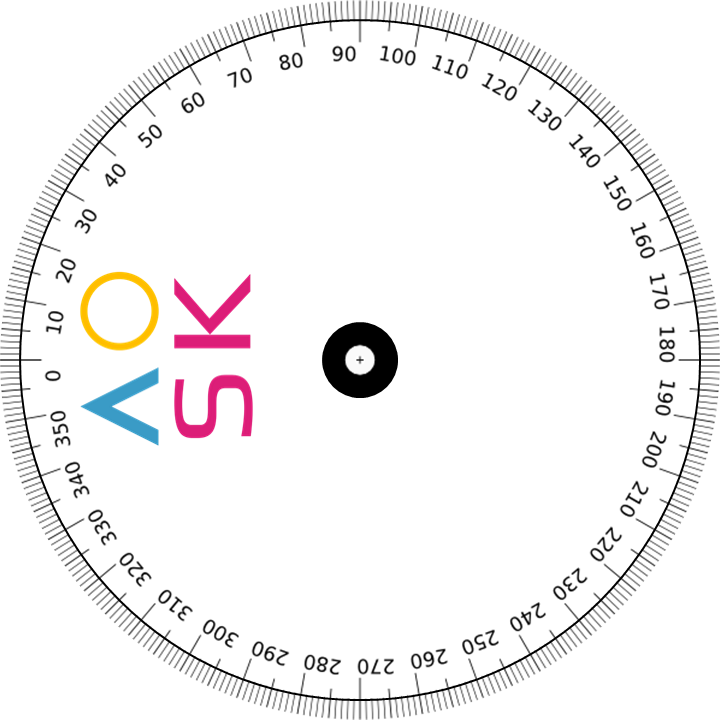
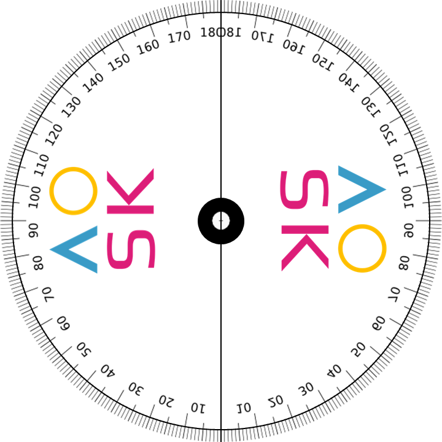

## Zadanie

Počet hviezd viditeľných na oblohe voľným okom je veľké číslo, ale bolo by možné ho aspoň odhadnúť? O to sa presne v tejto praktickej úlohe pokúsite. Pomocou azimutového stolčeka alebo ďalekohľadu na montáži so stupnicou odmerajte súradnice trojice hviezd, ktorá vytvára pekný, pravidelný trojuholník. Zo zistenej trojice súradníc následne vypočítate veľkosti strán tohto sférického trojuholníka podľa vzorca pre azimutálne súradnice ($A, h$) 

$$
\Delta_3 = \arccos{\!\big( \sin{h_1} \, \sin{h_2} + \cos{h_1} \, \cos{h_2} \, \cos{\left(A_1 - A_2\right)}\big)} \tag{1}
$$

 alebo ekvivalentne pre ekvatoriálne súradnice ($t, \delta$) 

$$
\Delta_3 = \arccos{\!\big( \sin{\delta_1} \, \sin{\delta_2} + \cos{\delta_1} \, \cos{\delta_2} \, \cos{\left(t_1 - t_2\right)}\big)} \, , \tag{2}
$$

 kde používame klasické značenie súradníc a indexy cyklicky zamieňame. Cyklické zamieňanie znamená, že index 1 zameníme za index 2 ($1\rightarrow 2$), index 2 za index 3 ($2\rightarrow 3$) a index 3 za index 1 ($3\rightarrow 1$). Zámenu môžeme spraviť dvakrát a takto dostať všetky tri potrebné permutácie vzťahov na výpočet všetkých strán sférického trojuholníka $\Delta_1, \Delta_2, \Delta_3$. Pomocou strán sférického trojuholníka je možné vypočítať jeho obsah pomocou vzťahu 

$$
S= 4 \arctan{\left( \sqrt{\tan{\left( \frac{d}{2} \right)}
    \tan{\left( \frac{d-\Delta_1}{2} \right)}
    \tan{\left( \frac{d-\Delta_2}{2} \right)}
    \tan{\left( \frac{d-\Delta_3}{2} \right)}
    } \right)}\,. \tag{3}
$$

 Kde $d = \frac{1}{2} (\Delta_1 + \Delta_2 + \Delta_3)$. Dôležitá je informácia, že plocha celej sféry je $4\pi$ alebo $720^{\circ}$ podľa toho, či ste mali pri výpočte vzťahu (3) kalkulačku nastavenú na radiány alebo stupne.

Ďalej spočítajte, koľko hviezd vidíte vnútri trojuholníka tvoreného danou trojicou hviezd. Teraz, keď viete počet hviezd v časti oblohy o známej ploche, vám už nič nebráni odhadnúť počet hviezd na celej oblohe. Celé meranie opakujte toľkokrát, koľko uznáte za vhodné, ale odporúčané je minimálne päťkrát. Výsledky z jednotlivých meraní prepojte metódou, akou uznáte za vhodné. Zároveň nezabudnite na odhad chyby získaného výsledku.

Celý proces dokumentujte a vybrané postupy odôvodnite. Zamerajte sa najmä na výber trojuholníkov, odhad vašich schopností pozorovania, meteorologické a astronomické podmienky, presnosť určenia plochy trojuholníka a spôsob prepojenia výsledkov viacerých meraní. Na meranie polôh hviezd si môžete vyrobiť azimutálny stolček pomocou priloženej grafiky. Obrázok so stupnicou $\left\langle 0^{\circ} \,;\,360^{\circ} \right\rangle$ je horizontálne meradlo a obrázok s dvoma stupnicami $\left\langle 0^{\circ} \,;\,180^{\circ} \right\rangle$ po zložení na polovicu slúži ako meradlo vo vertikálnom smere.

Riešenie

Postup merania a výsledky môžu byť pre každého odlišné, preto sa v tomto riešení pokúsime spísať najdôležitejšie body.

**Okolité podmienky**

Je vhodné, aby sme pozorovali počas bezmesačnej noci. Za dobrého počasia, kedy nie je prítomný žiaden typ oblačnosti a atmosféra je stabilná. Ideálne mimo mesta a celkovo obývanej oblasti, aby sme minimalizovali svetelné znečistenie. Zároveň je ideálne odhadnúť alebo nejakým spôsobom odmerať svoju limitnú magnitúdu, teda hodnotu magnitúdy najslabších objektov, ktoré sme v daných podmienkach schopní pozorovať.

**Výber trojuholníkov**

Snažíme sa vybrať trojuholníky tvorené jasnými, ľahko pozorovateľnými hviezdami. Čím väčší trojuholník zoberieme, tým menej sa prejaví chyba určenia polôh hviezd a taktiež sa minimalizuje chyba spôsobená nehomogénnym rozložením hviezd. Na druhú stranu narastá chyba určenia hraníc trojuholníku.

**Spôsob určenia polôh a následnej plochy**

Či už používame dodaný azimutálny stolček, alebo ďalekohľad s montážou, je potrebné určiť polohy hviezd, ktoré tvoria vrcholy trojuholníku, buď v azimutálnych $\left(A_{[1, 2, 3]}\,;\, h_{[1, 2, 3]} \right)$ alebo ekvatoriálnych súradniciach $\left(t_{[1, 2, 3]} \,;\, \delta_{[1, 2, 3]} \right)$. Teraz môžeme určiť vzdialenosti $\Delta_1, \Delta_2, \Delta_3$ medzi týmito hviezdami, ktoré tvoria hrany sférického trojuholníka, a to pomocou vzťahu (1) zo zadania, respektíve jeho alternatívou (2). Následne výsledné dĺžky $\Delta$ dosadíme do vzťahu (3) pre plochu $S$. Dosádzať je vhodné v radiánoch, potom je výsledok v steradiánoch a plocha celej sféry je $4\pi$. Ak by sme zadávali do vzorca (3) v stupňoch, potom je výsledok v stupňoch a plocha celej sféry je $720^{\circ}$. Nižšie uvádzame vysvetlenie, prečo je uhlová plocha sféry $4\pi$ radiánov, respektíve $720^{\circ}$.

**Počítanie hviezd**

Pred počítaním hviezd je potrebné stráviť minimálne pol hodiny v tme, bez jediného zásahu oka bielym svetlom. Ideálne minimalizujeme aj použitie červeného svetla. Táto doba je potrebná pre odfarbenie svetlocitlivých tyčiniek v oku, ktoré sa tak stanú násobne citlivejšími. Hviezdy spočítame v trojuholníku viackrát a môžeme použiť aj metódu bočného videnia. Je to spôsob zapojenia oblasti hustejšie posiatej tyčinkami mimo žltú škvrnu, ktorá je v centre pohľadu. Túto metódu uskutočníme upnutím pohľadu mimo oblasť, kde počítame hviezdy, a snahou rozoznať ich len periférnym pohľadom.

**Štatistické vyhodnotenie**

V spracovaní nie je asi veľa čo inovovať, a tak sa najviac oplatí hustoty hviezd z jednotlivých trojuholníkov spriemerovať. Za pokus môže stáť urobiť vážený priemer, kde váha bude veľkosť trojuholníka. Tým si zabezpečíme, že väčšie trojuholníky, kde sa menej prejavujú chyby merania, budú mať väčší vplyv na výsledok. Dobre kvantifikovateľná chyba je práve chyba rozlohy trojuholníka. Môžeme k tomu pristúpiť min-MAX metódou, rovnicou prenosu chyby (ktorá je ale náročná na odvodenie) alebo odhadom podľa platnej cifry. Pre zaujímavosť, z Monte Carlo simulácie pre prípad rovnostranného sférického trojuholníka so stranami $10^{\circ} \pm 1^{\circ}$ je výsledná relatívna chyba plochy okolo hodnoty $12\,\%$. Pre identický prípad so stranami $20^{\circ} \pm 1^{\circ}$ je relatívna chyba plochy približne $6\,\%$.

Plocha sféry v uhlovej miere je netriviálny koncept. Na jeho pochopenie si musíme ako prvé uvedomiť, že uhlové miery nemajú žiadnu fyzikálnu jednotku. Môžeme formálne písať, že daná uhlová veľkosť (miera) je v stupňoch alebo v radiánoch, avšak vždy sa jedná o *pomer*. Bežne sme zvyknutí, že ide o pomer dvoch dĺžok – dĺžky kružnicového oblúku a obvodu celej kružnice. Vieme to však zovšeobecniť aj pre plochy. Plocha sféry je $4\pi r^2$, kde $r$ je polomer sféry. Preto je prirodzené definovať uhlovú plochu sféry ako $4\pi$ (teda rovnú ploche pre $r=1$), podobne ako pri kružnici je prirodzené definovať jej uhlový obvod ako $2\pi$. Takéto uhlové jednotky voláme *radiány*. Ale opäť, nie sú to fyzikálne jednotky, ako metre či sekundy, ide vskutku iba o bezrozmerné čísla. Stále však môže byť užitočné túto uhlovú ”jednotku” písať. Je potom jasné, čo považujeme za uhlový obvod celej kružnice. Keď teda povieme, že uhlová plocha sféry je $720^{\circ}$, máme na mysli to, že jej uhlovú plochu meriame v takých uhlových ”jednotkách”, v ktorých je uhlový obvod hlavnej kružnice na sfére rovný $360^{\circ}$. Tu by vás mohlo zaraziť, že prečo má plocha aj dĺžka rovnakú jednotku, veď predsa ak je dĺžka napríklad v metroch, tak potom plocha je v metroch štvorcových. Avšak my sa rozprávame *nie* o absolútnych dĺžkach a plochách, ale o tých uhlových. Uhlové miery sú bezrozmerné, a preto nevadí, ak majú rovnakú ”jednotku” lebo v skutočnosti nemajú jednotku *žiadnu*.

Pre stupne platí, že uhlový obvod kružnice je 360. Mohli by ste sa pýtať ”360.. a čoho?”, no.. ničoho, jednoducho 360. Ale na to, aby sme predišli zmätkom, budeme tam predsa len písať znak stupňa. Tak teda.. uhlový obvod kružnice je $360^{\circ}$. Uhlová polovica obvodu kružnice je $180^{\circ}$, štvrtina $90^{\circ}$, šestina $60^{\circ}$ a tak ďalej. Pre radiány je uhlový obvod kružnice $2\pi$. A opäť čoho? Ničoho. Označenie $2\pi\,\mathrm{rad}$ je len, aby sme predišli nedorozumeniam. Uhlová polovica kružnice je potom $\pi\,\mathrm{rad}$, štvrtina $\pi/2\,\mathrm{rad}$, šestina $\pi/3\,\mathrm{rad}$ a tak ďalej. Vidíme jasnú závislosť (prepočet) medzi stupňami a radiánmi, a to $360^{\circ} = 2\pi\,\mathrm{rad}$. Vráťme sa teraz naspäť k zavedeniu uhlovej plošnej miery. Zistili sme, že prirodzené by bolo zaviesť uhlovú plochu celej sféry ako $4\pi\,\mathrm{rad}$. To (práve zisteným prepočtom) zodpovedá $2\cdot 360^{\circ} = 720^{\circ}$.

Ak vám ale táto úvaha príde neexaktná, vieme sa na to pozrieť aj z inej strany – pomocou výpočtu uhlovej plochy sférického trojuholníka. V konštantovníku máme uvedený vzťah (ktorého odvodenie si môžete overiť na internete) pre sférický exces $E = \alpha + \beta + \gamma - \pi$, kde $\alpha, \beta, \gamma$ sú vnútorné uhly sférického trojuholníka v radiánoch. Sférický exces je rovný uhlovej ploche daného trojuholníka (v radiánoch). Sférický exces je kladný, pretože súčet uhlov v trojuholníku na sfére je vždy väčší ako súčet uhlov v rovinnom trojuholníku (ktorý je práve $\pi\,\mathrm{rad}$, respektíve $180^{\circ}$). Pomocou $E$ spočítajme uhlovú plochu celej sféry. Uvažujme rozdelenie sféry na 8 rovnakých rovnoramenných pravouhlých sférických trojuholníkov (troma na seba kolmými rezmi). Každý z týchto trojuholníkov má všetky strany aj uhly rovné $\pi/2\,\mathrm{rad}$ (respektíve $90^{\circ}$). Súčet uhlov je teda $(3/2)\pi\,\mathrm{rad}$ (respektíve $270^{\circ}$) a sférický exces je potom $(3/2)\pi\,\mathrm{rad} - \pi\,\mathrm{rad} = \pi/2\,\mathrm{rad}$ (respektíve $90^{\circ}$), čo je podľa spomínaného vzťahu rovné uhlovej ploche daného sférického trojuholníka. Uhlová plocha celej sféry je potom osemnásobok tejto hodnoty, čiže $8\cdot \pi/2\,\mathrm{rad} = 4\pi\,\mathrm{rad}$. To potvrdzuje našu intuíciu v prirodzenom zavedení pomocou vzťahu pre plochu sféry $4\pi r^2$.

Ak vzťah pre sférický exces aplikujeme na stupne, dostaneme uhlovú plochu sférických trojuholníkov a celej sféry $8\cdot 90^{\circ} = 720^{\circ}$. Častou konvenciou býva pre uhlové miery v radiánoch nepísať ”jednotku” a pre uhlové miery v stupňoch ”jednotku” písať. Preto uvádzame plochu sféry ako $4\pi$ (bez ”jednotky”) a $720^{\circ}$ (s ”jednotkou”). Rovnako vieme použiť vzťah (3) zo zadania. Pre uvažovaný pravouhlý rovnostranný sférický trojuholník do neho dosadíme $90^{\circ}$ za všetky 3 uhlové dĺžky strán. Dosadením alebo úpravou dostaneme opäť výsledok $S=90^{\circ}$,[^1] čo zodpovedá už získanému výsledku.

Dôležité je nemýliť si uhlovú plochu v stupňoch so stupňami štvorcovými. $(1^{\circ})^2 \equiv 1\,{\mathrm{deg}}^{2}$ zodpovedá uhlovej ploche sférického štvorca so stranami $1^{\circ}$. Takýchto sférických štvorčekov budeme potrebovať na pokrytie oblohy značne viac ako 720. Predstavme si, že máme sféru o polomere $r = 1\,\mathrm{m}$. Dĺžka hlavnej kružnice na nej bude potom $2\pi r  = 2\pi \,\mathrm{m}$ a $1^{\circ}$ bude na nej zaberať $1/360$ obvodu, čo zodpovedá $a = (2\pi/360)\,\mathrm{m} \approx 17\,\mathrm{mm}$. Ak aproximujeme sférický štvorec za rovinný, tak jeho plocha bude $S^\square = a^2 =  (2\pi/360)^2\,{\mathrm{m}}^{2} \approx 300\,{\mathrm{mm}}^{2}$ (symbolom $\square$ značíme, že sa jedná o plochu rovinného štvorca). Celá plocha sféry je $4\pi r = 4\pi\,\mathrm{m}$, teda potrebujeme vyše 40 tisíc stupňov štvorcových na pokrytie sféry. V stupňoch štvorcových sa zvyknú udávať napríklad rozmery súhvezdí. Hydra ako najväčšie súhvezdie má $1303\,{\mathrm{deg}}^{2}$, teda zaberá asi $1/30$ oblohy.

Navyše, ak spravíme limitnú úvahu, pri ktorej budeme strany štvorca $a \approx 17\,\mathrm{mm}$ postupne zmenšovať ako $a_n = a/n$, kde $n \to \infty , n\in\mathbb{N}$, tak sa jeho plocha $S$ bude správať ako $S_n = (a/n)^2$. To je z dôvodu, že zmenšovanie strán sférického štvorca je ekvivalentné ”vyfukovaniu” (zmenšovaniu) celej sféry. Konkrétne, ak pôvodnej dĺžke strany sférického štvorca $a$ zodpovedá polomer sféry $r$, tak zmenšenej dĺžke $a_n = a/n$ bude odpovedať polomer $r_n = r/n$ (pretože obvod kružnice je úmerný $r$). Avšak plocha je úmerná $r^2$, preto $S_n \,\propto\, r_n^2 = (r/n)^2$. Preto $S_n \,\propto\, 1/n^2$. Ďalej pre všetky $\varepsilon > 0, \varepsilon \in \mathbb{R}$ vieme nájsť $n_0\in\mathbb{N}$, také, že pre všetky $n > n_0$ bude $|S_n - S_n^\square| < \varepsilon$, kde $S_n^\square$ je plocha rovinného štvorca o strane $a_n$. Inými slovami, aproximácia na rovinný štvorec je presnejšia pre malé štvorčeky a od istého $n_0$ limitne rovná. Potom ale 

$$
\lim_{n\to\infty} S_n = S_n^\square = a_n^2 = \left(\frac{a}{n}\right)^2 = S_n^2 \,, \tag{4}
$$

 kde posledná rovnosť vyplýva zo správania $S_n$ pri ”vyfukovaní” sféry. To ale teda znamená, že $S_n^\square = S_n$ a to nie len pre $n\to\infty$, pretože v rovnici (4) vieme ”zabudnúť” na prvú rovnosť, ktorá určuje $n$ pre zvyšok rovnice. Ten potom platí pre ľubovoľné $n$, a teda špeciálne aj pre $n=1$, kedy $S^\square = S_n^\square = S_n = S$. Z toho vyplýva, že plocha sféry zodpovedajúca $(1^{\circ})^2$ je $S = S^\square$, čiže jednoduchý aproximačný výpočet, ktorý sme vykonali vyššie, platí dokonca presne, teda 

$$
\frac{S_{sf\acute{e}ra}}{S} =
    \frac{4\pi r^2}{S^\square} =
    \frac{4\pi r^2}{a^2} =
    \frac{4\pi r^2}{(2\pi r / 360)^2} =
    \frac{360^2}{\pi} \approx
    41\,252{,}96 \,. \tag{5}
$$

 Pripomíname, že $S$ predstavuje plochu sférického štvorca so stranou $1^{\circ}$ v *absolútnych* jednotkách (napríklad v ${\mathrm{m}}^{2}$). Číslo 360 sa vo výpočte zjavuje kvôli tomu, že uhlový obvod kružnice je $360^{\circ}$, teda $1^{\circ}$ zaberá $1/360$ kružnice (viď. výpočet vyššie). Ako posledné si všimnime peknú vlastnosť tohto výpočtu pre radiány. Ako sme už spomínali, tie sú *definované* tak, že uhlový obvod kružnice je $2\pi$. Potom $S^\square = a^2 = (2\pi r/(2\pi))^2 = r^2$. Teda plocha sférického štvorca so stranou $1\,\mathrm{rad}$ je $r^2$. Pekné, nie? Uhlová plocha takéhoto štvorca je $1\,{\mathrm{rad}}^{2}$ (keďže to je štvorec so stranou $1\,\mathrm{rad}$) a takýchto radiánov štvorcových potrebujeme $4\pi$ aby sme vyplnili celú sféru (každý má absolútnu plochu rovnú $r^2$ a plocha sféry je $4\pi r^2$). Radiány štvorcové zvykneme volať *steradiány* a hovoríme, že uhlová plocha sféry je $4 \pi$ steradiánov (skrátene $4\pi\,\mathrm{sr}$). Avšak stále nesmieme zabúdať na to, že uhlové miery sú bezrozmerné, čiže to je ekvivalentné tomu povedať, že uhlová plocha sféry je jednoducho iba $4\pi$ (alebo $4\pi\,\mathrm{rad} = 4\pi\,{\mathrm{rad}}^{2} \equiv 4\pi\,\mathrm{sr}$). Analogicky pre stupne je uhlová plocha sféry 720 (alebo $720^{\circ} \approx 41\,252{,}96\,{\deg}^{2}$).

[^1]: Důkaz ponecháváme čtenáři jako cvičení.

## Komentár autora

Tento rok o niečo náročnejšia praktická úloha. Preverí najmä schopnosti orientácie na oblohe, kvalitu pozorovania jednoduchými prístrojmi a vlastným okom, ako aj čo-to zo znalostí sférickej geometrie.
