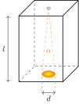
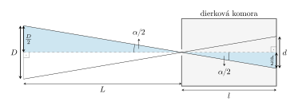

## Zadanie

V tejto praktickej úlohe sa pokúsime pomocou zopár jednoduchých nástrojov odmerať reálnu veľkosť Slnka. Hoci naše meranie bude bezpečné, je dobré mať na pamäti, že nikdy sa nepozeráme do Slnka priamo. Už krátky pohľad priamo do Slnka bez dostatočnej ochrany môže byť pre zrak riskantný. Preto je nutné riadiť sa čo najpresnejšie postupom.

Pre naše meranie si postavíme dierkovú komoru (z latinčiny známa aj ako *camera obscura*, v preklade temná komora). Naša camera obscura nemusí byť ani veľká, ani úplne temná. Ideálne si nájdeme väčšiu, podlhovastú krabicu, z ktorej odstránime bočnú stenu. Najdlhšia strana nech je aspoň $30\,\mathrm{cm}$ dlhá, ale čím viac, tým lepšie. Do jednej z menších stien urobíme malý otvor s veľkosťou len pár centimetrov. Cez tento otvor preložíme jednu vrstvu alobalu. Do tohto alobalu urobíme pomocou ihly veľmi malý otvor, čím menší, tým lepšie. Na protiľahlú stranu prilepíme biely kancelársky papier.

Teraz môžeme pristúpiť k samotnému meraniu. Našu cameru obscuru namierime malým otvorom na Slnko. Na protiľahlej strane (na bielom papieri) by sa mal objaviť obraz Slnka, tak ako je na obrázku 1. Nezľaknite sa, ak bude menší ako ste očakávali. Pomocou pravítka alebo iného dĺžkového meradla ako prvé odmerajte vzdialenosť dierky od obrazu Slnka $l$. Ako druhé odmerajte veľkosť Slnka na papieri $d$. Z nákresu je možné si všimnúť, že ak je dierka v hornej stene naozaj malá, potom vzniká trojuholník s uhlom $\alpha$, ktorý viete vypočítať.

<figure>

<figcaption>

**Obrázok 1:** Nákres ako môže vyzerať camera obscura aj s označením jednotlivých veličín.
</figcaption>

</figure>

Z týchto údajov a zo znalosti, že vzdialenosť Zeme od Slnka je $L = 1\,\mathrm{au} \approx 150\,000\,000\,\mathrm{km}$ určte skutočnú veľkosť Slnka $D$. Môže sa vám hodiť znalosť, že uhol $\alpha$ je rovný uhlovej veľkosti Slnka na oblohe. Keďže sa jedná o praktickú úlohu, pokúste sa napísať postup vášho merania, prípadne pridajte fotodokumentáciu vašej aparatúry. Zároveň sa zamyslite a napíšte možné zdroje chýb vo vašom meraní, ako mohli ovplyvniť výsledok a ako by sa dali odstrániť.

Riešenie

Pre praktickú úlohu, kde je súčasťou riešenia aj tvorba samotnej aparatúry, je zložité napísať jedno konkrétne riešenie. Preto si predstavme, že máme všetko odmerané našou hypotetickou aparatúrou, ktorá má veľkosť $l=30\,\mathrm{cm}$ a odmerali sme veľkosť Slnka na papieri na $d=0{,}3\,\mathrm{cm}$. Teraz si potrebujeme odvodiť vzťah pre reálnu veľkosť Slnka. Keď si celý problém nakreslíme,

<figure>

<figcaption>

**Obrázok 2:** Schematicky nákres (nie v reálnej mierke) zobrazujúci ako sa Slnko premieta cez dierku do našej temnej komory. Slúži nám najmä na uvedomenie si geometrie problému.
</figcaption>

</figure>

vidíme v ňom dva modro vyznačené pravouhlé trojuholníky, ktoré majú všetky tri uhly rovnaké. Túto úlohu vieme riešiť dvojicou spôsobov. Prvý je cez goniometrické funkcie, ktoré môžu byť náročnejšie na prácu. Druhý je cez podobnosť modrých trojuholníkov. Takto vieme, že 

$$
\frac{D/2}{L}=\frac{d/2}{l} \, . \tag{1}
$$

 Čo sa dá jednoducho upraviť na 

$$
\frac{D}{L}=\frac{d}{l} \, . \tag{2}
$$

Keďže $D$ je neznáma, ktorú hľadáme, potrebujeme si ju osamostatniť na jednej strane 

$$
D = \frac{d}{l} \cdot L = 1\,500\,000\,\mathrm{km} \,. \tag{3}
$$

 Reálna hodnota je $1\,391\,400\,\mathrm{km}$. Náš výsledok teda na pomery jednoduchosti merania, uskutočneného len za pomoci krabice a pravítka, nie je ďaleko od pravdy.

Zdroje chýb, ktoré môžu ovplyvniť naše meranie pochádzajú zo samotného pravítka, ktoré používame. Ďalej z prípadných pohybov atmosféry, ktoré chvejú obrazom Slnka, ako aj z podstaty, že na premietanie Slnka používame dierku, ktorá má svoj rozmer, a tak mierne ovplyvňuje aj veľkosť obrazu Slnka.

## Komentár autora

Táto úloha vychádza zo spojenia histórie fotografie a slnečnej fyziky. Jedno je moje hobby, to druhé moja práca. Zároveň možnosť uskutočniť meranie veľkosti Slnka iba za pomoci jednoduchých pomôcok je rozhodne zaujímavé.
