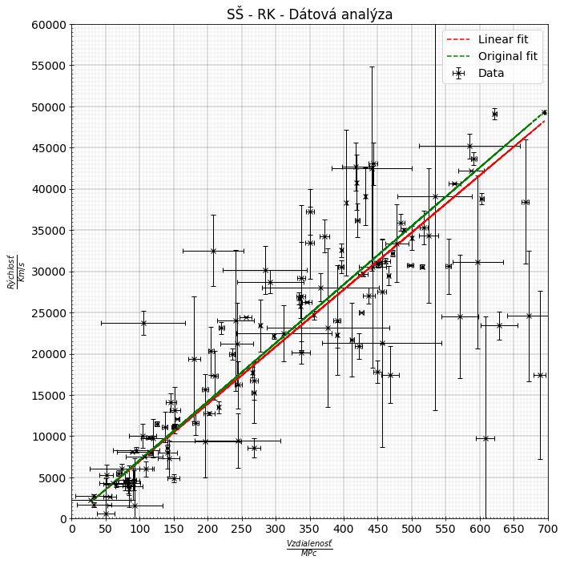
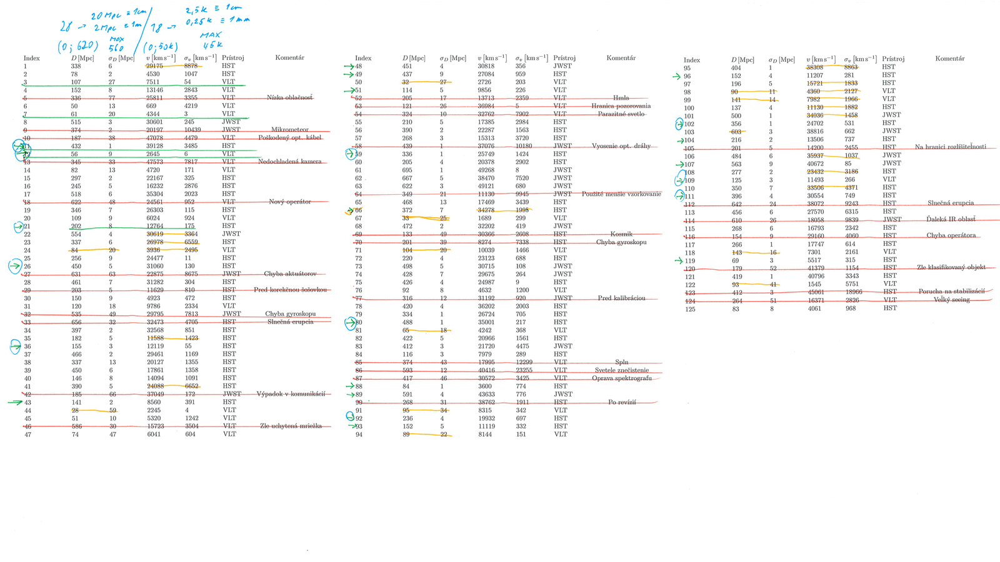
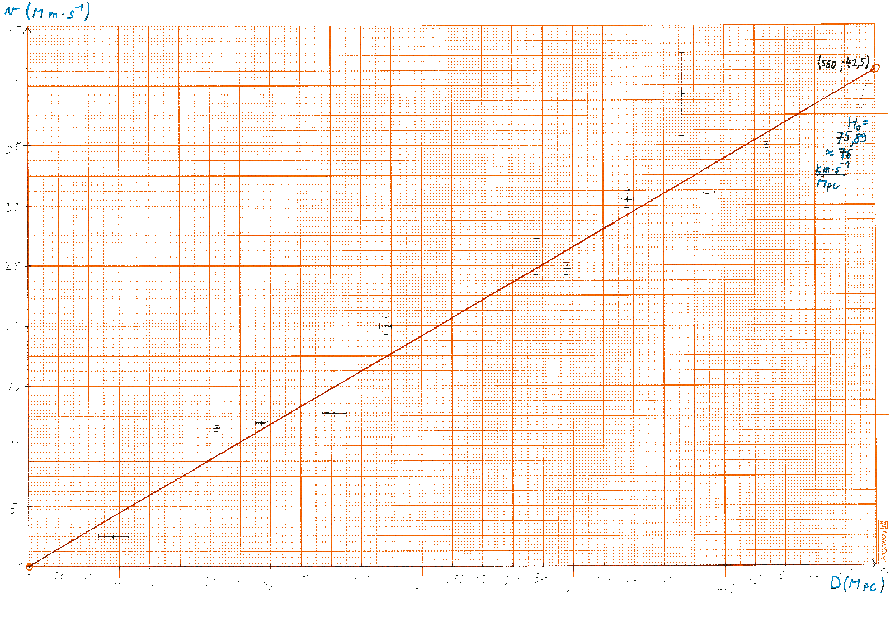

## Zadanie

Veľkou otázkou v kozmológii je presná hodnota Hubblovho parametra $H_0$ (konštanty). Ten udáva rýchlosť $v$ zdanlivého vzďaľovania sa vesmírnych objektov, v dôsledku rozpínania vesmíru, v závislosti od ich vzdialenosti $D$, 

$$
v=H_0 \cdot D \, . \tag{1}
$$

Jednou z najpriamejších metód merania tohto parametra je súčasné určenie radiálnej rýchlosti objektu (napr. zo spektrografu) a jeho vzdialenosti (napr. vďaka štandardným sviečkam). Vašou úlohou bude touto metódou vykonať odhad hodnoty $H_0$. K dispozícii máte dáta v tabuľke ??, ktoré ste obdržali z trojice pozorovacích prístrojov (HST, JWST, VLT).

Tieto merania sú však častokrát zaťažené veľkými náhodnými chybami, preto použite iba relevantné dáta z tabuľky. Tie vyneste do grafu na milimetrovom papieri a preložte ich priamkou pomocou pravítka. Zamyslite sa a odôvodnite, či budete fitovať rovnicou v tvare 

$$
y(x)=a \cdot x+b \tag{2}
$$

 alebo 

$$
y(x)=a \cdot x \, . \tag{3}
$$

Body sa udeľujú, narozdiel od iných klasických dátových analýz, iba za finálny výsledok a za správnosť postupu, nie za počet vynesených bodov.

|  |  |  |  |  |  |  |
|:--:|:--:|:--:|:--:|:--:|:--:|:--:|
|  |  |  |  |  |  |  |
| Index | $D \,\left[\mathrm{Mpc} \right]$ | $\sigma_{\mathit{D}}\,\left[\mathrm{Mpc} \right]$ | $v \, \left[\mathrm{km}\,{\mathrm{s}}^{-1} \right]$ | $\sigma_{\mathit{v}}\, \left[\mathrm{km}\,{\mathrm{s}}^{-1} \right]$ | Prístroj | Komentár |
| 1 | 338 | 6 | 29175 | 8878 | HST |  |
| 2 | 78 | 2 | 4530 | 1047 | HST |  |
| 3 | 107 | 27 | 7511 | 54 | VLT |  |
| 4 | 152 | 8 | 13146 | 2843 | VLT |  |
| 5 | 336 | 77 | 25811 | 3355 | VLT | Nízka oblačnosť |
| 6 | 50 | 13 | 669 | 4219 | VLT |  |
| 7 | 61 | 20 | 4344 | 3 | VLT |  |
| 8 | 515 | 3 | 30601 | 245 | JWST |  |
| 9 | 374 | 2 | 20197 | 10439 | JWST | Mikrometeor |
| 10 | 187 | 38 | 47078 | 4479 | VLT | Poškodený opt. kábel |
| 11 | 432 | 1 | 39128 | 3485 | HST |  |
| 12 | 56 | 9 | 2645 | 6 | VLT |  |
| 13 | 345 | 33 | 47573 | 7817 | VLT | Nedochladená kamera |
| 14 | 82 | 13 | 4720 | 171 | VLT |  |
| 15 | 297 | 2 | 22167 | 325 | HST |  |
| 16 | 245 | 5 | 16232 | 2876 | HST |  |
| 17 | 518 | 6 | 35304 | 2023 | HST |  |
| 18 | 622 | 48 | 24561 | 952 | VLT | Nový operátor |
| 19 | 346 | 7 | 26303 | 115 | HST |  |
| 20 | 109 | 9 | 6024 | 924 | VLT |  |
| 21 | 202 | 8 | 12764 | 175 | HST |  |
| 22 | 554 | 4 | 30619 | 3364 | JWST |  |
| 23 | 337 | 6 | 26978 | 6559 | HST |  |
| 24 | 84 | 20 | 3936 | 2495 | VLT |  |
| 25 | 256 | 9 | 24477 | 11 | HST |  |
| 26 | 450 | 5 | 31060 | 130 | HST |  |
| 27 | 631 | 63 | 22875 | 8675 | JWST | Chyba aktuátorov |
| 28 | 461 | 7 | 31282 | 304 | HST |  |
| 29 | 203 | 5 | 11629 | 810 | HST | Pred korekčnou šošovkou |
| 30 | 150 | 9 | 4923 | 472 | HST |  |
| 31 | 120 | 18 | 9786 | 2334 | VLT |  |
| 32 | 535 | 49 | 29795 | 7813 | JWST | Chyba gyroskopu |
| 33 | 656 | 32 | 32473 | 4705 | HST | Slnečná erupcia |
| 34 | 397 | 2 | 32568 | 851 | HST |  |
| 35 | 182 | 5 | 11588 | 1423 | HST |  |
| 36 | 155 | 3 | 12119 | 55 | HST |  |
| 37 | 466 | 2 | 29461 | 1169 | HST |  |
| 38 | 337 | 13 | 20127 | 1355 | HST |  |
| 39 | 450 | 6 | 17861 | 1358 | HST |  |
| 40 | 146 | 8 | 14094 | 1091 | HST |  |
| 41 | 390 | 5 | 24088 | 6652 | HST |  |
| 42 | 185 | 66 | 37049 | 172 | JWST | Výpadok v komunikácii |
| 43 | 141 | 2 | 8560 | 391 | HST |  |
| 44 | 28 | 59 | 2245 | 4 | VLT |  |
| 45 | 51 | 10 | 5320 | 1242 | VLT |  |
| 46 | 586 | 30 | 15723 | 3504 | VLT | Zle uchytená mriežka |
| 47 | 74 | 47 | 6041 | 604 | VLT |  |
| 48 | 451 | 4 | 30818 | 356 | JWST |  |
| 49 | 437 | 9 | 27084 | 959 | HST |  |
| 50 | 32 | 27 | 2726 | 203 | VLT |  |
| 51 | 114 | 5 | 9856 | 226 | VLT |  |
| 52 | 205 | 17 | 13713 | 2359 | VLT | Hmla |
| 53 | 121 | 26 | 36984 | 5 | VLT | Hranica pozorovania |
| 54 | 324 | 10 | 32762 | 7902 | VLT | Parazitné svetlo |
| 55 | 210 | 5 | 17385 | 2984 | HST |  |
| 56 | 390 | 2 | 22287 | 1563 | HST |  |
| 57 | 268 | 3 | 15313 | 3720 | HST |  |
| 58 | 439 | 1 | 37076 | 10180 | JWST | Vyosenie opt. dráhy |
| 59 | 336 | 1 | 25749 | 1424 | HST |  |
| 60 | 205 | 4 | 20378 | 2902 | HST |  |
| 61 | 695 | 1 | 49268 | 8 | JWST |  |
| 62 | 667 | 5 | 38470 | 7520 | JWST |  |
| 63 | 622 | 3 | 49121 | 680 | JWST |  |
| 64 | 349 | 21 | 11130 | 9945 | JWST | Použité malé vzorkovanie |
| 65 | 468 | 13 | 17469 | 3439 | HST |  |
| 66 | 372 | 7 | 34278 | 1995 | HST |  |
| 67 | 33 | 25 | 1689 | 299 | VLT |  |
| 68 | 472 | 2 | 32202 | 419 | JWST |  |
| 69 | 133 | 49 | 30366 | 2608 | HST | Kosmik |
| 70 | 201 | 39 | 8274 | 7338 | HST | Chyba gyroskopu |
| 71 | 104 | 20 | 10039 | 1466 | VLT |  |
| 72 | 220 | 4 | 23123 | 688 | HST |  |
| 73 | 498 | 5 | 30715 | 108 | JWST |  |
| 74 | 428 | 7 | 29675 | 264 | JWST |  |
| 75 | 426 | 4 | 24987 | 9 | HST |  |
| 76 | 92 | 8 | 4632 | 1200 | VLT |  |
| 77 | 316 | 12 | 31192 | 920 | JWST | Pred kalibráciou |
| 78 | 420 | 4 | 36202 | 2003 | HST |  |
| 79 | 334 | 1 | 26724 | 705 | HST |  |
| 80 | 488 | 1 | 35001 | 217 | HST |  |
| 81 | 65 | 18 | 4242 | 368 | VLT |  |
| 82 | 422 | 5 | 20966 | 1561 | HST |  |
| 83 | 412 | 3 | 21720 | 4475 | JWST |  |
| 84 | 116 | 3 | 7979 | 289 | HST |  |
| 85 | 374 | 43 | 17995 | 12299 | VLT | Spln |
| 86 | 593 | 12 | 40416 | 23255 | VLT | Svetelné znečistenie |
| 87 | 417 | 46 | 30572 | 3425 | VLT | Oprava spektrografu |
| 88 | 84 | 1 | 3600 | 774 | HST |  |
| 89 | 591 | 4 | 43633 | 776 | JWST |  |
| 90 | 268 | 31 | 38762 | 1911 | HST | Po revízií |
| 91 | 95 | 34 | 8315 | 342 | VLT |  |
| 92 | 236 | 4 | 19932 | 697 | HST |  |
| 93 | 152 | 5 | 11119 | 332 | HST |  |
| 94 | 89 | 22 | 8144 | 151 | VLT |  |
| 95 | 404 | 1 | 38308 | 8863 | HST |  |
| 96 | 152 | 4 | 11207 | 281 | HST |  |
| 97 | 196 | 5 | 15721 | 1833 | HST |  |
| 98 | 90 | 11 | 4360 | 2127 | VLT |  |
| 99 | 141 | 14 | 7982 | 1966 | VLT |  |
| 100 | 137 | 4 | 11130 | 1882 | HST |  |
| 101 | 500 | 1 | 34036 | 1458 | JWST |  |
| 102 | 356 | 1 | 24702 | 531 | HST |  |
| 103 | 603 | 3 | 38816 | 662 | JWST |  |
| 104 | 216 | 2 | 13506 | 737 | HST |  |
| 105 | 201 | 5 | 14200 | 2455 | HST | Na hranici rozlíšiteľnosti |
| 106 | 484 | 6 | 35937 | 1037 | JWST |  |
| 107 | 563 | 9 | 40672 | 85 | JWST |  |
| 108 | 277 | 2 | 23432 | 3186 | HST |  |
| 109 | 125 | 3 | 11493 | 266 | VLT |  |
| 110 | 350 | 7 | 33506 | 4371 | HST |  |
| 111 | 396 | 4 | 30554 | 749 | HST |  |
| 112 | 642 | 24 | 38072 | 9243 | HST | Slnečná erupcia |
| 113 | 456 | 6 | 27570 | 6315 | HST |  |
| 114 | 610 | 26 | 18058 | 9839 | JWST | Ďaleká IR oblasť |
| 115 | 268 | 6 | 16793 | 2342 | HST |  |
| 116 | 154 | 9 | 29160 | 4060 | HST | Chyba operátora |
| 117 | 266 | 1 | 17747 | 614 | HST |  |
| 118 | 143 | 16 | 7301 | 2161 | VLT |  |
| 119 | 69 | 3 | 5517 | 315 | HST |  |
| 120 | 179 | 52 | 41379 | 1154 | HST | Zle klasifikovaný objekt |
| 121 | 419 | 1 | 40796 | 3343 | HST |  |
| 122 | 93 | 41 | 1545 | 5751 | VLT |  |
| 123 | 412 | 3 | 45061 | 18966 | HST | Porucha stabilizácie |
| 124 | 264 | 51 | 16371 | 2826 | VLT | Veľký seeing |
| 125 | 83 | 8 | 4061 | 968 | HST |  |

Riešenie

Ako prvé sme odhadli rozsah vzdialeností, ktoré sa v tabuľke vyskytujú na $\langle 0 \,; \, 650 \rangle \, \mathrm{Mpc}$. Za druhé sme ihneď prešli od jednotky $\mathrm{km}\,{\mathrm{s}}^{-1}$ k jednotke $10^3 \,\mathrm{km}\,{\mathrm{s}}^{-1}\equiv\mathrm{Mm}\,{\mathrm{s}}^{-1}$, aby číselné hodnoty boli kratšie na zápis. Zároveň sme odhadli rozsah na $\langle 0\,; \, 50 \rangle \,\mathrm{Mm}\,{\mathrm{s}}^{-1}$. Zároveň si rozmyslíme škálu na grafe. Vzdialenosť $D$ budeme vynášať na vodorovnú os, tá má $28\,\mathrm{cm}$, takže ako rozumné škálovanie sme zobrali $1\,\mathrm{cm}\equiv20\,\mathrm{Mpc}$, ktoré nebolo plne dokonalé, pretože sme sa tak obmedzili na maximálnu hodnotu vzdialenosti $560\,\mathrm{Mpc}$. Pre radiálnu rýchlosť, vynášanú na zvislú os s veľkosťou $18\,\mathrm{cm}$, sme si zvolili škálu $1\,\mathrm{cm}\equiv2{,}5\,\mathrm{Mm}\,{\mathrm{s}}^{-1}$.

Následne sme si prečítali komentáre u meraní, ktoré ich mali. Dá sa z nich poľahky zistiť, že všetky odkazujú na nejaký problém s daným meraním. Preto najjednoduchšie je všetky škrtnúť a ďalej ich ignorovať. Ďalším krokom je vyškrtanie všetkých meraní, u ktorých vidíme veľkú chybu. Je to možno o niečo subjektívnejšie, ale v našom prípade sme škrtali merania s relatívnou chybou nad $10\,\%$ alebo inak povedané s chybou na druhom platnom mieste. Teraz už môžeme označovať vhodných kandidátov na body, ktoré chceme narysovať. Vyberali sme merania s naozaj malými chybami a taktiež s hodnotami nie blízko seba.

Pristúpme už ale k rysovaniu grafu. Najprv osi, ich označenie, smer a hodnoty na nich. Pokračujeme samotnými bodmi, pretože budeme rysovať aj chybové úsečky, tak rysujeme body ako krížiky. Metóda, ktorú môžeme využiť, a ktorá slúži na veľmi rýchle nachádzanie miest, kde je potrebné narysovať bod, je nami nazývaná ako dvojkalkulačková metóda (pretože si v plnosti vyžaduje dve kalkulačky). Prakticky ignorujeme nami nanesené hodnoty na osi (nebudeme ich používať na orientáciu) a do kalkulačky si pripravíme zlomok $x/\textrm{škála}$. To urobíme pre obe osi, preto dve kalkulačky. Ideálne si ich aj priestorovo umiestnime tak, aby sme v rýchlosti vedeli, ktorej osi, ktorá prislúcha. Teraz každé meranie z tabuľky napíšeme rýchlo do jednej a aj druhej kalkulačky. V našom prípade môžeme zobrať napríklad bod s indexom 26. Hodnota vzdialenosti predelená škálou nám vráti 

$$
450(5)\,\mathrm{Mpc} \a 20\,\mathrm{Mpc}\equiv1\,\mathrm{cm} \ztv 450:20=22,5\,. \tag{4}
$$

 Do druhej kalkulačky zadávame hodnotu merania rýchlosti s prislúchajúcou škálou zvislej osi. 

$$
31{,}060\,\mathrm{Mm}\,{\mathrm{s}}^{-1} \a 2{,}5\,\mathrm{Mm}\,{\mathrm{s}}^{-1}\equiv1\,\mathrm{cm} \ztv 31,060:2,5\doteq12,0\,. \tag{5}
$$

 Zaokrúhlili sme na prvé desatinné miesto. Následne už miesto nakreslenia bodu veľmi ľahko nájdeme, keďže výsledky našich kalkulačiek sú vzdialenosti v centimetroch od počiatku grafu (ak začína v bode $\left[0 \,;\,0 \right]$), ideálne teda je, aby sme mali naozaj milimetrový papier, kde je typicky centimetrový blok zvýraznený. Obdobný postup vieme aplikovať aj na chybové úsečky.

Ako poslednú vec musíme urobiť samotný fit, nájdenie trendovej spojnice. K tomu je dobré nechať si zopár minút čistého času na konci. Postupujeme klasickým spôsobom ako pri typickej dátovej analýze. V našom riešení sme zvolili fitovanie funkciou 

$$
y(x)=a \cdot x \, , \tag{6}
$$

 pretože presne zodpovedá fyzikálnemu problému. Eventuálny konštantný člen $b$ môže slúžiť na nájdenie systematickej chyby v meraniach. Nám sa neoplatí ho hľadať, najmä pretože nemáme dostatok meraní a zároveň v prípade bez $b$ môžeme fixovať pravítko v počiatku grafu. Hodnotu lineárneho parametra sme zistili z okraja grafu, kde fit prechádza bodom $\left[560\,\mathrm{Mpc}\,;\,42{,}5\,\mathrm{Mm}\,{\mathrm{s}}^{-1} \right]$, ako 

$$
A = \frac{42{,}5\,\mathrm{Mm}\,{\mathrm{s}}^{-1}}{560\,\mathrm{Mpc}} \approx 76\,\mathrm{km}\,{\mathrm{s}}^{-1}\,{\mathrm{Mpc}}^{-1} \,. \tag{7}
$$

 Čo keď porovnáme s hodnotou, ktorá sa použila na generovanie dát, $A=70\,\mathrm{km}\,{\mathrm{s}}^{-1}\,{\mathrm{Mpc}}^{-1}$ predstavuje dobrý výsledok.

<figure>

<figcaption>

**Obrázok 1:** Počítačový graf zobrazujúci všetky dáta z tabuľky. Original fit (zelená krivka) je zobrazenie generujúcej funkcie pre údaje. Keďže ale sú dáta silne zaťažené šumom, uskutočnili sme aj následný lineárny fit, červená krivka.
</figcaption>

</figure>

<figure>

<figcaption>

**Obrázok 2:** Ukážka ako vyzerali zadané tabuľky po skončení určeného času. Je možné vidieť vyškrtnuté hodnoty, hodnoty vybraté na narysovanie, ako aj poznámky k rozsahu údajov a navolenej škále.
</figcaption>

</figure>

<figure>

<figcaption>

**Obrázok 3:** Výsledný graf závislosti radiálnej rýchlosti od vzdialenosti. Za obmedzený čas sa podarilo narysovať 11 bodov, pričom jeden z nich nie je veľmi použiteľný.
</figcaption>

</figure>

## Komentár autora

Táto dátovka má jeden jasný cieľ, naučiť študenta efektívne operovať s časom a vedieť v krátkom časovom okne priradiť vierohodnosť a užitočnosť konkrétnym meraniam a vynášať do grafu iba tie. Táto znalosť je prospešná nielen v prostredí astronomickej olympiády, ale aj do budúcej kariéry vedca.
