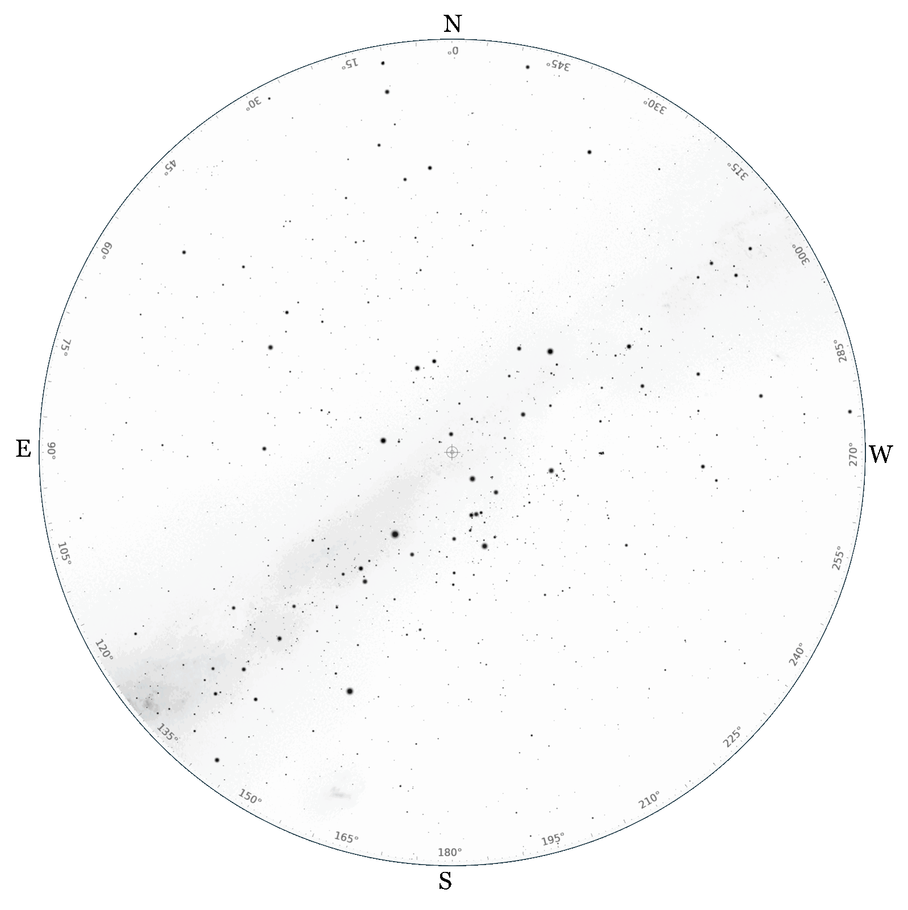
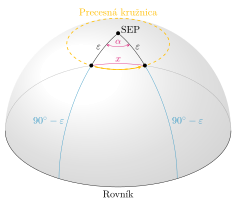
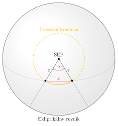
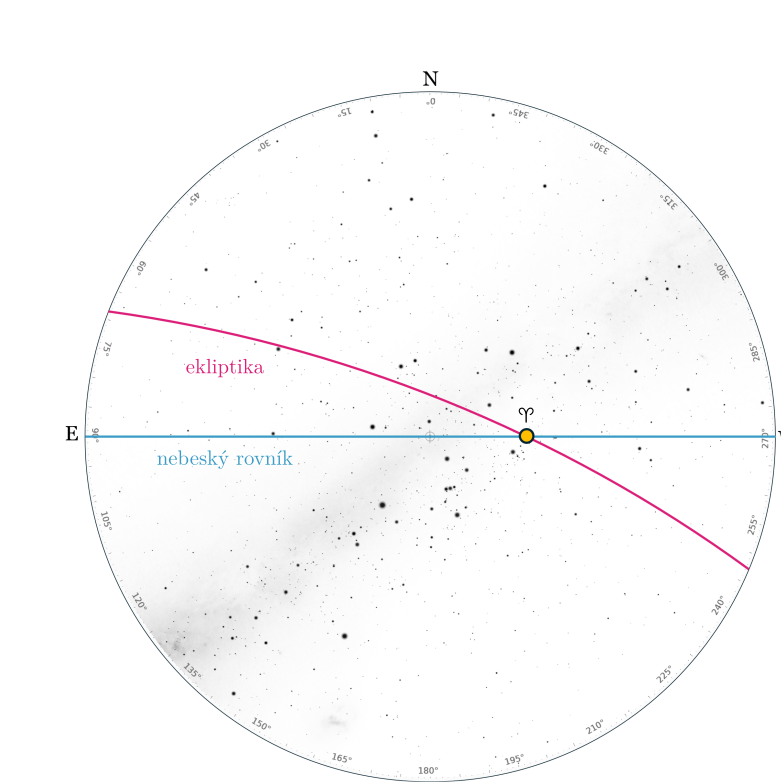

## Zadanie

Predstavte si hypotetickú situáciu, že sa vám po dlhom snažení podarilo zostrojiť stroj času, ktorý vás dokáže presunúť do minulosti. Avšak nefunguje perfektne a neviete ovládať, ako ďaleko do minulosti, a kam na Zemi vás presunie. Maximálne sa však viete posunúť o čas $P_P = 25\,800\,\mathrm{rokov}$ (Platónsky rok). Napriek tomu ho chcete vyskúšať. Ako správny astronóm si zbalíte základné astronomické pomôcky: hodinky, kompas a sextant; a stlačíte tlačidlo, ktoré spustí stroj času.

Ocitli ste sa na neznámom mieste a objavujete prostredie okolo seba. Počas zamračenej prvej noci a jasného dňa zistíte dve veci:

- Slnko kulminovalo v zenite,

- deň a noc trvali (s dostatočnou presnosťou) rovnako dlhý čas.

Po západe Slnka máte konečne šancu vykonať nočné pozorovania. Počkáte na súmrak a začnete si užívať pohľad na nočnú oblohu. Presne 8 hodín po západe Slnka vidíte oblohu ako na obrázku 2. Rýchlo si všimnete, že severný nebeský pól už nemieri do okolia Polárky.

**Úlohy**

<ol type="a">

<li>

[15 b] Zistite, v akom súhvezdí sa nachádza severný a južný pól. Do mapy na obrázku 2 načrtnite nebeský rovník.

</li>

<li>

[15 b] Napíšte, v akom súhvezdí sa nachádza severný a južný ekliptikálny pól.

</li>

<li>

[65 b] Zistite, v akom roku ste sa približne ocitli (môžete využiť, že pomocou kompasu a sextantu ste namerali, že v čase pozorovania má Polárka azimut $A = 335^{\circ}\,5'$ a výšku nad horizontom $h = 11^{\circ}\,55'$).

</li>

<li>

[30 b] Zaznačte do mapy jarný bod a napíšte v akom sa nachádza súhvezdí. Takisto do mapy načrtnite ekliptiku.

</li>

<li>

[25 b] Chcete využiť, že máte príležitosť pozorovať objekty hlbokého vesmíru bez svetelného znečistenia, a tak si chcete pripraviť zoznam pozorovateľných Messierových objektov, ktoré sú práve nad horizontom. Uveďte názov (prípadne číslo v Messierovom katalógu) aspoň desiatich a súhvezdie v akom sa nachádzajú. Ktorý objekt Messierovho katalógu by sa nachádzal nad horizontom, ale v čase pozorovania neexistoval?\
*Za nesprávne uvedené Messierove objekty vám budú odpočítané body.*

</li>

</ol>

Svoje odpovede zdôvodnite. Všetky body a kružnice na nočnej oblohe hľadajte v minulosti pre čas pozorovania, nie pre súčasnosť.

<figure>

<figcaption>

**Obrázok 2:** Mapa nočnej oblohy, ktorú vidíte $8\,\mathrm{h}$ po západe Slnka počas pozorovania v minulosti. V strede zorného poľa je zaznačený zenit a po okrajoch svetové strany.
</figcaption>

</figure>

**Pomôcka**

\
Ak zanedbáme nutáciu, posun nebeského pólu je spôsobený precesiou, čo je pohyb zemskej rotačnej osi s periódou $P_P$ (Platónskeho roka) okolo kolmice na rovinu ekliptiky s konštantným vychýlením $\varepsilon$. Ako dôsledok sa pri posúvaní naspäť v čase jarný bod pohybuje pozdĺž ekliptiky zo súhvezdia Ryby (kde je v súčasnosti) do súhvezdia Baran a ďalej.

Riešenie

Zo znalosti, že Slnko kulminuje v zenite a že deň a noc trvali približne rovnako dlho, vieme, že sme sa ocitli v čase niektorej z dvoch rovnodenností a nachádzame sa v blízkom okolí zemského rovníka. Slnko vychádza na azimute $90^{\circ}$ (východ) a zapadá na azimute $270^{\circ}$ (západ). Ak by tomu tak nebolo, tak za predpokladu, že má prechádzať zenitom, tak bude na oblohe dlhšie ako $12\,\mathrm{h}$, teda viac ako polovicu dňa.

<ol type="a">

<li>

Keďže sme na rovníku, tak severný pól sa nachádza na horizonte v smere na sever (na azimute $0^{\circ}$) a južný pól presne oproti nemu (na azimute $180^{\circ}$). Zo znalosti súhvezdí v ich okolí zistíme, že sa nachádzajú v súhvezdiach Draka a Vodného hada (na hranici so súhvezdím Hodín, obe odpovede budú uznané). Poloha nebeského rovníka je zakreslená na mape na obr.5.

</li>

<li>

Jednoduchou úvahou si vieme rozmyslieť, že rovina kolmá na zemskú os je naklonená voči rovine obehu o uhol $\varepsilon$. Zatiačo zemská os mieri do polohy nebeských pólov, kolmica na rovinu obehu smeruje do ekliptikálnych pólov. V dôsledku precesie rotuje aj smernica zemskej osi a to okolo priamky prechádzajúcej cez ekliptikálne póly. Tie nemenia svoju polohu na nebeskej sfére, sú teda v rovnakých súhvezdiach, ako dnes. Odpoveď je teda súhvezdie Draka pre severný ekliptikálny pól, resp. súhvezdie Mečiara pre južný ekliptikálny pól.

</li>

<li>

Inými slovami, potrebujeme zistiť, o koľko stupňov sa posunul severný pól zo svojej dnešnej polohy pri pohybe na precesnej kružnici okolo severného ekliptikálneho pólu. Najprv zistíme vzdialenosť $x$ dnešného severného pólu (resp. hviezdy Polárka) a severného pólu na mape. Použijeme kosínusovú vetu pre sférický trojuholník tvorený Polárkou, severným pólom a zenitom. 

$$
\cos x = \cos (90^{\circ}-h)\,\cos 90^{\circ}+\sin(90^{\circ}-h)\,\sin 90^{\circ} \,\cos(360^{\circ}-A) \,, \tag{1}
$$

 kde $(A, h)$ sú zadané azimutálne súradnice Polárky. Úpravou a použitím goniometrických vzťahov dostaneme 

$$
\cos x = \cos h \, \cos A \,. \tag{2}
$$

Následne si zostavíme trojuholník ako na obrázku 4, kde SEP označuje severný ekliptikálny pól a zvyšné dva vrcholy prislúchajú Polárke a severnému pólu na mape, ktoré sú od SEP vzdialené o $\varepsilon$, ich vzájomná vzdialenosť je $x$ a uhol pri vrchole SEP, ktorý hľadáme, je $\alpha$.

<figure>

<figcaption>

**Obrázok 4c:** Sférický trojuholník pre výpočet posunu severného nebeského pólu okolo severného ekliptikálneho pólu (SEP). Čiernou linkou je zobrazený ekliptikálny rovník a žltou čiarkovanou čiarou precesná kružnica.
</figcaption>

</figure>

Použitím kosínovej vety dostaneme 

$$
\cos x = \cos \varepsilon \,\cos \varepsilon + \sin \varepsilon \,\sin \varepsilon \, \cos \alpha \,, \tag{3}
$$

 teda pre $\alpha$ máme 

$$
\alpha = \arccos\left(\frac{\cos x-\cos^2 \varepsilon}{\sin^2 \varepsilon}\right) = 
        \arccos\left(\frac{\cos h \, \cos A - \cos^2\varepsilon}{\sin^2 \varepsilon}\right) \,. \tag{4}
$$

Toto je uhol pri SEP (na obrázku 4 ružovou), o ktorý sa posunul severný pól, pričom vieme, že sa posunie o $360^{\circ}$ za platónsky rok. Jednoduchou trojčlenkou dostaneme 

$$
\Delta t = \frac{\alpha}{360^{\circ}} P_P \,. \tag{5}
$$

 Dosadením číselných hodnôt dostaneme $\Delta t \approx 5250$ rokov, teda nachádzame sa na Zemi okolo roku $2025-5250 = -3225$, čo je približne 3000 rokov pred n.l. Druhou možnosťou by bol posun o 5250 rokov do budúcnosti, čo je ekvivalentné posunu do minulosti o $P_P - 5250\,\mathrm{rokov} = 20\,550\,\mathrm{rokov}$, teda by sme sa presunuli približne do roku $18\,500$ pred n. l. V takomto prípade by však nesedela pozorovaná obloha. Nad obzorom by musel byť jesenný bod, v ktorom však ekliptika vystupuje nad rovník (na severnú pologuľu) vo východno-západnom smere. Navyše by sme v podzadaní (d) nemohli zaznačiť jarný bod do mapy, keďže by bol pod horizontom.

<figure>

<figcaption>

**Obrázok 5:** Mapa so zakresleným nebeským rovníkom (modrou), ekliptikou (ružovou) a jarným bodom (symbol znamenia baran $\Aries$).
</figcaption>

</figure>

</li>

<li>

Môžeme si uvedomiť, že spolu so severným pólom sa pohybuje aj jarný bod a vykonáva pohyb po ekliptike tak, že vykoná pohyb po celej jej dĺžke za jeden platónsky rok. Pri ceste do minulosti sa pohybuje z dnešnej polohy v súhvezdí Ryby postupne do súhvezdia Baran a ďalej. Keďže máme časový rozdiel len 5250 rokov, bude sa nachádzať v niektorom zo súhvezdí, ktoré sú viditeľné na mape.

Polohu jarného bodu môžeme určiť zo znalosti, že jarný aj jesenný bod sa nachádzajú na horizonte v čase západu Slnka počas rovnodennosti. Oba body sa navyše stále nachádzajú na nebeskom rovníku. Počas noci prechádza jarný bod z východu (keďže Slnko zapadalo na západe a nachádza sa v jesennom bode) na západ cez zenit, teda na mape po priamke v horizontálnom smere zľava doprava. V čase západu Slnka bol jarný bod na východe a po ôsmich hodinách teda prešiel po tejto priamke vzdialenosť $\frac{8^{\mathrm{h}}}{12^{\mathrm{h}}} = \frac{2}{3}$ vzdialenosti po priamke od západu na východ, teda nachádza sa v súhvezdí Býk.

Ekliptika je rovnako ako ekliptikálne póly nehybná, teda prechádza rovnakými miestami ako dnes. Môžeme využiť, že poznáme jeden bod ekliptiky a to jarný bod, ktorý sme práve zistili. Ekliptika a jarný bod sú zakreslené na mape na obr. 5.

</li>

<li>

Na mape je viditeľných 55 Messierových objektov, ktorýkoľvek z nich je správnou odpoveďou. Nad horizontom by sa mala nachádzať aj Krabia hmlovina (M1), ale tá je pozostatkom supernovy SN 1054, ktorú pozorovali čínski astronómovia až v roku 1054, teda v čase nášho pozorovania ešte pozorovateľná určite nebola.

Kompletný zoznam je:\
M 1, M 31, M 32, M 33, M 34, M 35, M 36, M 37, M 38, M 40, M 41, M 42, M 43, M 44, M 45, M 46, M 47, M 48, M 49, M 50, M 52, M 58, M 61, M 65, M 66, M 67, M 74, M 76, M 77, M 78, M 79, M 81, M 82, M 84, M 85, M 86, M 87, M 88, M 89, M 90, M 91, M 93, M 94, M 95, M 96, M 97, M 98, M 99, M 100, M 103, M 105, M 106, M 108, M 109, M 110

</li>

</ol>

## Komentár autora

V dnešnej dobe, keď sa neustále zvyšuje úroveň svetelného znečistenia a množstvo satelitov na oblohe, amatérski astronómovia by určite ocenili vynález stroja času ako jeden z prostriedkov, ako uskutočniť kvalitné nočné pozorovanie.
