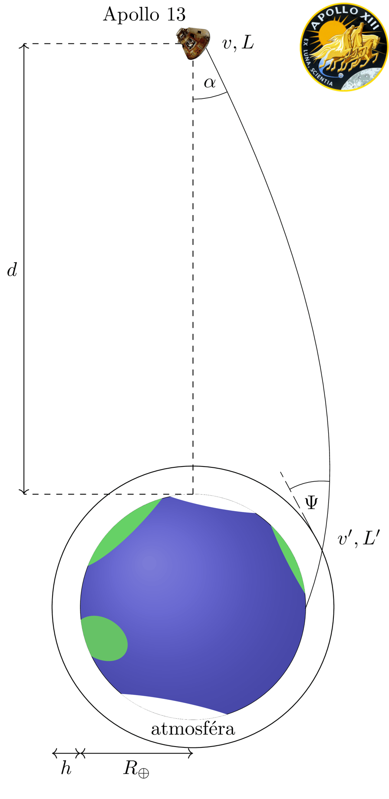

## Zadanie

Modul Apolla 13 sa pohybuje vo vzdialenosti $1000\,\mathrm{km}$ od povrchu Zeme rýchlosťou $v = 9{,}5\,\mathrm{km}\,{\mathrm{s}}^{-1}$, pričom uhol dráhy Apolla a spojnice Apolla so Zemou je v danej chvíli $35^{\circ}$.

<ol type="a">

<li>

[50 b] Vypočítajte uhol vstupu do atmosféry vo výške $100\,\mathrm{km}$ nad povrchom Zeme. Nad výškou $100\,\mathrm{km}$ uvažujte odpor atmosféry za zanedbateľný.

</li>

<li>

[5 b] Čo by sa stalo, keby bol uhol vstupu do atmosféry príliš malý a naopak, keby bol príliš veľký?

</li>

<li>

[5 b] Aké vplyvy pôsobia na modul po vstupe do atmosféry?

</li>

</ol>

*Pomôcka:* V príklade sa vám môže hodiť vzorec pre veľkosť vektorového súčinu dvoch vektorov, $|\vec{a} \times \vec{b}| = |\vec{a}| |\vec{b}| \sin \theta$, kde $\theta$ je uhol, ktorý zvierajú vektory $\vec{a}$ a $\vec{b}$.

Riešenie

<ol type="a">

<li>

Ako prvé si situáciu zakreslíme do obrázku 1. Vo vzdialenosti $d = 1000\,\mathrm{km}$ nad povrchom Zeme má modul Apolla 13 voči Zemi rýchlosť $v = 9{,}5\,\mathrm{km}\,{\mathrm{s}}^{-1}$ a moment hybnosti $L$. Pri vstupe do atmosféry vo výške $h=100\,\mathrm{km}$ má rýchlosť $v'$ a moment hybnosti $L'$.

Použijeme rovnicu Vis viva pre Apollo vo vzdialenosti $d$ od povrchu Zeme, teda vo vzdialenosti $r = R_\Ea + d$ od stredu Zeme. Teda 

$$
v^2 = GM \left(  \frac{2}{r} - \frac{1}{a}  \right ) =
    GM_\Ea \left (  \frac{2}{d+R_\Ea} - \frac{1}{a}  \right ) \,. \tag{1}
$$

Z toho vieme vyjadriť hlavnú polos $a$. 

$$
\begin{align*}
    v^2 &= \frac{2 GM_\Ea}{d+R_\Ea} - \frac{GM_\Ea}{a} \,, \tag{2}\\
    \frac{GM_\Ea}{a} &= \frac{2 GM_\Ea}{d+R_\Ea} - v^2 \,, \tag{3}\\
    a &= \frac{GM_\Ea}{\frac{2GM_\Ea}{d+R_\Ea} - v^2} \,. \tag{4}\end{align*}
$$

 Po dosadení 

$$
a \approx 22{,}4 \cdot 10^{6}\,\mathrm{m} \,. \tag{5}
$$

</li>

</ol>

<figure>

<figcaption>

**Obrázok 1:** Náčrt letu Apolla 13.
</figcaption>

</figure>

Pre dráhu Apolla 13 sa zachováva jej veľká polos $a$ (mimo atmosféru Zeme), čiže jej hodnota je rovnaká v $1000\,\mathrm{km}$ a $100\,\mathrm{km}$ nad povrchom. Na základe toho vieme pomocou ďalšej rovnice Vis viva určiť rýchlosť $v'$ vstupu Apolla 13 do atmosféry Zeme (vo výške $100\,\mathrm{km}$). 

$$
\begin{align*}
    (v')^2 &= GM_\Ea \left(  \frac{2}{h+R_\Ea} - \frac{1}{a}  \right ) \,, \tag{6}\\
    v' &= \sqrt{GM_\Ea \left(  \frac{2}{h+R_\Ea} - \frac{1}{a}  \right )} \,, \tag{7}\\
    v' &
    \approx 10{,}3\,\mathrm{km}\,{\mathrm{s}}^{-1} \,. \tag{8}\end{align*}
$$

Ďalej platí zákon zachovania momentu hybnosti, teda 

$$
\vec{L} = \vec{L'} \,, \tag{9}
$$

 pričom moment hybnosti $\vec{L}$ sa vypočíta ako $\vec{L} = m \, \vec{r} \times \vec{v}$, čiže 

$$
m \, \vec{r} \times \vec{v} = m \, \vec{r'} \times \vec{v'} \,. \tag{10}
$$

 Hmotnosť $m$ Apolla 13 zostáva rovnaká a môžeme ju preto zo vzťahu vykrátiť. 

$$
\vec{r} \times \vec{v} = \vec{r'} \times \vec{v'} \,. \tag{11}
$$

 To znamená, že platí aj rovnosť 

$$
|\vec{r} \times \vec{v}| = |\vec{r'} \times \vec{v'}| \,. \tag{12}
$$

 Tu sa nám bude hodiť pomôcka zo zadania. Vektor $\vec{r}$ uvažujeme, že mieri z modulu Apolla smerom do stredu Zeme. Potom $\vec{r}$ a $\vec{v}$ zvierajú uhol $\alpha = 35^{\circ}$, čiže 

$$
|\vec{r} \times \vec{v}| = r \, v \sin \alpha\,. \tag{13}
$$

 Ak by sme naopak uvažovali, že $\vec{r}$ mieri zo stredu Zeme smerom k Apollu, potom by bol uhol medzi $\vec{r}$ a $\vec{v}$ rovný $180^{\circ} - \alpha$. Na výsledku by to však nič nezmenilo, keďže $\sin(180^{\circ} - \alpha) = \sin\alpha$. Vzdialenosti vystupujúce v (13) napíšeme jednoducho ako 

$$
r = d + R_\Ea \a
r' = h + R_\Ea \,, \tag{14}
$$

 kde $d$ je vzdialenosť Apolla od povrchu Zeme, $h$ je výška nad povrchom Zeme, v ktorej začína atmosféra a $R_\Ea$ je polomer Zeme.

Pri vstupe do atmosféry je situácia o niečo zložitejšia. Uhol medzi vektormi $\vec{r'}$ a $\vec{v'}$ označme $\theta$. Je to ostrý uhol medzi spojnicou Apollo – Zem a dráhou Apolla. Preň platí $|\vec{r'} \times \vec{v'}| = r' \, v' \sin \theta$.

Uhol vstupu do atmosféry $\Psi$ je doplnkom $\theta$ do $90^{\circ}$, teda $\theta = 90^{\circ} - \Psi$, keďže ak by bolo $\Psi = 0^{\circ}$, tak by bola rýchlosť $\vec{v'}$ kolmá na spojnicu Apollo – Zem a naopak, ak by sme vstupovali kolmo do atmosféry ($\Psi=90^{\circ}$), tak by bolo $\theta=0^{\circ}$, čiže veľkosť vektorového súčinu nulová. Preto 

$$
|\vec{r'} \times \vec{v'}| = r' v' \sin \theta = r' v' \sin(90^{\circ}-\Psi) = r' v' \cos \Psi \,. \tag{15}
$$

Prepíšeme si teda našu rovnicu (11) a vyjadríme si uhol vstupu Apolla 13 do atmosféry. 

$$
\begin{align*}
    (d + R_\Ea) v \sin \alpha &= (h + R_\Ea) v' \cos \Psi \,, \tag{16}\\
    \cos \Psi &= \frac{(d + R_\Ea) v \sin \alpha}{(h + R_\Ea) v'} \,, \tag{17}\\
    \Psi &= \arccos \left ( \frac{(d + R_\Ea) v \sin \alpha}{(h + R_\Ea) v'} \right ) \,. \tag{18}\end{align*}
$$

 Po dosadení dostávame výsledok 

$$
\Psi \approx 52^{\circ}\,46' \,. \tag{19}
$$

<ol type="a" start="2">

<li>

Keby bol tento uhol príliš malý, tak pri vstupe modulu do atmosféry by sa mohlo stať, že sa celý ”odrazí” od atmosféry naspäť do vesmíru. Ak by bol, naopak, príliš veľký, tak by sa modulu Apollo 13 mohol zlomiť tepelný štít, čo by mohlo byť smrteľné pre astronautov v ňom.

</li>

<li>

Vplyvov, ktoré pôsobia na modul po vstupe do atmosféry, je hneď niekoľko. Je to napríklad vysoká teplota, ktorá vzniká stláčaním a trením častíc plynu a vzduchu proti povrchu modulu, ktorá tiež spôsobuje veľký tlak v kabíne. Taktiež by sa mohlo stať, že by nastala zrážka modulu s (mikro)meteoroidmi, vesmírnym odpadom alebo inými troskami, ktoré obiehajú okolo Zeme.

</li>

</ol>

**Poznámka**

\
Veľkosť vektorového súčinu je rovná ploche rovnobežníka, ktorý vznikne z vektorov, ktoré do tohto súčinu vstupujú. Uhol medzi vektormi preto hrá zásadnú rolu v tom, aký bude výsledok. Čím bude menší, tým bude rovnobežník skosenejší a jeho plocha menšia. Hranične pre nulový uhol splynú strany rovnobežníka do jednej priamky a plocha bude nulová. Preto sa vo vzťahu na výpočet veľkosti vektorového súčinu vyskytuje funkcia sínus. Je to funkcia, ktorá je nula pre nulový uhol a jedna pre uhol $90^{\circ}$. Vtedy sú na seba strany kolmé, čím vzniká obdĺžnik a plocha je maximálna.

## Komentár autora

Všetci poznáme príbeh misie Apolla 13, ktorej posádka sa po výbuchu jednej z kyslíkových nádrží a neúspešnom pokuse o pristátie na Mesiaci snažila bezpečne vrátiť na Zem. V tomto príklade sme si predstavili túto situáciu a snažili sa pomôcť astronautom bezpečne pristáť.
