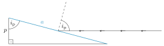

## Zadanie

<figure>

<figcaption>

**Obrázok 1:** Relatívna dráha.
</figcaption>

</figure>

Predstavme si hypotetickú situáciu. Pozorujete dvojhviezdny systém. Poznáte hmotnosť primárnej zložky $M_1=4,5M_{\Sun}$ a sekundárnej zložky $M_2=1,2M_{\Sun}$. Vidíte, že sekundárna zložka vykresľuje na oblohe elipsu relatívne voči primárnej zložke s periódou $T=13{,}2\,\mathrm{rokov}$. Schématicky situáciu zobrazuje obr. 1, pričom uhlová veľkosť hlavnej polosi je $q''=8{,}4''$ a uhlová veľkosť vedľajšej polosi je $p''=2{,}6''$. Uvažujte, že sa systém nachádza vo vzdialenosti $d = 1\,\mathrm{pc}$.

Vypočítajte

<ol type="a">

<li>

[10 b] aké možné hodnoty môže nadobúdať hlavná polos systému,

</li>

<li>

[25 b] aké možné hodnoty môže nadobúdať inklinácia systému,

</li>

<li>

[25 b] aké možné hodnoty môže nadobúdať excentricita systému.

</li>

</ol>

*Pomôcka:* Inklinácia systému je uhol medzi zorným lúčom a kolmicou na rovinu obehu.

*Poznámka:* V skutočnosti sa najbližšia hviezda k Slnku nachádza vo vzdialenosti väčšej ako $1\,\mathrm{pc}$ (konkrétne $1{,}3\,\mathrm{pc}$), jedná sa teda naozaj len o čisto hypotetickú situáciu.

Riešenie

<ol type="a">

<li>

Rovina, v ktorej obiehajú hviezdy okolo seba, môže byť naklonená voči nášmu zornému lúču (ako napovedá názov tejto úlohy). Avšak bez ohľadu na tento sklon (inklináciu $i$) bude platiť 3. Keplerov zákon rovnako. Pre hlavnú polos $a$ v astronomických jednotkách, periódu $P$ v rokoch a hmotnosti hviezd $M_1, M_2$ v hmotnostiach Slnka $M_\Sun$ má tvar 

$$
\frac{a^3}{T^2} = M_1 + M_2 \,. \tag{1}
$$

 Po vyjadrení a dosadení dostávame vzťah pre hlavnú polos 

$$
a = \sqrt[3]{T^2 (M_1+M_2)} \approx 10\,\mathrm{au} \,. \tag{2}
$$

</li>

<li>

Prvotne si musíme premeniť pozorované uhlové rozmery na fyzické rozmery (všeobecne $R$) polosí. Keďže pozorujeme malé uhly, môžeme použiť aproximovaný vzťah $R\,\left[ \mathrm{au}\right]=d\,\left[ \mathrm{pc}\right]\cdot\Theta\,\left[ ''\right]$. Teda $q=8{,}4\,\mathrm{au}$ a $p=2{,}6\,\mathrm{au}$. Vidíme, že pozorovaná hlavná polos nie je $10\,\mathrm{pc}$ ako nám vyšlo v podzadaní (a). To znamená, že systém musí byť naklonený a my pozorujeme iba priemet dráhy. Overiť si to môžeme aj tým, že pozorovaná hlavná polos $q$ nespĺňa 3. Keplerov zákon (pracujeme opäť v rovnakých jednotkách ako v (1)) 

$$
\frac{q^3}{T^2} \approx 3,4 \neq 5,7 = M_1+M_2 \,. \tag{3}
$$

Dokonca $q$ ani nemusí byť hlavnou polosou. Závisí to na smere sklonu systému. Hraničné prípady sú sklonenie pozdĺž hrany $q$ o uhol inklinácie $i_p$ (kedy sa predlžuje strana $p$) a sklonenie pozdĺž hrany $p$ o uhol inklinácie $i_q$ (kedy sa predlžuje strana $q$). Ostatné možné naklonenia (šikmo) budú mať dĺžky polosí medzi týmito hraničnými prípadmi. Našou úlohou bude nájsť také sklonenie elipsy, aby reálna hodnota hlavnej polosi odpovedala hodnote spočítanej v (a), teda musí platiť (2).

**Sklopenie cez hranu $\bm{q}$**

: V tomto prípade pozorujeme ako hlavnú polos stranu $p$, ktorá je priemetom reálnej polosi $a$, tak ako je na obrázku 2. Potom pre inklináciu platí 

$$
\cos{\left(i_p\right)}=\frac{p}{a}  \, . \tag{4}
$$

 Zároveň musí pre veľkú polos platiť vzťah (2), teda po dosadení 

$$
\cos{\left(i_p\right)}=\frac{p}{\sqrt[3]{T^2 (M_1+M_2)}} \ztv i_p \approx 75^{\circ} \,. \tag{5}
$$

<figure>

<figcaption>

**Obrázok 2:** Nákres systému z boku po sklonení cez hranu $q$.\
Pozorovaná polos $p$ je priemet reálnej polosi $a$, ktorá je vyznačená modrou farbou.
</figcaption>

</figure>

**Sklopenie cez hranu $\bm{p}$**

: V tomto prípade pozorujeme ako hlavnú polos stranu $q$, ktorá je priemetom reálnej polosi $a$, tak ako je na obrázku 3. Situácia je obdobná ako predtým, použijeme teda rovnaký postup.

<figure>

<figcaption>

**Obrázok 3:** Nákres systému z boku po sklonení cez hranu $p$.\
Pozorovaná polos $q$ je priemet reálnej polosi $a$, ktorá je vyznačená modrou farbou.
</figcaption>

</figure>

$$
\cos(i_q) = \frac{q}{a} = \frac{q}{\sqrt[3]{T^2 (M_1+M_2)}} \ztv i_q \approx 33^{\circ} \,. \tag{6}
$$

Inklinácia teda môže nadobúdať hodnoty v rozmedzí 

$$
i \in \langle i_q ;\, i_p \rangle \approx \langle 33^{\circ} ;\, 75^{\circ} \rangle \,. \tag{7}
$$

</li>

<li>

Vo všeobecnosti excentricitu spočítame z hodnôt hlavnej polosi $a$ a vedľajšej polosi $b$ ako 

$$
e=\frac{\sqrt{a^2 - b^2}}{a} \,. \tag{8}
$$

 Hlavná polos je stále rovnaká, ale v našich dvoch hraničných prípadoch je vedľajšia polos rovná strane okolo ktorej sklápame elipsu, a teda jej reálna dĺžka je rovná pozorovanej. Po dosadení konkrétnych hodnôt máme pre hraničné prípady 

$$
e_p=\frac{\sqrt{a^2 - q^2 }}{a} \approx 0,54 \a 
    e_q=\frac{\sqrt{a^2 - p^2 }}{a} \approx 0,97\,. \tag{9}
$$

Excentricita $e$ môže teda nadobúdať hodnotu v rozmedzí 

$$
e \in \langle e_p ;\, e_q \rangle \approx \langle 0,54 ;\, 0,97 \rangle \,. \tag{10}
$$

Dôležité je ale rozmyslieť si, že hoci píšeme, že inklinácia a excentricita môže nadobúdať ľubovoľnú hodnotu v danom rozsahu, tak tieto veličiny sú prepojené. Teda ak jednu z nich zafixujeme, druhá sa nastaví podľa nej.

</li>

</ol>

## Komentár autora

Nie vždy je všetko také, ako sa na prvý pohľad môže zdať.
