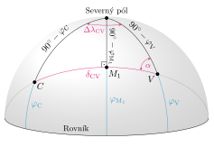
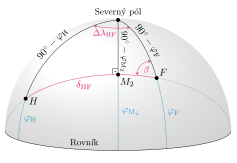

## Zadanie

Skupina astronómov cestovala do USA za úplným zatmením Slnka, ktoré sa odohralo 8. apríla 2024. Po ceste do USA leteli z Viedne do Chicaga a naspäť do Európy leteli z Houstonu do Frankfurtu. Zaujímalo ich, či aspoň počas jedného letu preletia ponad Grónsko. Vopred si zistili, že najjužnejší cíp Grónska sa nachádza na zemepisnej šírke $\varphi_G = 59^{\circ}\,46'$ N.

Pre obidva lety rozhodnite, či sa lietadlo dostane dostatočne na sever, aby mohlo letieť ponad Grónsko. Svoje tvrdenie podložte výpočtom. Predpokladajte, že lietadlá leteli presne po hlavných kružniciach.

Súradnice jednotlivých letísk sú:

- Viedeň: $\varphi_V = 48^{\circ}\,7'$ N, $\lambda_V = 16^{\circ}\,34'$ E,

- Chicago: $\varphi_C = 41^{\circ}\,59'$ N, $\lambda_C = 87^{\circ}\,54'$ W,

- Houston: $\varphi_H = 29^{\circ}\,59'$ N, $\lambda_H = 95^{\circ}\,20'$ W,

- Frankfurt: $\varphi_F = 50^{\circ}\,2'$ N, $\lambda_F = 8^{\circ}\,34'$ E,

*Pomôcka:* Môže sa vám hodiť fakt, že poludník prechádzajúci najsevernejším bodom dráhy lietadla je na túto dráhu kolmý.

Riešenie

Najskôr sa sústredíme na let z Viedne do Chicaga a nakreslíme si sférický trojuholník, ktorého vrcholy sú Viedeň, Chicago a severný pól. Strana spájajúca Viedeň a Chicago je hlavná kružnica, po ktorej sa pohybuje lietadlo. Spojnica najsevernejšieho bodu dráhy M$_1$ a severného pólu (teda vlastne poludník) je na samotnú dráhu kolmá.

Naším cieľom je zistiť zemepisnú šírku $\varphi_{M_1}$ tohto najsevernejšieho bodu dráhy. Potom ju porovnáme so zemepisnou šírkou najjužnejšieho cípu Grónska, čo nám napovie, či existuje šanca, že lietadlo poletí ponad Grónsko.

<figure>

<figcaption>

**Obrázok 1:** Sférická schéma letu z Viedne do Chicaga.
</figcaption>

</figure>

Hodnotu $\varphi_{M_1}$ nevieme vypočítať priamo, musíme najskôr zistiť veľkosti iných strán a uhlov. Využijeme kosínusovú vetu pre sférický trojuholník a vypočítame uhlovú veľkosť dráhy lietadla z Viedne do Chicaga, teda $\delta_{CV}$. 

$$
\cos \delta_{CV} = \sin \varphi_C \, \sin \varphi_V + \cos \varphi_C \, \cos \varphi_V \, \cos \Delta\lambda_{CV}\, . \tag{1}
$$

 Pri dosadzovaní za rozdiel zemepisných dĺžok miest si treba dať pozor na to, že Viedeň leží na východnej pologuli a Chicago na západnej pologuli, hodnoty ich zemepisných dĺžok je preto potrebné sčítať. Dostaneme tak medzivýsledok $\delta_{CV} = 68^{\circ}\,2'$.

Teraz potrebujeme zistiť ešte aspoň jeden uhol vnútri veľkého trojuholníka – napríklad uhol $\alpha$ medzi dráhou lietadla a poludníkom Viedne. Použijeme na to sínusovú vetu 

$$
\frac{\sin \delta_{CV}}{\sin \Delta\lambda_{CV}} = \frac{\cos \varphi_C}{\sin \alpha}\, . \tag{2}
$$

 Dostávame $\alpha = 50^{\circ}\,54'$.

Teraz už vieme využiť sínusovú vetu pre menší trojuholník VM$_1$SP a dopočítať $\varphi_{M_1}$. 

$$
\frac{\cos \varphi_V}{\sin 90^{\circ}} = \frac{\cos \varphi_{M_1}}{\sin \alpha}\, . \tag{3}
$$

Dostaneme $\varphi_{M_1} = 58^{\circ}\,48'$, čo znamená, že najsevernejší bod dráhy lietadla je stále na juh od najjužnejšieho bodu Grónska ($\varphi_G = 59^{\circ}\,46'$). Po ceste do USA teda lietadlo ponad Grónsko určite nemôže preletieť.

Rovnakým spôsobom riešime aj prípad letu z Houstonu do Frankfurtu. Najskôr si s pomocou kosínusovej vety vypočítame uhlovú veľkosť dráhy lietadla.

<figure>

<figcaption>

**Obrázok 2:** Sférická schéma letu z Houstonu do Frankfurtu.
</figcaption>

</figure>

$$
\cos \delta_{HF} = \sin \varphi_H \, \sin \varphi_F + \cos \varphi_H \, \cos \varphi_F \, \cos \Delta\lambda_{HF}\, . \tag{4}
$$

Vyjde nám $\delta_{HF} = 75^{\circ}\,34'$, čo využijeme pri dosadení do sínusovej vety a výpočte uhla $\beta$ pri vrchole trojuholníka vo Frankfurte. 

$$
\frac{\sin \delta_{HF}}{\sin \Delta\lambda_{HF}} = \frac{\cos \varphi_H}{\sin \beta}\, . \tag{5}
$$

Dostaneme $\beta = 60^{\circ}\,15'$ a teraz už len potrebujeme dopočítať zemepisnú šírku najsevernejšieho bodu tohto letu 

$$
\frac{\cos \varphi_F}{\sin 90^{\circ}} = \frac{\cos \varphi_{M_2}}{\sin \beta}\, . \tag{6}
$$

Číselne dostávame $\varphi_{M_2} = 56^{\circ}\,6'$, teda ani počas spiatočného letu do Európy sa lietadlo nedostane dostatočne na sever, aby mohlo letieť ponad Grónsko.

