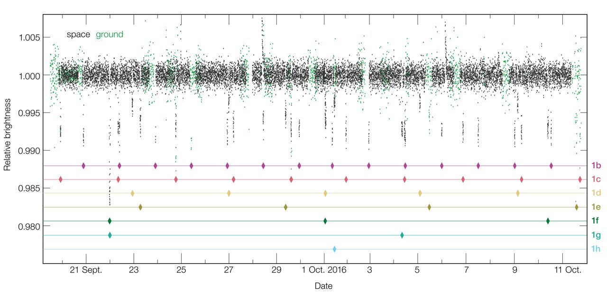

## Zadanie

Rýchlo sa rozvíjajúce odvetvie astronómie je výskum exoplanét. Počet objavených exoplanét a ich systémov stále rastie. Jednou z najrozšírenejších metód výskumu exoplanét je tzv. ”metóda tranzitov”. Tranzit je úkaz, keď sa z nášho pohľadu dostane exoplanéta pred materskú hviezdu a nastane pokles jej jasnosti.

V rokoch 2015/2016 bola objavená planetárna sústava pri hviezde TRAPPIST-1. Jedná sa o relatívne blízku planetárnu sústavu vo vzdialenosti $d =12{,}4\,\mathrm{pc}$, ktorá obsahuje 7 exoplanét. Na priloženom grafe (obr. 1) vidíme svetelnú krivku a graf s vyznačenými časmi tranzitov jednotlivých planét (b – h). O materskej hviezde ďalej vieme hmotnosť $M = 0{,}0898\,\mathit{M}_\Sun$, polomer $R = 0{,}1192\,\mathit{R}_\Sun$ a maximum vyžarovania má na vlnovej dĺžke $\lambda_{max} = 1{,}13\,\mu \mathrm{m}$.

Nasledujúce úlohy riešte pre planéty b – g:

<ol type="a">

<li>

[25 b] Z grafu zistite obežné doby jednotlivých planét okolo materskej hviezdy.

</li>

<li>

[35 b] Určte veľké polosi dráh týchto planét.

</li>

<li>

[30 b] Pre ďalšie výpočty budete potrebovať poznať povrchovú teplotu hviezdy, preto ju vypočítajte zo zadaných údajov.

</li>

<li>

[35 b] Určte svietivosť hviezdy (energiu vyžiarenú na všetkých vlnových dĺžkach za jednotku času celým povrchom hviezdy). Ak ste v predošlej úlohy nezískali teplotu použite hodnotu $3000\,\mathrm{K}$.

</li>

<li>

[35 b] Určte ekvivalent slnečnej konštanty pre jednotlivé planéty.

</li>

<li>

[20 b] Porovnajte ”slnečné konštanty” na týchto planétach so slnečnou konštantou na Zemi, $k_\Ea = 1361\,\mathrm{W}\,{\mathrm{m}}^{-2}$ a diskutujte, na ktorej planéte by sa mohol vyskytovať život.

</li>

</ol>

<figure>

<figcaption>

**Obrázok 1:** Závislosť relatívnej jasnosti na čase v dňoch. Značkami sú vyznačené okamihy tranzitov.\
Zdroj: ESO, M. Gillon et al. Dostupné online: <https://www.eso.org/public/images/eso1706e/>\
</figcaption>

</figure>

Riešenie

<ol type="a">

<li>

Na zistenie obežných periód jednotlivých planét použijeme priloženú svetelnú krivku s označenými tranzitmi jednotlivých planét. Obežná perióda planéty bude doba medzi dvoma po sebe nasledujúcimi tranzitmi. Keďže v grafe nie je mriežka s úplne veľkou presnosťou, určíme si mierku grafu. (Toto riešenie zodpovedá grafu vo formáte A4, pri iných formátoch, prípadne riešení v digitálnej forme, sa môže líšíť.) Najpresnejšie bude merať čo najväčšie vzdialenosti pomocou pravítka (takto eliminujeme chyby).

Odmeraním zistíme, že $21\,\mathrm{dní}$ zodpovedá $20\,\mathrm{cm}$ (jedná sa o vzdialenosť dvoch najvzdialenejších označených bodov na časovej osi v grafe), a teda pre lepšie využite pri výpočtoch, $1\,\mathrm{cm}$ v grafe zodpovedá času $1{,}05\,\mathrm{dní}$. Toto môžeme ďalej využiť na riešenie, kde sa budeme taktiež snažiť merať čo najväčší počet periód, aby sme predišli chybám. Riešenie si môžeme zapísať do tabuľky. Zmerali sme vzdialenosť dvoch najvzdialenejších tranzitov pre každú planétu a previedli ju na čas pomocou zistenej mierky grafu. Následne samotná obežná perióda je tento čas predelený počtom periód, ktoré počas tohto času prebehli.

**Tabuľka 1:** Meranie obežných periód jednotlivých planét. Mierka grafu na prepočet vzdialeností v grafe a časových úsekov je $1\,\mathrm{cm} \leftrightarrow 1{,}05\,\mathrm{dní}$.

|  |  |  |  |  |  |
|:--:|:--:|:--:|:--:|:--:|:--:|
| Planéta | Počet periód | Dĺžka $[\mathrm{cm}]$ | Čas $[\mathrm{deň}]$ | Obežná perióda $[\mathrm{deň}]$ | Obežná perióda $[\mathrm{s}]$ |
| b | 13 | 18,7 | 19,6 | 1,51 | 130 000 |
| c | 9 | 20,8 | 21,8 | 2,43 | 210 000 |
| d | 4 | 15,4 | 16,2 | 4,04 | 349 000 |
| e | 3 | 17,4 | 18,3 | 6,09 | 526 000 |
| f | 2 | 17,5 | 18,4 | 9,19 | 794 000 |
| g | 1 | 11,7 | 12,3 | 12,3 | 1 060 000 |

</li>

<li>

Na výpočet veľkých polosí planét použijeme 3. Keplerov zákon v úplnom tvare 

$$
\frac{a^3}{P^2} = \frac{G (M + m)}{4 \pi^2} \,, \tag{1}
$$

 kde $a$ je veľká polos v metroch, $P$ je obežná perióda v sekundách, $G = 6{,}674 \cdot 10^{-11}\,{\mathrm{m}}^{3}\,{\mathrm{kg}}^{-1}\,{\mathrm{s}}^{-2}$ je gravitačná konštanta a $M$, $m$ je hmotnosť hviezdy a hmotnosť planéty v kilogramoch. Budeme predpokladať, že platí $m \ll M$, a teda hmotnosť planéty môžeme vo vzťahu zanedbať. Následne vieme vyjadriť veľkú polos 

$$
a = \sqrt[3]{\frac{G M P^2}{4 \pi^2}} \,. \tag{2}
$$

Výsledky si môžeme opäť zapísať do malej tabuľky (tabuľka 2).

**Tabuľka 2:** Tabuľka veľkých polosí jednotlivých planét.\
Výsledky sú zapísané v miliardách metrov a stotinách astronomických jednotkách.

|           |      |      |      |      |      |      |
|:---------:|:----:|:----:|:----:|:----:|:----:|:----:|
|           |      |      |      |      |      |      |
|  Planéta  |  b   |  c   |  d   |  e   |  f   |  g   |
| $a\,[10^9 \, \mathrm{m}]$ | 1,73 | 2,37 | 3,33 | 4,37 | 5,75 | 6,98 |
| $a\,[10^{-2} \, \mathrm{au}]$ | 1,15 | 1,58 | 2,22 | 2,92 | 3,84 | 4,67 |

</li>

<li>

Teplotu hviezdy určíme na základe Wienovho posunovacieho zákona, ktorý nám udáva vzťah medzi efektívnou povrchovou teplotou hviezdy $T$ a vlnovou dĺžkou $\lambda_{max}$, na ktorej má hviezda maximum vyžarovania 

$$
T \cdot \lambda_{\mathrm{max}} = b = 2,898\cdot10^{-3}\,, \tag{3}
$$

 odkiaľ si vyjadríme teplotu ako 

$$
T = \frac{2,898\cdot10^{-3}}{\lambda_{\mathrm{max}}} \approx 2560\,\mathrm{K} \,. \tag{4}
$$

</li>

<li>

Žiarivý výkon hviezdy $L$ určíme pomocou Stefanovho-Boltzmannovho zákona v tvare 

$$
L = 4 \pi R^2 \sigma T^4 \,, \tag{5}
$$

 kde $R$ je polomer hviezdy, $\sigma = 5{,}670 \cdot 10^{-8}\,\mathrm{W} . \mathrm{m}^{-2} . \mathrm{K}^{-4}$ je Stefanova-Boltzmannova konštanta a $T$ je povrchová teplota hviezdy. Po dosadení v základných jednotkách dostaneme žiarivý výkon $L \approx 2,12e{23}\,\mathrm{W}$.

</li>

<li>

Slnečná konštanta $k$ je energia z hviezdy, ktorá dopadne na jednotku plochy planéty orientovanej kolmo na lúče za jednu sekundu bez extinkcie (mimo atmosféry). Energia $L$ vyžiarená hviezdou za $1\,\mathrm{s}$ sa rovnomerne rozloží na povrch gule s polomerom rovným veľkej polosi dráhy planéty $a$. Na $1\,{\mathrm{m}}^{2}$ dopadá za $1\,\mathrm{s}$ energia rovná ”slnečnej konštante” $k$ a plocha celej sféry je $4\pi a^2$. Teda 

$$
L = 4 \pi a^2 k \,, \tag{6}
$$

 odkiaľ po vyjadrení dostaneme vzťah pre $k$, 

$$
k = \frac{L}{4 \pi a^2} \,. \tag{7}
$$

**Tabuľka 3:** Tabuľka ”slnečných konštánt” jednotlivých planét.

|           |      |      |      |     |     |     |
|:---------:|:----:|:----:|:----:|:---:|:---:|:---:|
|           |      |      |      |     |     |     |
|  Planéta  |  b   |  c   |  d   |  e  |  f  |  g  |
| $k\,[\mathrm{W}\,{\mathrm{m}}^{-2}]$ | 5670 | 3020 | 1530 | 884 | 511 | 347 |

</li>

<li>

Podmienka pre život na exoplanéte podľa našich doterajších vedomostí je voda v kvapalnom skupenstve, a teda teplota na planéte, pri ktorej sa môže udržať kvapalná voda. Toto môžeme odhadnúť na základe porovnania ”slnečnej konštanty” so slnečnou konštantou na Zemi. V krajnom prípade môžeme povedať, že obývateľná zóna by mohla byť od dvojnásobku po polovicu zemskej slnečnej konštanty, a teda by v nej ležali planéty ”d” a ”e”. Dôležité je si uvedomiť, že nielen dopadajúca energia vplýva na život na planétach. V prípade spomínaných planét môže byť problém blízkosť pri materskej hviezde a vplyv hviezdneho vetra či prípadne radiácie. Takže dôležitú úlohu by zohrala magnetosféra a atmosféra.

</li>

</ol>

## Komentár autora

Príklad je ukážka toho, že aj s jednoduchými fyzikálnymi modelmi a zákonmi sa dajú robiť celkom dobré odhady vo svete výskumu exoplanét.
