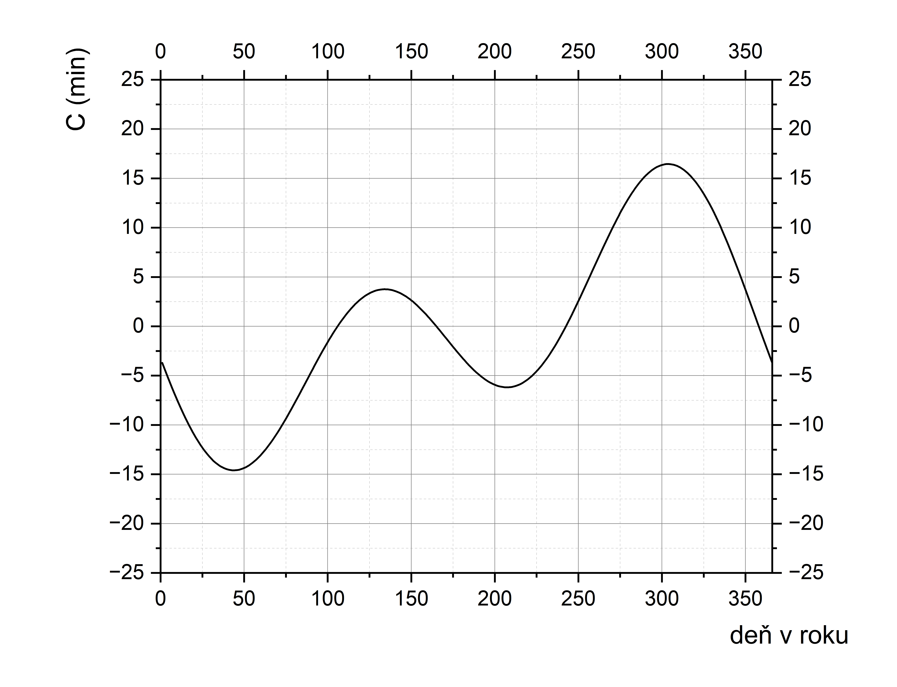
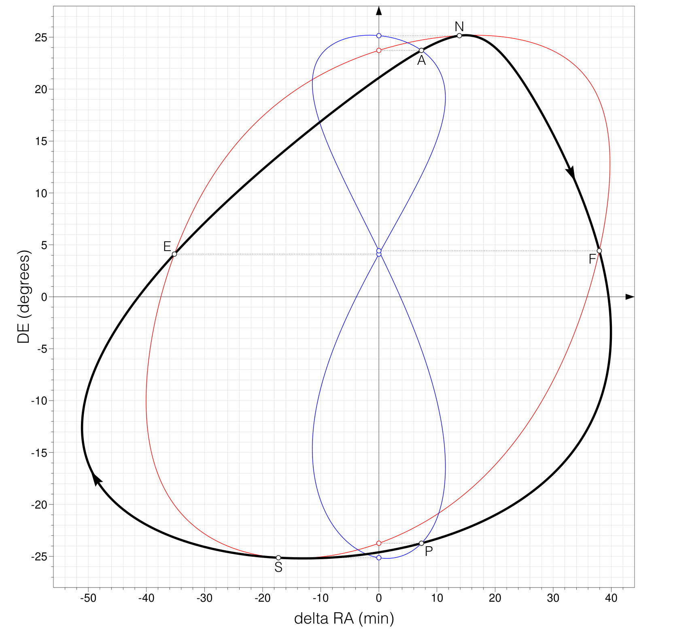
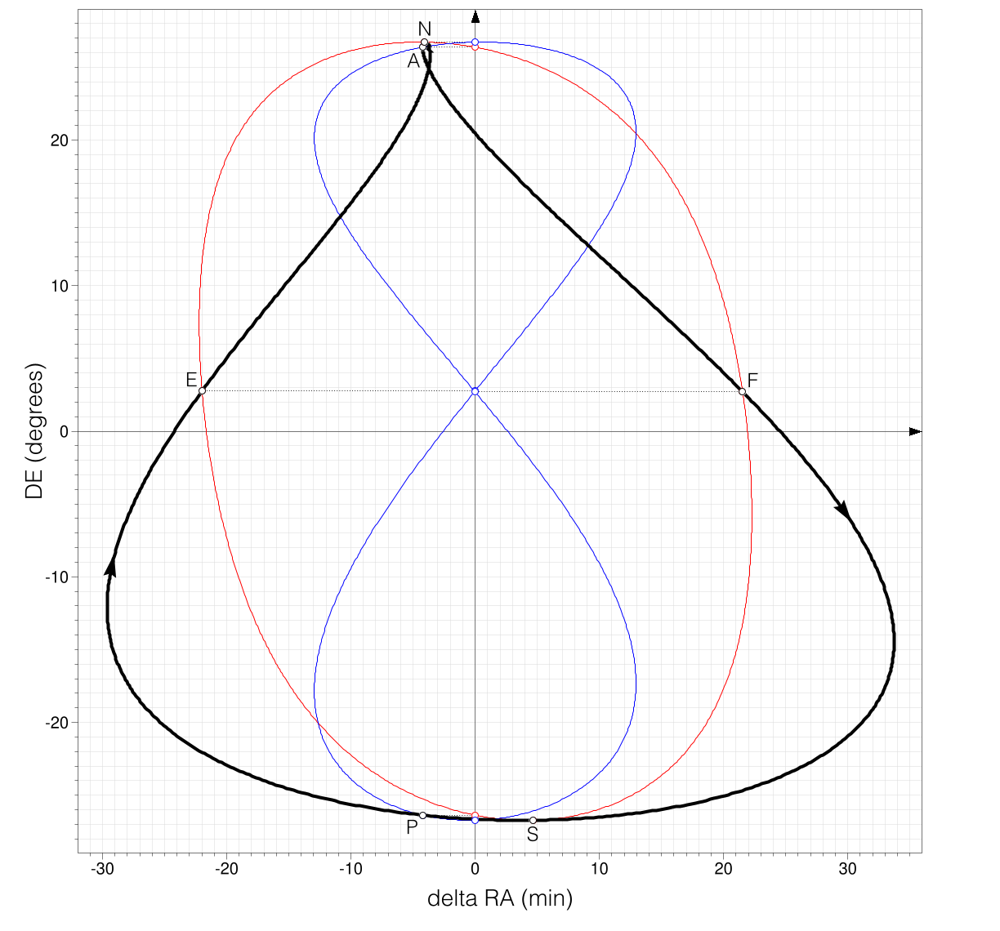
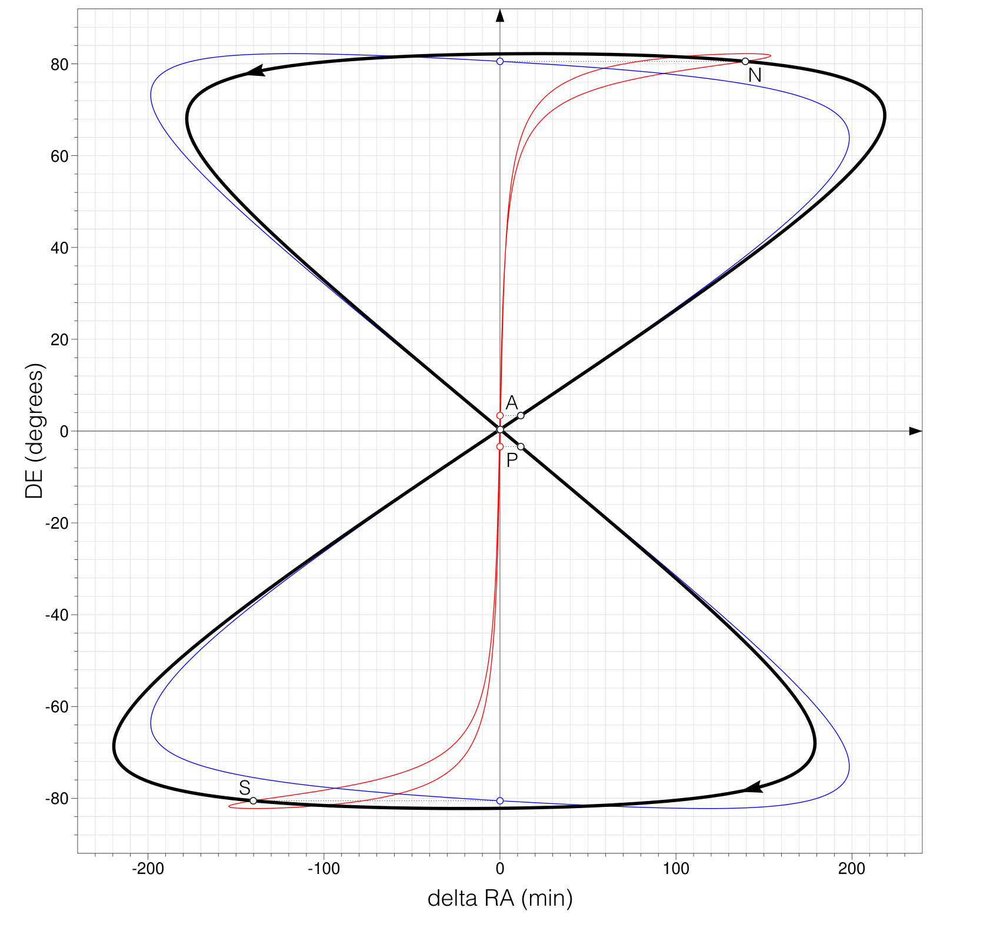
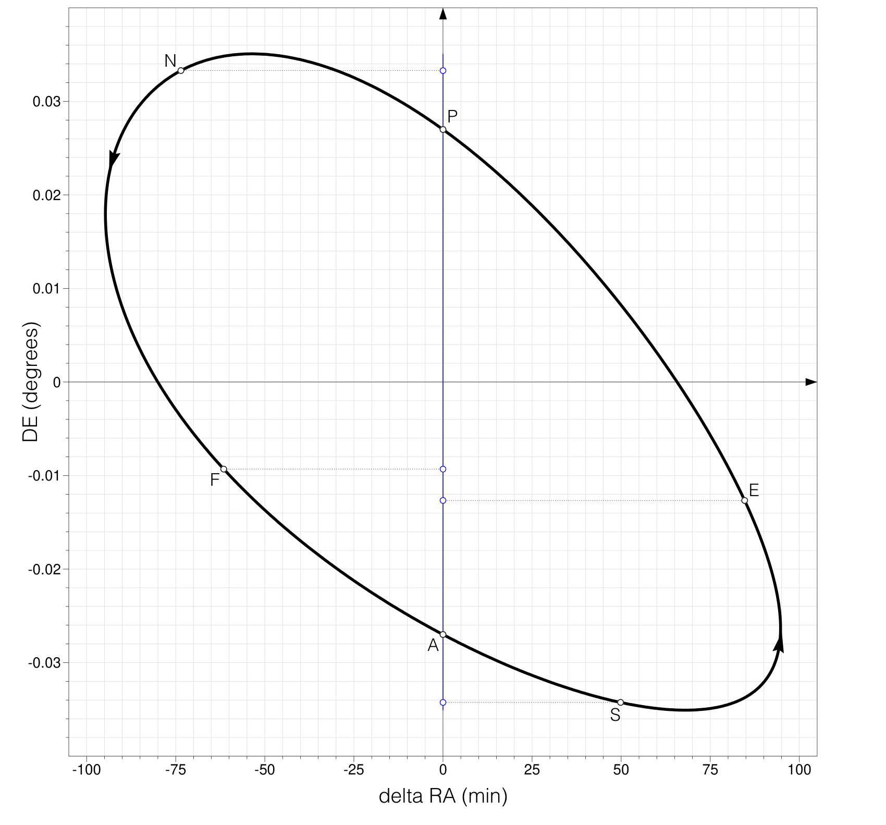
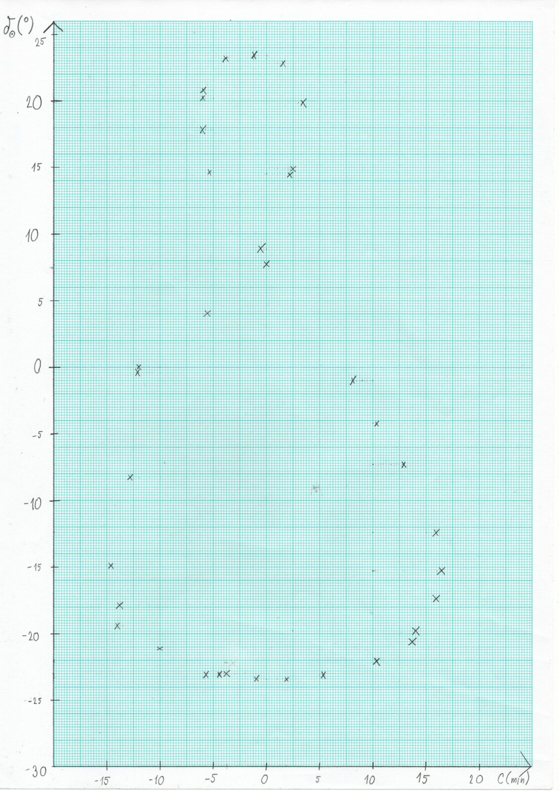
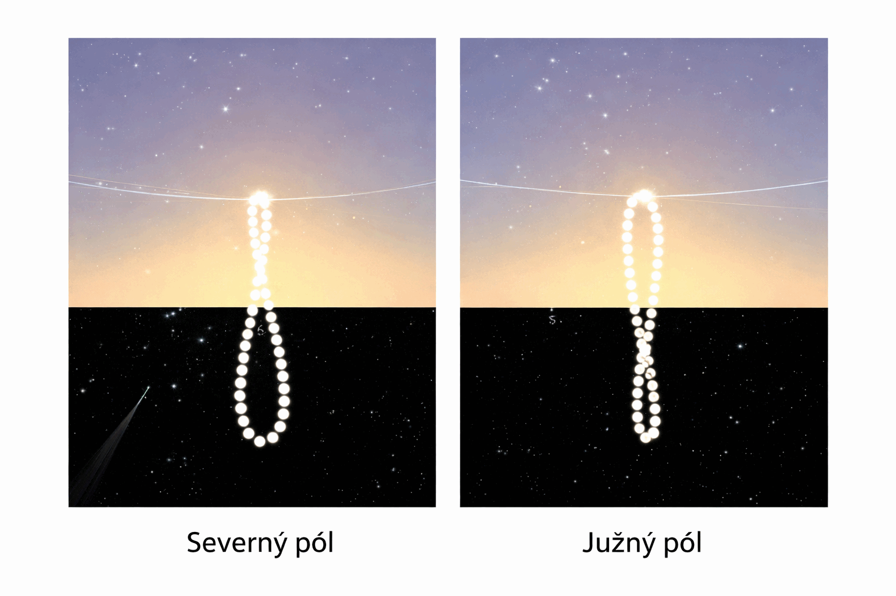
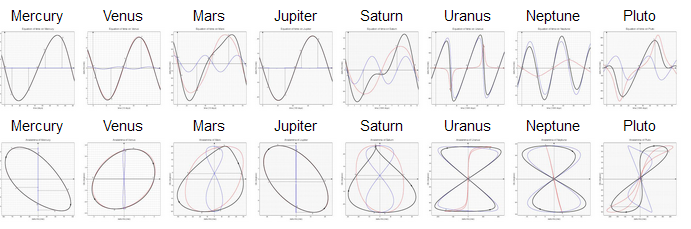

## Zadanie

Počas roka si môžeme všimnúť zaujímavý jav: Slnko sa na oblohe nepohybuje rovnomerne. Ak by sme totiž každý deň presne na poludnie (keď nám naše hodinky budú ukazovať 12:00) odfotili polohu Slnka na oblohe, zistili by sme, že nie je vždy na rovnakom mieste. Preto zavádzame pojmy pravého a stredného slnečného času.

Pravý slnečný čas $T_P$ je čas, ktorý je určený hodinovým uhlom pravého (skutočného) Slnka, teda Slnka, ktoré vidíme na oblohe počas každého dňa. Tento čas je však v praxi ťažko použiteľný, a preto sa zaviedol pojem stredného slnečného času $T_S$, ktorý je určený hodinovým uhlom stredného (fiktívneho) Slnka. Stredné Slnko je myslený objekt, ktorý sa pohybuje po ekliptike tak, že jeho priemet na svetový rovník sa pohybuje pozdĺž neho úplne rovnomerne. Z neho je odvodený bežný 24-hodinový občiansky deň, ktorý používame v bežnom živote.

Rozdiel medzi týmito dvoma časmi sa nazýva časová rovnica 

$$
C = T_P - T_S \,. \tag{1}
$$

 Hodnota veličiny $C$ môže nadobúdať kladné aj záporné hodnoty v závislosti od toho, či sa pravé Slnko oproti strednému (rovnomernému) času predbieha alebo oneskoruje. Graficky sú hodnoty $C$ v závislosti od dňa v roku v priloženom grafe na obr. 1.

Výsledná časová rovnica je kombináciou dvoch vplyvov. Po prvé, to je excentricita dráhy Zeme, ktorá spôsobuje rozdiely medzi pravou ($\nu$) a strednou ($M$) anomáliou Zeme, čo pri pohľade zo Zeme spôsobuje nerovnomerný pohyb Slnka pozdĺž ekliptiky. Vplyv excentricity je nulový v perihéliu (3. 1.) a v aféliu (6. 7.). Po druhé, aj keby bola dráha Zeme kruhová a pohyb Slnka pozdĺž ekliptiky rovnomerný, tak by sa jeho priemet na nebeský rovník nepohyboval pozdĺž neho rovnomerne. To je spôsobené súradnicovou transformáciou medzi ekliptikálnymi a rovníkovými súradnicami, ktorá dáva zhodné hodnoty ekliptikálnej dĺžky a rektascenzie iba počas jarnej rovnodennosti (20. 3.), letného slnovratu (21. 6.), jesennej rovnodennosti (23. 9.) a zimného slnovratu (22. 12.).

Vplyv excentricity aj súradnicovej transformácie vieme aproximovať sínusovými závislosťami. Výsledná časová rovnica je zložením týchto dvoch závislostí. Pre malú excentricitu dráhy ($e < 0.1$) a malý sklon rotačnej osi voči kolmici na rovinu orbity ($\varepsilon < 30^{\circ}$) platí pre rozdiel pravého a stredného slnečného času $C$ v minútach približný vzťah 

$$
C \approx \frac{720}{\pi} \left( - 2 e \sin \left( M \right) - \tan^2\left( \frac{\varepsilon}{2} \right) \sin \big( 2 M + M_0 \big) \right) \,, \tag{2}
$$

 kde $M$ je stredná anomália a $M_0$ konštanta.

<figure>

<figcaption>

**Obrázok 1:** Hodnoty veličiny $C$, definovanej rovnicou (1), v časových minútach počas roka. Deň v roku je poradové číslo dňa od začiatku tohto kalendárneho roka, teda číslo 1 zodpovedá 1. 1. 2026. Zdroj dát: Stellarium. Graf bol vytvorený v OriginPro.
</figcaption>

</figure>

Rozdiel pravej a strednej anomálie $(\nu - M)$ je zodpovedný za „excentrický“ člen $C$, teda za časť časovej rovnice, ktorá je spôsobená excentricitou. Táto časť je presne rovná zápornej hodnote $(\nu - M)$ pre nulový sklon $\varepsilon$. Pre nenulový sklon $\varepsilon$ to už platí iba približne, pričom výraznejšie sa to začne rozchádzať pre $\varepsilon > 30^{\circ}$.

Časovú rovnicu vieme takisto graficky znázorniť takzvanou *analémou*, čo je závislosť deklinácie Slnka od hodnoty $C$ z časovej rovnice (1). Analéma znázorňuje polohy Slnka na oblohe, ak by sme ho každý deň odfotili o 12:00 stredného slnečného času. Podobne ako časovú rovnicu, aj graf analémy je možné rozložiť na vplyv excentricity (zobrazený červenou) a súradnicovej transformácie (zobrazený modrou). Tieto dva vplyvy sa sčítavajú v horizontálnom smere, v ktorom je v analémach vynášaná hodnota $C$. Vertikálna súradnica analémy je rovná deklinácii Slnka v daný deň. Rovnako krivky vplyvu od excentricity a súradnicovej transformácie zobrazíme vo vertikálnom smere podľa deklinácie Slnka. Deklinácie Slnka vo vybraných dňoch roka sú uvedené v tabuľke 1.

**Tabuľka 1:** Hodnoty deklinácie Slnka počas vybraných 35 dní kalendárneho roka 2026. Poradové číslo 1. prislúcha 1. 1. 2026.

| pozorovanie | deň v roku | deklinácia |
|:-----------:|:----------:|:----------:|
|      1      |    1\.     | $-23{,}00^{\circ}$  |
|      2      |    2\.     | $-22{,}92^{\circ}$  |
|      3      |    9\.     | $-22{,}20^{\circ}$  |
|      4      |    17\.    | $-20{,}90^{\circ}$  |
|      5      |    24\.    | $-19{,}40^{\circ}$  |
|      6      |    32\.    | $-17{,}50^{\circ}$  |
|      7      |    41\.    | $-14{,}89^{\circ}$  |
|      8      |    60\.    | $-8{,}28^{\circ}$  |
|      9      |    80\.    | $-0{,}40^{\circ}$  |
|     10      |    81\.    | $0{,}00^{\circ}$  |
|     11      |    91\.    | $4{,}01^{\circ}$  |
|     12      |   120\.    | $14{,}57^{\circ}$  |
|     13      |   121\.    | $14{,}89^{\circ}$  |
|     14      |   140\.    | $19{,}91^{\circ}$  |
|     15      |   160\.    | $22{,}92^{\circ}$  |
|     16      |   172\.    | $23{,}44^{\circ}$  |
|     17      |   182\.    | $23{,}12^{\circ}$  |
|     18      |   200\.    | $20{,}83^{\circ}$  |

**Tabuľka 1:** Hodnoty deklinácie Slnka počas vybraných 35 dní kalendárneho roka 2026. Poradové číslo 1. prislúcha 1. 1. 2026.

| pozorovanie | deň v roku | deklinácia |
|:-----------:|:----------:|:----------:|
|     19      |   203\.    | $20{,}25^{\circ}$  |
|     20      |   213\.    | $17{,}93^{\circ}$  |
|     21      |   224\.    | $14{,}77^{\circ}$  |
|     22      |   241\.    | $8{,}89^{\circ}$  |
|     23      |   244\.    | $7{,}76^{\circ}$  |
|     24      |   266\.    | $-0{,}96^{\circ}$  |
|     25      |   274\.    | $-4{,}16^{\circ}$  |
|     26      |   282\.    | $-7{,}29^{\circ}$  |
|     27      |   296\.    | $-12{,}39^{\circ}$  |
|     28      |   305\.    | $-15{,}31^{\circ}$  |
|     29      |   315\.    | $-17{,}40^{\circ}$  |
|     30      |   322\.    | $-19{,}78^{\circ}$  |
|     31      |   326\.    | $-20{,}60^{\circ}$  |
|     32      |   335\.    | $-22{,}08^{\circ}$  |
|     33      |   346\.    | $-23{,}10^{\circ}$  |
|     34      |   355\.    | $-23{,}44^{\circ}$  |
|     35      |   360\.    | $-23{,}35^{\circ}$  |
|             |            |            |

**Úlohy**

<ol type="a">

<li>

[70 b] Pomocou priloženého grafu závislosti $C$ na poradovom čísle dňa a tabuľky 1 vykreslite na milimetrový papier analému Slnka.

</li>

<li>

[10 b] Kedy má pravý a stredný slnečný čas najväčšiu odchýlku? Kedy sa naopak tieto časy rovnajú? Napíšte dátumy.

</li>

<li>

[10 b] Načrtnite a odôvodnite, ako vyzerá analéma vzhľadom na horizont na severnom a južnom póle Zeme.

</li>

<li>

[40 b] Najväčší rozdiel pravej a strednej anomálie ($\nu - M$) očakávame okolo hodnoty $M = \frac{\pi}{2}$. Pomocou Keplerovej rovnice z konštantovníka numericky vypočítajte excentrickú anomáliu $E$, ktorá zodpovedá tejto strednej anomálii $M$. Následne prepočítajte $E$ na pravú anomáliu $\nu$ (opäť vám pomôže konštantovník) a určte hodnotu $(\nu - M)$. Tú porovnajte s hodnotou $C$ podľa rovnice (2) pre $M = \frac{\pi}{2}$ a $\varepsilon = 0$ (nulový sklon rotačnej osi voči kolmici na rovinu orbity).

</li>

<li>

[40 b] V tabuľke 2 nižšie nájdete excentricity ($e$) a sklony rotačných osí voči kolmici na rovinu orbity ($\varepsilon$) pre planéty slnečnej sústavy. Vašou úlohou je priradiť správnu planétu slnečnej sústavy pre každú priloženú analému. Tie sú vykreslené vzhľadom na nebeský rovník a ekliptiku, ktoré sú definované rovníkom a orbitou dráhy danej neznámej planéty.

</li>

</ol>

**Tabuľka 2:** Excentricity ($e$) a sklony rotačných osí voči kolmiciam na roviny orbít ($\varepsilon$) planét slnečnej sústavy. Údaj sklonu rotačnej osi pre Urán niekto omylom zamazal.

|  | **Merkúr** | **Venuša** | **Mars** | **Jupiter** | **Saturn** | **Urán** | **Neptún** |
|:---|:--:|:--:|:--:|:--:|:--:|:--:|:--:|
| $e$ | 0,2 | 0 | 0,1 | 0,05 | 0,05 | 0,05 | 0,01 |
| $\varepsilon$ | $<10^{\circ}$ | $>170^{\circ}$ | $\sim25^{\circ}$ | $<10^{\circ}$ | $\sim25^{\circ}$ |  | $\sim25^{\circ}$ |

<figure>

<figcaption>

**Obrázok 2b:** Analéma neznámej planéty $\text{X}_2$.
</figcaption>

</figure>

<figure>

<figcaption>

**Obrázok 3c:** Analémy štyroch neznámych planét.
</figcaption>

</figure>

Riešenie

<ol type="a">

<li>

Prvou úlohou je vytvoriť graf analémy, čiže graf závislosti deklinácie Slnka $\delta_\Sun$ od hodnoty $C$. V tabuľke 1 máme zaznamenaných 35 pozorovaní z rôznych dní počas roka a hodnoty deklinácie Slnka počas nich. Hodnoty $C$ síce priamo zadané nemáme, ale vieme ich zistiť z grafu 1. Vieme ich odčítať pre všetky potrebné dni a následne vytvoriť tabuľku 3 hodnôt $C$ a deklinácií Slnka a priamo z nich potom vytvoriť graf 4. [70 b]

Hodnoty na vertikálnej osi, na ktorú vynášame hodnoty deklinácie Slnka $\delta_\Sun$, sú v rozmedzí od cca $-25^{\circ}$ do $25^{\circ}$, čo vidíme rovno z tabuľky 3, čiže pre túto os si vieme zvoliť, aby začínala na hodnote $-25^{\circ}$ a končila na $25^{\circ}$.

Samozrejme bolo potrebné vynášať body čo najpresnejšie napríklad pentelkou alebo zastrúhanou ceruzkou. Hodnoty $C$ sme však, ako vidíme v tabuľke 3, nemohli udať presnejšie ako na 1 desatinné miesto. Chybou by bolo písať tieto čísla s príliš veľkou presnosťou, ktorú nevieme z odčítania hodnôt $C$ z grafu 1 dosiahnuť.

</li>

<li>

Najväčšiu odchýlku pravého $T_P$ a stredného slnečného $T_S$ času môžeme vidieť z grafu 1. Ak sa pozrieme na čiaru rovnobežnú s vodorovnou osou vychádzajúcu z bodu nula, tak vieme odčítať, že najväčšia odchýlka sa nachádza v bode najväčšieho extrému na danom grafe. To je na hodnote 304. dňa. Konkrétny deň si vypočítame jednoducho, je to totiž presne hodnota $31 + 28 + 31 + 30 + 31 + 30 + 31 + 31 + 30 + 31$, čo dáva 31. október 2026. [5 b]

Z rovnakého grafu vieme určiť aj dátumy, kedy sa pravý slnečný a stredný slnečný čas rovnajú. Vtedy je totiž hodnota $C$ podľa rovnice (1) nulová. Stačí sa preto pozrieť na to, kedy vodorovná čiara vychádzajúca z nuly pretína zobrazený graf 1. Vidíme, že to sa deje na štyroch miestach a po obdobnom odčítaní zistíme, že sú to hodnoty $106.$, $165.$, $243.$ a $358.$ dňa. Čiže sú to štyri dátumy: 16. apríl, 14. jún, 31. august a 24. december. [5 b]

*Poznámka: K určeniu extrémov by sme teoreticky mohli použiť aj graf analémy 4 pomocou interpolácie, teda procesu, pri ktorom sa pomocou známych bodov grafu pokúšame odhadnúť neznáme hodnoty medzi nimi. V našom prípade by to znamenalo preložiť vynesené body na milimetrovom papieri súvislou krivkou. Odčítanie hodnôt z grafu časovej rovnice je však presnejšie. Tento graf totiž zobrazuje časovú odchýlku priamo v závislosti od dní v roku. Na grafe analémy sú dátumy rozložené pozdĺž zložitej slučky, čo sťažuje ich presné priradenie. Pri ručnej interpolácii analémy navyše vzniká subjektívna chyba pri hľadaní bodu, kde je krivka najviac „vpravo“.*

**Tabuľka 3:** Hodnoty deklinácie Slnka $\delta_\Sun$ a $C$ z časovej rovnice (1) počas 35 pozorovaní behom roka.

| pozorovanie | deň v roku | $\delta_\Sun$ (°) | C (min) |
|:-----------:|:----------:|:-------------:|:-------:|
|      1      |    1\.     |    -23,00     |  -3,8   |
|      2      |    2\.     |    -22,92     |  -4,4   |
|      3      |    9\.     |    -22,20     |  -6,9   |
|      4      |    17\.    |    -20,90     |  -10,0  |
|      5      |    24\.    |    -19,40     |  -11,6  |
|      6      |    32\.    |    -17,50     |  -13,8  |
|      7      |    41\.    |    -14,89     |  -14,7  |
|      8      |    60\.    |     -8,28     |  -12,8  |
|      9      |    80\.    |     -0,40     |  -8,1   |
|     10      |    81\.    |     0,00      |  -8,0   |
|     11      |    91\.    |     4,01      |  -4,5   |
|     12      |   120\.    |     14,57     |   2,2   |
|     13      |   121\.    |     14,89     |   2,5   |
|     14      |   140\.    |     19,91     |   3,4   |
|     15      |   160\.    |     22,92     |   1,6   |
|     16      |   172\.    |     23,44     |  -0,9   |
|     17      |   182\.    |     23,12     |  -3,1   |
|     18      |   200\.    |     20,83     |  -5,9   |
|     19      |   203\.    |     20,25     |  -6,1   |
|     20      |   213\.    |     17,93     |  -6,1   |
|     21      |   224\.    |     14,77     |  -5,3   |
|     22      |   241\.    |     8,89      |  -0,6   |
|     23      |   244\.    |     7,76      |   0,0   |
|     24      |   266\.    |     -0,96     |   8,1   |
|     25      |   274\.    |     -4,16     |  10,3   |
|     26      |   282\.    |     -7,29     |  13,1   |
|     27      |   296\.    |    -12,39     |  15,9   |
|     28      |   305\.    |    -15,31     |  16,6   |
|     29      |   315\.    |    -17,40     |  15,9   |
|     30      |   322\.    |    -19,78     |  14,1   |
|     31      |   326\.    |    -20,60     |  13,8   |
|     32      |   335\.    |    -22,08     |  10,3   |
|     33      |   346\.    |    -23,10     |   5,3   |
|     34      |   355\.    |    -23,44     |   1,9   |
|     35      |   360\.    |    -23,35     |  -0,9   |

<figure>

<figcaption>

**Obrázok 4:** Vynesený graf analémy.
</figcaption>

</figure>

</li>

<li>

Analéma na severnom póle vyzerá ako zvislá osmička stojaca priamo na horizonte, pričom je viditeľná len jej horná polovica. Keďže je Slnko na póle pol roka pod obzorom, tak vidíme, ako sa horná slučka osmičky postupne dvíha od horizontu k najvyššiemu bodu (letný slnovrat) a potom klesá späť. Dolná slučka osmičky zostáva skrytá pod obzorom, a preto je neúplná. [5 b]

Na južnom póle je situácia zrkadlovo obrátená, takže analéma vyzerá ako prevrátená osmička, ktorej viditeľná časť smeruje nadol k horizontu. Slnko je tu nad obzorom v čase, keď je na severnej pologuli zima, takže vidíme tú časť osmičky, ktorá bola na severnom póle skrytá. Opäť platí, že vďaka polohe priamo na zemskej osi stojí táto osmička kolmo na horizont a jej spodná (z nášho pohľadu južná) slučka dominuje oblohe počas leta. [5 b] Znázornené to je na obrázku 5.

<figure>

<figcaption>

**Obrázok 5:** Znázornenie toho, ako vyzerá analéma na severnom a južnom póle.
</figcaption>

</figure>

</li>

<li>

Vzťah medzi pravou anomáliou $\nu$ a strednou anomáliou $M$ predstavuje Keplerova rovnica pre elipsu. Je daná vzťahmi 

$$
\begin{align*}
    M &= E -e \sin E \,, \tag{3}\\
    \tan \frac{E}{2} &= \sqrt{\frac{1-e}{1+e}} \tan \frac{\nu}{2} \,, \tag{4}\end{align*}
$$

 ktoré sú uvedené v konštantovníku. Dáva do súvislosti pravú anomáliu $\nu$, strednú anomáliu $M$ a excentrickú anomáliu $E$. Veličina $e$ značí v týchto rovniciach excentricitu. Pre Zem je excentricita $e_\Ea = 0,0167$, ako uvádza konštantovník. Hodnotu strednej anomálie berieme ako $M = \frac{\pi}{2} \, \mathrm{rad} =1{,}5708\,\mathrm{rad}$.

K vyjadreniu pravej anomálie $\nu$ potrebujeme poznať najskôr hodnotu excentrickej anomálie $E$. To spravíme tak, že si z Keplerovej rovnice vyjadríme $E$ ako 

$$
E = M + e \sin E \,. \qquad\textit{[5\,b]} \tag{5}
$$

 Tento vzťah budeme riešiť metódou iterácie, pri ktorej volíme za počiatočnú hodnotu $E_0 = M = \frac{\pi}{2} \, \mathrm{rad}$. [15 b] Po iterácii v kalkulačke nám vychádza $E = 1{,}5875\,\mathrm{rad}$, čo je o niečo viac ako hodnota $M$.

Následne vieme tento výsledok dosadiť do druhej rovnice a vyjadriť si $\nu$ 

$$
\tan \frac{\nu}{2} = \sqrt{\frac{1+e}{1-e}} \tan \frac{E}{2} = 1,0340 \,, \tag{6}
$$

 teda $\nu = 1{,}6042\,\mathrm{rad}$. [2 b] Rozdiel $\nu - M$ je potom $0{,}0334\,\mathrm{rad}$, čo zodpovedá časovému rozdielu v minútach 

$$
\frac{0,0334}{2\pi}\cdot24\cdot60 = \boxed{7{,}65\,\mathrm{min}}. \qquad\textit{[8\,b]} \tag{7}
$$

Tento výsledok teraz porovnáme s postupom, v ktorom budeme uvažovať rovnicu 2. Ako je napísané v zadaní, hodnota $(\nu - M)$ nám reprezentuje to isté ako „excentrický“ člen v tomto aproximatívnom vzťahu pre $C$, len s opačným znamienkom a pri nulovom sklone, t.j. $\varepsilon = 0$. Dostávame tak vzťah 

$$
C \approx \frac{720}{\pi} \left(2e \sin M\right) \,.\qquad\textit{[8\,b]} \tag{8}
$$

 Po vyčíslení nám vychádza hodnota priamo v minútach, a to konkrétne $C = \boxed{7{,}65\,\mathrm{min}}$. [2 b] Porovnaním vidíme, že tieto dve hodnoty sa rovnajú.

</li>

<li>

Jednotlivé analémy si preberieme postupne a budeme sa pritom pozerať na vplyvy excentricity $e$ a sklonu $\varepsilon$.

Najskôr sa pozrime na analému neznámej planéty $\text{X}_1$. Z 2 vidíme, že táto planéta má rozsah deklinácií od cca $+25^{\circ}$ do $-25^{\circ}$, čiže jej sklon je $\varepsilon \approx 25^{\circ}$. Ak sa pozrieme do tabuľky 2 tak vidíme, že našimi kandidátmi sa stávajú Mars, Saturn a Neptún. Ak sa ďalej pozrieme na ich excentricity $e$, tak si hneď všimneme, že Mars má na rozdiel od Saturnu a Neptúna rádovo väčšiu excentricitu, čo sa značne prejaví v šírke jeho analémy. Mars ju má kvôli svojej vyššej excentricite najširšiu a stáva sa preto planétou $\text{X}_1$.

Analéma planéty $\text{X}_2$ je podobná planéte $\text{X}_1$, pretože má opäť sklon $\varepsilon \approx 25^{\circ}$, no tentokrát má menšiu excentricitu, čo vidno už po prvotnom porovnaní. Mohlo by sa preto jednať buď o Saturn alebo Neptún. Neptún má ale na rozdiel od Jupitera veľmi neexcentrickú dráhu podobnú takmer kružnici. Preto analéma znázornená na obrázku 2 nemôže byť analémou Neptúna, ale naopak Saturnu.

Špeciálnejším prípadom je analéma planéty $\text{X}_3$ na obrázku 3. Môžeme si všimnúť, že hodnoty na vertikálnej osi dosahujú veľké hodnoty - až vyše $\pm 80^{\circ}$. To znamená, že sklon $\varepsilon$ bude dosahovať pri planéte $\text{X}_3$ túto extrémnu hodnotu. V praxi to znamená to, že rotačná os tejto planéty je voči kolmici na rovinu jej orbity sklopená o takmer pravý uhol, čiže sa dá v podstate povedať, že táto planéta rotuje „poležiačky“. To je známy fakt pre planétu Urán.

Poslednou analémou je analéma planéty $\text{X}_4$, pri ktorej už na prvý pohľad vidíme, že na vertikálnej osi sú rádovo menšie hodnoty ako v predchádzajúcich analémach. Sklon $\varepsilon$ preto musí byť rozhodne veľmi malý, menší ako $10^{\circ}$, z čoho berieme do úvahy Merkúr alebo Jupiter. Rozdiel medzi týmito dvoma planétami je to, že Merkúr má rádovo väčšiu excentricitu, najväčšiu zo všetkých planét slnečnej sústavy. To spôsobuje to, že jeho analéma bude značne natiahnutá, čo sa presne deje na grafe 3 analémy planéty $\text{X}_4$. Našou poslednou planétou je preto Merkúr.

Obdobným spôsobom by sme vedeli určiť analému akejkoľvek planéty, ak poznáme hodnoty jej excentricity $e$ a sklonu $\varepsilon$. Na obrázku 6 sú uvedené všetky analémy planét slnečnej sústavy aj s ich grafmi slnečnej rovnice.

<figure>

<figcaption>

**Obrázok 6:** Analémy a hodnoty veličiny $C$ z časovej rovnice pre planéty slnečnej sústavy a trpasličiu planétu Pluto.
</figcaption>

</figure>

</li>

</ol>

## Komentár autora

Slnko nám počas roka robí na oblohe osmičku.
