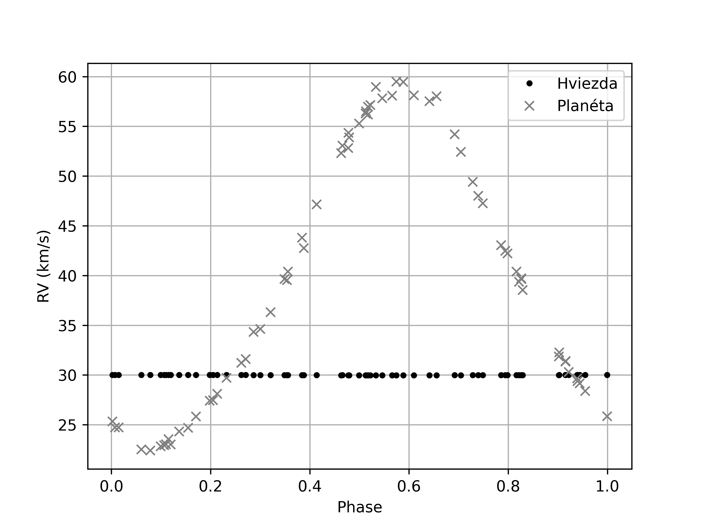
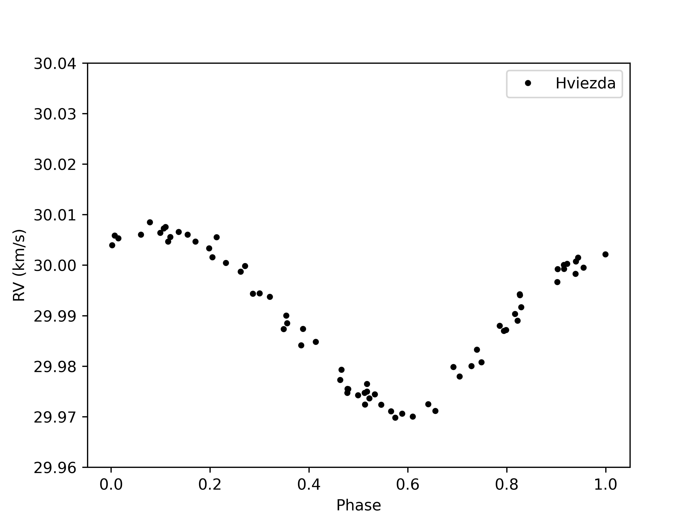
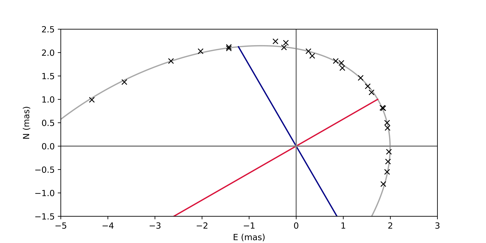
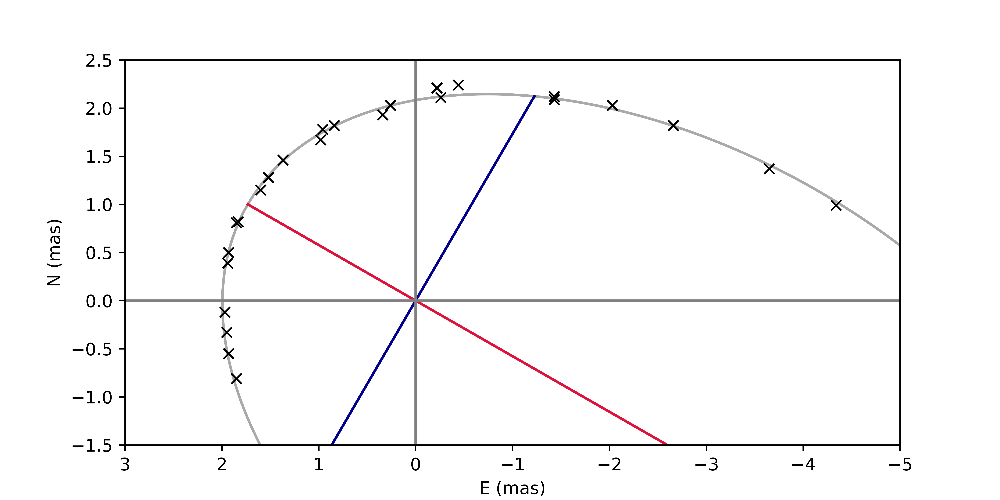
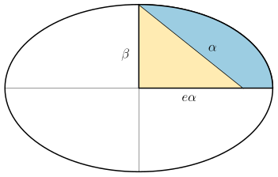
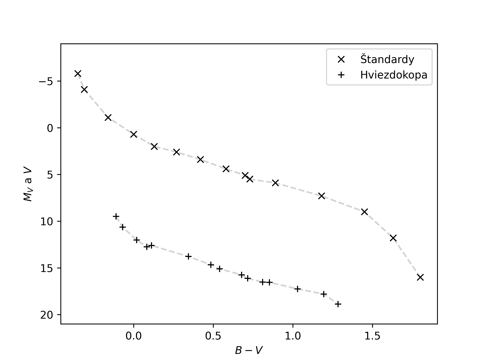

## Zadanie

Astrofyzik pozoruje obeh (exo)planéty okolo hviezdy pomocou nového interferometra, ktorý má veľmi detailné rozlíšenie. Ako to už pri astronomických pozorovaniach býva, trvajú celú večnosť. Keďže sa mu ale nechce tak dlho čakať, tak si povedal, že si zvyšok merania dopočíta a rozhodne sa preskúmať parametre pozorovaného systému na základe dát v tabuľke 1, ktoré doposiaľ nameral.

V celej tejto úlohe nie je potrebné odhadovať neistoty (chyby) veličín, s výnimkou prípadov, kedy je to explicitne napísané v zadaní.

<ol type="a">

<li>

[50 b] Vyneste dáta separácií $E$ a $N$ z tabuľky 1 na milimetrový papier a preložte ich časťou elipsy. Pre obidve osi si zvoľte rovnakú škálu, inak by sa vám výrazne skomplikovalo riešenie nasledujúcich úloh.

</li>

<li>

[10 b] Počas pozorovania prešla planéta cez nejaký významný bod svojej trajektórie. Určte, o ktorý bod ide a označte ho na grafe, ktorý ste kreslili v predchádzajúcej podúlohe.

</li>

<li>

[30 b] Vypočítajte veľkú polos $\alpha$ v uhlových jednotkách $\mathrm{mas}$ (*milli arc second*, teda tisíciny uhlovej sekundy) a excentricitu trajektórie planéty $e$. Využite na to vlastnosti bodu, ktorý ste našli v predchádzajúcej podúlohe a ešte nejakého ďalšieho vhodného bodu na trajektórii planéty. Svoj postup v riešení detailne opíšte. Pre jednoduchosť môžete predpokladať, že sklon dráhy voči nebeskej sfére je rovný presne $0^{\circ}$. Nesnažte sa dokresľovať zvyšnú časť eliptickej dráhy, vyšiel by vám veľmi nepresný výsledok.

</li>

<li>

[25 b] S pomocou vášho grafu vypočítajte periódu $P$ obehu planéty.

</li>

</ol>

**Tabuľka 1:** Namerané polohy planéty vzhľadom na hviezdu. Veličina $E$ označuje separáciu v rektascenzii (kladná smerom na východ) a $N$ separáciu v deklinácii (kladná smerom na sever). Obidve sú udané v tisícinách uhlovej sekundy (mas).

| Čas (roky) | $E$ (mas) | $N$ (mas) |
|:----------:|:---------------:|:---------------:|
|    0.12    |      1.85       |      -0.81      |
|    0.38    |      1.93       |      -0.55      |
|    0.64    |      1.95       |      -0.33      |
|    0.88    |      2.07       |      -0.12      |
|    1.50    |      1.94       |      0.39       |
|    1.66    |      1.93       |      0.50       |
|    2.09    |      1.83       |      0.82       |
|    2.12    |      1.85       |      0.81       |
|    2.56    |      1.60       |      1.15       |
|    2.88    |      1.52       |      1.28       |
|    3.14    |      1.37       |      1.46       |
|    3.71    |      0.98       |      1.67       |
|    3.77    |      0.96       |      1.78       |

**Tabuľka 1:** Namerané polohy planéty vzhľadom na hviezdu. Veličina $E$ označuje separáciu v rektascenzii (kladná smerom na východ) a $N$ separáciu v deklinácii (kladná smerom na sever). Obidve sú udané v tisícinách uhlovej sekundy (mas).

| Čas (roky) | $E$ (mas) | $N$ (mas) |
|:----------:|:---------------:|:---------------:|
|    3.94    |      0.84       |      1.82       |
|    4.51    |      0.34       |      1.93       |
|    4.61    |      0.26       |      2.03       |
|    5.09    |      -0.22      |      2.21       |
|    5.12    |      -0.26      |      2.11       |
|    5.30    |      -0.44      |      2.24       |
|    6.09    |      -1.43      |      2.12       |
|    6.14    |      -1.43      |      2.09       |
|    6.55    |      -2.03      |      2.03       |
|    6.98    |      -2.66      |      1.82       |
|    7.67    |      -3.65      |      1.37       |
|    8.07    |      -4.34      |      0.99       |
|            |                 |                 |

Na to, aby astrofyzik dokázal určiť z uhlových rozmerov aj skutočné rozmery dráhy, potrebuje získať jej vzdialenosť. Pozrel sa teda do rôznych archívov dát a našiel v nich dva užitočné záznamy o materskej hviezde systému - jedno meranie paralaxy a jedno spektrum. Paralaxa sa rovná $\Pi = (0.610 \pm 0.02)$ mas. Podľa spektra určil, že ide o hviezdu spektrálneho typu A3 V s efektívnou teplotou $T_{eff} = 8500\,\mathrm{K}$, povrchovým tiažovým zrýchlením $g = 152\,\mathrm{m}{\mathrm{s}}^{-2}$ a radiálnou rýchlosťou $v_r = 30\,\mathrm{km}/\mathrm{s}$. Zároveň si uvedomil, že hviezda sa na oblohe nachádza na rovnakom mieste ako malá hviezdokopa, pričom všetky hviezdy v nej majú podobnú radiálnu rýchlosť. Je teda pravdepodobné, že jeho pozorovaná hviezda je zároveň súčasťou tejto hviezdokopy. To mu umožnilo určiť vzdialenosť hviezdy na základe vlastností hviezdokopy.

Vzdialenosť hviezdokopy sa dá určiť z farebného, resp. HR diagramu, kedy do grafu zakreslíme $V$ magnitúdu hviezd v hviezdokope v závislosti od farebného indexu $B-V$. Do rovnakého grafu zároveň zakreslíme absolútnu magnitúdu $M_V$ dobre preskúmaných štandardných hviezd, taktiež v závislosti od indexu $B-V$, pričom veličiny $V$ a $M_V$ budú mať spoločnú stupnicu. Budeme tak mať zakreslené dve hlavné postupnosti – jednu pre hviezdokopu a druhú pre štandardné hviezdy. Za predpokladu, že nedochádza k medzihviezdnej absorpcii, platí, že vertikálna vzdialenosť týchto dvoch hlavných postupností sa rovná modulu vzdialenosti objektov v hviezdokope, teda veličine $\mu = V - M_V$.

**Tabuľka 2:** Štandardné hodnoty absolútnej V magnitúdy a farebného indexu $B-V$ pre rôzne spektrálne typy hviezd na hlavnej postupnosti.

| $M_V$ | $B-V$ | Sp. typ |
|:---------:|:---------:|:-------:|
|   -5.8    |   -0.35   |   O5    |
|   -4.1    |   -0.31   |   BO    |
|   -1.1    |   -0.16   |   B5    |
|    0.7    |   0.00    |   AO    |
|    2.0    |   0.13    |   A5    |
|    2.6    |   0.27    |   F0    |
|    3.4    |   0.42    |   F5    |
|    4.4    |   0.58    |   GO    |
|    5.1    |   0.70    |   G5    |
|    5.5    |   0.73    |   G8    |
|    5.9    |   0.89    |   KO    |
|    7.3    |   1.18    |   K5    |
|    9.0    |   1.45    |   MO    |
|   11.8    |   1.63    |   M5    |
|   16.0    |   1.80    |   M8    |

**Tabuľka 3:** Namerané hodnoty $V$ magnitúdy a farebného indexu $B-V$ pre niekoľko hviezd nachádzajúcich sa v hviezdokope.

| $V$ | $B-V$ |
|:---------:|:---------:|
|   9.49    |   -0.11   |
|  10.639   |  -0.069   |
|   12.01   |   0.019   |
|  12.748   |   0.083   |
|  12.599   |   0.112   |
|  13.777   |   0.344   |
|  14.668   |   0.485   |
|  15.096   |   0.54    |
|  15.748   |   0.678   |
|   16.12   |   0.716   |
|  16.521   |   0.81    |
|  16.547   |   0.853   |
|  17.246   |   1.029   |
|  17.802   |   1.194   |
|   18.87   |   1.284   |

<ol type="a" start="5">

<li>

[10 b] Typická svietivosť hviezdy spektrálneho typu A3V je okolo $L = 17\,\mathit{L}_\Sun$. Vypočítajte, aký by mala mať táto hviezda polomer a hmotnosť.

</li>

<li>

[10 b] Určte vzdialenosť hviezdy na základe jej paralaxy, vrátane neistoty.

</li>

<li>

[60 b] Do spoločného HR diagramu zakreslite dáta z tabuliek 2 a 3. Cez obidva sety dát nakreslite voľnou rukou čiaru, ktorá zhruba znázorňuje priebeh hlavnej postupnosti.

</li>

<li>

[25 b] Z grafu odhadnite modul vzdialenosti hviezdokopy $\mu$ a odhadnite jeho neistotu. Určte podľa neho vzdialenosť hviezdokopy a vypočítajte aj jej neistotu.

</li>

<li>

[2 b] Zistite, či sa vzdialenosti, ktoré ste určili v predchádzajúcich dvoch podúlohách, zhodujú v rámci neistôt. Na základe toho rozhodnite, či je hviezda súčasťou hviezdokopy. Ak áno, ďalej používajte vzdialenosť určenú z HR diagramu. Ak nie, používajte vzdialenosť určenú z paralaxy.

</li>

</ol>

Keďže teraz astronóm už pozná vzdialenosť hviezdy, môže sa pustiť do zisťovania jej ďalších parametrov.

<ol type="a" start="10">

<li>

[10 b] Vypočítajte dĺžku veľkej polosi v au a následne aj hmotnosť hviezdy v hmotnostiach Slnka $\mathcal{M}_\Sun$ (nateraz môžete predpokladať, že hmotnosť planéty je zanedbateľná).

</li>

</ol>

To je ale rádovo nižšia hmotnosť, než vyšla v podúlohe (e)! Niečo v doterajšej analýze je teda nesprávne. Astrofyzik preto musel nakoniec získať viac pozorovaní. O pár rokov neskôr sa vďaka novému spektrografu ukázalo, že je možné namerať krivku radiálnych rýchlostí nielen hviezdy, ale aj samotnej planéty. To ale znamená, že sklon dráhy voči nebeskej sfére nie je $0^{\circ}$, tak ako ste predpokladali v úlohe (c), inak by radiálne rýchlosti museli byť nulové.

<ol type="a" start="11">

<li>

[25 b] Z priloženého grafu nameraných radiálnych rýchlostí určte radiálnu rýchlosť $v_\gamma$ ťažiska sústavy a maximálnu a minimálnu radiálnu rýchlosť hviezdy aj planéty vzhľadom na ťažisko.

</li>

<li>

[20 b] Z nameraných rýchlostí vypočítajte novú hodnotu excentricity. Pomôže vám fakt, že dráha je vhodne orientovaná, a preto sú maximálne a minimálne radiálne rýchlosti hviezdy aj planéty priamo úmerné ich skutočným rýchlostiam v pericentre a apocentre.

</li>

</ol>

<figure>

<figcaption>

**Obrázok 1:** Krivka radiálnych rýchlostí v závislosti od orbitálnej fázy systému. Vpravo je rovnaký graf so zmenenou škálou, aby bolo možné dobre odmerať radiálne rýchlosti hviezdy.
</figcaption>

</figure>

Riešenie

<ol type="a">

<li>

Ak chceme nakresliť graf, ktorý by odpovedal polohám planéty tak, ako by sme ich videli na oblohe, kladný smer osi $E$, teda smer na východ, musí smerovať doľava. Za správny graf je ale v tejto úlohe uznaný aj taký, ktorý má kladnú časť osi $E$ smerujúcu vpravo, viď obr. 2. [50 b]

</li>

<li>

Planéta prechádza svojej dráhy, teda najbližším bodom k svojej materskej hviezde. V grafe ho nájdeme ako bod elipsy, ktorý je najbližší k počiatku súradnicovej sústavy, v ktorom je umiestnená hviezda. Na obr. 2 je pericentrum spojené s ohniskom elipsy červenou čiarou, ktorá predstavuje časť veľkej polosi. [10 b]

</li>

<li>

Elipsa má jednu nepríjemnú vlastnosť – ak máme bodmi pokrytý len nejaký jej menší úsek, je veľmi ťažké odhadnúť veľkosť a tvar celej elipsy. Naše dáta v grafe môžeme preložiť veľmi odlišnými elipsami, pričom všetky sa nám budú zdať v podstate rovnako dobré. Preto v tejto úlohe musíme zvoliť iný postup.

<figure>

<figcaption>

**Obrázok 2:** Astrometrická dráha planéty okolo hviezdy. Vrchný graf je nakreslený s kladným smerom vodorovnej osi klasicky vpravo, zatiaľ čo spodný graf zobrazuje dráhu tak, ako by ju videl pozorovateľ na oblohe.
</figcaption>

</figure>

Využijeme fakt, že planéta prechádza pericentrom,[5 b] pre ktorého vzdialenosť od dráhy platí jednoduchý vzťah $r_{per} = \alpha (1-e)$. Ďalej využijeme polárnu rovnicu elipsy z konštantovníka, podľa ktorej pre vzdialenosť ľubovoľného bodu elipsy od daného ohniska platí vzťah

</li>

</ol>

$$
r = \frac{\alpha (1-e^2)}{1+e\cos \nu} \, , \tag{1}
$$

 pričom pravú anomáliu $\vartheta$ si vieme odmerať priamo z grafu. Aj keď teoreticky je možné na tento účel použiť ľubovoľný bod elipsy, ako veľmi vhodný sa ponúka koncový bod tzv. latus rectum, teda úsečky, ktorá je kolmá na hlavnú os a prechádza cez ohnisko (na obr. 2 označená modrou farbou). Tento bod má pravú anomáliu $\nu = 90^{\circ}$, vďaka čomu sa nám vzťah 1 zjednoduší na 

$$
r_{LR} = \frac{\alpha (1-e^2)}{1+e\cos 90^{\circ}} = \alpha (1-e^2) = \alpha (1-e)(1+e)\, .
    \qquad\textit{[5\,b]} \tag{2}
$$

 Vydelením $r_{LR}$ a $r_{per}$ dostaneme 

$$
\frac{r_{LR} }{r_{per}}= \frac{\alpha (1-e)(1+e)}{\alpha (1-e)} = (1+e)\, .
    \qquad\textit{[5\,b]} \tag{3}
$$

 Dĺžky úsečiek odmeriame v grafe, dostaneme hodnoty $r_{per} = 1{,}97\,\mathrm{mas}$ a $r_{LR} = 2{,}73\,\mathrm{mas}$.[5 b] Orientácia a tým pádom aj dĺžka $r_{LR}$ závisí najmä na presnosti určenia pericentra dráhy. Teraz už vieme vypočítať excentricitu 

$$
e = \frac{r_{LR} }{r_{per}} - 1 = \boxed{0,386}\, ,
    \qquad\textit{[5\,b]} \tag{4}
$$

 a následne aj veľkú polos dráhy planéty 

$$
\alpha = \frac{r_{per}}{(1-e)} = \boxed{3{,}21\,\mathrm{mas}}\, .
    \qquad\textit{[5\,b]} \tag{5}
$$

<ol type="a" start="4">

<li>

Keďže vieme iba uhlový rozmer veľkej polosi a vôbec nepoznáme hmotnosť hviezdy ani planéty, periódu nemôžeme vypočítať z 3. Kepleroveho zákona. Musíme si preto poradiť inak. Využijeme vzorce pre anomálie z konštantovníka a časy z tabuľky 1. Na základe údajov z tabuľky odhadneme, že planéta prešla pericentrom svojej dráhy zhruba v čase $t_0 = 2{,}9\,\mathrm{rokov}$[5 b] a bodom s pravou anomáliou $\nu = 90^{\circ}$ prešla v čase $t_{90} = 6{,}3\,\mathrm{rokov}$.[5 b] Vieme, že v pericentre sú všetky tri anomálie, pravá, excentrická aj stredná, rovné nule. Pre bod s $\nu = 90^{\circ}$ vypočítame najskôr excentrickú a potom strednú anomáliu.

</li>

</ol>

$$
\tan \frac{E}{2} = \sqrt{\frac{1-e}{1+e}}\tan \frac{\nu}{2} \, .
    \qquad\textit{[5\,b]} \tag{6}
$$

Excentrická anomália vyjde $E = 67{,}3^{\circ} = 1{,}175\,\mathrm{rad}$. Strednú anomáliu vypočítame z Keplerovej rovnice, pričom je potrebné si dávať pozor na to, že uhly treba dosadiť v radiánoch;

$$
M = E - e \sin E = 0{,}819\,\mathrm{rad}\, .
    \qquad\textit{[5\,b]} \tag{7}
$$

Obežnú dobu teraz vieme vypočítať vďaka definícii strednej anomálie (opäť dosadíme anomáliu $M$ v radiánoch)

$$
P = 2\pi \frac{t-t_0}{M}= \boxed{26\,\mathrm{rokov}}\, .
    \qquad\textit{[5\,b]} \tag{8}
$$

Druhá možnosť ako vypočítať periódu, je cez 2. Keplerov zákon. Zo znalosti $\alpha$ a $e$ vieme zistiť polohu stredu elipsy. Do grafu z časti a) nakreslíme čiaru kolmú na hlavnú polos, ktorá prechádza stredom elipsy. Táto čiara pretne dráhu planéty vo vedľajšom vrchole elipsy. Vzdialenosť vedľajšieho vrcholu od stredu elipsy sa nazýva malá polos elipsy, jej uhlový rozmer označíme $\beta$. 2. Keplerov zákon nám hovorí, že sprievodič planéty opíše za rovnaký čas vždy rovnakú plochu. Z toho tiež vyplýva, že pomer časových intervalov sa rovná pomeru plôch opísaných sprievodičom. Za periódu $P$ opíše sprievodič plochu celej elipsy, ktorá sa rovná $S_e = \pi \alpha \beta$. [Alt. 5 b] Plocha, ktorú opíše sprievodič planéty pri prechode z pericentra do vedľajšieho vrcholu elipsy sa dá vypočítať podľa obr. 3.

<figure>

<figcaption>

**Obrázok 3:** Nákres elipsy potrebnej na výpočet obežnej doby pomocou 2. Keplerovho zákona.
</figcaption>

</figure>

Plocha modrej oblasti $S$ sa rovná rozdielu štvrtiny plochy elipsy a plochy žltého pravouhlého trojuholníka ohnisko-stred-vedľajší vrchol elipsy, pričom plochu trojuholníka vypočítame ako $S_t = \frac{e\alpha\beta}{2}$. Pre vyšrafovanú oblasť máme 

$$
S = \frac{\pi \alpha \beta}{4}- \frac{e\alpha\beta}{2}\, .
    \qquad\textit{[5\,b]} \tag{9}
$$

 Pre pomer plôch platí 

$$
\frac{S}{S_e} = \frac{t_b-t_0}{P}=\frac{\pi \alpha\beta}{4\pi \alpha\beta} - \frac{e\alpha\beta}{2\pi \alpha\beta}=\frac{1}{4}-\frac{e}{2\pi}\, . \tag{10}
$$

Čas prechodu pericentrom sme už určili ako $t_0 = 2{,}9\,\mathrm{rokov}$. Čas, kedy planéta prechádza vedľajším vrcholom dráhy môžeme na základe údajov v tabuľke 1 určiť ako $t_b = 7{,}3\,\mathrm{rokov}$. Teraz už len z rovnice 10 vyjadríme periódu a dostaneme 

$$
\frac{t_b-t_0}{P}=\frac{\pi -2e}{4\pi}\, ,
    \qquad\textit{[10\,b]} \tag{11}
$$

$$
P = \frac{4\pi}{\pi -2e}(t_b-t_o) = \boxed{23{,}3\,\mathrm{rokov}}\, .
    \qquad\textit{[5\,b]} \tag{12}
$$

Rozdielny výsledok oproti predchádzajúcej metóde je spôsobený najmä tým, že hodnota excentricity, ktorú sme použili na výpočet nie je správna, ako uvidíme v neskorších častiach tejto úlohy.

<ol type="a" start="5">

<li>

Najskôr vypočítame polomer hviezdy zo Stefanovho-Boltzmannovho zákona. Hmotnosť potom získame vďaka známej hodnote gravitačného zrýchlenia na povrchu.

</li>

</ol>

$$
R = \sqrt{\frac{L}{4\pi \sigma T_{eff}^4}} = 1{,}32 \cdot 10^{9}\,\mathrm{m} = \boxed{1{,}9\,\mathit{R}_\Sun}\, .
    \qquad\textit{[5\,b]} \tag{13}
$$

$$
M = \frac{gR^2}{G} = 3{,}97 \cdot 10^{30}\,\mathrm{kg} = \boxed{2\,\mathcal{M}_\Sun}\, .
    \qquad\textit{[5\,b]} \tag{14}
$$

<ol type="a" start="6">

<li>

Vzdialenosť v parsekoch vypočítame jednoducho ako prevrátenú hodnotu paralaxy v uhlových sekundách.

</li>

</ol>

$$
d_1 = \frac{1}{\Pi} = \frac{1000}{0,61}= 1639\,\mathrm{pc}\, .
    \qquad\textit{[5\,b]} \tag{15}
$$

 Relatívna chyba vzdialenosti sa rovná relatívnej chybe paralaxy, dostaneme teda

$$
\sigma_{d_1} = \frac{d_1}{\Pi}\sigma_{\Pi}= 54\,\mathrm{pc}\, .
    \qquad\textit{[5\,b]} \tag{16}
$$

 Vzdialenosť hviezdy určená z jej paralaxy je .

<ol type="a" start="7">

<li>

Graf je nakreslený na obr. 4.[60 b]

<figure>

<figcaption>

**Obrázok 4:** HR diagram na určenie vzdialenosti.
</figcaption>

</figure>

</li>

<li>

Modul vzdialenosti sa dá odhadnúť premeraním vertikálnej vzdialenosti hlavných postupností na viacerých miestach na grafe. Z týchto hodnôt potom dopočítame priemer a štandardnú odchýlku. Výsledok je $\boxed{\mu =  11{,}0 \pm 0{,}1\,\mathrm{mag}}$.[10 b] Vzdialenosť hviezdy je

</li>

</ol>

$$
\mu = 5\log d_2 -5\, , \tag{17}
$$

$$
d_2 = 10^{\frac{\mu + 5}{5}} = 10^{\frac{11 + 5}{5}} = 1585\,\mathrm{pc}\, .
    \qquad\textit{[5\,b]} \tag{18}
$$

Odvodenie vzorca na výpočet chyby vzdialenosti je pomerne ťažké, pretože si vyžaduje znalosť derivácií. Chybu je možné ale odhadnúť aj jednoduchšie, stačí do rovnice 18 dosadiť maximálnu a minimálnu možnú hodnotu modulu vzdialenosti, tým dostaneme hraničné hodnoty 

$$
d_{2,max} = 10^{\frac{11,1 + 5}{5}} = 1660\,\mathrm{pc}\, ,
    \qquad\textit{[2,5\,b]} \tag{19}
$$

 

$$
d_{2,min} = 10^{\frac{10,9 + 5}{5}} = 1514\,\mathrm{pc}\, .
    \qquad\textit{[2,5\,b]} \tag{20}
$$

Odchýlku vzdialenosti $d_2$ môžeme odhadnúť z rozdielu $d_{2,max}$ a $d_{2,min}$ ako $\sigma_{d_2} = 73\,\mathrm{pc}$. Vzdialenosť hviezdy určená z HR diagramu je teda $\boxed{d_2 = 1585 \pm 73\,\mathrm{pc}}$. [5 b]

<ol type="a" start="9">

<li>

Vzdialenosť $d_2$ sa v rámci odchýlky zhoduje so vzdialenosťou $d_1$ určenou z paralaxy hviezdy. Ďalej preto budeme používať hodnotu $d_2$. [2 b]

</li>

<li>

Na rýchly výpočet veľkej polosi v au je možné využiť definíciu parseku a do nasledujúceho vzorca dosadiť $\alpha$ v uhlových sekundách a $d_2$ v pc

</li>

</ol>

$$
a = \alpha d_2 = \frac{3,21}{1000}\cdot 1600 = \boxed{5{,}14\,\mathrm{au}}\, .
    \qquad\textit{[5\,b]} \tag{21}
$$

Hmotnosť vypočítame z 3. Keplerovho zákona, pričom ak veľkú polos dosadíme v au a obežnú periódu v rokoch, výsledok nám vyjde rovno v jednotkách hmotnosti Slnka

$$
M = \frac{a^3}{P^2} = \frac{5,14^3}{26^2}= \boxed{0{,}2\,\mathcal{M}_\Sun}\, .
    \qquad\textit{[5\,b]} \tag{22}
$$

To je až 10-krát menšia hmotnosť, než sme pre daný spektrálny typ vypočítali v rovnici 14.

<ol type="a" start="11">

<li>

Radiálnu rýchlosť ťažiska odčítame z grafu 1 ako hodnotu, v ktorej sa pretínajú krivky RV planéty a hviezdy. V tomto momente sú totiž planéta a hviezda z pohľadu pozorovateľa v konjunkcii, ich radiálna rýchlosť spôsobená orbitálnym pohybom je nulová a pozorujeme tak iba radiálnu rýchlosť ťažiska sústavy, ktorá sa rovná zhruba $\boxed{v_\gamma = 30\,\mathrm{km}\,{\mathrm{s}}^{-1}}$. [5 b]

Z grafu teraz ešte určíme minimálne a maximálne radiálne rýchlosti hviezdy aj planéty a vypočítame ich rozdiel voči $v_\gamma$. Dostaneme nasledujúce hodnoty:

- $v_{*, max} = |29,97-30| = \boxed{0{,}03\,\mathrm{km}\,{\mathrm{s}}^{-1}}$, [5 b]

- $v_{*, min} = 30,008 - 30 = \boxed{0{,}008\,\mathrm{km}\,{\mathrm{s}}^{-1}}$, [5 b]

- $v_{p, max} = 58,5 - 30 = \boxed{28{,}5\,\mathrm{km}\,{\mathrm{s}}^{-1}}$, [5 b]

- $v_{p, min} = |22,5-30| = \boxed{7{,}5\,\mathrm{km}\,{\mathrm{s}}^{-1}}$. [5 b]

</li>

<li>

Podľa zákona zachovania momentu hybnosti platí pre hviezdu aj planétu 

$$
L_{per} = L_{apo} \implies mv_{per}r_{per} = mv_{apo}r_{apo}\, .
        \qquad\textit{[5\,b]} \tag{23}
$$

 Ďalej využijeme, že pre pericentrum a apocentrum dráhy platí $r_{per} = a(1-e)$ a $r_{apo} = a(1+e)$.[2,5 b] Zo zadania vieme, že namerané maximálne a minimálne radiálne rýchlosti sú priamo úmerné skutočným rýchlostiam v pericentre a apocentre, platí teda $v_{max} = K v_{per}$ a $v_{min} = K v_{apo}$,[2,5 b] kde $K$ je nejaká konštanta úmernosti. Po dosadení do rovnice 23 sa $K$ aj $a$ vykrátia a môžeme si vyjadriť excentricitu. Z hodnôt radiálnej rýchlosti planéty dostaneme

</li>

</ol>

$$
\frac{v_{p,max}}{v_{p,min}} = \frac{1+e}{1-e}\, ,
    \qquad\textit{[5\,b]} \tag{24}
$$

 

$$
(1-e)\frac{v_{p,max}}{v_{p,min}} = 1+e\, , \tag{25}
$$

 

$$
\frac{v_{p,max}}{v_{p,min}} - 1 = e\left(1+\frac{v_{p,max}}{v_{p,min}}\right)\, , \tag{26}
$$

 

$$
e = \frac{v_{p,max}-v_{p,min}}{v_{p,max}+v_{p,min}} = \frac{28,5-7,5}{28,5+7,5} = \boxed{0,58}\, .
    \qquad\textit{[5\,b]} \tag{27}
$$

Rovnaký výsledok dostaneme aj po dosadení hodnôt pre hviezdu.

<ol type="a" start="13">

<li>

Vďaka vhodnej orientácii dráhy je uhlová veľkosť pericentra dráhy odmeraná z grafu 2 správne. Na výpočet správnej uhlovej veľkosti veľkej polosi preto len potrebujeme zmeniť excentricitu za hodnotu vypočítanú v predchádzajúcej podúlohe

</li>

</ol>

$$
\alpha = \frac{r_p}{1-e} = \boxed{4{,}7\,\mathrm{mas}}\, .
    \qquad\textit{[5\,b]} \tag{28}
$$

Veľká polos dráhy v astronomických jednotkách je 

$$
a = \alpha d_2 = \frac{4,7}{1000}\cdot1600 = \boxed{7{,}5\,\mathrm{au}}\, .
    \qquad\textit{[5\,b]} \tag{29}
$$

Zostáva nám vypočítať už len obežnú periódu, Použijeme na to rovnaký postup ako v časti (d), len tentoraz dosadíme správnu hodnotu excentricity. Pre bod s pravou anomáliou $\nu = 90^{\circ}$ dostaneme excentrickú anomáliu $E = 1{,}90\,\mathrm{rad}$ a strednú anomáliu $M = 1{,}43\,\mathrm{rad}$.[5+5 b] Perióda je

$$
P = \frac{2\pi}{M}(t-t_0) = \frac{2\pi}{1,43}\cdot(6,3-2,9) = \boxed{14{,}9\,\mathrm{rokov}}\, .
    \qquad\textit{[5\,b]} \tag{30}
$$

Tentoraz sa už nedá použiť 2. Keplerov zákon, pretože pri novej hodnote veľkej polosy vychádza umiestnenie vedľajšieho vrcholu elipsy až niekde na/za okraj grafu (závisí na použitej mierke), ktorý sme kreslili v časti a). V každom prípade už nie je možné získať rozumný odhad času, kedy planéty vedľajším vrcholom prešla.

<ol type="a" start="14">

<li>

Hmotnosť vypočítame z 3. Kepleroveho zákona

</li>

</ol>

$$
M = \frac{a^3}{P^2} = \boxed{1{,}9\,\mathcal{M}_\Sun}\, .
    \qquad\textit{[5\,b]} \tag{31}
$$

<ol type="a" start="15">

<li>

Pomer hmotností sa rovná prevrátenému pomeru radiálnych rýchlostí. Na toto sa dá prísť na základe nasledujúcej úvahy: pomer vzdialeností hviezdy a planéty od ťažiska sústavy sa rovná prevrátenému pomeru ich hmotností (ako na hojdačke) 

$$
\frac{r_*}{r_p} = \frac{M_p}{M_*}\, .
    \qquad\textit{[5\,b]} \tag{32}
$$

 Obidva objekty musia obehnúť okolo ťažiska za rovnakú periódu, dokonca musia mať v každom okamihu navzájom rovnakú uhlovú rýchlosť. Platí teda 

$$
\frac{v_p}{r_p} = \omega_p = \omega_* = \frac{v_*}{r_*}\, , \tag{33}
$$

 

$$
\frac{r_*}{r_p} = \frac{v_*}{v_*}\, .
    \qquad\textit{[5\,b]} \tag{34}
$$

</li>

</ol>

Skombinovaním rovníc 32 a 34 dostaneme 

$$
q = \frac{M_p}{M_*} = \frac{v_{*,max}}{v_{p,max}} = \frac{0,03}{28,5} \doteq \boxed{0.001} \ll 1 \, .
    \qquad\textit{[5\,b]} \tag{35}
$$

Pre väčšiu presnosť výsledku sme dosadili maximálne hodnoty radiálnych rýchlostí. Vidíme, že planéta je zhruba 1000-krát ľahšia ako jej materská hviezda, pri našej presnosti výpočtov ju teda naozaj môžeme zanedbať.

<ol type="a" start="16">

<li>

Hmotnosť planéty je zhruba dvojnásobkom hmotnosti Jupitera a jej veľká polos je o niečo väčšia ako veľká polos Jupitera, ide preto o chladný Jupiter. [8 b]

</li>

</ol>

