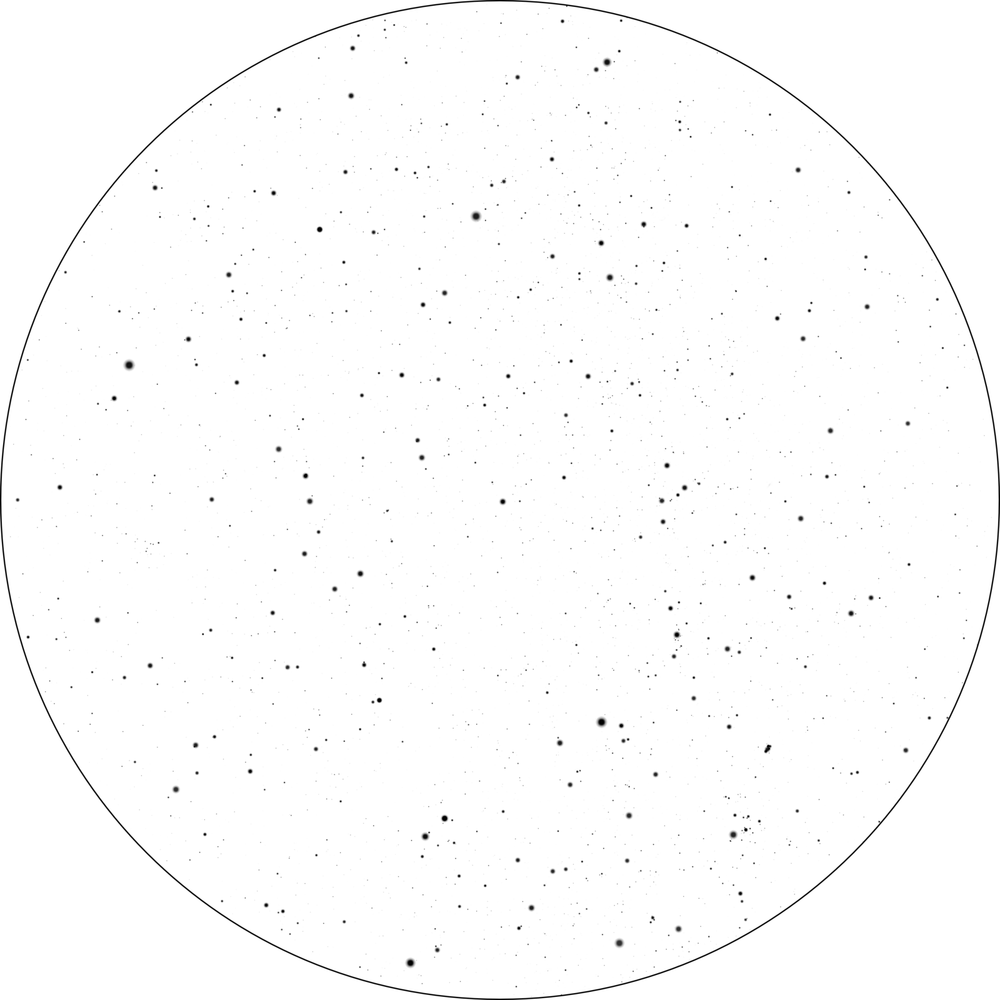
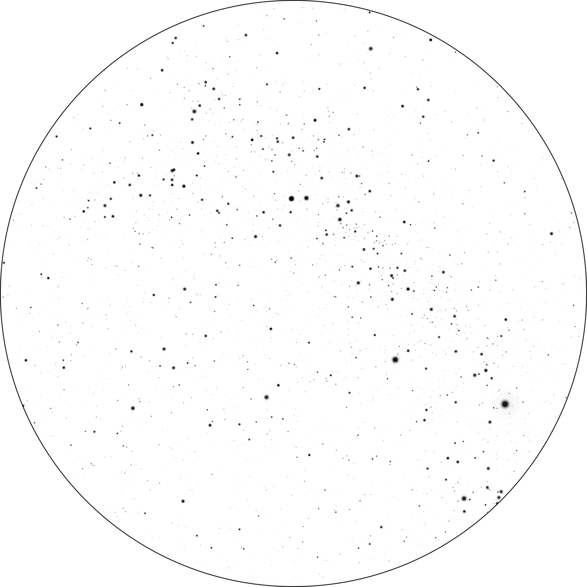
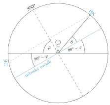
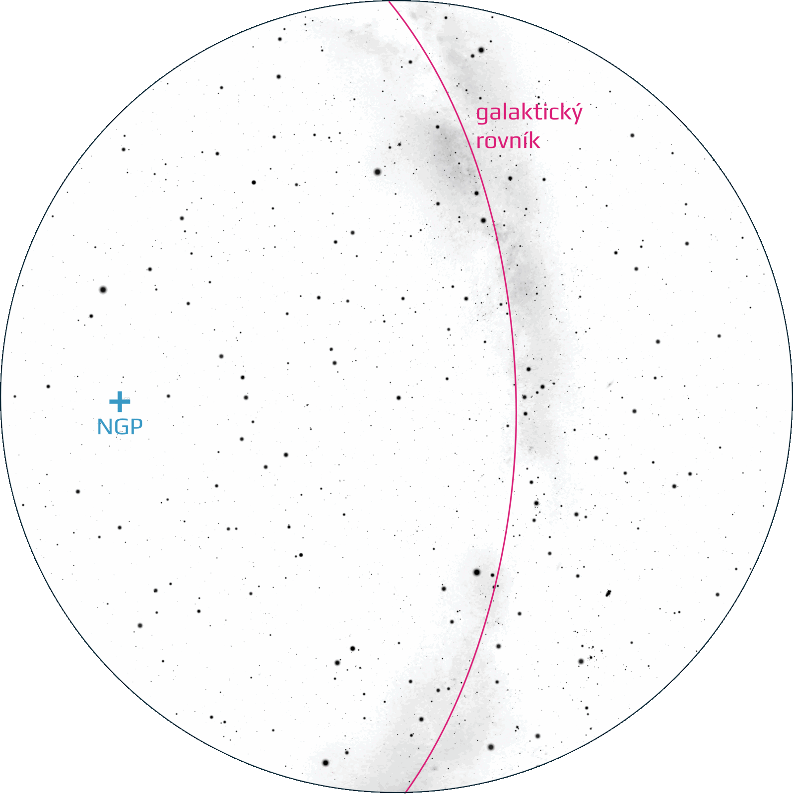
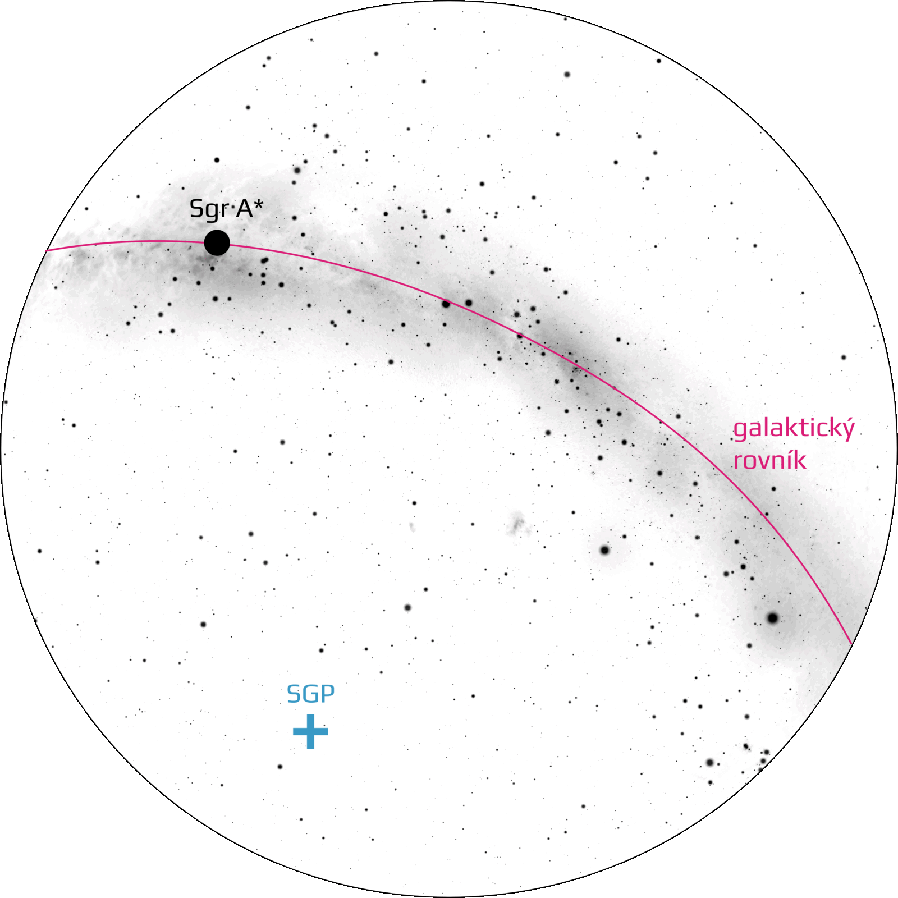

## Zadanie

Na priložených mapách je v takzvanej *fish-eye* projekcii zobrazená severná obloha (obr. 1) a južná obloha (obr. 2). Mapy boli vytvorené ako snímky celej oblohy zo severného, respektíve južného pólu.

*Poznámka k projekcii: Fish-eye projekcia je azimutálna projekcia so stredom v zenite. Vzdialenosť každého objektu od stredu mapy je priamo úmerná jeho zenitovej vzdialenosti.*

V prvej časti úlohy sa pozrieme na galaktický rovník, ktorý je hlavnou kružnicou na oblohe reprezentujúcou priemet roviny našej galaxie na nebeskú sféru.

<ol type="a">

<li>

[15 b] Zakreslite približnú polohu galaktického rovníka na severnej oblohe (obr. 1).

</li>

<li>

[15 b] Zakreslite približnú polohu galaktického rovníka na južnej oblohe (obr. 2).

</li>

<li>

[15 b] Na základe riešenia úloh (a) a (b) odhadnite približný rozsah deklinácií galaktického rovníka s presnosťou $\pm8^{\circ}$.

</li>

<li>

[15 b] Na základe výsledku úlohy (c) určte rozsah zemepisných šírok, odkiaľ je možné vidieť v priebehu roka celú Mliečnu cestu, reprezentovanú galaktickým rovníkom.

</li>

</ol>

V ďalšej časti sa pozrieme na niektoré špecifické body v sústave galaktických súradníc.

<ol type="a" start="5">

<li>

[10 b] Vyznačte do príslušných máp približnú polohu severného a južného galaktického pólu. Zároveň napíšte latinské názvy súhvezdí, v ktorých sa nachádzajú.

</li>

<li>

[10 b] Kde sa nachádza bod, ktorý určuje počiatok galaktických súradníc? Napíšte latinský názov súhvezdia, v ktorom sa nachádza, názov objektu, ktorý ho reprezentuje, a vyznačte približnú polohu v príslušnej mape.

</li>

</ol>

Na oblohe poznáme ešte ďalšie dve významné kružnice, a to nebeský rovník a ekliptiku.

<ol type="a" start="7">

<li>

[10 b] Existujú súhvezdia, v ktorých sa pretína galaktický a nebeský rovník? Napíšte latinský názov aspoň jedného z nich.

</li>

<li>

[15 b] Bolo by možné na oblohe pozorovať nejakú planétu na pozadí Mliečnej cesty? Ak áno, v akom súhvezdí? Napíšte jeho latinský názov.

</li>

</ol>

V poslednej časti úlohy sa pozrieme na ostatné hviezdy a objekty vzdialeného vesmíru.

<ol type="a" start="9">

<li>

[10 b] Kde na oblohe sa najviac vyskytujú guľové hviezdokopy a kde otvorené hviezdokopy? Vypíšte aspoň dve guľové hviezdokopy, ktoré toto rozdelenie porušujú.

</li>

<li>

[10 b] V úlohe sme sa zameriavali na našu galaxiu, na záver sa pozrieme na tie ostatné. V ktorom ročnom období ich pozorovateľ na severnej/južnej pologuli môže pozorovať najviac? Vysvetlite prečo a napíšte aspoň tri zoskupenia galaxií, ktoré to potvrdzujú.

</li>

</ol>

<figure>

<figcaption>

**Obrázok 1:** Mapa 1 celej oblohy vytvorená pre severný pól. Zdroj: Stellarium.
</figcaption>

</figure>

<figure>

<figcaption>

**Obrázok 2:** Mapa 2 celej oblohy vytvorená pre južný pól. Zdroj: Stellarium.
</figcaption>

</figure>

Riešenie

<ol type="a">

<li>

Poloha galaktického rovníka na severnej oblohe je zakreslená na mape na obrázku 4.

</li>

<li>

Poloha galaktického rovníka na južnej oblohe je zakreslená na mape na obrázku 5.

</li>

<li>

V deklinácii je galaktický rovník symetrický a jeho rozsah je približne od $-62{,}5^{\circ}$ do $62{,}5^{\circ}$. Ak si túto hodnotu nepamätáme ani približne, je možné ju odhadnúť podľa nášho nákresu. Využijeme vlastnosť fish-eye projekcie, a to vlastnosť, že vzdialenosť od stredu je daná zenitovou vzdialenosťou. Stačí nájsť najbližší bod galaktického rovníka k zenitu, čo je v súhvezdí Kasiopeja, ktorá sa nachádza zhruba v tretine ($30^{\circ}$) vzdialenosti zenitu a horizontu. To znamená, že maximálna deklinácia je približne $60^{\circ}$.

</li>

<li>

Vzhľadom na symetriu nám stačí nájsť najsevernejší bod, z ktorého je ešte vidieť najjužnejší bod galaktického rovníka. [3 b] Výška hviezdy s deklináciou $\delta$ na zemepisnej šírke $\varphi$ pri kulminácii je (pre odvodenie viď. obrázok 3) 

$$
h = 90^{\circ} - \varphi + \delta \,. \qquad\textit{[4\,b]} \tag{1}
$$

Keďže hľadáme limit, tak hľadáme miesto, kde je galaktický rovník presne na horizonte, teda ho limitne vidíme. Dosadíme do rovnice $h = 0^{\circ}$ [2 b] 

$$
0^{\circ} = 90^{\circ} - \varphi + \delta \,, \tag{2}
$$

 odkiaľ vyjadríme zemepisnú šírku 

$$
\varphi = 90^{\circ} + \delta \,. \qquad\textit{[3\,b]} \tag{3}
$$

 Pri hľadaní najsevernejšieho bodu, kde vidíme ešte najjužnejšiu časť galaktického rovníka, dosadíme $\delta = -62{,}5^{\circ}$, teda dostaneme $\varphi = 27{,}5^{\circ}$. Rozsah zemepisných šírok, odkiaľ je vidieť celý galaktický rovník, je od $-27{,}5^{\circ}$ do $27{,}5^{\circ}$. [3 b]

<figure>

<figcaption>

**Obrázok 3:** Schéma na výpočet výšky hviezdy pri hornej kulminácii. Použité skratky: HK/DK - horná/dolná kulminácia, SNP - severný nebeský pól.
</figcaption>

</figure>

</li>

<li>

Severný galaktický pól sa nachádza v súhvezdí Coma Berenices (Vlasy Bereniky) a je vyznačený krížikom v mape na obrázku 4. Južný galaktický pól sa nachádza v súhvezdí Sculptor (Sochár) a je vyznačený krížikom na mape na obrázku 5.

</li>

<li>

Centrum Galaxie predstavuje čierna diera s označením Sgr A\* v súhvezdí Sagittarius (Strelec) a je vyznačené na mape na obrázku 5.

</li>

<li>

Keďže sú mapy vytvorené presne pre svetové póly tak horizont máp je zhodný s nebeským rovníkom. Stačí teda nájsť miesta, kde sa galaktický rovník pretína s horizontom, a to je súhvezdie Monoceros (Jednorožec) a na druhej strane súhvezdie Aquila (Orol).

</li>

<li>

Galaktický rovník má s ekliptikou dva priesečníky. Keďže ale hľadáme planéty na pozadí Mliečnej dráhy, tak berieme širšie okolie galaktického rovníka. Jeden priesečník je blízko hranice súhvezdí Gemini (Blíženci) a Taurus (Býk) a na druhej strane je priesečník blízko hraníc súhvezdí Scorpius (Škorpión), Sagittarius (Strelec) a Ophiuchus (Hadonos).

</li>

<li>

Guľové hviezdokopy sa štandardne v Galaxii vyskytujú v galaktickom hale a galaktickej výduti, čo na oblohe predstavuje predovšetkým oblasť mimo galaktického disku. Otvorené hviezdokopy obsahujú hlavne mladé hviezdy a vznikajú a existujú v galaktickom disku. Tomuto rozdeleniu nezodpovedajú guľové hviezdokopy v blízkosti galaktického disku ako napríklad M71 (Sge), M56 (Lyr), M28 (Sgr), M22 (Sgr), M69 (Sgr), M70 (Sgr), M28 (Sgr) …

</li>

<li>

Najviac galaxií je možné pozorovať predovšetkým na jar, keďže jarnou oblohou Mliečna cesta skoro vôbec neprechádza (na jarnej oblohe sa nachádza severný galaktický pól) a nebráni pozorovaniu vzdialených galaxií. Dôkazom sú výrazné kopy galaxií na jarnej oblohe ako Kopa galaxií v Panne, Kopa galaxií vo Vlasoch Bereniky a trojica galaxií *Leo triplet*. Pre pozorovateľov na južnej pologuli je rovnaká situácia pre ich jarnú oblohu (z nášho pohľadu jesenná) a v blízkosti južného galaktického pólu sa nachádza Skupina galaxií v Sochárovi.

</li>

</ol>

<figure>

<figcaption>

**Obrázok 4:** Mapa celej oblohy vytvorená pre severný pól. Ružovou farbou je vyznačený galaktický rovník, krížikom je vyznačený severný galaktický pól. Zdroj: Stellarium.
</figcaption>

</figure>

<figure>

<figcaption>

**Obrázok 5:** Mapa celej oblohy vytvorené pre južný pól. Ružovou farbou je vyznačený galaktický rovník, krížikom južný galaktický pól a čiernym krúžkom objekt Sgr A\* (čierna diera). Zdroj: Stellarium.
</figcaption>

</figure>

