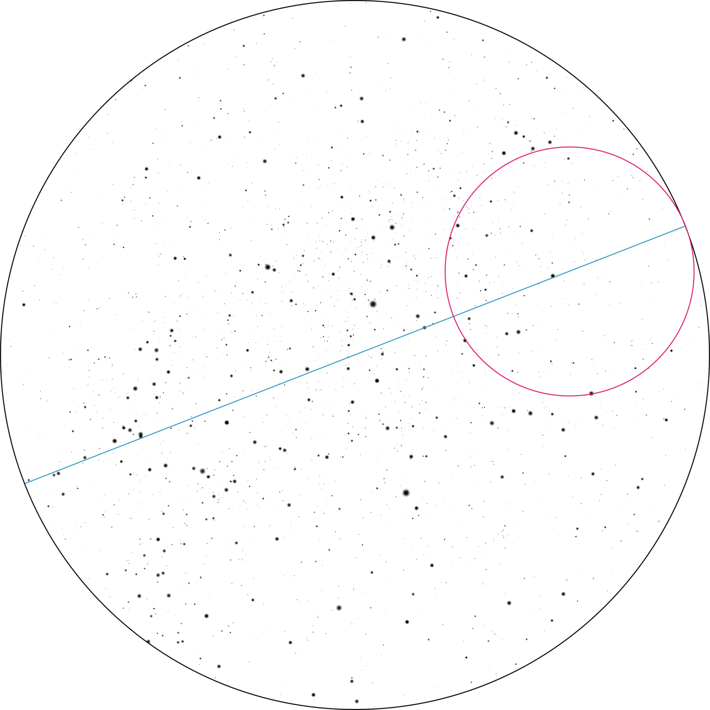
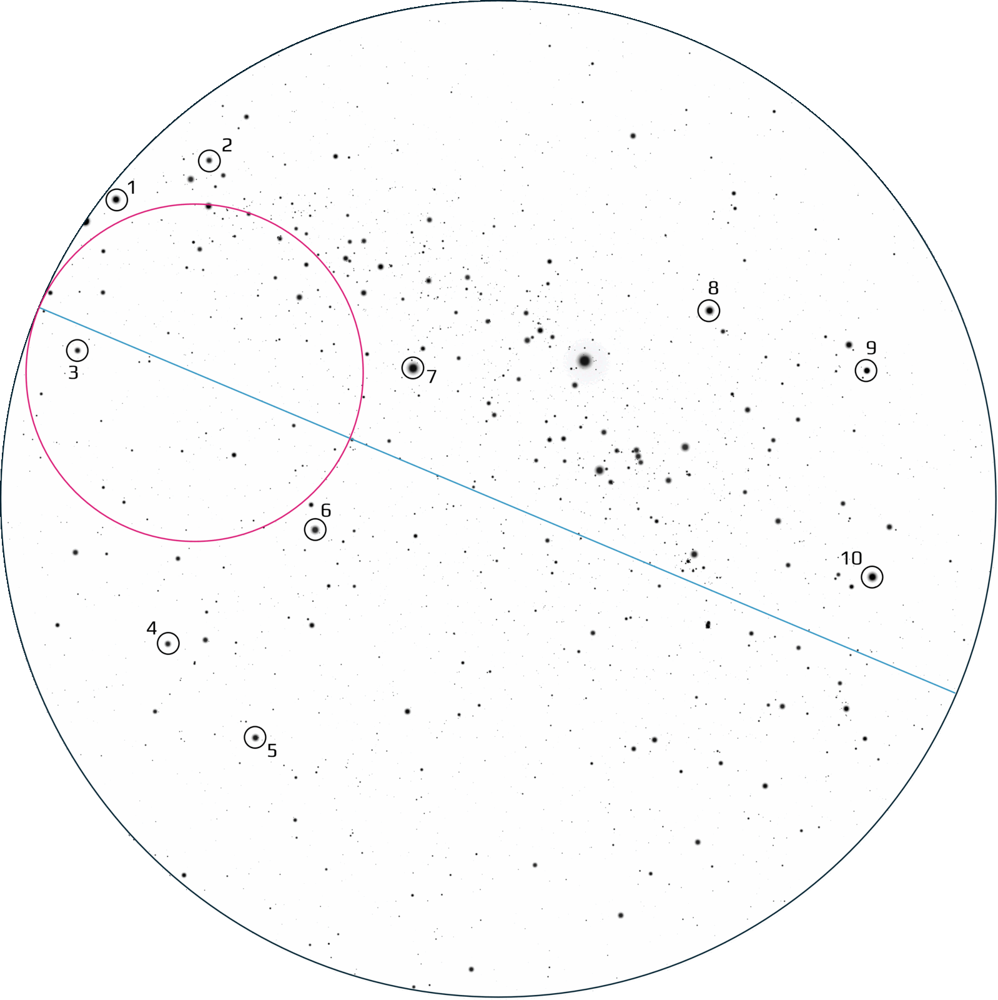
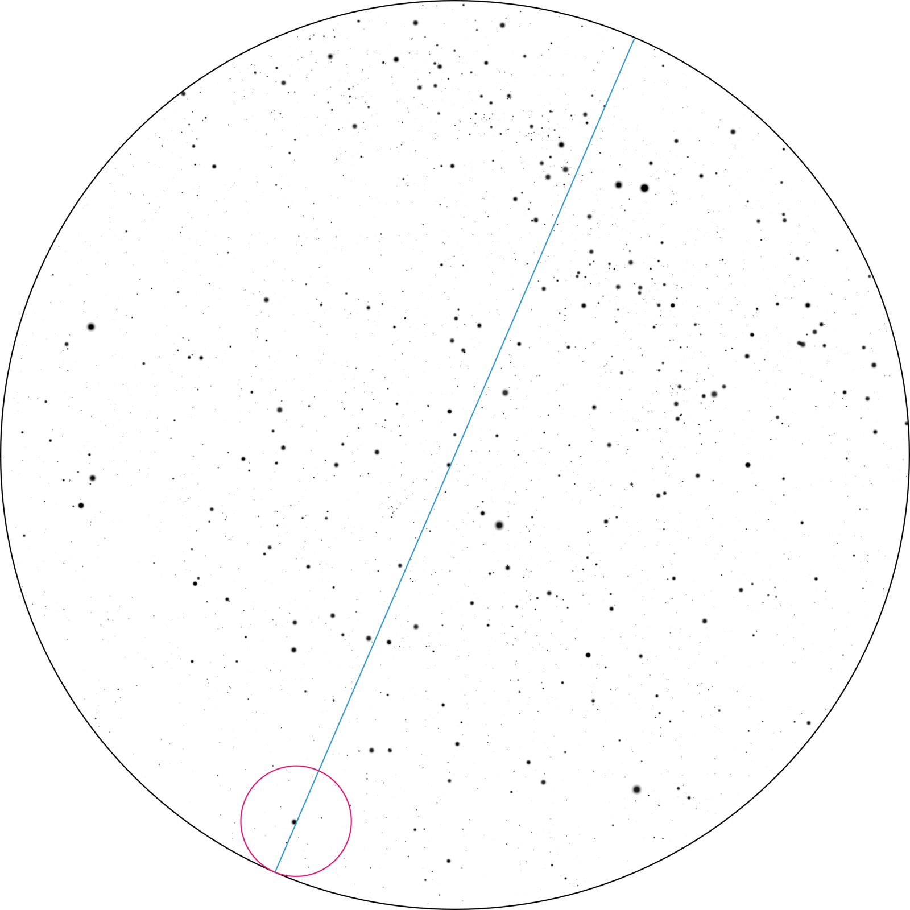
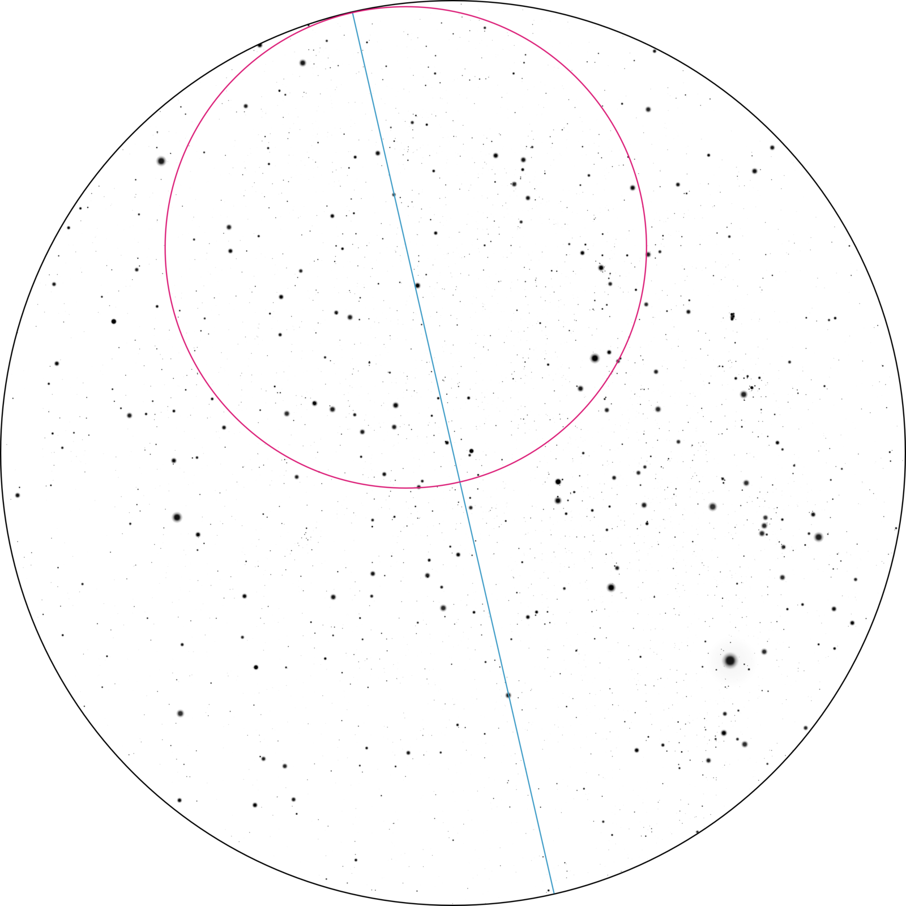
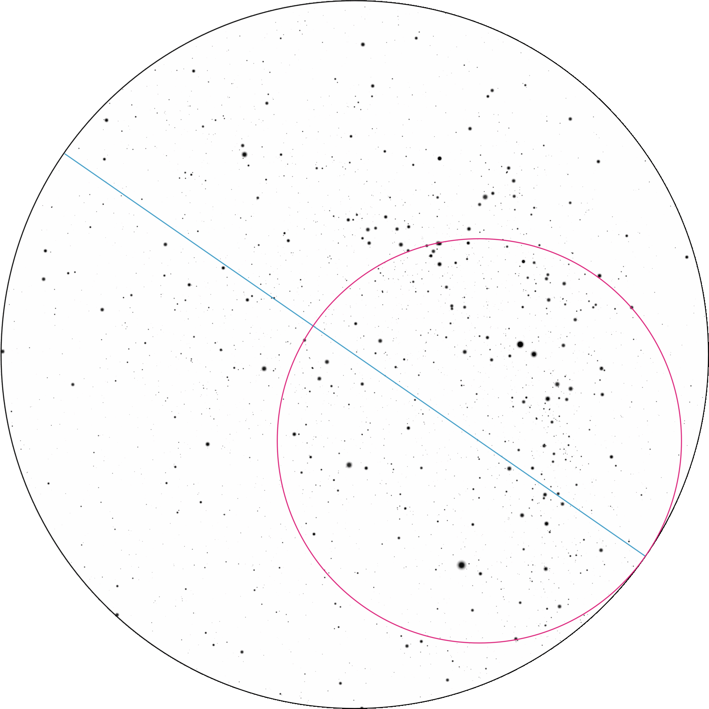
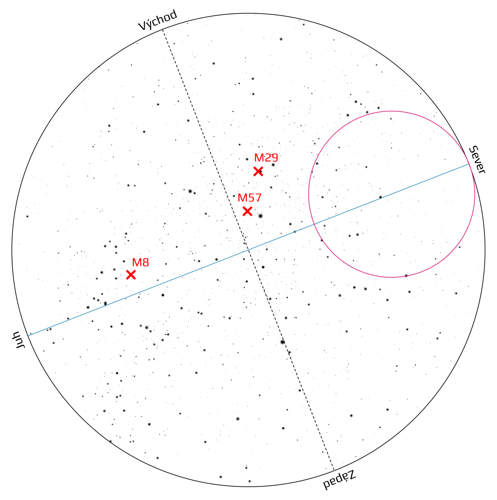
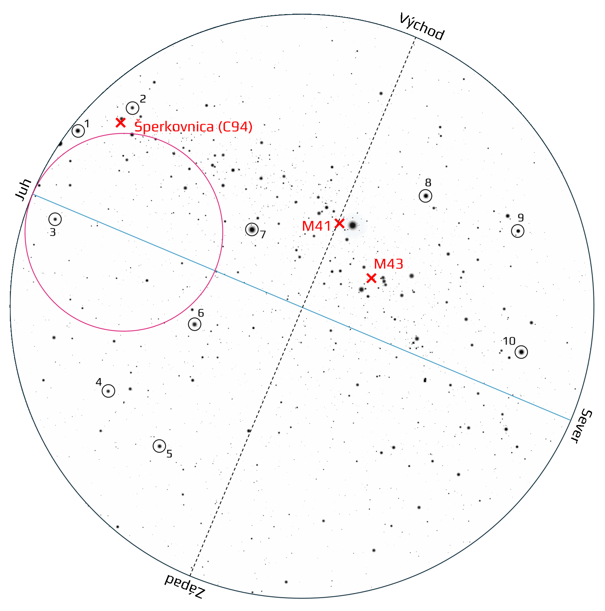
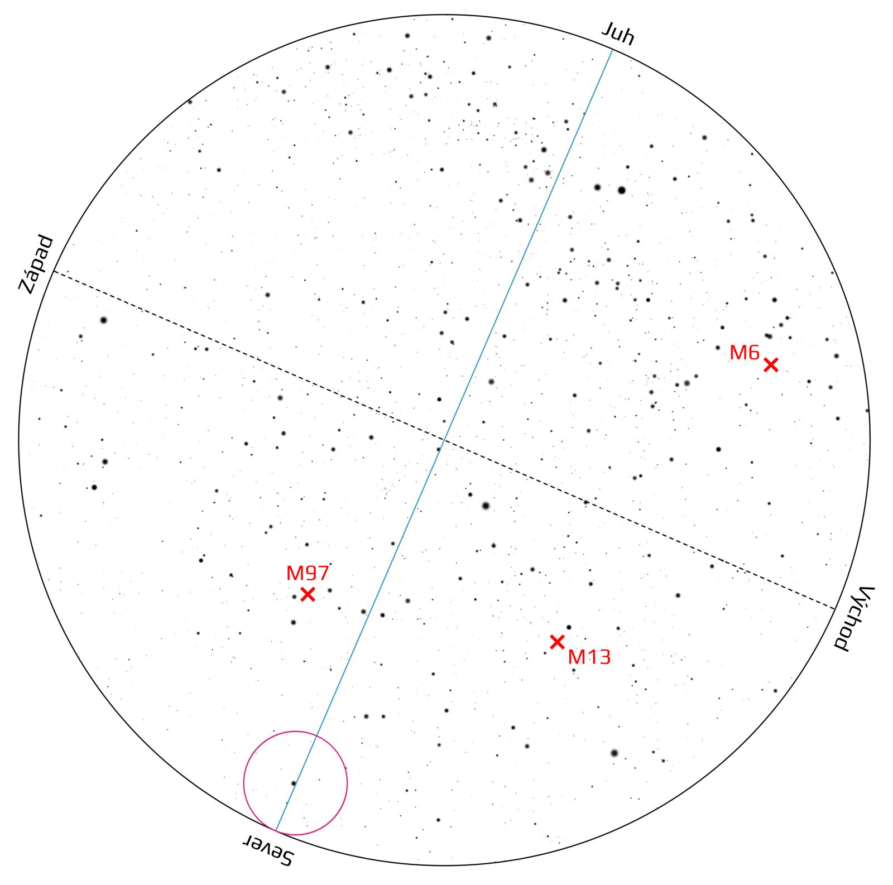
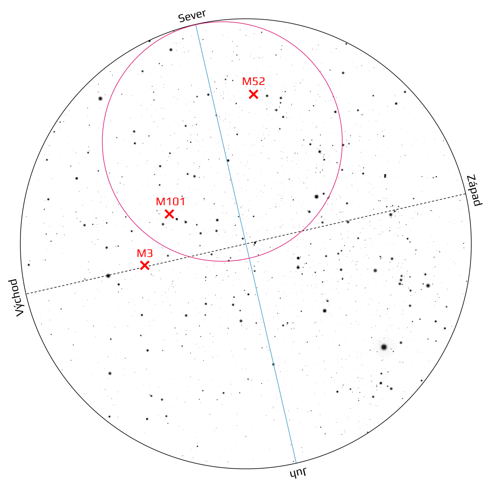
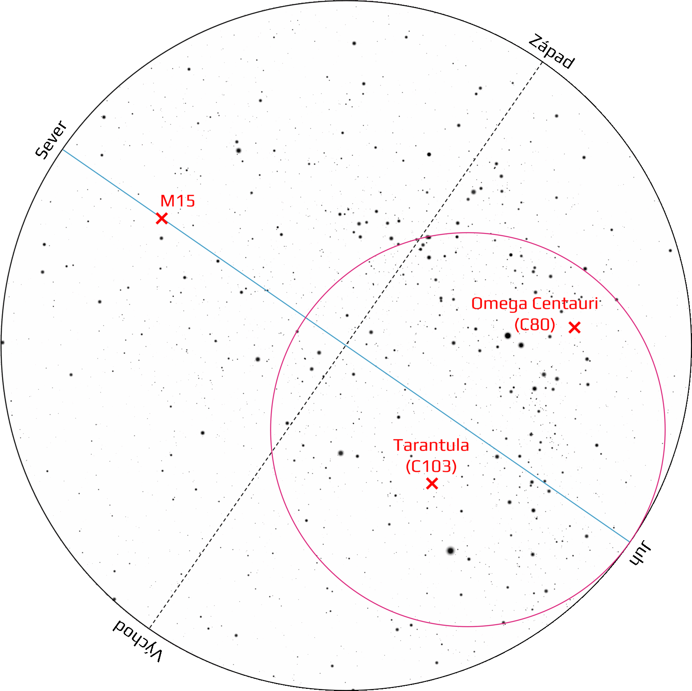

## Zadanie

Dobrodruh počas roka 2026 cestuje po svete a zakresľuje si mapy hviezdnej oblohy tak, ako ju vidí na niektorých zaujímavých miestach, ktoré sú vypísané v priloženej tabuľke. Všetky tieto mapy máte k dispozícii. Každá mapa bola zakreslená o polnoci pásmového času na danom mieste, pričom pásmový čas sa na žiadnom z miest výrazne nelíši od miestneho času. V každej mape je tiež vyznačený meridián a cirkumpolárna kružnica.

<ol type="a">

<li>

[20 b] Priraďte každú hviezdnu mapu ku geografickému miestu, ktorého oblohu ukazuje. Vašu odpoveď stručne zdôvodnite.

</li>

<li>

[25 b] Ku každej hviezdnej mape napíšte aj dátum, pre ktorý bola vytvorená. Na výber máte z nasledujúcich možností:

- 10\. 2. 2026,

- 15\. 4. 2026,

- 1\. 7. 2026,

- 9\. 9. 2026,

- 24\. 12. 2026.

</li>

<li>

[25 b] Ku každej hviezdnej mape doplňte aj jej miestny hviezdny čas. Na výber máte z nasledujúcich hodnôt:

- $4^{\mathrm{h}}\,16^{\mathrm{min}}$,

- $9^{\mathrm{h}}\,29^{\mathrm{min}}$,

- $13^{\mathrm{h}}\,5^{\mathrm{min}}$,

- $17^{\mathrm{h}}\,31^{\mathrm{min}}$,

- $21^{\mathrm{h}}\,29^{\mathrm{min}}$.

</li>

<li>

[20 b] Do všetkých piatich máp vyznačte kardinálne body (hlavné svetové strany).

</li>

<li>

[20 b] V mape B je vyznačených 10 hviezd – vašou úlohou je napísať do tabuľky ich názov alebo Bayerovo označenie a latinský názov súhvezdia, v ktorom sa nachádzajú. Rozhodnite, ktoré z nich patria medzi 10 najjasnejších hviezd nočnej oblohy (podľa zdanlivej vizuálnej magnitúdy).

</li>

<li>

[15 b] Dobrodruh si obľúbil pozorovanie deep-sky objektov, pričom na každom mieste pozoruje nejaké iné. Vašou úlohou je vytvoriť návrh takéhoto pozorovania – do každej mapy zakreslite polohy 3 ľubovoľných Messierových alebo iných deep-sky objektov podľa vášho výberu a pripíšte k nim názov alebo katalógové označenie. Dajte pozor na to, aby boli v každej mape zakreslené iné objekty.

</li>

</ol>

**Tabuľka 1:** Tabuľka s mapami, ktoré zakresľoval dobrodruh na cestách.

| **Miesto** | **Zem. šírka** | **Zem. dĺžka** | **Dátum** | **Hviezdny čas** | **Mapa** |
|:---|:--:|:--:|:--:|:--:|:--:|
|  |  |  |  |  |  |
| Hanga Roa | $27^{\circ}\,8'$ S | $109^{\circ}\,25'$ W |  |  |  |
| Phuket | $7^{\circ}\,53'$ N | $98^{\circ}\,24'$ E |  |  |  |
| Punta Arenas | $53^{\circ}\,9'$ S | $70^{\circ}\,55'$ W |  |  |  |
| St. Cruz de Tenerife | $28^{\circ}\,28'$ N | $16^{\circ}\,15'$ W |  |  |  |
| Sobotište | $48^{\circ}\,44'$ N | $17^{\circ}\,24'$ E |  |  |  |

**Tabuľka 2:** Tabuľka s hviezdami zakrúžkovanými na mape B.

| **Hviezda** |  **Názov/označenie**  |  **Súhvezdie**  |  **Top 10 (áno/nie)**  |
|:-----------:|:---------------------:|:---------------:|:----------------------:|
|             |                       |                 |                        |
|      1      |                       |                 |                        |
|      2      |                       |                 |                        |
|      3      |                       |                 |                        |
|      4      |                       |                 |                        |
|      5      |                       |                 |                        |
|      6      |                       |                 |                        |
|      7      |                       |                 |                        |
|      8      |                       |                 |                        |
|      9      |                       |                 |                        |
|     10      |                       |                 |                        |

<figure>

<figcaption>

**Obrázok 1:** Mapa A. Zdroj: Stellarium.
</figcaption>

</figure>

<figure>

<figcaption>

**Obrázok 2:** Mapa B. Zdroj: Stellarium.
</figcaption>

</figure>

<figure>

<figcaption>

**Obrázok 3:** Mapa C. Zdroj: Stellarium.
</figcaption>

</figure>

<figure>

<figcaption>

**Obrázok 4:** Mapa D. Zdroj: Stellarium.
</figcaption>

</figure>

<figure>

<figcaption>

**Obrázok 5:** Mapa E. Zdroj: Stellarium.
</figcaption>

</figure>

Riešenie

<ol type="a">

<li>

Zemepisnú šírku pozorovacieho miesta nám napovedajú cirkumpolárne kružnice – čím sú väčšie, tým bližšie sa nachádza k pólom. Severnú/južnú pologuľu určíme podľa toho, ktorý svetový pól je vidno nad obzorom. Napríklad mapy D a E majú najväčšie cirkumpolárne kružnice, musia preto zodpovedať aj najväčším zemepisným šírkam. Na mape D je vidno severný pól, musela byť preto vyrobená pre Sobotište, zatiaľ čo mapa E bola určite vyrobená pre Punta Arenas, pretože je na nej vidno južný pól. Všetky správne odpovede sú uvedené v tabuľke 3.

</li>

<li>

Riešenie tejto a nasledujúcej úlohy nám uľahčí fakt, že všetky mapy boli zakreslené o polnoci. To znamená, že dátumy a hviezdne časy na sebe navzájom závisia – mapa s neskorším dátumom zodpovedá zároveň aj neskoršiemu hviezdnemu času. Dátum môžeme odhadnúť podľa polohy bodov rovnodennosti a slnovratných bodov alebo tiež podľa polohy súhvezdí typických pre určité ročné obdobie. Napríklad na mape C vidíme v okolí meridiánu typické súhvezdia jarnej oblohy, pričom jarný bod je kúsok západne od meridiánu – to naznačuje, že mapa zodpovedá obdobiu krátko po jarnej rovnodennosti. Z dátumov, ktoré máme na výber, tomu najlepšie zodpovedá 15. 4. 2026. Podobným spôsobom určíme dátumy pre všetky mapy, správne odpovede sú v tabuľke 3.

</li>

<li>

Hviezdny čas vieme tiež odhadnúť z polohy súhvezdí a významných bodov na oblohe. Napríklad v mape B je vidno, že súhvezdie Orión sa nachádza východne od meridiánu. Ak si pamätáme, že sa Orión tesne zmestí medzi hodnoty rektascenzie $5^{\mathrm{h}}$ a $6^{\mathrm{h}}$, môžeme zhruba odhadnúť, že na meridiáne sa v tom momente nachádzajú hviezdy s rektascenziou $4^{\mathrm{h}}$, čo sa zároveň rovná aj hviezdnemu času. V ponúkaných možnostiach máme veľmi blízku hodnotu $4^{\mathrm{h}}\,16^{\mathrm{min}}$. Ostatné správne hodnoty sú uvedené v tabuľke 3.

</li>

<li>

Sever a juh nájdeme v mieste, kde sa meridián pretína s horizontom, pričom ich rozlíšime podľa viditeľného svetového pólu. Teda ak vidíme Polárku nad obzorom, smer na sever vyznačíme v jej blízkosti, ak vidíme súhvezdie Oktant, bude pri ňom smer na juh. Kolmo na meridián nakreslíme priamku tak, aby prechádzala cez zenit v strede mapy – teda prvý vertikál, pomocou ktorého určíme smery na východ a západ. Pritom si môžeme uvedomiť, že keď sa pozeráme na skutočnú oblohu smerom na juh, po ľavej ruke máme východ a po pravej západ. Ak si teda mapu natočíme tak, aby juh bol na jej dolnom okraji, východ bude v ľavej časti mapy a západ v pravej časti mapy.

</li>

<li>

Správne odpovede sú v tabuľke 4.

</li>

<li>

V mapách 6 až 10 je zakreslená jedna z mnohých možných kombinácií deep-sky objektov.

</li>

</ol>

**Tabuľka 3:** Tabuľka s doplnenými údajmi o mapách, ktoré zakresľoval dobrodruh.

| **Miesto** | **Zem. šírka** | **Zem. dĺžka** | **Dátum** | **Hviezdny čas** | **Mapa** |
|:---|:--:|:--:|:--:|:--:|:--:|
|  |  |  |  |  |  |
| Hanga Roa | $27^{\circ}\,8'$ S | $109^{\circ}\,25'$ W | 24\. 12. 2026 | $4^{\mathrm{h}}\,16^{\mathrm{min}}$ | B |
| Phuket | $7^{\circ}\,53'$ N | $98^{\circ}\,24'$ E | 15\. 4. 2026 | $13^{\mathrm{h}}\,5^{\mathrm{min}}$ | C |
| Punta Arenas | $53^{\circ}\,9'$ S | $70^{\circ}\,55'$ W | 9\. 9. 2026 | $21^{\mathrm{h}}\,29^{\mathrm{min}}$ | E |
| Santa Cruz de Tenerife | $28^{\circ}\,28'$ N | $16^{\circ}\,15'$ W | 1\. 7. 2026 | $17^{\mathrm{h}}\,31^{\mathrm{min}}$ | A |
| Sobotište | $48^{\circ}\,44'$ N | $17^{\circ}\,24'$ E | 10\. 2. 2026 | $9^{\mathrm{h}}\,29^{\mathrm{min}}$ | D |

**Tabuľka 4:** Tabuľka s hviezdami zakrúžkovanými na mape B.

| **Hviezda** | **Názov/označenie** | **Súhvezdie** | **Top 10 (áno/nie)** |
|:--:|:--:|:--:|:--:|
|  |  |  |  |
| 1 | Hadar/Agena/$\beta$ Cen | Centaurus | NIE |
| 2 | Gacrux/$\gamma$ Cru | Crux | NIE |
| 3 | Atria/$\alpha$ TrA | Triangulum Australe | NIE |
| 4 | Alnair/$\alpha$ Gru | Grus | NIE |
| 5 | Fomalhaut/$\alpha$ PsA | Piscis Austrinus | NIE |
| 6 | Achernar/$\alpha$ Eri | Eridanus | ÁNO |
| 7 | Canopus/$\alpha$ Car | Carina | ÁNO |
| 8 | Prokyón/$\alpha$ CMi | Canis Minor | ÁNO |
| 9 | Castor/$\alpha$ Gem | Gemini | NIE |
| 10 | Capella/$\alpha$ Aur | Auriga | ÁNO |

<figure>

<figcaption>

**Obrázok 6:** Mapa A s označenými kardinálnymi bodmi a tromi deep-sky objektmi.
</figcaption>

</figure>

<figure>

<figcaption>

**Obrázok 7:** Mapa B s označenými kardinálnymi bodmi a tromi deep-sky objektmi.
</figcaption>

</figure>

<figure>

<figcaption>

**Obrázok 8:** Mapa C s označenými kardinálnymi bodmi a tromi deep-sky objektmi.
</figcaption>

</figure>

<figure>

<figcaption>

**Obrázok 9:** Mapa D s označenými kardinálnymi bodmi a tromi deep-sky objektmi.
</figcaption>

</figure>

<figure>

<figcaption>

**Obrázok 10:** Mapa E s označenými kardinálnymi bodmi a tromi deep-sky objektmi.
</figcaption>

</figure>

