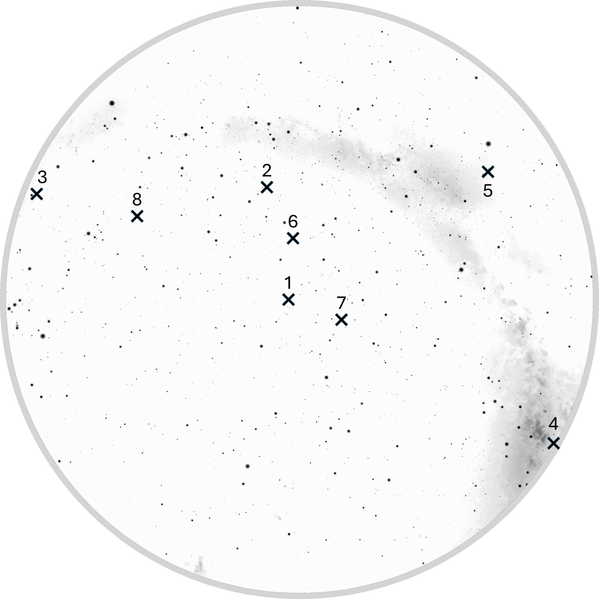
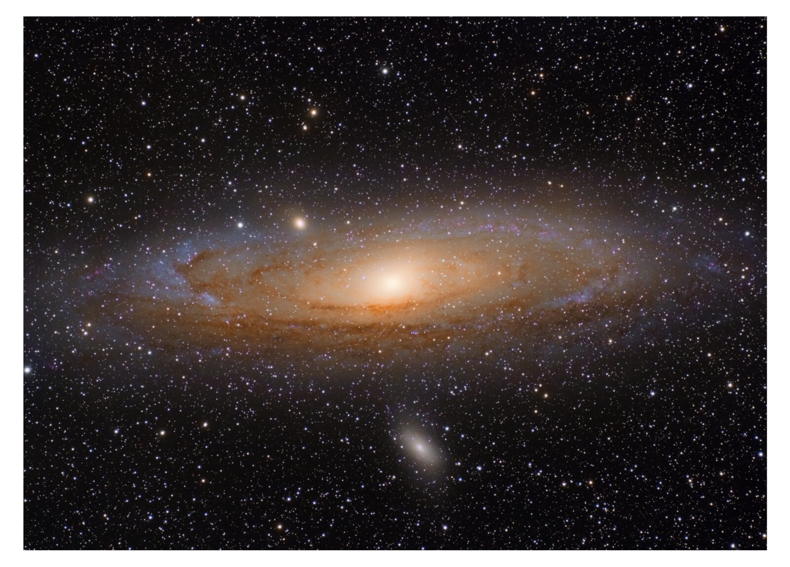
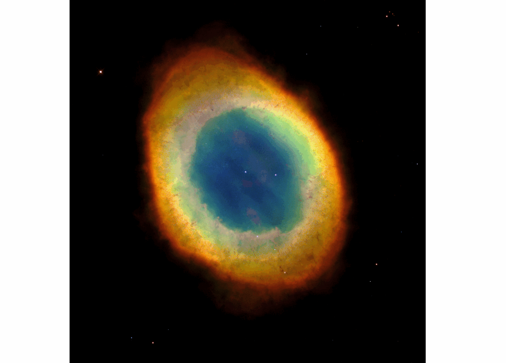
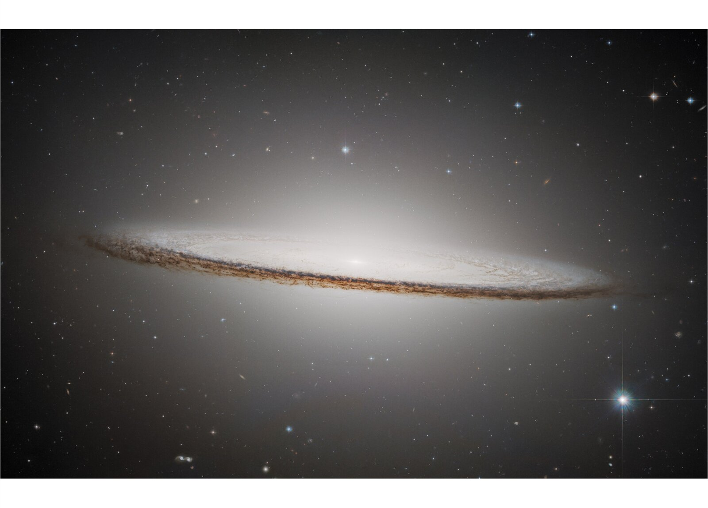
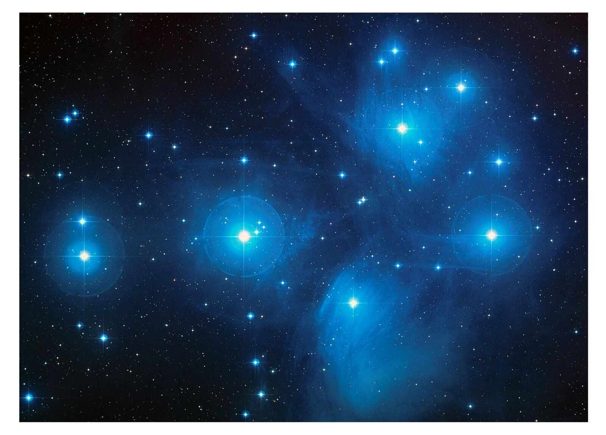
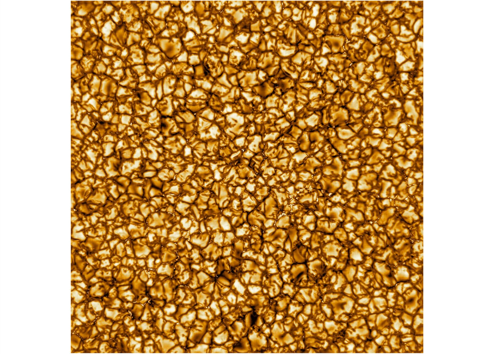
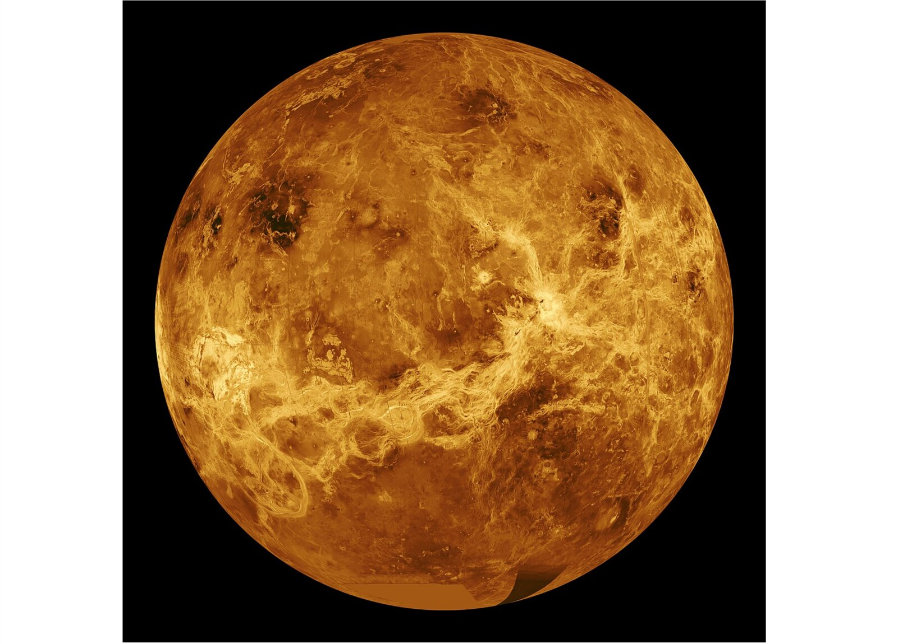
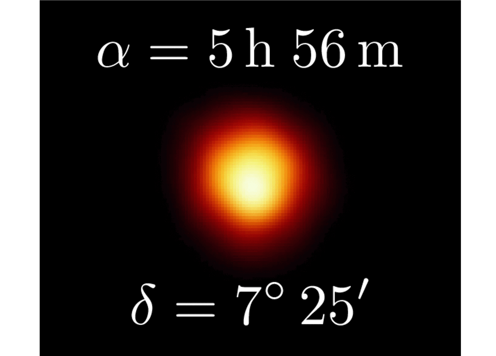
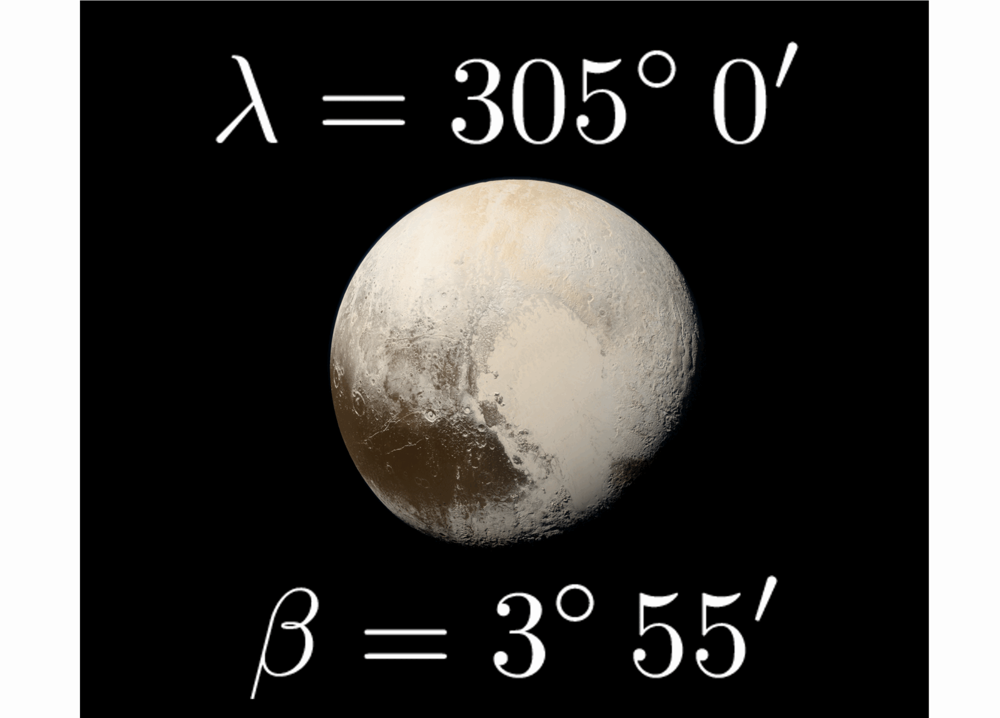
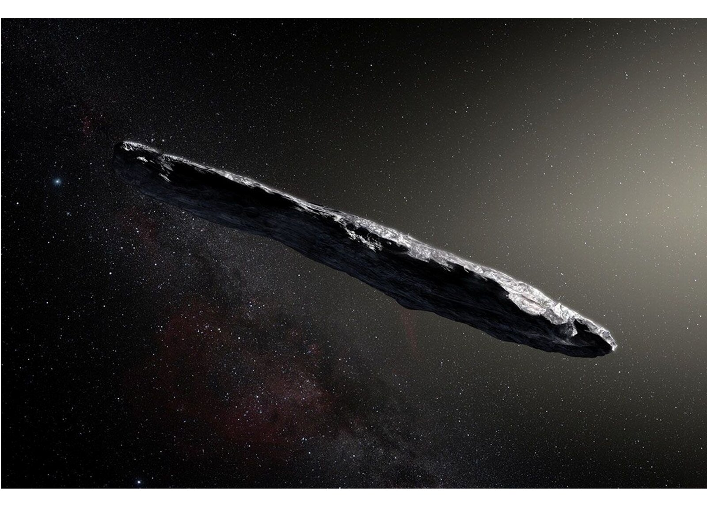

## Zadanie

Planetárium zobrazí oblohu na nejakom mieste na Zemi v čase jarnej rovnodennosti o 14:00 UTC, 15 minút pred pravým poludním. Objekty slnečnej sústavy planetárium nezobrazuje.

Na priložených obrázkoch sú fotografie 10 rôznych objektov, z ktorých sa 8 nachádza nad horizontom a 2 pod ním. Vašou úlohou je tieto objekty správne identifikovať a priradiť ku krížikom vyznačeným na oblohe. Ku každému objektu napíšte číslo krížika, kde sa tento objekt nachádza (3 body za správne priradenie), zakrúžkujte, či je POD/NAD horizontom (6 bodov celkovo), a napíšte názov alebo označenie tohto objektu (2 body za objekt). Pozor, za nesprávne priradené objekty sa vám body odčítajú (mínus 1 bod za objekt). Za nesprávne určený názov objektu sa body nestrhávajú. Za túto časť úlohy viete získať 50 bodov.

Na základe premietnutej oblohy takisto vyriešte ďalšie priložené úlohy (a) až (h) za 55 bodov.

<figure>

<figcaption>

**Obrázok 1:** Premietnutá obloha s vyznačenými krížikmi. Zdroj: Stellarium.
</figcaption>

</figure>

|  |  |  |  |  |
|:--:|:--:|:--:|:--:|:--:|
|  |  |  |  |  |
| číslo krížika: | číslo krížika: | číslo krížika: | číslo krížika: | číslo krížika: |
|  |  |  |  |  |
| NAD / POD obzorom | NAD / POD obzorom | NAD / POD obzorom | NAD / POD obzorom | NAD / POD obzorom |
|  |  |  |  |  |
| názov alebo označenie | názov alebo označenie | názov alebo označenie | názov alebo označenie | názov alebo označenie |
|  |  |  |  |  |

|  |  |  |  |  |
|:--:|:--:|:--:|:--:|:--:|
|  |  |  |  |  |
| číslo krížika: | číslo krížika: | číslo krížika: | číslo krížika: | číslo krížika: |
|  |  |  |  |  |
| NAD / POD obzorom | NAD / POD obzorom | NAD / POD obzorom | NAD / POD obzorom | NAD / POD obzorom |
|  |  |  |  |  |
| názov alebo označenie | názov alebo označenie | názov alebo označenie | názov alebo označenie | názov alebo označenie |
|  |  |  |  |  |

<ol type="a">

<li>

[10 b] Odhadnite zemepisnú šírku, na ktorej sa nachádzame:

</li>

<li>

[6 b] Z nasledujúcich hlavných kružníc zakrúžkujte dvojicu, ktorá je na zobrazenej oblohe zhodná: nebeský rovník ekliptika meridián horizont prvý vertikál galaktický rovník

</li>

<li>

[10 b] K súhvezdiam napíšte ich skratku a zakrúžkujte tie, ktoré sú aspoň čiastočne nad obzorom:

<ol type="i">

<li>

Páv

</li>

<li>

Eridanus

</li>

<li>

Vodný had

</li>

<li>

Južný trojuholník

</li>

<li>

Jašterica

</li>

</ol>

<ol type="i" start="6">

<li>

Rys

</li>

<li>

Južný kríž

</li>

<li>

Oktant

</li>

<li>

Mucha

</li>

<li>

Južná koruna

</li>

</ol>

</li>

<li>

[5 b] Napíšte 5 súhvezdí, ktoré sú aspoň sčasti nad obzorom a prechádza cez ne nebeský rovník.\
\

</li>

<li>

[6 b] Napíšte, koľko súhvezdí je na tejto oblohe plne cirkumpolárnych, a vypíšte ich.\
\

</li>

<li>

[6 b] Odhadnite hviezdny čas:

</li>

<li>

[6 b] Odhadnite čas v UTC, kedy zapadne hviezda Mintaka:

</li>

<li>

[6 b] Odhadnite rektascenziu Veľkého Magellanovho mračna:

</li>

</ol>

Riešenie

<ol type="a">

<li>

[10 b] Odhadnite zemepisnú šírku, na ktorej sa nachádzame: $0^{\circ}$

</li>

<li>

[6 b] Z nasledujúcich hlavných kružníc zakrúžkujte dvojicu, ktorá je na zobrazenej oblohe zhodná: nebeský rovník ekliptika meridián horizont prvý vertikál galaktický rovník

</li>

<li>

[10 b] K súhvezdiam napíšte ich skratku a zakrúžkujte tie, ktoré sú aspoň čiastočne nad obzorom:

<ol type="i">

<li>

Páv Pav

</li>

<li>

Eridanus Eri

</li>

<li>

Vodný had Hyi

</li>

<li>

Južný trojuholník TrA

</li>

<li>

Jašterica Lac

</li>

</ol>

<ol type="i" start="6">

<li>

Rys Lyn

</li>

<li>

Južný kríž Cru

</li>

<li>

Oktant Oct

</li>

<li>

Mucha Mus

</li>

<li>

Južná koruna CrA

</li>

</ol>

</li>

<li>

[5 b] Napíšte 5 súhvezdí, ktoré sú aspoň sčasti nad obzorom a prechádza cez ne nebeský rovník. Orión, Eridanus, Býk, Veľryba, Ryby, Vodnár, Orol, Had, Hadonos\
\

</li>

<li>

[6 b] Napíšte, koľko súhvezdí je na tejto oblohe plne cirkumpolárnych, a vypíšte ich. 0\
\

</li>

<li>

[6 b] Odhadnite hviezdny čas: $23^{\mathrm{h}}\,45^{\mathrm{min}}$

</li>

<li>

[6 b] Odhadnite čas v UTC, kedy zapadne hviezda Mintaka: 23:30

</li>

<li>

[6 b] Odhadnite rektascenziu Veľkého Magellanovho mračna: $5^{\mathrm{h}}\,20^{\mathrm{min}}$

</li>

</ol>

|  |  |  |  |  |
|:--:|:--:|:--:|:--:|:--:|
|  |  |  |  |  |
| číslo krížika: 2 | číslo krížika: 5 | číslo krížika: 3 | číslo krížika: | číslo krížika: 8 |
|  |  |  |  |  |
| NAD / POD obzorom | NAD / POD obzorom | NAD / POD obzorom | NAD / POD obzorom | NAD / POD obzorom |
|  |  |  |  |  |
| M31/ M32/ M110 | M57/ Prstenec | M16/ Orlia hmlovina | M104/ Sombrero | M45/ Plejády |
|  |  |  |  |  |

|  |  |  |  |  |
|:--:|:--:|:--:|:--:|:--:|
|  |  |  |  |  |
| číslo krížika: 1 | číslo krížika: 7 | číslo krížika: | číslo krížika: 4 | číslo krížika: 6 |
|  |  |  |  |  |
| NAD / POD obzorom | NAD / POD obzorom | NAD / POD obzorom | NAD / POD obzorom | NAD / POD obzorom |
|  |  |  |  |  |
| Slnko | Venuša | $\beta$ Ori/ Betelgeuse | Pluto | ’Oumuamua |
|  |  |  |  |  |

