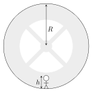
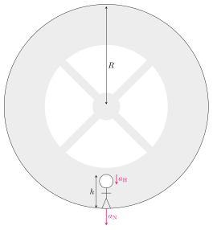

## Zadanie

Častým motívom v sci-fi literatúre a filmoch je medzihviezdne cestovanie s potrebou umelej gravitácie v kozmickej lodi. Jednoduchým spôsobom, ako vytvoriť umelú gravitáciu, je rotujúci valec. S vesmírnou loďou takéhoto tvaru sme sa mohli stretnúť v knihách, resp. filmoch Vesmírna odysea, Marťan, Stretnutie s Rámom alebo Pasažieri.

<figure>

<figcaption>

**Obrázok 1:** Schéma lode.
</figcaption>

</figure>

Zrýchlenie je vytvárané rotáciou valca okolo jeho osi. Problémom nie je dosiahnuť samotné zrýchlenie, ale nepríjemnosti by mohli vzniknúť pri veľkom rozdiele zrýchlení pôsobiacich na hlavu a na nohy človeka. Vypočítajte, aký polomer $R$ musí mať valec, aby pre všetkých astronautov bolo zrýchlenie pôsobiace na nohy maximálne o $p = 5 \, \%$ väčšie ako zrýchlenie pôsobiace na hlavu. Výška astronautov $h$ sa pohybuje v rozmedzí $1{,}5\,\mathrm{m}$ až $2\,\mathrm{m}$ a podlaha lode sa nachádza priamo na vnútornom plášti valca.

Riešenie

Zrýchlenie vyvolané rotáciou je dané vzťahom 

$$
a_[it]r = \frac{v_[it]r^2}{r} \,, \tag{1}
$$

 kde $a_[it]r$ je zrýchlenie vo vzdialenosti $r$ od osi rotácie, $v_[it]r$ je rýchlosť otáčania valca v tejto vzdialenosti a $r$ je daná vzdialenosť od osi rotácie. Keďže valec, s ktorým počítame, rotuje ako tuhé teleso, bude praktickejšie použiť uhlovú rýchlosť $\omega = v_[it]r/r$. Vyjadríme si rýchlosť pomocou uhlovej rýchlosti ako $v_[it]r = \omega r$ a dosadíme do rovnice pre zrýchlenie 

$$
a_[it]r = \omega^2 r \,. \qquad\textit{[4\,b]} \tag{2}
$$

 Pasažieri na takejto kozmickej lodi žijú vo vnútornej časti valca, čo znamená, že na nohy pôsobí väčšie zrýchlenie než na hlavu (viď. obrázok 2). Zrýchlenie pôsobiace na nohy môžeme zapísať ako 

$$
a_N = \omega^2 R \,, \tag{3}
$$

 kde $R$ je polomer valca, teda vzdialenosť podlahy (nôh) od osi otáčania. [3 b] Hlava je bližšie k osi otáčania o výšku človeka $h$, teda zrýchlenie pôsobiace na hlavu môžeme zapísať ako 

$$
a_H = \omega^2 (R - h) \,. \qquad\textit{[3\,b]} \tag{4}
$$

<figure>

<figcaption>

**Obrázok 2:** Schéma človeka stojaceho vo vesmírnej lodi a zrýchlení, ktoré na pôsobia na jeho hlavu ($a_H$) a na jeho nohy ($a_N$).
</figcaption>

</figure>

Percentuálny rozdiel podľa zadania môžeme zapísať nerovnicou 

$$
\frac{\omega^2 R - \omega^2 (R -h)}{\omega^2 (R - h)} \leq p \,, \qquad\textit{[4\,b]} \tag{5}
$$

 pokrátime $\omega^2$ a v čitateli sa odčíta $R$ 

$$
\frac{h}{R - h} \leq p \,, \tag{6}
$$

 vynásobíme menovateľom a pravú stranu roznásobíme 

$$
h \leq p R - p h \,, \tag{7}
$$

 na pravej strane osamostatníme polomer $R$ a dostaneme 

$$
R \geq \frac{h}{p} + h \,. \qquad\textit{[3\,b]} \tag{8}
$$

 Z odvodenej nerovnice vidíme, že pre väčšie $h$ (vyšších ľudí) je nutný väčší polomer lode. Preto dosadíme $h = 2\,\mathrm{m}$ a $p = 0,05$, čím dostaneme podmienku pre polomer 

$$
\boxed{R \geq 42\,\mathrm{m}}\,. \qquad\textit{[3\,b]} \tag{9}
$$

## Komentár autora

Túto úlohu sme do Astronomickej olympiády zaradili na počesť nášho organizátora Samuela Amricha. Samo v roku 2024 navrhoval do súťaže toľko úloh, že mohol sám poskladať celý ročník. V našich archívoch sa preto stále nachádzajú úlohy s jeho menom a rozhodli sme sa dve z nich spracovať, jednu v základoškolskej a druhú v stredoškolskej kategórii.
