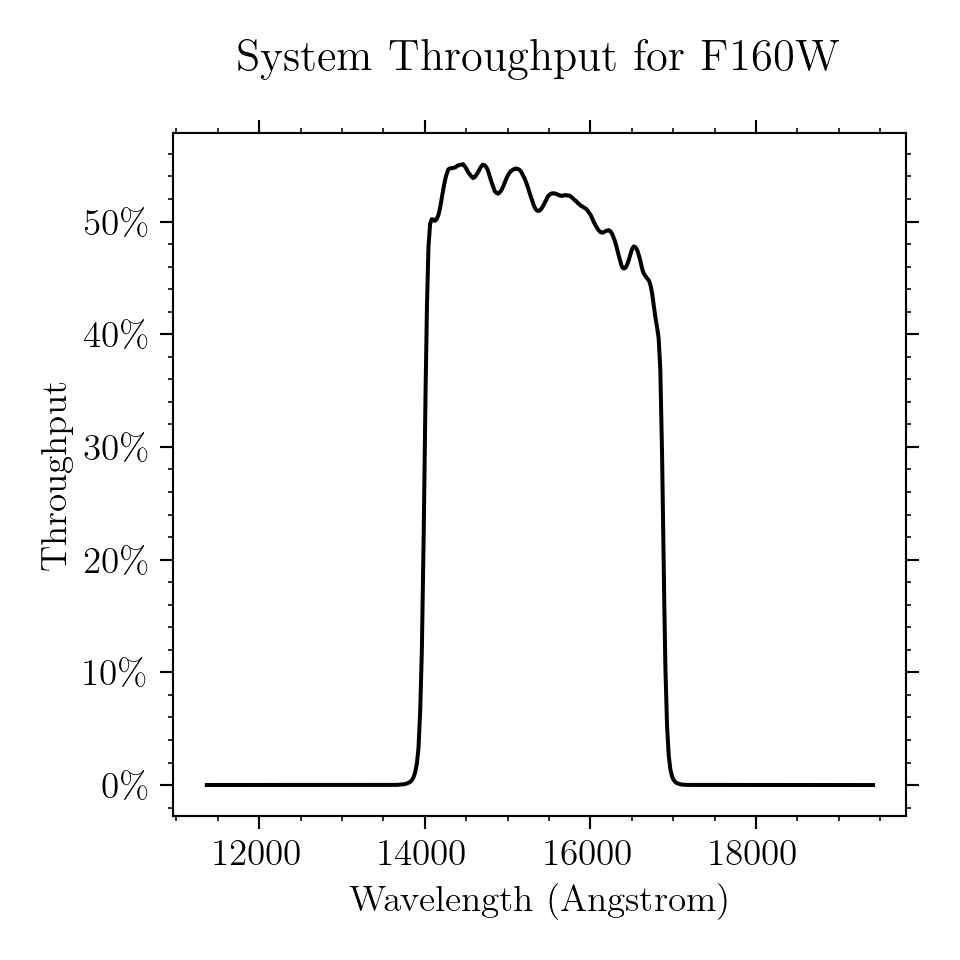
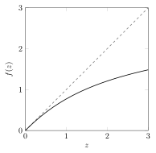
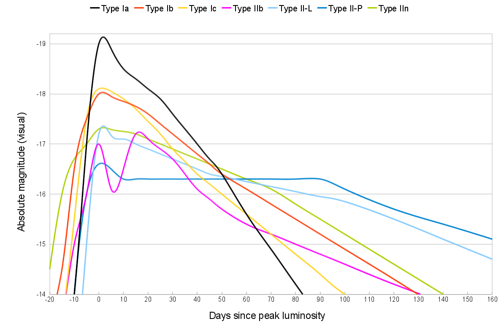
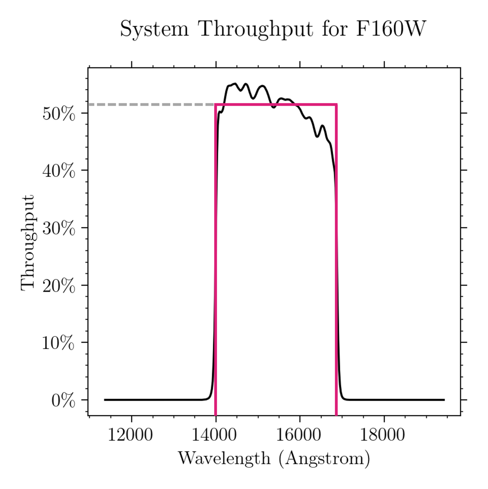
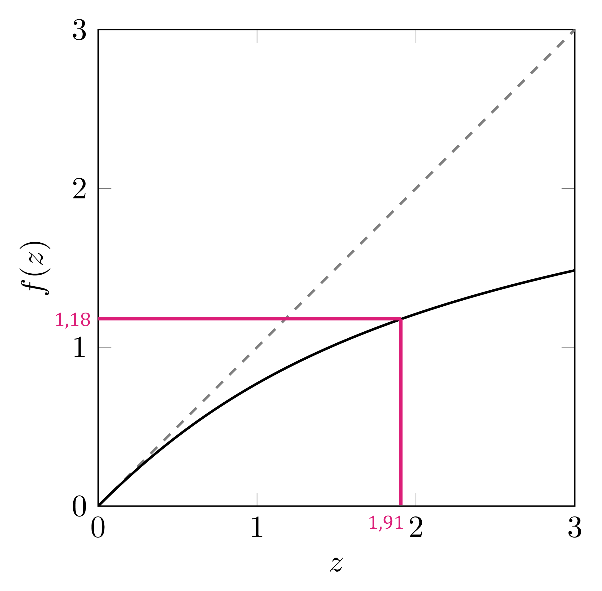

## Zadanie

30\. decembra 2010 Hubblov vesmírny ďalekohľad (HST) objavil v súhvezdí Veľryba jednu z najvzdialenejších supernov. Táto supernova bola označená ako SN$\,$UDS10Wil a jej červený posun bol určený na väčší ako 1, konkrétne $z=1,91$. Pri takto vysokých červených posunoch už neplatí Hubblov–Lemaîtreov zákon, ktorý je iba aproximáciou pre blízky vesmír.

<ol type="a">

<li>

[15 b] Jeden z filtrov, cez ktorý HST pozoroval, bol infračervený filter F160W. Graf závislosti jeho priepustnosti od vlnovej dĺžky je zobrazený na obrázku 1 nižšie. Pod priepustnosťou rozumieme pomer množstva svetla, ktoré prejde cez filter, k celkovému množstvu dopadajúceho svetla, vyjadrený v percentách. Z grafu odčítajte interval $\mathbb{F}_0 = (\lambda_{min,0}, \lambda_{max,0})$ vlnových dĺžok, ktoré filter prepúšťa, a odhadnite jeho priemernú priepustnosť $\eta$ v percentách. Takisto odhadnite neistotu $\lambda_{min,0}, \lambda_{max,0}$ a $\eta$.

</li>

</ol>

<figure>

<figcaption>

**Obrázok 1:** Graf závislosti priepustnosti *(throughput)* vo filtri F160W od vlnovej dĺžky (*wavelength*). Jeden angstrom ($\text {Å}$) je rovný $0{,}1\,\mathrm{nm} = 10^{-10}\,\mathrm{m}$. Zdroj: Hubble Space Telescope User Documentation.
</figcaption>

</figure>

<ol type="a" start="2">

<li>

[10 b] Pri pozorovaní HST vo filtri F160W supernova najjasnejšie zasvietila so zdanlivou magnitúdou $m'_{\mathit{\mathbb{F}_0}} = 26{,}9\,\mathrm{mag}$. Túto magnitúdu opravte o priemernú priepustnosť filtra, ktorú ste stanovili v (a). Inými slovami, určte reálnu zdanlivú magnitúdu $m_{\mathit{\mathbb{F}_0}}$ supernovy pri pozorovaní v oblasti vlnových dĺžok v intervale $\mathbb{F}_0$. Neistotu $m_{\mathit{\mathbb{F}_0}}$ neurčujte.

</li>

</ol>

**Tabuľka 1:** Prehľad štandardných fotometrických filtrov.

| Označenie | Stred filtra | Šírka filtra |
|:---------:|:------------:|:------------:|
|     U     |  $3650\,\text {Å}$   |  $660\,\text {Å}$   |
|     B     |  $4450\,\text {Å}$   |  $940\,\text {Å}$   |
|     V     |  $5510\,\text {Å}$   |  $880\,\text {Å}$   |
|     R     |  $6580\,\text {Å}$   |  $1380\,\text {Å}$   |
|     I     |  $8060\,\text {Å}$   |  $1490\,\text {Å}$   |

<ol type="a" start="3">

<li>

[15 b] Každá vlna žiarenia putujúca vesmírom sa predlžuje v dôsledku rozpínania vesmíru. Vypočítajte, akému intervalu vlnových dĺžok $\mathbb{F} = (\lambda_{min} \;,\; \lambda_{max})$ zodpovedal detekčný interval $\mathbb{F}_0$ pri emitovaní žiarenia supernovou. Takisto vypočítajte neistotu $\lambda_{min}$ a $\lambda_{max}$ na základe neistot $\lambda_{min,0}$ a $\lambda_{max,0}$, ktoré ste odhadli v (a). Akému filtru zo štandardného fotometrického systému (tabuľka 1) najbližšie zodpovedá interval $\mathbb{F}$?

</li>

</ol>

Na kozmologických škálach existuje viacero rôznych definícií vzdialenosti. Jednou z nich je luminozitná vzdialenosť $d_L$, ktorá je definovaná pomocou modulu vzdialenosti ako 

$$
m_{\mathbb{F}_0} - M_{\mathbb{F}} = 5 \log d_L - 5 \a [d_L] = \mathrm{pc} \,, \tag{1}
$$

 kde $m_{\mathbb{F}_0}$ je zdanlivá a $M_{\mathbb{F}}$ absolútna magnitúda v daných intervaloch vlnových dĺžok. Zanedbali sme absorpciu žiarenia a K-korekciu, ktorá by bola potrebná, ak by sme nepracovali v zodpovedajúcich si intervaloch $\mathbb{F}_0$ a $\mathbb{F}$. Na popisovanie kozmologických štruktúr je vhodnejšou definíciou vzdialenosti takzvaná *comoving distance* $d_C$. Uvažujme štandardný $\Lambda$CDM kozmologický model a plochý vesmír. Comoving vzdialenosť vieme potom vyjadriť ako 

$$
d_C = d_H \, f(z) \,, \tag{2}
$$

 kde $d_H = c/H_0$ je Hubblova vzdialenosť, $c$ rýchlosť svetla, $H_0$ Hubblova konštanta a $f(z)$ komplikovaná funkcia červeného posunu zobrazená na obrázku 2. Medzi luminozitnou a comoving vzdialenosťou navyše platí jednoduchý vzťah $d_L = (1+z) \, d_C$.

<figure>

<figcaption>

**Obrázok 2:** Graf funkcie $f(z)$ pre výpočet comoving vzdialenosti $d_C$. Prerušovanou čiarou je zobrazená aproximácia pre malé červené posuny $z$ (Hubblov-Lemaîtreov zákon).
</figcaption>

</figure>

<ol type="a" start="4">

<li>

[35 b] Vypočítajte $M_{\mathbb{F}}$. Neistotu neurčujte.

</li>

</ol>

Rozpínanie vesmíru spôsobuje naťahovanie vĺn elektromagnetického žiarenia, a teda aj predlžovanie ich periód. Zároveň sa ale v rovnakom pomere predlžujú aj ďalšie časové intervaly (tie, ktoré sú výrazne kratšie ako vek vesmíru), vrátane dĺžky dosvitu supernovy. Bolo pozorované, že po maxime jasnosti narástla magnitúda supernovy o $1{,}5\,\mathrm{mag}$ za $\Delta t_0 = 67\,\mathrm{dní}$.

<ol type="a" start="5">

<li>

[10 b] Vypočítajte reálnu dĺžku dosvitu $\Delta t$, čiže časový interval, za ktorý stúpla absolútna magnitúda supernovy z maximálnej hodnoty $M_{\mathbb{F}}$ o hodnotu $1{,}5\,\mathrm{mag}$.

</li>

<li>

[5 b] Na základe maximálnej absolútnej magnitúdy $M_{\mathbb{F}}$ a času dosvitu $\Delta t$ odhadnite typ supernovy SN$\,$UDS10Wil. Využite graf typického priebehu svetelnej krivky pre rôzne typy supernov na obrázku 3, ktorý je nakreslený v takzvanom *rest frame*, teda vo vzťažnej sústave, ktorá je v pokoji vzhľadom na supernovu.

</li>

</ol>

<figure>

<figcaption>

**Obrázok 3:** Typické priebehy svetelných kriviek pre rôzne typy supernov. Na horizontálnej osi je znázornený čas v jednotke dní od najvyššej jasnosti (*Days since peak luminosity*), pričom časová škála je v takzvanom *rest frame*, teda vo vzťažnej sústave, ktorá je v pokoji vzhľadom na supernovu. Na vertikálnej osi je znázornená absolútna vizuálna magnitúda – *Absolute magnitude (visual)*. Typ supernovy je rozlíšený farebne, legenda je uvedená nad grafom. Autor: Lithopsian.
</figcaption>

</figure>

Riešenie

<ol type="a">

<li>

Rozsah vlnových dĺžok, ktoré filter F160W zaznamenáva, určíme odčítaním z grafu pomocou pravítka, ako je zobrazené na obrázku 4. Dostávame

align \_min,0 &= $14\,000 \pm 200\,\text {Å}$ ,\
\_max,0 &= $16\,800 \pm 200\,\text {Å}$ .

Priemernú priepustnosť $\eta$ odhadneme vodorovnou čiarou približne kopírujúcou krivku priepustnosti na intervale $\mathbb{F}_0 = (\lambda_{min,0} \;,\; \lambda_{max,0})$ tak, aby zhruba rovnaká plocha bola pod a nad vodorovnou čiarou. Dostávame 

$$
\boxed{\eta = 51{,}5 \pm 1{,}5\,\% } \,. \tag{3}
$$

<figure>

<figcaption>

**Obrázok 4:** Náčrt odčítania vlastností filtra F160W.
</figcaption>

</figure>

</li>

<li>

Pri pozorovaní cez filter zachytíme iba $\eta = 51{,}5 \pm 1{,}5\,\% = 0{,}515 \pm 0{,}015$ toku svetla $f_0$, čo sme odhadli v podzadaní (a). Vzťah medzi magnitúdami môžeme vyjadriť Pogsonovou rovnicou 

$$
m_{\mathit{\mathbb{F}_0}} - m'_{\mathit{\mathbb{F}_0}} = -2,5 \log \left(\frac{f_0}{ \eta f_0} \right) \,, \tag{4}
$$

 z čoho 

$$
\begin{align*}
    m_{\mathit{\mathbb{F}_0}} &= m'_{\mathit{\mathbb{F}_0}} + 2,5 \log(\eta)\, , \tag{5}\\
    &= 26{,}9\,\mathrm{mag} + 2,5 \log(0{,}515 \pm 0{,}015)\, , \tag{6}\\
    &\doteq \boxed{26{,}2\,\mathrm{mag}}\,. \tag{7}\end{align*}
$$

 Chybu $\eta$ sme už nepreniesli ďalej, nakoľko spôsobila vo výsledku rozdiel až na druhom desatinnom mieste, ale $m'_{\mathit{\mathbb{F}_0}}$ máme zadané iba na jedno desatinné miesto.

</li>

<li>

Červený posun je definovaný ako 

$$
z := \frac{\lambda_{obs} - \lambda_{emit}}{\lambda_{emit}} = \frac{\lambda_{obs}}{\lambda_{emit}} - 1 \,, \tag{8}
$$

 kde $\lambda_{obs}$ je v súčasnosti pozorovaná vlnová dĺžka a $\lambda_{emit}$ je v minulosti emitovaná vlnová dĺžka. Preto pre hranice intervalov $\mathbb{F}_0, \mathbb{F}$ platí 

$$
\frac{\lambda_{min,0}}{\lambda_{min}} - 1 = z = \frac{\lambda_{max,0}}{\lambda_{max}} - 1 \,. \tag{9}
$$

Uvažovať v tomto kozmologickom kontexte o Dopplerovom posune nie je správne. Rovnice s ním nemajú nič spoločné. Ide čisto iba o to, ako definujeme červený posun. Úpravou dostávame 

$$
\begin{align*}
    \lambda_{min} &= \frac{\lambda_{min,0}}{z+1} = \frac{14\,000 \pm 200\,\text {Å}}{1,91 + 1} \doteq \boxed{4810 \pm 70\,\text {Å}} \,, \tag{10}\\
    \lambda_{max} &= \frac{\lambda_{max,0}}{z+1} = \frac{16\,800 \pm 200\,\text {Å}}{1,91 + 1} \doteq \boxed{5770 \pm 70\,\text {Å}} \,. \tag{11}\end{align*}
$$

Najbližšie k tomuto rozsahu vlnových dĺžok je filter V, ktorý sa podľa tabuľky 1 nachádza v strede viditeľného svetla v rozsahu $\pm 440\,\text {Å}$ okolo $5510\,\text {Å}$. Zodpovedá to minimálnej vlnovej dĺžke $5070\,\text {Å}$ a maximálnej vlnovej dĺžke $5950\,\text {Å}$. Filter V je teda posunutý voči intervalu $\mathbb{F}$ o menej ako $300\,\text {Å}$ a má aj podobnú šírku.

</li>

<li>

V tomto podzadaní je dôležité nestratiť sa v troch rôznych definíciách vzdialenosti. Inak máme všetko zadané a postup je priamočiary. Začneme výpočtom Hubblovej vzdialenosti 

$$
d_H = \frac{c}{H_0} = \frac{2{,}998 \cdot 10^{8}\,\mathrm{m}\,{\mathrm{s}}^{-1}}{70\,\mathrm{km}\,{\mathrm{s}}^{-1}\,{\mathrm{Mpc}}^{-1}} \doteq 4283\,\mathrm{Mpc} \,, \tag{12}
$$

 kde nesmieme zabudnúť premeniť $\mathrm{km}\,{\mathrm{s}}^{-1}$ na $\mathrm{m}\,{\mathrm{s}}^{-1}$ v Hubblovej konštante $H_0$. Výsledok si ponechávame s vysokou presnosťou, keďže ide iba o medzivýsledok a nechceme sa dopustiť zaokrúhľovacej chyby. Ďalej vypočítame comoving vzdialenosť, pre ktorú budeme potrebovať odčítať hodnotu $f(z)$ pre $z=1,91$ z grafu na obrázku 2. Odčítanie je zobrazené na obrázku 5 a dostávame z neho $f(z=1,91) = 1{,}18 \pm 0{,}05$. Pre comoving distance dostávame 

$$
d_C = d_H \, f(z) = 4283\,\mathrm{Mpc} \cdot (1{,}18 \pm 0{,}05) \doteq 5050 \pm 200\,\mathrm{Mpc} \,. \tag{13}
$$

Zo znalosti comoving vzdialenosti zistíme luminozitnú zadaným vzťahom 

$$
\begin{align*}
    d_L &= (1+z) \, d_C \tag{14}\\
    &= (1+1,91) \cdot 5050 \pm 200\,\mathrm{Mpc} \tag{15}\\
    &\doteq 14\,700 \pm 600\,\mathrm{Mpc} \,. \tag{16}\end{align*}
$$

 Je dobré poznamenať, že táto vzdialenosť nezodpovedá vzdialenosti, ktorú prekonalo svetlo zo supernovy. Po prepočte $d_L$ na svetelné roky zistíme, že $d_L = 50 \cdot 10^{9}\,\mathrm{ly}$, čo by ale svetlu trvalo viac ako vek vesmíru, $13{,}8 \cdot 10^{9}\,\mathrm{rokov}$. Podobne to je aj pre comoving vzdialenosť $d_C$, ktorá je po prepočte na svetelné roky $d_C = 16{,}5 \cdot 10^{9}\,\mathrm{ly}$.

*Poznámka: comoving vzdialenosť sa zavádza preto, lebo najlepšie zodpovedá vzdialenosti supernovy od nás, ktorú by sme namerali ak by sme k nej natiahli veľmi dlhý meter. Ako je však možné, že nám vychádza väčšia ako stihol ľubovoľný fotón vo vesmíre od jeho vzniku prejsť? Je to spôsobené tým, že vesmír stihol expandovať medzi emitovaním svetla supernovou a pozorovaním tohto svetla nami. Supernova sa takto od nás odsunula ďalej, ako stihlo prejsť svetlo. Tento princíp sa aplikuje na celý vesmír. Funkcia $f(z)$ sa pre veľké $z$ blíži k hodnote okolo $3,3$. Po prepočte na comoving vzdialenosť vychádza $d_C = 46 \cdot 10^{9}\,\mathrm{ly}$, čo zodpovedá hranici pozorovateľného vesmíru.*

Ako posledné stačí dosadiť $d_L$ a $m_{\mathbb{F}_0}$, určené v podzadaní (b), do definície luminozitnej vzdialenosti 

$$
m_{\mathbb{F}_0} - M_{\mathbb{F}} = 5 \log d_L - 5 \a [d_L] = \mathrm{pc} \,, \tag{17}
$$

 čím po úprave získame hľadanú absolútnu magnitúdu 

$$
\begin{align*}
    M_{\mathbb{F}} &= m_{\mathbb{F}_0} - 5 \log d_L + 5\,, \tag{18}\\
    &= 26{,}2\,\mathrm{mag} - 5 \log\big(14\,700 \pm 600 \cdot 10^{6}\big) + 5\, , \tag{19}\\
    &\doteq \boxed{ -19{,}64 \pm 0{,}08\,\mathrm{mag} } \,. \tag{20}\end{align*}
$$

<figure>

<figcaption>

**Obrázok 5:** Odčítanie hodnoty $f(z=1,91)$.
</figcaption>

</figure>

</li>

<li>

Ako sme zistili v podzadaní (c), vlnové dĺžky sa škálujú s koeficientom $(1+z)$. Rovnako sa škálujú aj periódy vĺn a ako napovedá zadanie, tak aj dĺžka dosvitu supernovy. Preto platí 

$$
\Delta t = \frac{\Delta t_0}{1+z} = \frac{67\,\mathrm{dní}}{1+1,91} \doteq \boxed{ 23\,\mathrm{dní} }\,. \tag{21}
$$

</li>

<li>

Supernova má magnitúdu menšiu ako $-19$, takže jedinou možnosťou je typ Ia. To potvrdzuje aj čas dosvitu, ktorý je príliš krátky pre iné typy. Supernovy typu Ia vznikajú vtedy, keď v dvojhviezdnom systéme nabalí na seba biely trpaslík príliš veľa hmoty, prekoná Chandrasekharovu medzu a nedokáže zabrániť vlastnému gravitačnému kolapsu. Supernovy tohto typu majú podobné absolútne magnitúdy a svetelné krivky, preto ide o veľmi dôležité štandardné sviečky, ktoré nám pomáhajú určovať vzdialenosti vo vesmíre.

</li>

</ol>

