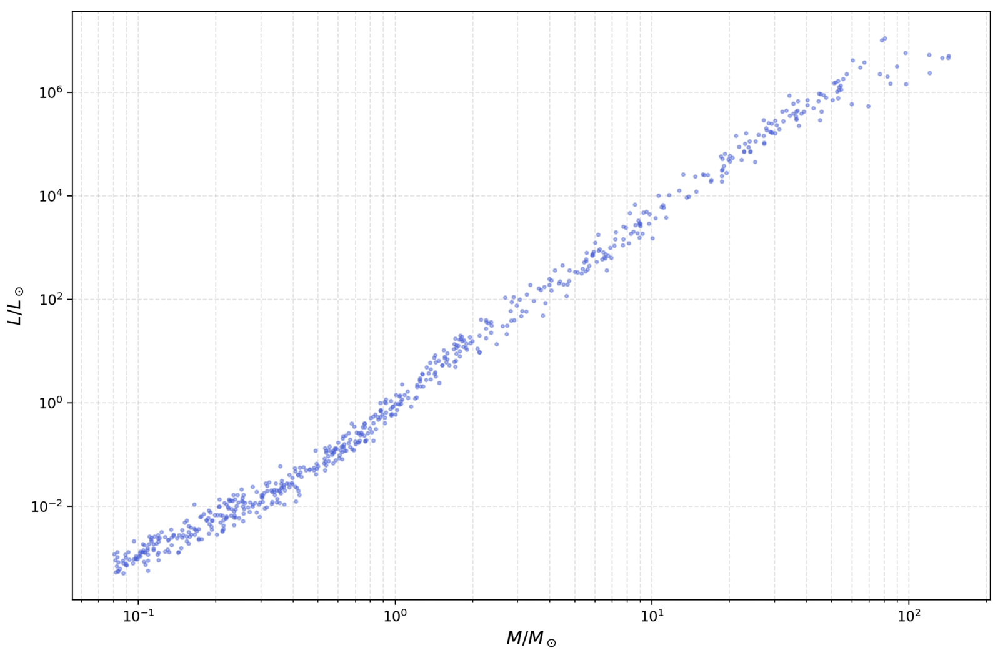
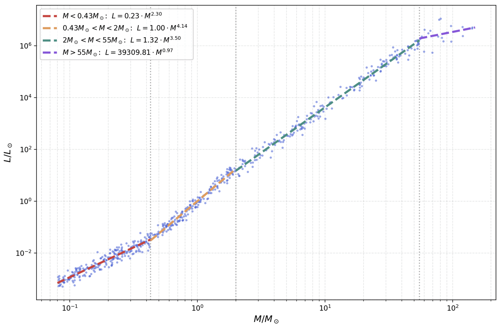
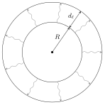

## Zadanie

**A. Empirické pozorovania**

V astrofyzike sa často stretávame so vzťahom, ktorý vyjadruje úmeru medzi svetelným výkonom $L$ hviezdy a jej hmotnosťou $M$. Z priloženého grafu vyplýva, že hviezdy v rôznych intervaloch sa správajú podľa rôznych mocninových závislostí v tvare 

$$
\frac{L}{L_\Sun} = b \left(\frac{M}{M_\Sun}\right)^a . \tag{1}
$$

<ol type="a">

<li>

[30 b] Na základe priloženého grafu rozdeľte hviezdy podľa ich hmotnosti na niekoľko vhodných intervalov a pre každý interval vypočítajte koeficienty $a, b$.

</li>

</ol>

<figure>

<figcaption>

**Obrázok 1:** Logaritmický graf závislosti $L/L_\Sun$ od $M/M_\Sun$.
</figcaption>

</figure>

Riešenie

<ol type="a">

<li>

[6 b] Keďže už máme zadaný priamo log-log graf, tak je prirodzené zlogaritmovať rovnicu (1), čím získame 

$$
\log_{10}\left(\frac{L}{L_\Sun}\right) = a\log_{10}\left(\frac{M}{M_\Sun}\right) + \log_{10}(b)\,. \tag{2}
$$

 Jednotlivé intervaly teda budú mať tvar priamky.

<figure>

<figcaption>

**Obrázok 2:** Postupnosť hviezd rozdelená na jednotlivé intervaly.
</figcaption>

</figure>

Teraz je kľúčové si rozmyslieť, koľko intervalov vlastne hľadáme. Prvý nám do oka určite padne posledný „chvostík“ postupnosti hviezd, v ktorom je najmenšia „hustota“ hviezd. Podobne v prvom úseku pozorujeme vyššiu hustotu hviezd. Keď sa ďalej budeme pozornejším okom pozerať na stredný úsek alebo by sme sa ho pokúsili preložiť jednou priamkou, tak by sme si mohli všimnúť, že tam je v skutočnosti ešte jeden prechod – celkovo je teda postupnosť hviezd rozdelená 4 intervaly, viď obr. 2.

Koeficienty $a_i,b_i$ $i$-teho intervalu určíme tak, že daný interval preložíme priamkou a nájdeme na nej 2 body $[x_{i1}, y_{i1}], [x_{i2}, y_{i2}]$. Z nich potom vieme vypočítať hľadané koeficienty ako [6 b] 

$$
\begin{align*}
    a_i &= \frac{\log_{10}(y_{i2}) - \log_{10}(y_{i1})}{\log_{10}(x_{i2})-\log_{10}(x_{i1})}\,, \tag{3}\\
    b_i &= \log_{10}(y_{i1})-a\log_{10}(x_{i1})\,. \tag{4}\end{align*}
$$

</li>

<li>

Nakoľko uvažujeme sférickú nerotujúcu hviezdu, na škrupinu pôsobí iba vztlaková sila a gravitačná sila, obidve v radiálnom smere. Rozpíšme si preto sily, ktoré pôsobia na škrupinu smerom dovnútra a smerom von z hviezdy. Označme si $\Delta m$ hmotnosť škrupiny a $S$ jej povrch. Potom 

$$
\begin{align*}
    F_{dovnutra} &= \frac{GM_p(r)\Delta m}{r^2} + p(r+ \Delta r) S \,, \tag{5}\\ \qquad\textit{[4\,b]}
    F_{von} &= p(r)S\,. \tag{6}\end{align*}
$$

 Predpokladáme $\Delta r\ll r$, preto povrch škrupiny je rovnaký zvnútra ako zvonku, a to $S = 4\pi r^2$. Hmotnosť hviezdy vypočítame priamočiaro podľa hustoty ako $\Delta m(r) = \Delta V \rho(r) = 4\pi r^2 \Delta r \rho(r)$. [3 b] Hydrostatická rovnováha potom hovorí, že 

$$
\begin{align*}
    F_{von} &= F_{dovnutra}  \,, \tag{7}\\
    p(r)\cdot 4\pi r^2 &= \frac{GM_p(r)}{r^2}\cdot4\pi r^2 \Delta r \rho(r) + p(r+ \Delta r) \cdot 4\pi r^2  \,, \tag{8}\end{align*}
$$

 [3 b] odkiaľ po úpravách dostávame 

$$
\boxed{-\frac{GM_p(r)\rho(r)}{r^2} = \frac{p(r+\Delta r)-p(r)}{\Delta r} = \frac{\Delta p}{\Delta r}}\,. \tag{9}
$$

 [5 b]

</li>

<li>

Na vonkajšiu škrupinu pôsobí gravitačná sila vnútornej škrupiny, ktorá má hmotnosť $M_p = M/2$. Hustotu uvažujeme v celej hviezde konštantnú, preto 

$$
\rho(r) = \frac{M}{V} = \frac{M}{\frac{4}{3}\pi R^3}\,. \tag{10}
$$

 [3 b] V zadaní máme dané 2 hodnoty tlaku, z čoho pre ich rozdiel dostaneme $\Delta p = p(R) - p(0) = -p_0$. Z toho prirodzene plynie $\Delta r = R - 0 = R$. [3 b] Dosadením do rovnice hydrostatickej rovnováhy získame 

$$
\frac{-p_0}{R} = - \frac{G\frac{M}{2}\frac{M}{\frac{4}{3}\pi R^3}}{R^2}\,, \tag{11}
$$

 z čoho po úpravách 

$$
\boxed{p_0 = \frac{3GM^2}{8\pi R^4}}\,. \tag{12}
$$

 [4 b]

</li>

<li>

Stavová rovnica ideálneho plynu je [2 b] 

$$
p_0 V = Nk_BT_1\,, \tag{13}
$$

 kde $N$ je počet častíc tvoriacich plyn. Slnko sa skladá z vodíkovej plazmy, teda iba z protónov a elektrónov, pričom na každý protón pripadá 1 elektrón. Z toho plynie $N = 2 N_p$. Keďže $m_p \gg m_e$, tak počet protónov je $N_p = M/m_p$, z čoho pre celkový počet častíc máme $N = 2M/m_p$. [5 b] Po vyjadrení teploty $T_1$ a následnom dosadení získame 

$$
\boxed{T_1 = \frac{p_0 V}{N k_B} = \frac{\frac{3GM^2}{8\pi R^4}\frac{4}{3}\pi R^3}{\frac{2M}{m_p} k_B} = \frac{GMm_p}{4k_BR}}\,. \tag{14}
$$

 [3 b]

</li>

<li>

Viriálová veta [5 b] 

$$
2K + U = 0 \,, \tag{15}
$$

 udáva vzťah medzi kinetickou energiou častíc $K$ a gravitačnou väzbovou energiou $U$ vo viriálovej rovnováhe. Stredná kinetická energia jednej častice s termodynamickou teplotou $T_2$ je rovná $s/2\cdot k_BT_2 = 3/2\cdot k_BT_2$. Celková kinetická energia častíc tak je 

$$
K = \frac32 Nk_B T_2 = \frac{3}{2} \left( 2 \frac{M}{m_p} \right) k_B T_2 = 3 \frac{M}{m_p} k_B T_2\,. \tag{16}
$$

 [5 b] Gravitačná väzbová energia pre guľu s konštantnou hustotou je $U = -3GM^2/(5R)$, preto podľa viriálovej vety platí 

$$
2\cdot3 \frac{M}{m_p} k_B T_2 = \frac{3GM^2}{5R}\,, \tag{17}
$$

 z čoho 

$$
\boxed{T_2 = \frac{G M m_p}{10k_B R}}\,. \tag{18}
$$

 [5 b]

</li>

<li>

Protóny musia mať dostatočnú počiatočnú rýchlosť v nekonečne na to, aby sa mohli k sebe priblížiť na vzdialenosť $d_p$. Pre elektrostatickú energiu medzi dvomi protónmi (každý má náboj $e$) platí 

$$
E_e = \frac{1}{4\pi \varepsilon_0} \frac{e^2}{d_p}\,. \tag{19}
$$

 [4 b] Zo symetrie situácie sa v bode najväčšieho priblíženia zastavia (vo vzťažnej sústave ich ťažiska), preto podľa zákona zachovania energie 

$$
E_e = 2E_k = mv_0^2\,. \tag{20}
$$

 [4 b] Ako sme už využili v predchádzajúcej podúlohe, stredná kinetická energia častice s teplotou $T_3$ je $3 k_B T_3/2 =  E_k = mv_0^2/2$. Po dosadení do rovnice 20 a následnom vyjadrení hľadanej teploty získame 

$$
\boxed{T_3 = \frac{e^2}{12\pi\varepsilon_0 k_B d_p} \doteq 3{,}7 \cdot 10^{9}\,\mathrm{K}}\,. \tag{21}
$$

 [4+3 b]

</li>

<li>

Ak do vzťahov dosadíme hodnoty pre Slnko ($M= M_\Sun$, $R = R_\Sun$), dostaneme rádovo hodnoty

- $T_1 \doteq 5{,}8 \cdot 10^{6}\,\mathrm{K}$, [2 b]

- $T_2 \doteq 2{,}3 \cdot 10^{6}\,\mathrm{K}$, [2 b]

- $T_3 \doteq 3{,}7 \cdot 10^{9}\,\mathrm{K}$.

Z výsledkov vidíme, že teplota $T_1$ získaná z hydrostatickej rovnováhy je najbližšie k teplote Slnka $T_\Sun = 15 \cdot 10^{6}\,\mathrm{K}$. Zdrojom rozdielu vo všetkých prípadoch je samozrejme uvažovanie konštantnej teploty v celej hviezde. Prvý aj druhý model takisto predpokladajú homogénne rozloženie hmoty (konštantnú hustotu), avšak v skutočnosti hustota smerom od jadra hviezdy klesá. Takisto si všimnite, že teploty $T_1,T_2$ sa od seba navzájom líšia iba o multiplikatívnu konštantu.

Teplota $T_3$ je rádovo úplne iná ako hodnoty $T_1$ a $T_2$. Jeden z dôvodov je ten, že táto hodnota vôbec nezávisí od parametrov hviezdy. Takisto si vieme všimnúť, že táto hodnota je o 3 rády vyššia ako skutočná hodnota Slnka, teda by v skutočnosti ani k jadrovým fúziám vôbec nemalo dochádzať. Dôvod, prečo k fúziám aj napriek tomu dochádza, je, že vďaka kvantovému tunelovaniu môžu protóny prekonať potrebnú energetickú „bariéru“. Ďalší (druhotný) dôvod je ten, že vzťah pre **strednú** kinetickú energiu častice hovorí len o strednej hodnote jej energie, ktorá patrí do Maxwell-Boltzmannovho rozdelenia. Keďže ide o štatistické rozdelenie, tak je nenulová pravdepodobnosť toho, že aj pri nižších teplotách bude dochádzať k fúzii. [6 b]

</li>

<li>

Podľa Stefan-Boltzmannovho zákona je výkon vyžiarený z jednotkovej plochy čierneho telesa $I = \sigma T^4$. [2 b] Z celej hviezdy je tak za čas $\Delta t$ vyžiarená celková energia 

$$
E = I\Delta t \cdot 4\pi R^2 = 4\pi R^2 \sigma T^4\Delta t\,.
    \qquad\textit{[4\,b]} \tag{22}
$$

 Uvažujme zatiaľ iba radiálne žiarenie. Za čas $\Delta t$ prejde svetlo dráhu $c \Delta t$, teda vyplní objem $V = 4\pi R^2 c\Delta t$. [3 b]

Hustota čisto radiálneho žiarenia potom je 

$$
u_{rad} = \frac{E}{V} = \frac{4\pi R^2 \sigma T^4\Delta t}{4\pi R^2 c\Delta t} = \frac{\sigma}{c} T^4\,. \tag{23}
$$

 Žiarenie ale vyžaruje do celého polpriestoru daného dotykovou rovinou k povrchu hviezdy a k tomu ani nie izotropne, ale ako kosínový žiarič. Našťastie nám namiesto presného počítania stačí využiť fakt v zadaní, že $u_{rad}$ tvorí $1/4$ celkovej hustoty žiarenia $u$, teda 

$$
\boxed{u = 4u_{rad} = \frac{4\sigma}{c} T^4}\,. 
    \qquad\textit{[4\,b]} \tag{24}
$$

<figure>

<figcaption>

**Obrázok 3:** Znázornenie uvažovaného šírenia žiarenia.
</figcaption>

</figure>

</li>

<li>

Obdobne ako v podúlohe B.2 riešime zmenu $\Delta u = u(R)-u(0)$ na vzdialenosti $\Delta r = R - 0$, teda [2+2 b] 

$$
\boxed{F = -D \frac{u(R)-u(0)}{R - 0} = -D \frac{\frac{4\sigma}{c} T(R)^4-\frac{4\sigma}{c} T(0)^4}{R} = D\frac{4\sigma T_2^4}{cR}}\,. \qquad\textit{[6\,b]} \tag{25}
$$

</li>

<li>

Jednotky veličín vo Fickovom zákone sú 

$$
\begin{align*}
    [F]&= \mathrm{W}.\mathrm{m}^{-2} = \mathrm{J}.\mathrm{s}^{-1}.\mathrm{m}^{-2}\,, \tag{26}\\
    \left[\frac{\Delta u}{\Delta r}\right]&= \mathrm{J}.\mathrm{m}^{-4}\,. \tag{27}\end{align*}
$$

 Z toho plynie 

$$
[D] = \frac{[F]}{[\Delta u/\Delta r]} = \mathrm{m}^2.\mathrm{s}^{-1}\,. \qquad\textit{[4\,b]} \tag{28}
$$

Jednotky premenných na pravej strane rovnice $D = \frac13 \lambda^\alpha p^\beta v^\gamma$ sú 

$$
\begin{align*}
    [\lambda]&= \mathrm{m}\,, \tag{29}\\&= \mathrm{kg}.\mathrm{m}.\mathrm{s}^{-1}\,, \tag{30}\\&= \mathrm{m}.\mathrm{s}^{-1} \,. \tag{31}\end{align*}
$$

 Všimnime si, že hybnosť obsahuje jednotku hmotnosť, zatiaľ čo difúzny koeficient $D$ nie. [3 b] Z toho plynie $\beta = 0$. Po tomto pozorovaní ľahko nahliadneme, že $\alpha = 1$ a $\gamma = 1$. Výsledná rovnica pre difúzny koeficient je 

$$
D = \frac13 \lambda v\,. \tag{32}
$$

 [3 b]

</li>

<li>

Riešime difúziu fotónov v hviezde, ktoré sa pohybujú rýchlosťou $v = c$.

Ostáva nám už len určiť strednú voľnú dráhu $\lambda$. Elektróny v hviezde majú zaručene rýchlosť $v_e\ll c$, z čoho vyplýva, že ich môžeme považovať za statické body, ktoré sú rovnomerne rozložené v priestore s hustotou $n_e$. [4 b] Nad fotónom teraz uvažujeme ako nad časticou s prierezom $\sigma_e$. Pri posune o dráhu $l$ tak v priestore „vytne“ objem $V=\sigma_el$. V tomto objeme sa nachádza [7 b] $N_e = n_eV = n_e \sigma_e l$ elektrónov. Stredná voľná dráha $\lambda$ hovorí o strednej dráhe, ktorú prejde častica medzi dvomi zrážkami. Keďže na dráhe $l$ došlo k $N_e$ zrážkam, tak priemerná dráha medzi dvomi zrážkami je 

$$
\lambda = \frac{l}{N_e} = \frac{l}{ n_e \sigma_e l} = \frac{1}{n_e\sigma_e}\,. \tag{33}
$$

 Pre difúzny koeficient tak dostávame 

$$
\boxed{D = \frac{1}{3} \frac{1}{n_e\sigma_e}c}\,. \tag{34}
$$

 [4 b]

</li>

<li>

V tejto podúlohe pospájame všetko, čo sme si odvodili, dokopy.

Zo symetrie vyplýva, že na povrchu hviezdy bude konštantný svetelný tok $F$, preto celkový výkon hviezdy je 

$$
L = F\cdot 4\pi R^2\,. \tag{35}
$$

 Za $F$ dosadíme z rovnice 25 

$$
F = \frac{c}{3n_e\sigma_e}\frac{4\sigma T_2^2}{cR} = \frac{4\sigma T^4}{3 n_e \sigma_e R}\,. \qquad\textit{[8\,b]} \tag{36}
$$

 Hustotu elektrónov vyjadríme cez hmotnosť hviezdy. Ako sme už odvodili, pre celkový počet častíc platí $N = 2M/m_p$ a takisto $N = 2N_e$. Hustotu elektrónov tak vypočítame jednoducho ako 

$$
n_e = \frac{N_e}{V} = \frac{\frac{M}{m_p}}{\frac{4}{3}\pi R^3} = \frac{3M}{4\pi R^3 m_p}\,. \qquad\textit{[8\,b]} \tag{37}
$$

 Dosadením do rovnice 36 a následným dosadením do rovnice 

$$
L = \frac{4\sigma T^4}{3 \sigma_e R} \frac{4\pi R^3 m_p}{3 M}\cdot 4\pi R^2 = \frac{64\pi^2 \sigma m_p R^4 T^4}{9 \sigma_e M}\,. \tag{38}
$$

Napokon ostáva už len dosadenie teploty $T_2$ z rovnice 18: 

$$
\boxed{L = \frac{64\pi^2 \sigma m_p R^4}{9 \sigma_e M} \cdot \left( \frac{G^4 M^4 m_p^4}{10\,000 k_B^4 R^4} \right) = \left( \frac{64\pi^2 \sigma G^4 m_p^5}{90\,000 \sigma_e k_B^4} \right) M^3}\,. \qquad\textit{[8\,b]} \tag{39}
$$

 Z výsledku vidíme, že sa nám krásne vykrátil polomer hviezdy $R$ a skutočne nám ostala závislosť od fyzikálnych konštánt a $M$. Keďže nám vyšlo $L \propto M^3$, a teda $a=3$, tak výsledok je najbližšie k 3. intervalu, v ktorom sú hviezdy v intervale hmotností $2M_\Sun<M<55M_\Sun$.

Najprv si pre prehľadnosť vyčíslime $\sigma_e \doteq 6{,}652 \cdot 10^{-29}\,\mathrm{m}^2$. Po vyčíslení zvyšku a pre $M = M_\Sun$ dostaneme 

$$
\boxed{L \doteq 2{,}1 \cdot 10^{27}\,\mathrm{W} \doteq 5,5 L_\Sun}\,. \tag{40}
$$

 Výsledok je rádovo rovnaký, ako skutočná hodnota svetelného výkonu Slnka. Na to, ako veľmi hrubé odhady sme využili a ako veľmi komplikované procesy prebiehajú v Slnku, to vôbec nie je zlý výsledok. [6 b]

</li>

</ol>

