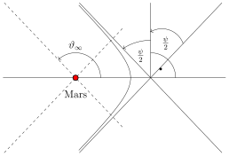

## Zadanie

Ohlasy obyvateľov oboch planét na darček zaslaný Zemou pri príležitosti dvojstého výročia prvého pristátia človeka na Marse v roku 2230 boli také silné, až sa táto udalosť zapísala do historických análov ako „Deň medziplanetárneho vďakyvzdania“. Politici oboch planét sa zhodli, že by túto udalosť chceli zopakovať. Rovnako ako pri prvom štarte bude raketa štartovať po parabolickej trajektórii (vzhľadom na Slnko) tak, že jej vektor rýchlosti bude rovnobežný s obežnou rýchlosťou Zeme. Na to, aby raketa preletela blízko Marsu, musí nastať vhodná konfigurácia Zeme a Marsu. Predpokladajte kruhové orbity Zeme a Marsu a pokiaľ nie je povedané inak, uvažujte iba gravitačný vplyv Slnka.

Môžu sa vám hodiť vzťahy pre pohyb telesa po parabolickej trajektórii, ktoré ste už odvodili na regionálnom kole 

$$
r = \frac{2r_p}{1+\cos{\nu}}\,, \tag{1}
$$

$$
t = \frac{P_\Ea\sqrt{2}}{2\pi} \left(\tan\frac\nu2 +\frac13\tan^3\frac\nu2\right) \,, \tag{2}
$$

kde $r$ je okamžitá vzdialenosť, $r_p$ je vzdialenosť v pericentre, $\nu$ je pravá anomália, $t$ je čas, ktorý uplynul od momentu prechodu pericentrom, a $P_\Ea$ je siderická obežná doba Zeme.

<ol type="a">

<li>

[25 b] Aký uhol $\alpha_1$ zvierali Zem-Slnko-Mars v čase štartu rakety a aký uhol $\alpha_2$ budú zvierať v čase preletu rakety okolo Marsu?

</li>

</ol>

Túto udalosť chcú ďalej politici zopakovať v roku, kedy nastane pekné okrúhle výročie. Zhodli sa, že to zopakujú pri príležitosti 300. výročia prvého pristátia na Marse.

<ol type="a" start="2">

<li>

[20 b] Určte s presnosťou na týždeň, v ktorý deň by mohla raketa v roku 2330 priletieť na Mars po parabolickej trajektórii. Posledná opozícia Zeme a Marsu nastala 16. januára 2025.

</li>

</ol>

Doposiaľ sme zanedbávali gravitačný vplyv planét a uvažovali jedine vplyv Slnka. Pri štarte rakety a pri jej prelete v tesnej blízkosti Marsu ale bude na raketu aj na vyhodený balík pôsobiť najmä gravitácia jednotlivých planét, s ktorou v podúlohách (c) až (g) v blízkosti planét už budeme počítať.

<ol type="a" start="3">

<li>

[10 b] Dokážte, že keď sa raketa pohybuje v blízkosti Zeme alebo Marsu, tak sa pohybuje vo vzťažnej sústave danej planéty po hyperbolickej trajektórii.

</li>

<li>

[25 b] Vypočítajte najmenšiu rýchlosť $\Delta v_1$, o ktorú musí raketa zrýchliť, aby po opustení zemského gravitačného poľa prešla na uvažovanú parabolickú dráhu voči Slnku. Predpokladajte, že raketa štartuje z nízkej obežnej dráhy Zeme (LEO), teda z výšky $h_\Earth=400\,\mathrm{km}$ nad zemským povrchom.

</li>

<li>

[45 b] Raketa pri Marse nezastaví, ale v momente najväčšieho priblíženia preletí okolo neho vo vzdialenosti $h_\Mars =800\,\mathrm{km}$ od povrchu. Vypočítajte rýchlosť rakety $v'$ v bode najväčšieho priblíženia vo vzťažnej sústave Marsu.

</li>

</ol>

Bez ohľadu na to, aký výsledok ste dostali v podúlohe (e), **počítajte ďalej v podúlohách (f) a (g) s hodnotou $v' = 20{,}0\,\mathrm{km}.\mathrm{s}^{-1}$**.

<ol type="a" start="6">

<li>

[55 b] Keďže raketa na Marse nepristáva, bude musieť mať systém, ktorým by sa balík vedel vystreliť z rakety. Vypočítajte najmenšiu rýchlosť $\Delta v_2$ vystrelenia balíka vzhľadom na raketu potrebnú na to, aby balík po vystrelení z miesta najväčšieho priblíženia dopadol na povrch Marsu. Balík **nemusí** byť vystrelený rovnobežne so smerom pohybu rakety.

</li>

<li>

[35 b] Mars bude pri prelete rakety v jeho blízkosti slúžiť ako gravitačný prak, v dôsledku čoho dôjde k odkloneniu trajektórie od pôvodne uvažovanej parabolickej. Vypočítajte uhol odklonenia $\psi$ vo vzťažnej sústave Marsu.

</li>

</ol>

Predpokladajme, že raketa pokračovala ďalej po svojej parabolickej dráhe, ktorú sme doposiaľ uvažovali, bez zmeny smeru a rýchlosti v blízkosti Marsu.

<ol type="a" start="8">

<li>

[20 b] Odhadnite vzdialenosť $d_2$ a latenciu $\tau_2$ prijímaného signálu medzi Zemou a raketou v čase, keď astronauti v tejto rakete nadobudnú dôchodkový vek. Uvažujte, že boli do vesmíru vyslaní ako $25$-roční a pri miere zvyšovania dôchodkov bude v roku 2330 dôchodkový vek 85 rokov. Pripomíname, že latencia je čas, za ktorý sa obojsmerne vymení informácia medzi raketou a Zemou.

</li>

</ol>

Riešenie

<ol type="a">

<li>

Určme najprv rovnakým spôsobom ako v regionálnom kole čas, ktorý uplynie od štartu rakety do momentu, kedy pretne orbitu Marsu. V tom okamihu pre jej vzdialenosť od Slnka platí $r=a_\Mars$, takže podľa rovnice (1) platí 

$$
a_\Ma = \frac{2r_p}{1+\cos{\nu}}\,, \tag{3}
$$

 

$$
\cos{\nu_\Ma} = \frac{2r_p}{a_\Ma} -1 \ztv \nu_\Ma \doteq 71{,}8^{\circ}\,,\qquad\textit{[5\,b]} \tag{4}
$$

 a doba letu k Marsu je potom podľa rovnice (2) rovná 

$$
t= \frac{P_\Ea\sqrt{2}}{2\pi} \left(\tan\frac{\nu_\Ma}{2} +\frac13\tan^3\frac{\nu_\Ma}{2}\right) \doteq 69{,}9\,\mathrm{dní}\,.\qquad\textit{[3\,b]} \tag{5}
$$

Teraz určme ešte obežnú dobu Marsu pomocou 3. Keplerovho zákona 

$$
\frac{a_\Ma^3}{P_\Ma^2} = \frac{a_\Ea^3}{P_\Ea^2} \ztv P_\Ma = P_\Ea \left(\frac{a_\Ma}{a_\Ea}\right)^{\frac32} \doteq 687{,}2\,\mathrm{dní} \,. \qquad\textit{[5\,b]} \tag{6}
$$

Počas letu rakety opíšu Zem a Mars na svojich obežných dráhach uhly 

$$
\begin{align*}
        \Delta \alpha_\Ea &= \frac{t}{P_\Ea} \cdot 360^{\circ} \doteq 68{,}9^{\circ} \,,\qquad\textit{[2\,b]} \tag{7}\\
        \Delta \alpha_\Ma &= \frac{t}{P_\Ma} \cdot 360^{\circ} \doteq 36{,}6^{\circ} \,.\qquad\textit{[2\,b]} \tag{8}\end{align*}
$$

Vieme teda, že po čase $t$ bude z pohľadu zo Slnka uhol medzi pôvodnou polohou Zeme a konečnou polohou Marsu $\alpha_1 + \Delta \alpha_\Ma$. Keďže musí presne tento uhol z pohľadu zo Slnka prejsť aj raketa, musí teda platiť 

$$
\alpha_1 + \Delta \alpha_\Ma = \nu_\Ma \,, \tag{9}
$$

 odkiaľ po úprave dostávame 

$$
\alpha_1 = \nu_\Ma - \Delta \alpha_\Ma \doteq \boxed{35{,}2^{\circ}} \,.\qquad\textit{[4\,b]} \tag{10}
$$

Uhol Zem-Slnko-Mars v čase preletu rakety okolo Marsu už teraz určíme jednoducho, keďže od štartu rakety sa vplyvom obehu Marsu okolo Slnka tento uhol zvýšil o $\Delta \alpha_\Ma$ a vplyvom obehu Zeme okolo Slnka sa zase naopak znížil o $\Delta \alpha_\Ea$. V čase preletu rakety okolo Marsu tak platí 

$$
\alpha_2 = \alpha_1 + \Delta \alpha_\Ma - \Delta \alpha_\Ea = \nu_\Ma - \Delta \alpha_\Ea \doteq \boxed{2{,}9^{\circ}} \,.\qquad\textit{[4\,b]} \tag{11}
$$

</li>

<li>

Synodickú obežnú dobu Marsu určíme podobne ako na regionálnom kole ako 

$$
P_{syn} = \frac{2\pi}{\Omega_\Ma'} = \frac{2\pi}{\frac{2\pi}{P_\Ma} - \frac{2\pi}{P_\Ea}} = \frac{1}{\frac{1}{P_\Ma} - \frac{1}{P_\Ea}}\doteq-779{,}7\,\mathrm{dní}\,.\qquad\textit{[2\,b]} \tag{12}
$$

Za $\Delta t = 2330-2025=305\,\mathrm{rokov}$ prebehne synodických periód približne 

$$
\frac{\Delta t}{|P_{syn}|} \doteq 143\,.\qquad\textit{[2\,b]} \tag{13}
$$

Od poslednej opozície Marsu 16. januára 2025 si tak vieme odpočítať 143 synodických periód, ktoré trvajú $143 \cdot |P_{syn}| = 111\,493\,\mathrm{dní}$. Je pritom dôležité [3 b] medzivýsledky priebežne nezaokrúhľovať, keďže na časovej škále 305 rokov vie aj malá zmena v siderickej perióde výrazne ovplyvniť výsledný dátum.

Od roku 2025 do roku 2329 je 73 priestupných rokov (násobkov [3 b] štyroch od 2026 do 2328 je 76, od čoho ale treba ešte odpočítať roky, ktoré sú násobkami 100 a nie sú násobkami 400, čiže roky 2100, 2200 a 2300). Príslušných 305 rokov teda má dokopy $365 \cdot 305 + 73=111\,398\,\mathrm{dní}$, takže nám ešte ostáva 95 dní do opozície. Potrebujeme teda zistiť deň, ktorý je 95 dní po dátume 16. januára 2330, respektíve zistiť 111. deň v roku 2330. Keďže ide o nepriestupný rok, tak prvé tri mesiace majú dokopy $31+28+31=90\,\mathrm{dní}$ a ostalo nám ešte 21 dní, takže opozícia nastane 21. apríla 2330.[4 b]

V čase preletu rakety okolo Marsu však nebol Mars v opozícii, ale uhol Zem-Slnko-Mars mal podľa výsledku podúlohy (a) veľkosť $\alpha_2 \doteq 2{,}9^{\circ}$. Keďže má Zem vyššiu obehovú uhlovú rýchlosť, tak sa veľkosť tohto uhla v čase zmenšuje, pričom na pôvodnú hodnotu sa vráti za jednu synodickú periódu $P_{syn}$. Z veľkosti $\alpha_2$ sa tak tento uhol zmenší na nulovú veľkosť (teda na veľkosť prislúchajúcu opozícii Marsu) za čas 

$$
\frac{\alpha_2}{360^{\circ}} \cdot |P_{syn}| \doteq 6\,\mathrm{dní}\,.\qquad\textit{[4\,b]} \tag{14}
$$

Práve o takýto časový úsek skôr, než nastane opozícia Marsu, tak môže raketa priletieť na Mars, čo teda nastane približne . Keďže je synodická perióda Marsu väčšia než 1 rok, tak žiaden iný vhodný okamih v roku 2330 už určite nenastane.[2 b]

</li>

<li>

V blízkosti Zeme musí mať raketa dostatočnú rýchlosť nielen na únik z gravitačného poľa Zeme, ale aj na následný únik z gravitačného poľa Slnka. To však znamená, že po úniku z gravitačného poľa Zeme jej vzhľadom na Zem musí ostať ešte nejaká nenulová zostatková rýchlosť. Keďže na okraji sféry vplyvu má raketa voči Zemi kladnú kinetickú energiu a nulovú potenciálnu energiu, tak jej celková mechanická energia vo vzťažnej sústave Zeme je nutne kladná ($E > 0$), takže sa [5 b] musí v jej blízkosti skutočne pohybovať po hyperbolickej trajektórii.

V blízkosti Marsu vieme argumentovať veľmi podobne, že po úniku z gravitačného poľa Marsu musí mať raketa stále dostatočnú rýchlosť aj na únik z gravitačného poľa Slnka. Druhým spôsobom je zamerať sa na to, že do oblasti gravitačného vplyvu Marsu vletí raketa nenulovou rýchlosťou, a tak touto istou rýchlosťou z danej sféry určite aj vyletí. Oba tieto pohľady vedú opäť k tomu, že po úniku z gravitačného poľa Marsu má raketa kladnú energiu voči nemu, z čoho jasne vyplýva, že sa v jeho blízkosti pohybuje po [5 b]hyperbolickej trajektórii.

</li>

<li>

Rozdeľme si túto podúlohu na dve časti, a to na únik z gravitačného poľa Slnka a na únik z gravitačného poľa Zeme. [6 b]Určme teda najprv, akou rýchlosťou $v_{\infty, \Ea}$ sa bude musieť raketa pohybovať voči Zemi v nekonečne, aby mala stále dostatočnú rýchlosť na únik z gravitačného poľa Slnka. V tom jej bude pomáhať rýchlosť Zeme voči Slnku 

$$
v_\Ea = \frac{2\pi a_\Ea}{P_\Ea} \doteq 29{,}8\,\mathrm{km}\,{\mathrm{s}}^{-1} \,,\qquad\textit{[3\,b]} \tag{15}
$$

 a tak pre jej vlastnú rýchlosť po úniku z gravitačného poľa Zeme musí platiť 

$$
\frac12 m \left(v_{\infty, \Ea} + v_\Ea \right)^2 - \frac{G\mathcal{M}_\Sun m}{a_\Ea} = 0 \ztv v_{\infty, \Ea} = \sqrt{\frac{2G\mathcal{M}_\Sun}{a_\Ea}} - v_\Ea \doteq 12{,}3\,\mathrm{km}.\mathrm{s}^{-1} \,. \qquad\textit{[5\,b]} \tag{16}
$$

V gravitačnom poli Zeme sa zase raketa pohybuje po nízkej obežnej dráhe Zeme s počiatočnou rýchlosťou voči Zemi 

$$
v_{LEO} = \sqrt{\frac{G\mathcal{M}_\Ea}{R_\Ea + h_\Ea}} \doteq  7{,}67\,\mathrm{km}.\mathrm{s}^{-1}\,. \qquad\textit{[3\,b]} \tag{17}
$$

Počiatočná energia rakety pritom musí byť rovnaká ako jej zostatková kinetická energia po opustení gravitačného poľa Zeme, takže pre potrebný rozdiel rýchlosti bude platiť 

$$
\frac12 m (v_{LEO} + \Delta v_1)^2 - \frac{G\mathcal{M}_\Ea m}{R_\Ea + h_\Ea} = \frac12 m v_{\infty, \Ea}^2 \,, \qquad\textit{[5\,b]} \tag{18}
$$

 

$$
\Delta v_1 = \sqrt{v_{\infty, \Ea}^2 + \frac{2G\mathcal{M}_\Ea}{R_\Ea + h_\Ea}} - v_{LEO} \doteq \boxed{8{,}76\,\mathrm{km}.\mathrm{s}^{-1}} \,. \qquad\textit{[3\,b]} \tag{19}
$$

*Poznámka: Ak by sme sa pokúšali spraviť celý výpočet potrebnej únikovej rýchlosti priamočiaro cez zákon zachovania energie, teda úvahou, že počiatočná kinetická energia sa spotrebuje na nárast potenciálnej energie voči Slnku aj voči Zemi, dostali by sme nesprávny výsledok. Museli by sme to totiž celé počítať v jednej vzťažnej sústave (napr. vo vzťažnej sústave Slnka), v ktorej sa však Zem, voči ktorej by sme tiež počítali potenciálnu energiu, pohybuje. V skutočnosti sa tak raketa nachádza v pohybujúcom sa gravitačnom poli, ktoré na ňu koná prácu, čím sa mení jej celková energia voči Slnku, čo takýto jednoduchý prístup nezohľadňuje. Môžeme si tiež uvedomiť, že takýto postup, pri ktorom by sme chceli „naraz“ vyriešiť únik rakety z gravitačného poľa Zeme aj Slnka, nedokáže rozlíšiť medzi obežnou rýchlosťou Zeme (ktorá rakete pomáha pri úniku z gravitačného poľa Slnka, no nie pri úniku z gravitačného poľa Zeme) a pôvodnou obežnou rýchlosťou rakety $v_{LEO}$ vo vzťažnej sústave Zeme (ktorá pomáha rakete už aj pri úniku z gravitačného poľa Zeme).*

</li>

<li>

Pri vstupe do sféry gravitačného vplyvu Marsu sa raketa pohybuje vzhľadom na Slnko po parabolickej trajektórii, takže pre jej rýchlosť $v_{vstup}$ voči Slnku v danom okamihu bude platiť 

$$
\frac12 m v_{vstup}^2 - \frac{G \mathcal{M}_\Sun m}{a_\Ma} = 0 \ztv v_{vstup} = \sqrt{\frac{2G\mathcal{M}_\Sun}{a_\Ma}} \doteq 34{,}1\,\mathrm{km}.\mathrm{s}^{-1} \,. \qquad\textit{[3\,b]} \tag{20}
$$

Vo vzťažnej sústave Marsu však bude rýchlosť rakety v nekonečne o niečo iná, keďže aj Mars sa voči Slnku pohybuje nejakou rýchlosťou. Konkrétne, keďže Mars sa pohybuje rýchlosťou $v_\Mars=\sqrt{G\mathcal{M}_\Sun/a_\Mars}\doteq 24{,}1\,\mathrm{km}.\mathrm{s}^{-1}$ čisto v tangenciálnom smere voči Slnku, tak ak si rýchlosť rakety $v_{vstup}$ vo vzťažnej sústave Slnka rozložíme na radiálnu zložku $v_{vstup, r}$ a na tangenciálnu zložku $v_{vstup, t}$, vo vzťažnej sústave Marsu sa radiálna zložka rýchlosti nezmení a tangenciálna zložka sa zmenší o obežnú rýchlosť Marsu, takže jednotlivé zložky rýchlosti rakety v nekonečne voči Marsu budú 

$$
\begin{align*}
        v_{\infty, \Ma, r} &= v_{vstup, r}\,,  \qquad\textit{[7\,b]} \tag{21}\\
        v_{\infty, \Ma, t} &= v_{vstup, t} - v_\Ma  \qquad\textit{[7\,b]}\,. \tag{22}\end{align*}
$$

Teraz určme príslušné zložky rýchlosti $v_{vstup}$. Keďže poznáme jej celkovú veľkosť, vieme, že 

$$
v_{vstup}^2 = v_{vstup, r}^2 + v_{vstup, t} ^2 \,, \tag{23}
$$

 a tak nám stačí určiť už iba jednu z týchto zložiek a druhú dopočítať pomocou tohto vzťahu. Ľahko pritom vieme určiť tangenciálnu zložku pomocou zákona zachovania momentu hybnosti porovnaním s miestom úniku zo sféry gravitačného vplyvu Zeme, v ktorom je celá úniková rýchlosť $v_p$ voči Slnku tangenciálna a má veľkosť 

$$
v_p = \sqrt{\frac{2G\mathcal{M}_\Sun}{a_\Ea}} \doteq 42{,}1\,\mathrm{km}.\mathrm{s}^{-1} \,.\qquad\textit{[3\,b]} \tag{24}
$$

Zo zákona zachovania momentu hybnosti teda pre $v_{vstup, t}$ dostávame 

$$
mv_{vstup, t} a_\Mars = m v_p a_\Ea \ztv v_{vstup, t} = v_p \frac{a_\Ea}{a_\Mars} \doteq 27{,}6\,\mathrm{km}.\mathrm{s}^{-1}\,, \qquad\textit{[9\,b]} \tag{25}
$$

 a radiálna zložka rýchlosti $v_{vstup}$ je potom 

$$
v_{vstup, r} = \sqrt{v_{vstup}^2 - v_{vstup, t}^2} \doteq 20{,}0\,\mathrm{km}.\mathrm{s}^{-1}\,. \qquad\textit{[5\,b]} \tag{26}
$$

Vo vzťažnej sústave Marsu má teda raketa v nekonečne rýchlosť pozostávajúcu z oboch zložiek podľa vzťahov (21) a (22), takže táto celková rýchlosť v nekonečne voči Marsu bude mať veľkosť 

$$
v_{\infty, \Ma} = \sqrt{v_{\infty, \Ma, r}^2 + v_{\infty, \Ma, t}^2} = \sqrt{v_{vstup, r}^2 + (v_{vstup, t} - v_\Ma)^2} \doteq 20{,}3\,\mathrm{km}.\mathrm{s}^{-1}\,. \qquad\textit{[5\,b]} \tag{27}
$$

Teraz už stačí pracovať len vo vzťažnej sústave Marsu a v nej zo zákona zachovania energie vyjadriť rýchlosť rakety v bode najväčšieho priblíženia vo vzdialenosti $R_\Ma + h_\Ma$ od jeho stredu, čím dostaneme 

$$
\frac12 mv_{\infty, \Ma}^2 = \frac12 mv'^2 - \frac{G\mathcal{M}_\Ma m}{R_\Ma + h_\Ma} \ztv v' = \sqrt{v_{\infty, \Ma}^2 + \frac{2G\mathcal{M}_\Ma}{R_\Ma + h_\Ma}} \doteq \boxed{20{,}8\,\mathrm{km}.\mathrm{s}^{-1}}\,. \qquad\textit{[6\,b]} \tag{28}
$$

</li>

<li>

Ďalej už uvažujeme iba pohyb v blízkosti Marsu, teda môžeme zanedbať gravitačné pôsobenie Slnka. Zamyslime sa teraz nad tým, ako čo najvýhodnejšie vybrať rýchlosť vystrelenia balíka. Na prvý pohľad by sa mohlo zdať, že keď vystrelíme balík priamo za loď tak, aby sa z trajektórie stala elipsa s apocentrom v $r_0=R_\Mars+h_\Mars$ a pericentrom v $R_\Mars$, tak to bude najvýhodnejšie. V skutočnosti je však ešte energeticky výhodnejšie nechať balík letieť po hyperbolickej trajektórii a len ho „nasmerovať“ tak, aby jeho pericentrum bolo v $R_\Mars$, čo podložíme aj príslušnými rovnicami. Balík teda vo všeobecnosti môžeme vystreliť šikmo vzhľadom na vektor rýchlosti rakety.

Celkovú rýchlosť balíka vieme rozložiť na zložku $v_r$ v radiálnom smere a na zložku $v_t$ v tangenciálnom smere. Keďže je rýchlosť rakety $v'$ v bode najväčšieho priblíženia čisto tangenciálna, tak pre celkovú zmenu rýchlosti balíka dostávame 

$$
\Delta v_2^2 = v_r^2 + (v_t-v')^2 \,,  \qquad\textit{[5\,b]} \tag{29}
$$

Zo zákona zachovania momentu hybnosti pre balík platí 

$$
m v_t r_0 = m v_p R_\Mars \ztv v_p = \frac{r_0}{R_\Mars} v_t  \,, \qquad\textit{[8\,b]} \tag{30}
$$

 kde $v_p$ je rýchlosť balíka v pericentre jeho novej trajektórie (teda na povrchu Marsu). Teraz porovnáme bod vystrelenia a pericentrum aj pomocou zákona zachovania energie 

$$
\frac{1}{2}\left(v_r^2 + v_t^2\right) - \frac{G \mathcal{M}_\Mars}{r_0} = \frac{1}{2}v_p^2 - \frac{G \mathcal{M}_\Mars}{R_\Mars}\,. \qquad\textit{[5\,b]} \tag{31}
$$

 Dosadením $v_p$ z rovnice (30) vyjadríme $v_r^2$ 

$$
v_r^2 = \left[ \left(\frac{r_0}{R_\Mars}\right)^2 - 1 \right] v_t^2 - 2G \mathcal{M}_\Mars \left( \frac{1}{R_\Mars} - \frac{1}{r_0} \right) \,. \tag{32}
$$

 Tento výraz vieme teraz dosadiť do rovnice (29), čím dostaneme 

$$
\Delta v_2^2 = \left[ \left(\frac{r_0}{R_\Mars}\right)^2 - 1 \right] v_t^2 - 2G \mathcal{M}_\Mars \left( \frac{1}{R_\Mars} - \frac{1}{r_0} \right) + (v_t - v')^2 \,, \tag{33}
$$

 

$$
\Delta v_2^2 = \left(\frac{r_0}{R_\Mars}\right)^2 v_t^2 - 2v' v_t + v'^2 - \frac{2G \mathcal{M}_\Mars h_\Mars}{R_\Mars r_0}\,. \qquad\textit{[20\,b]} \tag{34}
$$

Všimnime si, že sa nám teraz úspešne podarilo vyjadriť si druhú mocninu potrebnej zmeny rýchlosti ako kvadratickú závislosť od $v_t$. Pre nájdenie optimálnej rýchlosti $v_t$ môžeme buď pravú stranu tejto rovnice zderivovať, alebo spomenúť si na to, že vrchol grafu kvadratickej funkcie $ax^2+bx+c$ nastáva pre $x=-\frac{b}{2a}$. Pre optimálne $v_t$ tak dostávame napokon krásny vzťah 

$$
v_{t} = \frac{2v'}{2\left(\frac{r_0}{R_\Ma}\right)^2} = v'\left(\frac{R_\Mars}{r_0}\right)^2\,. \qquad\textit{[9\,b]} \tag{35}
$$

Dosadením späť do rovnice (34) napokon získame 

$$
\Delta v_2^2 = v'^2 \left[ 1 - \left(\frac{R_\Mars}{r_0}\right)^2 \right] - \frac{2G \mathcal{M}_\Mars h_\Mars}{R_\Mars r_0}\,. \qquad\textit{[3\,b]} \tag{36}
$$

 Po dosadení $v'=20{,}0\,\mathrm{km}.\mathrm{s}^{-1}$ a vyčíslení dostávame 

$$
\boxed{\Delta v_2 \doteq 11{,}5\,\mathrm{km}.\mathrm{s}^{-1}}\,. \qquad\textit{[5\,b]} \tag{37}
$$

</li>

<li>

V blízkosti Marsu sme zanedbávali gravitačné pôsobenie Slnka. Ak by ale Mars gravitačne nepôsobil na raketu, tak by jej trajektóriou bola vo vzťažnej sústave Marsu približne priamka daná pôvodným vektorom rýchlosti, s akým raketa prišla z nekonečna. Pri gravitačnom pôsobení ale dôjde k odklonu jej trajektórie o uhol rovný dvojnásobku uhla, ktorý asymptota zviera s $y$-ovou osou (pozri obrázok 1). Tento uhol bude mať teda veľkosť $\psi/2$.

<figure>

<figcaption>

**Obrázok 1:** Vyznačenie uhlov súvisiacich s asymptotami hyperbolickej trajektórie rakety
</figcaption>

</figure>

Z polárnej rovnice hyperboly a z podmienky kladnej vzdialenosti $r$ vyplýva, že existujú hodnoty pravej anomálie $\vartheta$, ktoré raketa nemôže nadobudnúť. Hraničná hodnota je daná nulovou hodnotou menovateľa 

$$
1+e\cos\vartheta_\infty  = 0 \ztv \cos\vartheta_\infty = -\frac{1}{e}\,. \qquad\textit{[8\,b]} \tag{38}
$$

 Jednoduchou geometriou vieme z obrázka 1 určiť, že 

$$
\vartheta_{\infty} = 90^{\circ} + \frac{\psi}{2} \,. \qquad\textit{[6\,b]} \tag{39}
$$

 Dosadením tohto vzťahu do rovnice (38) a využitím $\cos (90^{\circ} + x) = -\sin x$ dostávame 

$$
\sin{\frac{\psi}{2}} = \frac{1}{e}\,. \qquad\textit{[3\,b]} \tag{40}
$$

Ostáva už len určiť excentricitu $e$. Využijeme na to vzťah z konštantovníka pre *semi-latus rectum*. Na to potrebujeme ešte poznať dĺžku hlavnej polosi, ktorú získame z rovnice vis-viva 

$$
v'^2 = G\mathcal{M_\Mars}\left( \frac{2}{r_0}-\frac{1}{a} \right) \quad \implies \quad \frac{1}{a} = \frac{2}{r_0} - \frac{v'^2}{G\mathcal{M_\Mars}}\,. \qquad\textit{[5\,b]} \tag{41}
$$

 Dosadením do vzťahu pre *semi-latus rectum* získame 

$$
e^2 = 1-\frac{L^2}{G\mathcal{M}_\Mars m^2 a} = 1 - \frac{(mv' r_0)^2}{G\mathcal{M}_\Mars m^2 a} = 1 - \frac{v'^2 r_0^2}{G\mathcal{M}_\Mars}\left(\frac{2}{r_0} - \frac{v'^2}{G\mathcal{M}_\Mars}\right)\,, \qquad\textit{[8\,b]} \tag{42}
$$

 odkiaľ po dosadení $v'=20{,}0\,\mathrm{km}.\mathrm{s}^{-1}$ a vyčíslení máme $e\doteq 38,2$. Z toho pre uhol odklonenia dostávame 

$$
\boxed{\psi = 2\arcsin\frac{1}{e}\doteq 3{,}00^{\circ}}\,. \qquad\textit{[5\,b]} \tag{43}
$$

</li>

<li>

Na určenie vzdialenosti cez polárne vyjadrenie paraboly potrebujeme určiť uhol $\nu_2$, v ktorom sa nachádza raketa v čase $t_2=(85\, \mathrm{rokov})-(25\, \mathrm{rokov})=60\,\mathrm{rokov}$[1 b] od vyštartovania rakety. Na to potrebujeme numericky vyriešiť rovnicu (2).

Opakujúci sa výraz $\tan \frac\nu2$ navádza zaviesť substitúciu $x=\tan\frac{\nu_2}{2}$, kedy dostávame 

$$
t_2 = \frac{P_\Ea\sqrt{2}}{2\pi} \left(x +\frac13x^3\right)\,.\qquad\textit{[3\,b]} \tag{44}
$$

 Vhodným spôsobom, ako sa pri takto jednoduchej rovnici rýchlo dopracovať k výsledku, je iteratívna metóda. V našom prípade máme na výber 2 možnosti, z ktorých si vyjadríme $x$, buď z kubického, alebo z lineárneho člena. Pri vyjadrení podľa lineárneho člena by sme ale veľmi rýchlo zistili, že rovnica diverguje, a teda pomocou nej nebudeme vedieť nájsť naše riešenie. Po vyjadrení $x$ z kubického člena dostaneme 

$$
x=\sqrt[3]{3\left(\frac{t_2}{P_\Ea}\pi \sqrt{2} -x \right)}\,.\qquad\textit{[6\,b]} \tag{45}
$$

 Ako počiatočnú hodnotu si môžeme zvoliť napríklad $x_1=1$. Po niekoľkých iteráciách výsledok skonverguje k číslu $x\doteq9,174$, z čoho vieme vypočítať uhol[3 b] 

$$
\nu_2=2\arctan x \doteq 167{,}6^{\circ}\,.\qquad\textit{[2\,b]} \tag{46}
$$

 Pre vzdialenosť od Slnka potom dostávame 

$$
r_{2\Sun} = \frac{2r_p}{1+\cos{\nu_2}} \doteq 85{,}2\,\mathrm{au}\,.\qquad\textit{[2\,b]} \tag{47}
$$

 Táto vzdialenosť je rádovo väčšia ako vzdialenosť Slnka a Zeme, teda pre vzdialenosť rakety od Zeme dostávame $\boxed{d_2 \approx r_{2\Sun} \doteq 85\,\mathrm{au}}$. Alternatívne by sme vedeli použiť kosínusovú vetu v trojuholníku Zem-Slnko-raketa a dopočítať tak presnejšiu hodnotu tejto vzdialenosti.[2 b]

Pre latenciu z definície dostávame $\boxed{\tau_2=2d_2/c\doteq24\,\mathrm{h}}$. Inými slovami, ak by astronauti z rakety poslali na Zem nejakú správu, tak by na odpoveď čakali aspoň približne jeden deň.[2 b]

</li>

</ol>

