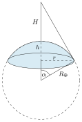
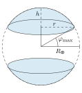

## Zadanie

<figure>

<figcaption>

**Obrázok 1:** Guľový vrchlík.
</figcaption>

</figure>

Medzinárodná vesmírna stanica obieha Zem po dráhe so strednou výškou nad povrchom $400\,\mathrm{km}$ a sklonom $51{,}6^{\circ}$. Na priamych prenosoch NASA priamo z ISS jasne vidno, že astronauti na palube vidia iba malú časť zemského povrchu.

<ol type="a">

<li>

[20 b] Akú časť zemského povrchu je možné naraz vidieť z ISS? Odpoveď uveďte v percentách zemského povrchu. Zanedbajte atmosférickú refrakciu a excentricitu dráhy ISS. Zem považujte za dokonalú guľu.

</li>

</ol>

*Nápoveda: Môže sa vám hodiť vzorec na výpočet povrchu guľového vrchlíka $S=2\pi hR$.*

Vďaka orbitálnemu pohybu ISS a rotácii Zeme môžu astronauti počas dlhšej doby vidieť oveľa väčšiu časť povrchu Zeme, než ste vypočítali v časti (a).

<ol type="a" start="2">

<li>

[30 b] Vypočítajte, akú časť povrchu Zeme je možné teoreticky zahliadnuť z paluby ISS v priebehu mnohých obehov. Svoju odpoveď opäť uveďte v percentách.

</li>

</ol>

Riešenie

<ol type="a">

<li>

Načrtnime si najskôr celú situáciu (pozri obr. 2, ktorý nie je v skutočnej mierke). Oblasť viditeľná z ISS je zafarbená namodro a výška ISS nad zemským povrchom je označená $H$. Priamka spájajúca ISS a najvzdialenejší viditeľný bod na povrchu je zároveň dotyčnicou k povrchu, a preto s polomerom Zeme v bode dotyku zviera pravý uhol. Vznikne tak pravouhlý trojuholník, v ktorom pre stredový uhol $\alpha$ platí 

$$
\cos \alpha\ = \frac{R_\Ea}{R_\Ea+H}\, .
    \qquad\textit{[5\,b]} \tag{1}
$$

</li>

</ol>

<figure>

<figcaption>

**Obrázok 2:** Schematický nákres oblasti viditeľnej naraz z ISS.
</figcaption>

</figure>

Vzdialenosť podstavy vrchlíka od stredu Zeme sa podľa obr. 2 rovná $R\cos \alpha$. Vzdialenosť $h$ od podstavy vrchlíka po povrch Zeme sa preto dá vyjadriť ako 

$$
h = R_\Ea-R_\Ea\cos \alpha\ = R_\Ea\left(1-\frac{R_\Ea}{R_\Ea+H}\right) = \frac{R_\Ea H}{R_\Ea+H} \,. \qquad\textit{[5\,b]} \tag{2}
$$

Celkový povrch Zeme je $S=4\pi R_\Ea^2$,[3 b] zatiaľ čo povrch guľového vrchlíka viditeľného z ISS je 

$$
S_1=2\pi hR_\Ea=\frac{2\pi R_\Ea^2 H}{R_\Ea+H}\,.
    \qquad\textit{[4\,b]} \tag{3}
$$

Pomer týchto dvoch plôch je 

$$
\frac{S_1}{S}=\frac{H}{2(R_\Ea+H)} \doteq \boxed{0,0295}\,.
    \qquad\textit{[3\,b]} \tag{4}
$$

Astronauti z ISS môžu teda naraz uvidieť približne $3\,\%$ zemského povrchu.

<ol type="a" start="2">

<li>

Vďaka sklonu dráhy ISS môžu astronauti vidieť väčšinu povrchu Zeme s výnimkou oblastí okolo pólov – modrých oblastí na obrázku 3. ISS sa na svojej naklonenej dráhe dokáže pri správnom natočení Zeme (na čo stačí počkať dostatočne veľa obehov) dostať priamo nad ľubovoľné miesto so zemepisnou šírkou v absolútnej hodnote maximálne rovnou $i = 51{,}6^{\circ}\qquad\textit{[2\,b]}$.

</li>

</ol>

<figure>

<figcaption>

**Obrázok 3:** Schematický nákres oblasti dlhodobo viditeľnej z ISS.
</figcaption>

</figure>

Keďže ale obieha vo výške $400\,\mathrm{km}$, je možné vidieť ešte väčšie zemepisné šírky. Najväčšia absolútna hodnota zemepisnej šírky na severnej pologuli, ktorá je ešte stále viditeľná z ISS, je $\varphi_{max} = i+\alpha$,[4 b] kde $\alpha$ je rovnaký uhol ako v časti (a). Číselne dostaneme

$$
\varphi_{max} = i+\alpha = i+ \arccos \left(\frac{R_\Ea}{R_\Ea+H}\right) \doteq 71{,}4^{\circ} \, \mathrm{N}\,.\qquad\textit{[7\,b]} \tag{5}
$$

Najjužnejšia viditeľná zemepisná šírka je $71{,}4^{\circ}\, \mathrm{S}$, symetricky k severnej pologuli.[2 b] Najjednoduchší spôsob, akým môžeme vypočítať celý viditeľný povrch Zeme je najskôr zistiť, aký je povrch guľových vrchlíkov v okolí pólov, ktoré nevidíme. Postupujeme pri tom rovnako ako v predchádzajúcej časti úlohy. Vzdialenosť $h$ je podľa obrázka 

$$
h=R_\Ea-R_\Ea\sin \varphi_{max}\,.\qquad\textit{[5\,b]} \tag{6}
$$

 Celkový povrch oblasti, ktorú nevidno z ISS, je teda po zarátaní oboch oblastí okolo pólov 

$$
S_2=2\cdot2\pi h R_\Ea=4\pi R_\Ea^2(1-\sin \varphi_{max})\,.\qquad\textit{[5\,b]} \tag{7}
$$

 Pomer viditeľnej oblasti a celého zemského povrchu je 

$$
\frac{S-S_2}{S}=\frac{4\pi R_\Ea^2-4\pi R_\Ea^2(1-\sin \varphi_{max})}{4\pi R_\Ea^2}=\sin \varphi_{max} \doteq \boxed{0,948}\,,\qquad\textit{[5\,b]} \tag{8}
$$

 takže astronauti môžu napokon zahliadnuť až 95% povrchu Zeme.

