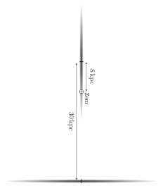
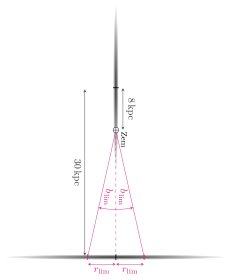

## Zadanie

Galaxia v Androméde ($\messier{31}$) sa po dobu takmer $4,5$ miliardy rokov približovala k Mliečnej ceste – galaxii, kde sa nachádza slnečná sústava, planéta Zem a aj toto miesto, kde práve píšete celoslovenské kolo. Po splynutí týchto dvoch sesterských galaxií nastane nová epocha, v ktorej sa už nebude hovoriť jednotlivo o galaxii v Androméde a Mliečnej ceste (po ang. *Milky Way*), ale o jednotnej novej galaxii – Milkdroméde.

Jasnosť galaxie je tvorená dvomi hlavnými komponentami – jadrom a diskom. V tejto úlohe sa zameriame na disk, keďže jasnosť jadra dominuje iba v centrálnej oblasti galaxie do vzdialenosti asi $1{,}2\,\mathrm{kpc}$ od stredu galaxie. Jasnosť galaxie sa zvykne popisovať pomocou plošnej magnitúdy $\mu$, ktorej jednotky sú $\mathrm{mag}/{\mathrm{arcsec}}^{2}$ (magnitúda na štvorcovú uhlovú sekundu oblohy). Rôzne miesta disku galaxie majú rozdielnu jasnosť, a teda aj rozdielnu plošnú magnitúdu. Budeme predpokladať, že si $\messier{31}$ udržuje rovnováhu medzi zánikom a tvorbou hviezd tak, že jej absolútna magnitúda a rozloženie jasností rôznych častí disku sú v čase konštantné.

<ol type="a">

<li>

[15 b] Dokážte, že plošná magnitúda $\mu$, ktorú pozorujeme zo Zeme v jednom konkrétnom mieste disku galaxie $\messier{31}$, nezávisí od vzdialenosti $\messier{31}$ od Zeme a jej inklinácie voči zornému lúču.

</li>

</ol>

Profil jasnosti kruhového disku $\messier{31}$ môžeme modelovať exponenciálnym poklesom, ktorý je polárne symetrický okolo stredu galaxie. Matematicky zapísané 

$$
\text{jasnosť} = K \, \exp \left(-\frac{r}{r_s}\right) \,, \tag{1}
$$

 kde $K$ je konštanta, $r$ je vzdialenosť časti disku od stredu galaxie a $r_s = 5{,}7\,\mathrm{kpc}$ je škálovacia vzdialenosť, v ktorej jasnosť disku klesne $e$-krát voči jasnosti v strede disku. Konštanta $K$ je rovná jasnosti disku v strede galaxie, teda jasnosti stredu galaxie po odpočítaní zložky jasnosti pre jadro galaxie. Plošnú magnitúdu v strede disku budeme označovať $\mu_0$.

<ol type="a" start="2">

<li>

[15 b] Prepísaním vzťahu (1) do plošných magnitúd pomocou Pogsonovej rovnice ukážte, že plošná magnitúda disku klesá lineárne so vzdialenosťou $r$. Ako výsledok uveďte vyjadrenie pre $\mu$ v závislosti od $\mu_0, r, r_s$.

</li>

</ol>

V súčasnosti sa galaxia $\messier{31}$ nachádza vo vzdialenosti $d_{M31} = 765\,\mathrm{kpc}$ od Zeme, jej plošná magnitúda disku v strede je $\mu_0 = 16{,}7\,\mathrm{mag}/{\mathrm{arcsec}}^{2}$ a na nočnej oblohe voľným okom limitne vidíme disk $\messier{31}$ do vzdialenosti $20'$ od jeho stredu.

<ol type="a" start="3">

<li>

[15 b] Určte, do akej fyzickej vzdialenosti $r_{lim}$ v $\mathrm{kpc}$ vidíme v súčasnosti voľným okom disk galaxie $\messier{31}$ od jeho stredu. Vypočítajte limitnú plošnú magnitúdu $\mu_{lim}$ zodpovedajúcu vzdialenosti $r_{lim}$, ktorú dokáže naše oko zaznamenať v disku galaxie $\messier{31}$.

</li>

</ol>

<figure>

<figcaption>

**Obrázok 1:** Znázornenie zrážajúcich sa galaxií pri pohľade z boku ich diskov. Zem leží na spojnici stredov galaxií, ktoré sú od seba vzdialené $30\,\mathrm{kpc}$.
</figcaption>

</figure>

Teraz sa presunieme do budúcnosti do času tesne pred zrážkou galaxií. Pre jednoduchosť uvažujme, že disky galaxií sú orientované kolmo na seba, zachovali si kruhový tvar a Mliečna cesta mieri do stredu $\messier{31}$. Situácia je zobrazená na obrázku 1.

<ol type="a" start="4">

<li>

[15 b] Vypočítajte rozsah galaktických šírok $b$, na ktorých by sme mohli voľným okom pozorovať galaktický disk $\messier{31}$ v čase, kedy nastane situácia zobrazená na obrázku 1. Zanedbajte medzihviezdnu absorpciu.

</li>

</ol>

Riešenie

<ol type="a">

<li>

Na prvý pohľad by sa mohlo zdať, že plošná magnitúda bude menšia pre menšiu vzdialenosť, keďže množstvo zachytenej energie z jedného metra štvorcového disku galaxie je úmerné $1/d^2$, kde $d$ je vzdialenosť galaxie $\messier{31}$. Avšak musíme si dať pozor na to, že pod plošnou magnitúdou $\mu$ v jednotke $\mathrm{mag}/{\mathrm{arcsec}}^{2}$ rozumieme magnitúdu, ktorá do našich očí prichádza z oblasti oblohy s uhlovými rozmermi $1\times1$ uhlovej sekundy (angl. *arc second*). Plocha disku galaxie obsiahnutá v jednej štvorcovej uhlovej sekunde je tým menšia, čím bližšie sa k nám galaxia nachádza. Veľkosť tejto plochy je úmerná takisto $1/d^2$, čo presne vykompenzuje efekt menšej vzdialenosti galaxie. Preto množstvo energie zachytené z jednej štvorcovej uhlovej sekundy disku galaxie je nezávislé od vzdialenosti galaxie. To platí pre každé miesto disku galaxie, keďže predpokladáme, že si galaxia zachováva absolútny profil jasnosti. [8 b]

Druhou prekvapivou vecou je, že plošná magnitúda nezávisí od uhla sklonenia disku. Klasicky sme zvyknutí na to, že množstvo zachytenej plochy z jedného metra štvorcového je úmerné $\sin \alpha$, kde $\alpha$ je uhol medzi zorným lúčom a pozorovanou žiariacou plochou. Avšak v prípade plošnej magnitúdy hovoríme o ploche, ktorú vidíme pod uhlom jednej štvorcovej oblúkovej sekundy. Sklonenie plochy o uhol $\alpha$ spôsobí nárast plochy, ktorá sa vojde do jednej štvorcovej oblúkovej sekundy, a to práve s koeficientom $\sin \alpha$. Efekty sa opäť vzájomne vyrušia a plošná magnitúda nezávisí od uhla naklonenia disku. Rovnaká úvaha platí pre každé miesto disku. [7 b]

</li>

<li>

Pogsonovu rovnicu môžeme písať v tvare 

$$
\mu - \mu_0 = 
    -2,5 \log \left( \frac{\text{jasnosť}}{\text{jasnosť v strede}} \right) , \qquad\textit{[5\,b]} \tag{2}
$$

 kde $\mu_0$ je plošná magnitúda v strede disku ($r=0$) a $\mu$ je plošná magnitúda časti disku vo vzdialenosti $r$ od stredu disku. Dosadením exponenciálneho predpisu pre jasnosť zo zadania dostaneme 

$$
\mu - \mu_0 = 
    -2,5 \log \left( \frac{K \exp \left(-\frac{r}{r_s}\right)}{K \exp \left(-\frac{0}{r_s}\right)} \right) =
    -2,5 \log \left( \exp \left(-\frac{r}{r_s}\right) \right) . \tag{3}
$$

 Po úprave, v ktorej si dáme pozor na to, že logaritmus je dekadický a nie prirodzený, máme 

$$
\boxed{\mu = \mu_0 + 2,5 \, \frac{r}{r_s} \log e} \,.
     \qquad\textit{[10\,b]} \tag{4}
$$

</li>

<li>

Vzdialenosť $r_{lim}$ pozorujeme zo vzdialenosti $d_{M31} = 765\,\mathrm{kpc}$ pod uhlom $20'$. Keďže je tento uhol malý, môžeme $r_{lim}$ aproximovať kružnicovým oblúkom a písať trojčlenku v tvare 

$$
\frac{20'}{360^{\circ}} = \frac{r_{lim}}{2\pi d_{M31}} \qquad\textit{[5\,b]} \,, \tag{5}
$$

 z ktorej 

$$
r_{lim} = 2\pi d_{M31} \, \frac{20'}{360^{\circ}} \doteq
    \boxed{4{,}5\,\mathrm{kpc}} \,. \qquad\textit{[5\,b]} \tag{6}
$$

 Alternatívne by sme vedeli $r_{lim}$ vypočítať pomocou trigonometrie cez tangens alebo sínus.

Dosadením $r=r_{lim}$ do rovnice (4) vypočítame $\mu = \mu_{lim}$ ako 

$$
\mu_{lim} = \mu_0 + 2,5 \, \frac{r_{lim}}{r_s} \log e \doteq
    \boxed{17{,}5\,\mathrm{mag}/{\mathrm{arcsec}}^{2}} \,. \qquad\textit{[5\,b]} \tag{7}
$$

</li>

<li>

Keďže plošná magnitúda disku nie je závislá od vzdialenosti a uhla, tak to znamená, že hranica $\pm \, r_{lim}$ okom pozorovateľného disku $\messier{31}$ bude rovnaká v budúcnosti ako je dnes[5 b]. Úloha sa preto mení na jednoduchú geometriu zobrazenú na obrázku 2. Galaktická šírka je uhlová súradnica[3 b] popisujúca vzdialenosť od galaktického rovníka Mliečnej cesty pri pohľade zo Zeme. Keďže Zem leží na spojnici stredov galaxií, tak rozsah galaktických šírok $b$ bude symetrický okolo nuly. Z geometrie pravouhlého trojuholníka dostávame 

$$
\tan b_{\hspace{1pt}lim} = \frac{r_{lim}}{30\,\mathrm{kpc} - 8\,\mathrm{kpc}} \ztv
    b_{\hspace{1pt}lim} = 11{,}4^{\circ} \qquad\textit{[5\,b]} \,. \tag{8}
$$

 Rozsah galaktických šírok, na ktorých uvidíme galaxiu $\messier{31}$, bude $\boxed{b \in (-11{,}4^{\circ} \; ; \; 11{,}4^{\circ})}$. [2 b] Galaxia bude mať na oblohe 46-krát väčší priemer ako Mesiac, čo je toľko ako uhlová vzdialenosť medzi hviezdami Aldebaran a Pollux.

<figure>

<figcaption>

**Obrázok 2:** Znázornenie voľným okom pozorovateľných častí galaxie $\messier{31}$, ktorá sa nám zobrazí na rozsah galaktických dĺžok $b \in ( - b_{\hspace{1pt}lim} \; , \; b_{\hspace{1pt}lim})$.
</figcaption>

</figure>

</li>

</ol>

## Komentár autora

Tretí zo série príkladov, ktorý sa zoberá Mliečnou cestou a galaxiou v Androméde. Tentoraz sa pozrieme do ďalekej budúcnosti a pokúsime sa odhadnúť ako bude galaxia $\messier{31}$ vyzerať na nočnej oblohe.
