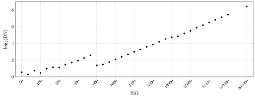
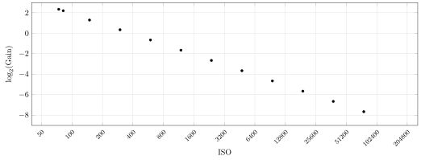
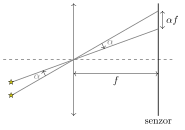

## Zadanie

Svetelné znečistenie rastie rýchlym tempom takmer o $10\,\%$ ročne, čo robí z prirodzene tmavej oblohy ohrozený unikát. Na Slovensku je najtmavším miestom Park tmavej oblohy Poloniny ($\phi=49{,}03^{\circ} \text{ N}$, $\lambda=22{,}45^{\circ} \text{ E}$), kde jas nočnej oblohy dosahuje limitné hodnoty plošnej magnitúdy $\mu_1 \approx 22\,\mathrm{mag}/{\mathrm{arcsec}}^{2}$. Pre astrofotografov je v takýchto podmienkach veľmi dôležité zistiť, ako nastaviť expozíciu tak, aby zachytili čo najslabšie objekty bez toho, aby boli hviezdy v dôsledku rotácie Zeme rozmazané.

V tejto úlohe sa budeme zaoberať fotením s digitálnou zrkadlovkou Nikon D780 s full-frame CMOS senzorom (rozmery $a \times b =35{,}9\,\mathrm{mm} \times 23{,}9\,\mathrm{mm}$, počet štvorcových pixelov $N_p=24\,\mathrm{MPx}$) a objektívom s ohniskovou vzdialenosťou $f=50\,\mathrm{mm}$ a svetelnosťou (*F-ratio*) $f/1.8$. Uvažujte, že fotíme hviezdy s deklináciou $\delta=30^{\circ}$ a predpokladajte, že nepoužívame motorizovanú montáž.

<ol type="a">

<li>

[13 b] Vypočítajte najdlhšiu expozičnú dobu $\tau$, pri ktorej nebudú vznikať takzvané *star trails*. Ako podmienku na vznik star trails budeme považovať, že obraz hviezdy musí na senzore prejsť dráhu rovnú aspoň veľkosti strany štvorcového pixela senzora.

</li>

</ol>

Schopnosť senzora zaznamenať slabú hviezdu je limitovaná šumom $N$. Proces fungovania CMOS senzora je zjednodušene založený na tom, že fotóny dopadajúce na pixel z jeho povrchu „vybijú“ elektróny, ktoré sa v ňom akumulujú ako náboj (pomer počtu vybitých elektrónov na jeden fotón sa nazýva kvantová účinnosť $\eta$). Po ukončení expozície sa tento náboj premení na napätie, zosilní sa a v A/D prevodníku sa zmení na digitálnu hodnotu DN (*Digital Number*).

Tento proces nie je dokonalý a do signálu vstupuje niekoľko zložiek šumu:

- **Fotónový šum** (*photon shot noise*) samotného žiarenia hviezdy je rozptyl $\sigma_{PN}^2=S$, kde $S$ je signál, teda počet zaznamenaných elektrónov $e^-$.

- **Tmavý šum** (*dark current noise*) je $\sigma_{DC}^2=n_{px}\cdot DC\cdot \tau$, kde $n_{px}$ je počet pixelov, z ktorých sa vyčítava informácia, a $DC$ tmavý prúd (*dark current*) senzora, pre ktorý platí $DC = 0,1\ e^-/\text{pixel/s}$.

- **Vyčítací šum** (*readout noise*) vzniká pri samotnom čítaní signálu z pixelu a jeho digitalizácii. Jeho hodnota v digitálnych jednotkách (DN) závisí od nastavenia ISO. Platí preň vzťah $\sigma_{RN}^2=n_{px}\cdot RN^2$, kde $RN$ je šum v elektrónoch, ktorý viete odčítať z priloženého grafu. Pre prevod z digitálnych jednotiek (DN) na elektróny ($\text{e}^-$) použite konverzný zisk (Gain), ktorý takisto viete odčítať z priloženého grafu. Platí prevodový vzťah: $\text{Signál [e}^-] = \text{Signál [DN]} \cdot \text{Gain}$.

- **Šum pozadia oblohy** (*background sky noise*) sa rovná priamo počtu elektrónov, ktoré vznikajú ako dôsledok dopadu fotónov z oblohy na pixely, teda $\sigma_{sky}^2= S_{sky}$.

**Doplňujúce informácie:**

- Hviezdu na fotke uvidíme, ak je pomer signálu k šumu (*Signal-to-Noise ratio*) rovný aspoň 3, teda $S/N \geq 3$.

- Fotíme na citlivosti ISO 800.

- Kvantová účinnosť celej aparatúry na uvažovanej vlnovej dĺžke fotenia $\lambda = 500\,\mathrm{nm}$ je $\eta = 60\,\%.(\mathrm{e}^-/\mathrm{fotón})$.

- Šírka pásma, ktorú senzor prepúšťa, je $\Delta\lambda = 100\,\mathrm{nm}$.

- Referenčný svetelný tok $\Phi_0$ pre nulovú plošnú magnitúdu ($\mu_0=0\,\mathrm{mag}/{\mathrm{arcsec}}^{2}$) je rovný $\Phi_0 = 10^{4}\,\mathrm{fotónov}.\mathrm{cm}^{-2}.\mathrm{s}^{-1}.\mathrm{nm}^{-1}$.

- Kvôli seeingu sa efektívne bodová hviezda nezobrazí iba na jeden pixel. Predpokladajte, že obraz hviezdy bude rovnomerne „rozmazaný“ na 4 susedných pixeloch.

- Celkový šum určíte ako $N = \sqrt{\sigma_{PN}^2 + \sigma_{DC}^2 + \sigma_{RN}^2+\sigma_{sky}^2}$.

<ol type="a" start="2">

<li>

[5 b] Vypočítajte plochu oblohy v $\mathrm{arcsec}^{2}$, z ktorej sa zbiera šum oblohy.

</li>

<li>

[57 b] Vypočítajte limitnú magnitúdu hviezd $m$, ktoré sme v uvažovanej časti oblohy schopní zachytiť fotografiou s dĺžkou expozície $\tau$.

</li>

</ol>

<figure>

<figcaption>

**Obrázok 1:** Graf závislosti $\log_2(\text{DN})$ od nastavenia ISO. Zdroj: [photonstophotos.net](https://photonstophotos.net/Charts/RN_ADU.htm).
</figcaption>

</figure>

<figure>

<figcaption>

**Obrázok 2:** Graf závislosti $\log_2(\text{Gain})$ od nastavenia ISO. Zdroj: [photonstophotos.net](https://photonstophotos.net/Charts/Gain.htm).
</figcaption>

</figure>

Riešenie

<ol type="a">

<li>

Naším cieľom je určiť rýchlosť $v$, ktorou sa obraz hviezdy pohybuje po senzore, pretože z toho potom vieme priamočiaro určiť čas, za ktorý prejde obraz hviezdy veľkosť strany pixela $p$.

</li>

</ol>

<figure>

<figcaption>

**Obrázok 3:** Geometria pohybu hviezdy na oblohe a na senzore fotoaparátu.
</figcaption>

</figure>

Pixely sú štvorcové a na jeden pixel pripadá plocha $ab/N_p$, z čoho pre veľkosť strany štvorcového pixela máme 

$$
p = \sqrt{\frac{ab}{N_p}} \doteq 5{,}98\,\mu \mathrm{m} \,.\qquad\textit{[3\,b]} \tag{1}
$$

Uhlová rýchlosť, ktorou pozorujeme, že sa pohybujú hviezdy na oblohe s deklináciou $\delta$, je 

$$
\omega = \frac{2\pi}{t_\Ea}\cos \delta \,.\qquad\textit{[5\,b]} \tag{2}
$$

Pri zaostrení fotoaparátu na hviezdu je vzdialenosť šošovky a senzora rovná $f$. Keďže $p\ll f$, tak z obr. 3 vyplýva, že pri posune hviezdy na oblohe o uhol $\alpha$ sa obraz na senzore posunie o vzdialenosť $f\alpha$. Dostávame tak vzťah pre čas 

$$
p = f \alpha = f\omega \tau \quad \implies \quad \tau = \frac{p}{\omega f} = \frac{p}{2\pi f \cos \delta} \, t_\Ea \doteq \boxed{1{,}9\,\mathrm{s}}\,.   \qquad\textit{[5\,b]} \tag{3}
$$

<ol type="a" start="2">

<li>

Z podúlohy (a) vieme, že uhlový rozmer jedného pixelu na oblohe je $\alpha$. Plocha jedného pixelu na oblohe tak bude $\Omega_{px} = \alpha^2$. Keďže uvažujeme, že sa hviezda rozmaže na $n_{px} = 4\,$pixely, tak celková plocha oblohy, z ktorej zbierame šum je 

$$
\Omega = n_{px} \alpha^2 = n_{px} \left(\frac{p}{f}\right)^2 \doteq 5{,}722 \cdot 10^{-8}\,\mathrm{rad}^2\doteq \boxed{2434\,\mathrm{arcsec}^{2}}\,.\qquad\textit{[5\,b]} \tag{4}
$$

</li>

<li>

Hoci to tak na prvý pohľad možno nevyzerá, úloha je celkom priamočiara – vypočítať hodnoty jednotlivých šumov a potom z podmienky $S/N \geq 3$ určiť limitný tok, ktorý už považujeme za postačujúcu podmienku na odfotenie hviezdy. Následne z Pogsonovej rovnice podľa referenčného toku vypočítame, aká magnitúda tomuto toku prislúcha.

Vypočítajme najprv hodnoty jednotlivých šumov:

Fotónový šum  
určíme priamo zo zadania $\sigma_{PN}^2=S$.

Tmavý šum  
vypočítame zo zadaného vzorca $\sigma_{DC}^2 = n_{px}\cdot DC\cdot \tau \doteq 0{,}756\,\mathrm{e}^-$.

Vyčítací šum  
vypočítame podľa zadaného vzorca $\sigma_{RN}^2=n_{px}\cdot RN^2$, kde $RN$ vyčítame z priložených grafov. Z grafu 2 lineárnou regresiou určíme, že pre ISO 800 máme $\log_2(\text{Gain}) = -1$, z čoho $\text{Gain} = 0,5$. Obdobne z grafu 1 je $\log_2(\text{Signál [DN]}) = 1,33$, a teda $\text{Signál [DN]} \doteq 2,51$. Preto $RN= \text{Gain}\cdot \text{Signál [DN]} \doteq 1,26$ a $\sigma_{RN}^2 \doteq 6{,}35\,\mathrm{e}^-$.[7 b]

Šum pozadia oblohy  
určíme priamo ako počet fotónov dopadajúcich do fotoaparátu. Tok fotónov $\Phi_{1,1}$ z jednej uhlovej štvorcovej sekundy oblohy určíme z Pogsonovej rovnice 

$$
\mu_1 - \mu_0 = -2,5\log\left( \frac{\Phi_{1,1}}{\Phi_0} \right) ,\qquad\textit{[7\,b]} \tag{5}
$$

 z čoho po úpravách 

$$
\Phi_{1\text{,}1} = \Phi_0 \cdot 10^{0,4(\mu_0-\mu_1)} \doteq 1{,}58 \cdot 10^{-5}\,\mathrm{fotónov}.\mathrm{cm}^{-2}.\mathrm{s}^{-1}.\mathrm{nm}^{-1}\,. \qquad\textit{[4\,b]} \tag{6}
$$

 V podúlohe (b) sme vypočítali plochu oblohy $\Omega$, z ktorej fotoaparát zachytáva šum z pozadia oblohy. Tok týchto fotónov je 

$$
\Phi_1 = \Omega \, \Phi_{1\text{,}1} = 3{,}86 \cdot 10^{-2}\,\mathrm{fotónov}.\mathrm{cm}^{-2}.\mathrm{s}^{-1}.\mathrm{nm}^{-1}\,.\qquad\textit{[5\,b]} \tag{7}
$$

Ostáva už len urobiť prevod toku fotónov na reálny signál v elektrónoch. Jednotka toku $\Phi_1$ nám napovedá, ako presne to urobíme. Započítaním kvantovej účinnosti, ktorá má jednotku $\mathrm{e}^-/\mathrm{fotón}$, tak získame už priamo signál v elektrónoch 

$$
S_{sky} = \Phi_1\cdot \eta \cdot \pi \left(\frac{D}{2}\right)^2\cdot \tau\cdot \Delta \lambda\,,\qquad\textit{[8\,b]} \tag{8}
$$

 kde $D$ je priemer vstupnej pupily[^1]. Ten určíme zo svetelnosti objektívu ako 

$$
1.8 = f/D \ztv D = f/1.8 = 27{,}8\,\mathrm{mm}\,.\qquad\textit{[3\,b]} \tag{9}
$$

 Dosadením do rovnice (8) dostaneme $S_{sky} \doteq 26,55 e^-$.[3 b]

Teraz už len ostáva všetko dosadiť do rovnice pre $S/N$. 

$$
3  = \frac{S}{\sqrt{S+S_{sky}+\sigma_{RN}^2 + \sigma_{DC}^2}} := \frac{S}{\sqrt{S+\Sigma}}\,,\qquad\textit{[3\,b]} \tag{10}
$$

 kde pre prehľadnosť výpočtov $\Sigma\doteq 33{,}66\,\mathrm{e}^-$ je súčet rozptylov šumov, ktorých hodnoty už poznáme. Úpravami dostaneme kvadratickú rovnicu 

$$
S^2-9S-9\Sigma = 0\,, \tag{11}
$$

 ktorej riešením je kladný koreň 

$$
S = \frac{9}{2} + \sqrt{\left(\frac{9}{2}\right)^2 + 9\Sigma} \doteq 22,45 e^-\,.\qquad\textit{[5\,b]} \tag{12}
$$

Podobným spôsobom, akým sme počítali tok fotónov z oblohy, teraz vypočítame limitnú magnitúdu hviezdy. Pre tok fotónov hviezdy, ktorý sme zachytili, platí 

$$
\Phi_{2} = \frac{S}{\eta \cdot \pi \left(\frac{D}{2}\right)^2\cdot \tau\cdot \Delta \lambda} \doteq 3{,}261 \cdot 10^{-2}\,\mathrm{fotónov}.\mathrm{cm}^{-2}.\mathrm{s}^{-1}.\mathrm{nm}^{-1}\,.\qquad\textit{[5\,b]} \tag{13}
$$

Dosadením do Pogsonovej rovnice získame 

$$
m_2 = m_0-2,5\log\left(\frac{\Phi_2}{\Phi_0}\right) \doteq \boxed{13{,}7\,\mathrm{mag}}\,.\qquad\textit{[4\,b]} \tag{14}
$$

</li>

</ol>

[^1]: Pozor, ide o inú vec ako priemer objektívu – fotoaparát má pevne daný priemer objektívu, ktorý sa nedá meniť, ale naopak môžete meniť tzv. clonu. Vstupná pupila je teda otvor, ktorý pozorujete pri pohľade spredu na objektív pri privretej clone.

