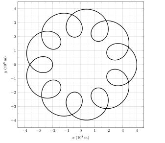
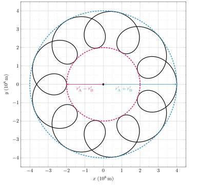

## Zadanie

Väčšina exoplanét sa v súčasnosti objavuje nepriamo, napríklad sledovaním poklesu jasnosti hviezdy pri tranzite planéty alebo meraním zmien jej radiálnej rýchlosti. Ďalšou, na presnosť prístrojov však extrémne náročnou metódou je astrometria, teda priame pozorovanie pohybu centrálnej hviezdy v dôsledku gravitačného vplyvu planét obiehajúcich okolo nej.

Uvažujme hviezdnu sústavu, v ktorej okolo materskej hviezdy obiehajú po kruhových dráhach dve planéty v rovine kolmej na zorný lúč. Pre jednoduchosť tieto planéty ďalej označme ako $A$ a $B$ tak, aby polomer dráhy planéty $A$ bol väčší ako polomer dráhy planéty $B$.

Na priloženom obrázku je znázornená trajektória stredu materskej hviezdy (po odčítaní jej vlastného, paralaktického a aberačného pohybu), pričom vieme, že stred hviezdy opíše celú túto trajektóriu za čas $t=$ $10\,\mathrm{rokov}$ a potom sa pohyb po trajektórii periodicky opakuje. Ďalej predpokladajme, že hmotnosti oboch planét sú zanedbateľne malé v porovnaní s hmotnosťou hviezdy, a tak môžeme aj gravitačný vplyv planét na seba navzájom zanedbať.

<ol type="a">

<li>

[40 b] Na základe obrázka a zadaných údajov určte siderické obežné periódy $T_A, T_B$ oboch planét.

</li>

<li>

[40 b] Nezávislým pozorovaním planéty $A$ sme zistili, že polomer jej dráhy je $r_A = 5{,}5\,\mathrm{au}$. Na základe tejto hodnoty, predošlých údajov a meraní z priloženého obrázka určte hmotnosť hviezdy $\mathcal{M}$ a hmotnosti oboch planét $\mathcal{m}_A, \mathcal{m}_B$.

</li>

</ol>

<figure>

<figcaption>

**Obrázok 1:** Trajektória stredu materskej hviezdy.
</figcaption>

</figure>

Riešenie

<ol type="a">

<li>

Zamyslime sa najprv nad tým, ako by vyzerala trajektória stredu hviezdy, ak by šlo o hviezdnu sústavu len s jednou planétou, ktorá by okolo svojej materskej hviezdy obiehala po kruhovej dráhe v rovine kolmej na zorný lúč. V takom prípade by planéta aj hviezda obiehali po kruhových dráhach okolo svojho spoločného ťažiska, takže trajektória stredu hviezdy by mala tvar kružnice.

Na určenie hmotnosti hviezdy a planéty by sme potom potrebovali už len obežnú dobu planéty a polomer kružnice, ktorú počas svojho pohybu vykresľuje stred hviezdy, keďže z 3. Keplerovho zákona a z definície ťažiska (teda z rovnosti súčinu hmotnosti a vzdialenosti od ťažiska pre planétu a hviezdu) by sme potom dostali sústavu dvoch rovníc s dvomi neznámymi, ktorú by nám stačilo vyriešiť.

Vráťme sa teraz k situácii zo zadania, teda k hviezdnej sústave s dvomi planétami. Z obrázka vidíme, že trajektória stredu hviezdy už teraz nemá iba jednoduchý tvar kružnice, ale vytvára rôzne slučky, ktoré sa napokon po čase $t$ uzavrú. Vďaka predpokladom $m_A, m_B \ll M$ sa však na túto situáciu vieme pozerať tak, že každá planéta svojím gravitačným vplyvom spôsobuje pohyb stredu hviezdy po trajektórii tvaru kružnice a že výsledný tvar trajektórie stredu hviezdy je jednoducho súčtom (alebo tzv. superpozíciou) týchto dvoch efektov[10 b]. Geometricky si vieme takýto pohyb predstaviť tak, že máme väčšiu kružnicu, po ktorej sa pohybuje myslený bod, a súčasne menšiu kružnicu so stredom v tomto pohybujúcom sa bode, po ktorej obieha druhý bod, zodpovedajúci práve polohe stredu hviezdy. Myšlienku takéhoto pohybu vieme potvrdiť aj opätovným analyzovaním trajektórie stredu hviezdy. Jednotlivé slučky totiž zdanlivo obiehajú po väčšej kružnici (gravitačný vplyv jednej planéty), pričom samotné slučky vznikajú v dôsledku obiehania po menšej kružnici s vyššou uhlovou rýchlosťou (gravitačný vplyv druhej planéty).

Keďže stred hviezdy vykoná za jeden obeh po veľkej kružnici viacero obehov po malej kružnici (trajektória obsahuje viacero slučiek), tak obežná perióda planéty, ktorá spôsobuje obeh po veľkej kružnici, je určite väčšia ako obežná perióda planéty, ktorá spôsobuje obeh po malej kružnici. Z 3. Keplerovho zákona zároveň vieme, že pri zanedbaní hmotností planét voči hmotnosti hviezdy s rastúcou veľkou polosou rastie aj perióda planéty. Planéta spôsobujúca obeh po veľkej kružnici je preto určite vzdialenejšia planéta, teda planéta $A$[3 b]. Zo zadania tiež vieme, že stred hviezdy opíše celú túto trajektóriu za čas $t = 10\,\mathrm{rokov}$. Tento čas je ale zjavne určený priamo periódou obehu po veľkej kružnici, teda periódou planéty $A$, ktorá je tak $\boxed{T_A = 10\,\mathrm{rokov}}$. [3 b]

Na určenie obežnej periódy planéty $B$ bude užitočné spočítať z obrázka počet vykonaných slučiek trajektórie stredu hviezdy, ktorý je rovný $N=9$. [3 b] Odtiaľto je ľahké unáhlene dospieť k záveru, že keď za jednu periódu planéty $A$ vykoná stred hviezdy $N$ slučiek, tak každá slučka zodpovedá jednému obehu planéty $B$ okolo svojej materskej hviezdy. Perióda planéty $B$ by potom bola $N$-krát nižšia ako perióda planéty $A$, takže by platilo $T_B = \frac{T_A}{N} = \frac{10}{9}\ \mathrm{rokov}$.

Keď sa však bližšie zamyslíme nad dôvodom vzniku jednotlivých slučiek, tak zistíme, že predošlý argument je nesprávny. Vo vnútornom „vrchole“ každej slučky totiž dochádza k tomu, že efekty gravitačného vplyvu oboch planét sa „odčítavajú“ (ide o body trajektórie, ktoré sa nachádzajú najbližšie k počiatku súradnicovej sústavy). To nastáva v okamihu, keď sa obe planéty nachádzajú na spoločnej priamke s ich materskou hviezdou, no na opačných stranách od nej. Každá slučka tak v skutočnosti prislúcha synodickej obežnej perióde [8 b] planéty $B$ voči planéte $A$.

Teraz je ešte potrebné rozmyslieť si z obrázka, že obe planéty obiehajú v rovnakom smere[3 b]. Ak si totiž vyberieme ľubovoľný z dvoch možných smerov obehu po veľkej kružnici, tak v tom istom smere dochádza aj k obehu po malej kružnici pri vykresľovaní slučiek, pričom každá planéta obieha okolo materskej hviezdy v tom istom smere, v akom sa vplyvom jej gravitačného vplyvu pohybuje hviezda.

Označme teraz uhlové rýchlosti obehu planét okolo svojej materskej hviezdy ako $\omega_A, \omega_B$. Keďže $T_A>T_B$, tak $\omega_A<\omega_B$, takže vnútorná planéta $B$ „predbieha“ vonkajšiu planétu $A$. Z toho, že $T_A = t$ a že synodická perióda planéty $B$ je $\frac{t}{N}$, dostávame potom rovnice 

$$
\begin{align*}
t &= \frac{2 \pi}{\omega_A} \,, \tag{1}\\
\frac{t}{N} &= \frac{2 \pi}{\omega_B - \omega_A} \,. \qquad\textit{[4\,b]} \tag{2}\end{align*}
$$

Po vzájomnom vydelení týchto rovníc dostaneme 

$$
N = \frac{\omega_B - \omega_A}{\omega_A} \,, \tag{3}
$$

 odkiaľ po úprave máme 

$$
\omega_B = (N + 1) \,\omega_A \,. \tag{4}
$$

 Skutočná siderická perióda planéty $B$ je teda 

$$
T_B = \frac{2 \pi}{\omega_B} = \frac{2 \pi}{(N+1) \omega_A} = \frac{t}{N+1} = \frac{10\,\mathrm{rokov}}{9+1} = \boxed{1\,\mathrm{rok}}\,. \qquad\textit{[6\,b]} \tag{5}
$$

</li>

<li>

Označme $r_A, r_B$ polomery dráh oboch planét a $r_A', r_B'$ príslušné polomery kružníc, po ktorých sa v dôsledku gravitačného vplyvu planét stred hviezdy pohybuje. Vďaka predpokladom $m_A, m_B \ll M$ môžeme potom pre planétu $A$ napísať 3. Keplerov zákon v tvare 

$$
\frac{T_A^2}{r_A^3} = \frac{4\pi^2}{GM} \,, \qquad\textit{[3\,b]} \tag{6}
$$

 kde hodnotu $r_A$ poznáme zo zadania a hodnotu $T_A$ sme určili v podúlohe (a), takže hmotnosť hviezdy vieme jednoducho vyjadriť a vyčísliť ako 

$$
M = \frac{4\pi^2 r_A^3}{GT_A^2} \doteq \boxed{3{,}3 \cdot 10^{30}\,\mathrm{kg} \doteq 1{,}7\,\mathcal{M}_\Sun}\,. \qquad\textit{[2\,b]} \tag{7}
$$

 Poďme teraz z obrázka zistiť polomery $r_A', r_B'$[5 b]. Podobne ako pri zdôvodnení toho, že každá slučka zodpovedá synodickej perióde planéty $B$, sa nám aj teraz oplatí pozrieť na nejaké význačné body trajektórie stredu hviezdy, a to konkrétne na body s najmenšou, respektíve najväčšou vzdialenosťou od počiatku súradnicovej sústavy. Tieto body totiž zodpovedajú tomu, že gravitačné vplyvy oboch planét sa navzájom akurát „odčítavajú“, respektíve „sčítavajú“. Tie najvzdialenejšie body trajektórie sú teda od počiatku súradnicovej sústavy vzdialené $r_A'+r_B'$, zatiaľ čo tie najbližšie body sú od stredu vzdialené $r_A'-r_B'$. [8 b]

Inak povedané, trajektóriu stredu hviezdy vieme ohraničiť sústrednými kružnicami so stredom v počiatku súradnicovej sústavy a s polomermi $r_A'+r_B'$ a $r_A'-r_B'$ (obr. 2), pričom práve dotykové body týchto kružníc s trajektóriou stredu hviezdy sú význačné body, ktoré nám pomôžu určiť tieto polomery. Jeden z význačných bodov na vonkajšej kružnici totiž leží na kladnej $x$-ovej polosi práve na súradnici $x = 4 \cdot 10^{8}\,\mathrm{m}$ a na zápornej $x$-ovej polosi leží naopak jeden z význačných bodov trajektórie na vnútornej kružnici práve na súradnici $x = -2 \cdot 10^{8}\,\mathrm{m}$[4 b].

<figure>

<figcaption>

**Obrázok 2:** Modrá a ružová kružnica ohraničujú trajektóriu stredu hviezdy zvonka a zvnútra, pričom ich polomery vieme odčítať z vyznačených bodov na $x$-ovej osi.
</figcaption>

</figure>

Pre polomery $r_A', r_B'$ teda platia rovnosti 

$$
\begin{align*}
    r_A' + r_B' &= 4 \cdot 10^{8}\,\mathrm{m} \,, \tag{8}\\
    r_A' - r_B' &= 2 \cdot 10^{8}\,\mathrm{m} \,, \tag{9}\end{align*}
$$

 ktorých vzájomným sčítaním dostávame $2r_A' = 6 \cdot 10^{8}\,\mathrm{m}$, teda $r_A' = 3 \cdot 10^{8}\,\mathrm{m}$, a ktorých vzájomným odčítaním dostaneme zase $2r_B' = 2 \cdot 10^{8}\,\mathrm{m}$, odkiaľ $r_B' = 1 \cdot 10^{8}\,\mathrm{m}$. [4 b]

Keď už teraz poznáme polomery kružníc, po ktorých sa hviezda pohybuje vplyvom gravitačného pôsobenia oboch planét, tak ich vieme dať do vzťahu s hmotnosťami a polomermi dráh jednotlivých planét pomocou definície ťažiska 

$$
\begin{align*}
    Mr_A' &= m_A r_A \,, \tag{10}\\ 
    Mr_B' &= m_B r_B \,. \qquad\textit{[5\,b]} \tag{11}\end{align*}
$$

 Keďže už poznáme hmotnosť hviezdy aj polomer dráhy planéty $A$, tak z rovnice (10) vieme vyjadriť hmotnosť planéty $A$ ako 

$$
m_A = \frac{M r_A'}{r_A} \doteq \boxed{1{,}2 \cdot 10^{27}\,\mathrm{kg}} \,. \qquad\textit{[2\,b]} \tag{12}
$$

Na určenie hmotnosti planéty $B$ nám treba zistiť ešte polomer jej dráhy, ktorý určíme podobne opäť z 3. Keplerovho zákona v zjednodušenom tvare 

$$
\frac{T_B^2}{r_B^3} = \frac{4\pi^2}{GM} \,, \qquad\textit{[3\,b]} \tag{13}
$$

 odkiaľ 

$$
r_B = \sqrt[3]{\frac{GM T_B^2}{4 \pi^2}} \approx 1{,}8 \cdot 10^{11}\,\mathrm{m} \approx 1{,}2\,\mathrm{au} \,. \qquad\textit{[2\,b]} \tag{14}
$$

Teraz už máme všetko potrebné na vyjadrenie hmotnosti planéty $B$ z rovnice (11), čím dostaneme 

$$
m_B = \frac{M r_B'}{r_B} \doteq \boxed{1{,}9 \cdot 10^{27}\,\mathrm{kg}} \,. \qquad\textit{[2\,b]} \tag{15}
$$

*Poznámka: Výsledná trajektória stredu hviezdy, ktorá je superpozíciou dvoch súhlasných pohybov po kružnici s rozdielnymi polomermi a uhlovými rýchlosťami, je v geometrii známa ako epitrochoida. Ak by ale jedna z planét obiehala v opačnom smere, tak by slučky nesmerovali dovnútra, ale von, a šlo by o tzv. hypotrochoidu. Obe tieto krivky patria do širšej matematickej rodiny tzv. ruliet (kriviek, ktoré vznikajú odvaľovaním jednej krivky po druhej). Ako zaujímavosť môžeme uviesť, že s rovnakým typom trajektórie sa vo vesmíre stretávame úplne bežne. Pri predpoklade kruhových dráh vykonávajú presne takýto zložený pohyb napríklad mesiace planét vo vzťažnej sústave spojenej s materskou hviezdou. Rovnaký princíp platí aj pre zdanlivý pohyb iných planét pri pohľade zo Zeme. Vizuálnym prejavom toho je napríklad retrográdny pohyb Marsu, ktorý zodpovedá práve slučke epitrochoidy, ktorú Mars na oblohe pri pohľade zo Zeme približne opisuje.*

</li>

</ol>

