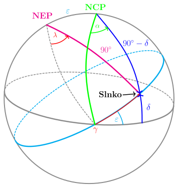
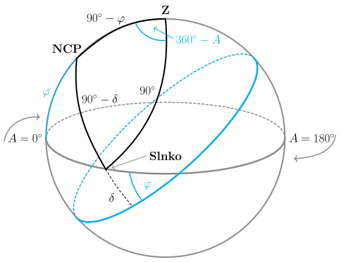

## Zadanie

Na americkej univerzite MIT sa nachádza dlhá hlavná chodba – *the Infinite Corridor*. Niekoľkokrát za rok sa stane, že sa Slnko na oblohe dostane presne do takej polohy, že presvieti cez presklené dvere a cez celú chodbu. Keďže je výhľad z východnej časti blokovaný inou budovou, tak tento úkaz nastáva iba pri západoch Slnka.

Pri pohľade z východného konca chodby sa stred jej západného konca nachádza na azimute $A = 245{,}81^{\circ}$ (azimut je meraný od severu smerom na východ). Dĺžka chodby je $l = 250\,\mathrm{m}$, výška je $h = 4\,\mathrm{m}$ a šírka $w = 2{,}75\,\mathrm{m}$. Súradnice MIT sú $\phi = 42{,}36^{\circ} \, \text{N}$ a $\lambda = 71{,}09^{\circ}\,\text{W}$. Uvažujte pozorovateľa s výškou $h_p=2\,\mathrm{m}$ stojaceho v strede východného konca chodby.

*V tejto úlohe zanedbajte atmosférickú refrakciu pri horizonte, excentricitu zemskej orbity a vplyv inklinácie zemskej osi na časovú rovnicu. Predpokladajte, že deklinácia Slnka sa počas dňa nemení.*

<ol type="a">

<li>

[5 b] Vypočítajte uhlové rozmery západného konca chodby pre tohto pozorovateľa.

</li>

<li>

[25 b] Odvoďte rovnicu závislosti deklinácie Slnka od dňa roka.

</li>

<li>

[25 b] Zistite, pre akú deklináciu bude Slnko zapadať na azimute $A$.

</li>

<li>

[35 b] Pomocou týchto vzťahov a hodnôt zistite, kedy nastane najbližší MIThenge, teda dátum, kedy má Slnko deklináciu určenú v podzadaní (c). Ďalej zistite čas, kedy v daný deň nastane západ Slnka. Bude sa vám hodiť vedieť, že jarná rovnodennosť nastala 20. marca 2026 a že sa MIT nachádza v časovom pásme EST, teda UTC-5.

</li>

</ol>

Riešenie

<ol type="a">

<li>

Na toto podzadanie nám stačí obyčajná planárna trigonometria; [5 b] 

$$
\begin{align*}
\text{uhlová výška:}&\quad 
    \alpha_h = 2\arctan\left(\frac{\linfrac{h}{2}}{l}\right) = \boxed{0{,}92^{\circ}} \,, \tag{1}\\
\text{uhlová šírka:}&\quad 
    \alpha_w = 2\arctan\left(\frac{\linfrac{w}{2}}{l}\right) = \boxed{0{,}63^{\circ}} \,. \tag{2}\end{align*}
$$

</li>

<li>

Na túto časť použijeme sférickú trigonometriu podľa nákresu na obr. 1. Vrcholy použitého sférického trojuholníka sú severný svetový pól (NCP), severný ekliptikálny pól (NEP) a Slnko. Veľkosti strán sú viditeľné na obrázku 1.

Nech $\lambda$ je ekliptikálna dĺžka Slnka (uhlová vzdialenosť od jarného bodu). Keďže nultý poludník ekliptikálnych súradníc prechádza jarným bodom, uhol pri vrchole NEP v našom trojuholníku je $A = 90^\circ - \lambda$. Dosadíme do kosínusovej vety pre sférický trojuholník 

$$
\cos(a) = \cos(b)\cos(c) + \sin(b)\sin(c)\cos(A) \,. \tag{3}
$$

<figure>

<figcaption>

**Obrázok 1:** Sférický trojuholník pre výpočet deklinácie Slnka. Vrcholy tvoria severný svetový pól (NCP), severný ekliptikálny pól (NEP) a samotné Slnko.
</figcaption>

</figure>

Po dosadení hodnôt ($a = 90^\circ - \delta$, $b = 90^\circ$, $c = \varepsilon$, $A = 90^\circ - \lambda$) dostaneme 

$$
\cos(90^\circ - \delta) = \cos(90^\circ)\cos(\varepsilon) + \sin(90^\circ)\sin(\varepsilon)\cos(90^\circ - \lambda) \,. \qquad\textit{[10\,b]} \tag{4}
$$

Výraz postupne upravíme s využitím goniometrických identít $\cos(90^\circ - x) = \sin(x)$, $\cos(90^\circ)=0$ a $\sin(90^\circ)=1$ 

$$
\sin(\delta) = 0 \cdot \cos(\varepsilon) + 1 \cdot \sin(\varepsilon)\sin(\lambda) \,, \tag{5}
$$

 

$$
\sin(\delta) = \sin(\varepsilon)\sin(\lambda) \,. \tag{6}
$$

Nakoniec vyjadríme výsledný vzťah pre deklináciu 

$$
\delta = \arcsin(\sin(\varepsilon)\sin(\lambda)) \,. \qquad\textit{[5\,b]} \tag{7}
$$

Keďže v zadaní je uvedené, aby sme zanedbali excentricitu zemskej orbity, uvažujeme, že Slnko sa z nášho pohľadu pohybuje po ekliptike konštantnou uhlovou rýchlosťou. Ekliptikálnu dĺžku $\lambda$ tak vieme vyjadriť ako lineárnu funkciu času 

$$
\lambda = \frac{360^\circ}{365,25} (N - N_V) \,, \qquad\textit{[5\,b]} \tag{8}
$$

kde $N$ je číslo dňa v roku a $N_V$ je deň jarnej rovnodennosti (kedy $\lambda = 0^\circ$).

Dosadením tohto vzťahu späť dostávame výslednú rovnicu 

$$
\delta = \boxed{\arcsin\left[ \sin(\varepsilon) \cdot \sin\left( \frac{360^\circ}{365,25} (N - N_V) \right) \right]} \,. \qquad\textit{[5\,b]} \tag{9}
$$

</li>

<li>

Nakreslíme si ďalší sférický trojuholník. Tu si musíme dať pozor na to, že sférické trojuholníky sa skladajú iba z hlavných kružníc (preto nemôžeme ako stranu použiť deklinačnú rovnobežku Slnka). Použijeme nautický sférický trojuholník na obr. 2, ktorého vrcholy sú severný svetový pól (NCP), zenit a Slnko na horizonte. Veľkosti strán trojuholníka sú zrejmé z obr. 2.

<figure>

<figcaption>

**Obrázok 2:** Nautický sférický trojuholník pri západe Slnka. Strany spájajú severný svetový pól, zenit a Slnko na horizonte.
</figcaption>

</figure>

Pre tento sférický trojuholník môžeme použiť sférickú kosínusovú vetu pre stranu $90^\circ - \delta$ 

$$
\cos(90^\circ - \delta) = \cos(90^\circ - \phi)\cos(90^\circ) + \sin(90^\circ - \phi)\sin(90^\circ)\cos(360^{\circ}-A) \,. \qquad\textit{[15\,b]} \tag{10}
$$

Vieme, že $\cos(90^\circ) = 0$, $\sin(90^\circ) = 1$ a $\cos(90^\circ - x) = \sin(x)$. Rovnicu teda môžeme prepísať do zjednodušeného tvaru 

$$
\sin(\delta) = \cos(\phi) \cdot \cos(A) \,. \qquad\textit{[5\,b]} \tag{11}
$$

Z toho si jednoducho vyjadríme sínus deklinácie $\delta$. Dosadíme hodnoty pre MIT ($\phi = 42,36^\circ$) a azimut stredovej osi chodby ($A = 245,81^\circ$) 

$$
\sin(\delta) = \cos(42,36^\circ) \cdot \cos(245,81^\circ) \approx 0,7389 \cdot (-0,4097) \approx -0,3027 \,, \tag{12}
$$

 

$$
\delta = \arcsin(-0,3027) \approx \boxed{ -17,62^\circ } \,. \qquad\textit{[5\,b]} \tag{13}
$$

</li>

<li>

Z predošlej časti vieme, že deklinácia by mala byť $\delta = -17,62^\circ$. Pre výpočet dátumov vyjadríme ekliptikálnu dĺžku $\lambda$ zo vzťahu, ktorý sme odvodili v časti (b) 

$$
\sin(\lambda) = \frac{\sin(\delta)}{\sin(\varepsilon)} \,. \qquad\textit{[5\,b]} \tag{14}
$$

 Po dosadení dostávame 

$$
\sin(\lambda) = \frac{\sin(-17,62^\circ)}{\sin(23,44^\circ)} \approx \frac{-0,3027}{0,3978} \approx -0,7609 \,, \tag{15}
$$

 pričom tento sínus zodpovedá dvom uhlom na ekliptike: [5 b]

- $\lambda_1 \approx 360^\circ - 49,54^\circ = 310,46^\circ$ ,

- $\lambda_2 \approx 180^\circ + 49,54^\circ = 229,54^\circ$ .

Pomocou rovnice z časti (b) vieme zistiť, koľko dní po jarnej rovnodennosti sa bude slnko nachádzať na daných ekliptikálnych dĺžkach 

$$
\Delta N = \lambda \frac{365,25}{360^\circ} \,. \tag{16}
$$

Pre $\lambda_1$ a $\lambda_2$ dostávame hodnoty: $\Delta N_1 \approx 315$ a $\Delta N_2 \approx 233$.

Vidíme, že skôr nastane $\lambda_2$, a vieme dopočítať, že to bude . [5 b]

Následne pre výpočet času západu Slnka určíme hodinový uhol $H$. Využijeme nautický trojuholník z predošlej časti. Hodinový uhol $H$ zodpovedá v tomto trojuholníku uhlu pri severnom svetovom póle. Použijeme sférickú kosínusovú vetu pre stranu medzi zenitom a Slnkom (ktorej dĺžka je pri západe $90^\circ$) 

$$
\cos(90^\circ) = \cos(90^\circ - \phi)\cos(90^\circ - \delta) + \sin(90^\circ - \phi)\sin(90^\circ - \delta)\cos(H) \,. \tag{17}
$$

Keďže $\cos(90^\circ) = 0$, $\cos(90^\circ - x) = \sin(x)$ a $\sin(90^\circ - x) = \cos(x)$, rovnicu upravíme do tvaru 

$$
0 = \sin(\phi)\sin(\delta) + \cos(\phi)\cos(\delta)\cos(H) \,. \tag{18}
$$

 Z toho priamo vyplýva známy vzťah pre hodinový uhol pri západe 

$$
\cos(H) = -\frac{\sin(\phi)\sin(\delta)}{\cos(\phi)\cos(\delta)} = -\tan(\phi)\tan(\delta) \,. \qquad\textit{[5\,b]} \tag{19}
$$

 odkiaľ po dosadení dostaneme 

$$
\cos(H) = -\tan(42,36^\circ)\tan(-17,62^\circ) \approx -(0,9119)(-0,3176) \approx 0,2896 \,, \tag{20}
$$

 

$$
H \approx 73,16^\circ \,. \tag{21}
$$

Keďže Zem rotuje rýchlosťou $15,00^\circ = \frac{360^\circ}{24\text{ h}}$ za hodinu, čas uplynutý od pravého slnečného poludnia je 

$$
t_H = \frac{73,16^\circ}{15^\circ/\text{h}} \approx 4,877~\text{h} \approx 4~\text{h}~52~\text{min}~38~\text{s} \,. \qquad\textit{[5\,b]} \tag{22}
$$

Pravé slnečné poludnie na MIT však nenastáva presne o 12:00, pretože univerzita neleží na centrálnom poludníku svojho časového pásma. Pásmo EST (UTC-5) má referenčný poludník $75^\circ~\text{W}$. Keďže MIT leží na $\lambda_{MIT} = 71,09^\circ~\text{W}$, nachádza sa o $3,91^\circ$ východnejšie. Slnko tam teda kulminuje skôr o $\Delta t$ 

$$
\Delta t = \frac{3,91^\circ}{15^\circ/\text{h}} \approx 0,2607~\text{h} \approx 15~\text{min}~38~\text{s} \,. \qquad\textit{[5\,b]} \tag{23}
$$

Takže pravé slnečné poludnie nastane o $12:00:00 - 00:15:38 = \text{11:44:22 EST}$.

Výsledný čas západu Slnka v tento deň je teda 

$$
t_{\text{zapad}} = 11:44:22 + 4:52:38 = \boxed{ \textbf{16:37:00 EST} } \,. \qquad\textit{[5\,b]} \tag{24}
$$

</li>

</ol>

*Poznámka: Ak sa pozrieme na presné predpovede na stránke MIT, tak zistíme, že sa náš výpočet sekol o približne 3 dni. To je spôsobené viacerými faktormi, ktoré sme v zadaní pre jednoduchosť zanedbali (najmä ohyb svetla v atmosfére, excentricita zemskej orbity, či nepresnosti s uvažovaním, že slnko bude na horizonte). Detailné informácie, merania a presné predpovede viete nájsť na <https://web.mit.edu/planning/www/mithenge.html>.*

