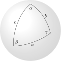

<table>
<tbody>
<tr>
<td colspan="4" style="text-align: left;"><strong>Základné konštanty</strong></td>
</tr>
<tr>
<td style="text-align: left;">rýchlosť svetla vo vákuu</td>
<td style="text-align: right;">c</td>
<td style="text-align: center;">=</td>
<td style="text-align: left;">2{,}998 \cdot 10^{8}\,\mathrm{m}\,{\mathrm{s}}^{-1}</td>
</tr>
<tr>
<td style="text-align: left;">gravitačná konštanta</td>
<td style="text-align: right;">G</td>
<td style="text-align: center;">=</td>
<td style="text-align: left;">6{,}674 \cdot 10^{-11}\,{\mathrm{m}}^{3}\,{\mathrm{kg}}^{-1}\,{\mathrm{s}}^{-2}</td>
</tr>
<tr>
<td style="text-align: left;">elementárny elektrický náboj</td>
<td style="text-align: right;">e</td>
<td style="text-align: center;">=</td>
<td style="text-align: left;">1{,}602 \cdot 10^{-19}\,\mathrm{C}</td>
</tr>
<tr>
<td style="text-align: left;">Coulombova konštanta</td>
<td style="text-align: right;">k_e</td>
<td style="text-align: center;">=</td>
<td style="text-align: left;">8{,}988 \cdot 10^{9}\,{\mathrm{m}}^{3}\,\mathrm{kg}\,{\mathrm{s}}^{-2}\,{\mathrm{C}}^{-2}</td>
</tr>
<tr>
<td style="text-align: left;">Planckova konštanta</td>
<td style="text-align: right;">h</td>
<td style="text-align: center;">=</td>
<td style="text-align: left;">6{,}626 \cdot 10^{-34}\,\mathrm{J}\,\mathrm{s}</td>
</tr>
<tr>
<td style="text-align: left;">univerzálna plynová konštanta</td>
<td style="text-align: right;">\bar{R}</td>
<td style="text-align: center;">=</td>
<td style="text-align: left;">8{,}314\,\mathrm{J}\,{\mathrm{K}}^{-1}\,{\mathrm{mol}}^{-1}</td>
</tr>
<tr>
<td style="text-align: left;">Boltzmannova konštanta</td>
<td style="text-align: right;">k_B</td>
<td style="text-align: center;">=</td>
<td style="text-align: left;">1{,}381 \cdot 10^{-23}\,\mathrm{J}\,{\mathrm{K}}^{-1}</td>
</tr>
<tr>
<td style="text-align: left;">Stefanova-Boltzmannova konštanta</td>
<td style="text-align: right;">\sigma</td>
<td style="text-align: center;">=</td>
<td style="text-align: left;">5{,}670 \cdot 10^{-8}\,\mathrm{W} . \mathrm{m}^{-2} . \mathrm{K}^{-4}</td>
</tr>
<tr>
<td style="text-align: left;">Wienova posunovacia konštanta</td>
<td style="text-align: right;">b</td>
<td style="text-align: center;">=</td>
<td style="text-align: left;">2{,}898 \cdot 10^{-3}\,\mathrm{m}\,\mathrm{K}</td>
</tr>
<tr>
<td style="text-align: left;">Hubblova konštanta</td>
<td style="text-align: right;">H_0</td>
<td style="text-align: center;">=</td>
<td style="text-align: left;">70\,\mathrm{km}\,{\mathrm{s}}^{-1}\,{\mathrm{Mpc}}^{-1}</td>
</tr>
<tr>
<td style="text-align: left;"></td>
<td style="text-align: right;"></td>
<td style="text-align: center;"></td>
<td style="text-align: left;"></td>
</tr>
<tr>
<td colspan="4" style="text-align: left;"><strong>Astronomické jednotky</strong></td>
</tr>
<tr>
<td style="text-align: left;">stredný slnečný deň</td>
<td style="text-align: right;">\mathrm{deň}</td>
<td style="text-align: center;">=</td>
<td style="text-align: left;">24\,\mathrm{h}</td>
</tr>
<tr>
<td style="text-align: left;">siderický (hviezdny) deň</td>
<td style="text-align: right;">t_\Ea</td>
<td style="text-align: center;">=</td>
<td style="text-align: left;">23\,\mathrm{h}\;56\,\mathrm{min}\;4{,}1\,\mathrm{s}</td>
</tr>
<tr>
<td style="text-align: left;">juliánsky rok</td>
<td style="text-align: right;">\mathrm{rok}</td>
<td style="text-align: center;">=</td>
<td style="text-align: left;">365{,}25\,\mathrm{dní}</td>
</tr>
<tr>
<td style="text-align: left;">siderický rok</td>
<td style="text-align: right;">\mathit{P}_\Ea</td>
<td style="text-align: center;">=</td>
<td style="text-align: left;">365{,}2564\,\mathrm{dní}</td>
</tr>
<tr>
<td style="text-align: left;">tropický rok</td>
<td style="text-align: right;">\mathit{P}_\Ea^{\mathrm{trop}}</td>
<td style="text-align: center;">=</td>
<td style="text-align: left;">365{,}2422\,\mathrm{dní}</td>
</tr>
<tr>
<td style="text-align: left;">anomalistický rok</td>
<td style="text-align: right;">\mathit{P}_\Ea^{\mathrm{anom}}</td>
<td style="text-align: center;">=</td>
<td style="text-align: left;">365{,}2596\,\mathrm{dní}</td>
</tr>
<tr>
<td style="text-align: left;">astronomická jednotka</td>
<td style="text-align: right;">\au</td>
<td style="text-align: center;">=</td>
<td style="text-align: left;">1{,}496 \cdot 10^{11}\,\mathrm{m}</td>
</tr>
<tr>
<td style="text-align: left;">svetelný rok</td>
<td style="text-align: right;">\ly</td>
<td style="text-align: center;">=</td>
<td style="text-align: left;">9{,}461 \cdot 10^{15}\,\mathrm{m}</td>
</tr>
<tr>
<td style="text-align: left;">parsek</td>
<td style="text-align: right;">\pc</td>
<td style="text-align: center;">=</td>
<td style="text-align: left;">3{,}086 \cdot 10^{16}\,\mathrm{m}</td>
</tr>
<tr>
<td style="text-align: left;">Jansky</td>
<td style="text-align: right;">Jy</td>
<td style="text-align: center;">=</td>
<td style="text-align: left;">10^{-26}\,\mathrm{W}\,{\mathrm{m}}^{-2}\,{\mathrm{Hz}}^{-1}</td>
</tr>
<tr>
<td style="text-align: left;"></td>
<td style="text-align: right;"></td>
<td style="text-align: center;"></td>
<td style="text-align: left;"></td>
</tr>
<tr>
<td style="text-align: left;"><strong>Slnko</strong></td>
<td style="text-align: right;"></td>
<td style="text-align: center;"></td>
<td style="text-align: left;"></td>
</tr>
<tr>
<td style="text-align: left;">hmotnosť Slnka</td>
<td style="text-align: right;">\mathcal{M}_\Sun</td>
<td style="text-align: center;">=</td>
<td style="text-align: left;">1{,}989 \cdot 10^{30}\,\mathrm{kg}</td>
</tr>
<tr>
<td style="text-align: left;">polomer Slnka</td>
<td style="text-align: right;">R_\Sun</td>
<td style="text-align: center;">=</td>
<td style="text-align: left;">6{,}957 \cdot 10^{8}\,\mathrm{m}</td>
</tr>
<tr>
<td style="text-align: left;">svietivosť (žiarivý výkon) Slnka</td>
<td style="text-align: right;">\mathit{L}_\Sun</td>
<td style="text-align: center;">=</td>
<td style="text-align: left;">3{,}828 \cdot 10^{26}\,\mathrm{W}</td>
</tr>
<tr>
<td style="text-align: left;">povrchová (efektívna) teplota Slnka</td>
<td style="text-align: right;">\mathit{T}_\Sun</td>
<td style="text-align: center;">=</td>
<td style="text-align: left;">5772\,\mathrm{K}</td>
</tr>
<tr>
<td style="text-align: left;">farebná teplota Slnka</td>
<td style="text-align: right;">\mathit{T}_\Sun^{\mathrm{color}}</td>
<td style="text-align: center;">=</td>
<td style="text-align: left;">5900\,\mathrm{K}</td>
</tr>
<tr>
<td style="text-align: left;">zdanlivá vizuálna magnitúda Slnka</td>
<td style="text-align: right;">m_\Sun</td>
<td style="text-align: center;">=</td>
<td style="text-align: left;">-26{,}74\,\mathrm{mag}</td>
</tr>
<tr>
<td style="text-align: left;">zdanlivá bolometrická magnitúda Slnka</td>
<td style="text-align: right;">m_{\Sun}^{\mathrm{bol}}</td>
<td style="text-align: center;">=</td>
<td style="text-align: left;">-26{,}83\,\mathrm{mag}</td>
</tr>
<tr>
<td style="text-align: left;">absolútna vizuálna magnitúda Slnka</td>
<td style="text-align: right;">M_{\Sun}</td>
<td style="text-align: center;">=</td>
<td style="text-align: left;">4{,}83\,\mathrm{mag}</td>
</tr>
<tr>
<td style="text-align: left;">absolútna bolometrická magnitúda Slnka</td>
<td style="text-align: right;">M_{\Sun}^{\mathrm{bol}}</td>
<td style="text-align: center;">=</td>
<td style="text-align: left;">4{,}74\,\mathrm{mag}</td>
</tr>
<tr>
<td style="text-align: left;"></td>
<td style="text-align: right;"></td>
<td style="text-align: center;"></td>
<td style="text-align: left;"></td>
</tr>
<tr>
<td style="text-align: left;"><strong>Planéty</strong></td>
<td style="text-align: right;"></td>
<td style="text-align: center;"></td>
<td style="text-align: left;"></td>
</tr>
<tr>
<td style="text-align: left;">excentricita dráhy Zeme</td>
<td style="text-align: right;">e_\Ea</td>
<td style="text-align: center;">=</td>
<td style="text-align: left;">0{,}0167</td>
</tr>
<tr>
<td style="text-align: left;">inklinácia rotačnej osi Zeme</td>
<td style="text-align: right;">\varepsilon</td>
<td style="text-align: center;">=</td>
<td style="text-align: left;">23^{\circ}\,26'</td>
</tr>
<tr>
<td style="text-align: left;">Tiažové zrýchlenie na povrchu Zeme</td>
<td style="text-align: right;">g</td>
<td style="text-align: center;">=</td>
<td style="text-align: left;">9{,}8\,\mathrm{m}\,{\mathrm{s}}^{-2}</td>
</tr>
<tr>
<td style="text-align: left;"></td>
<td style="text-align: right;"></td>
<td style="text-align: center;"></td>
<td style="text-align: left;"></td>
</tr>
<tr>
<td style="text-align: left;"></td>
<td style="text-align: right;"></td>
<td style="text-align: center;"></td>
<td style="text-align: left;"></td>
</tr>
<tr>
<td style="text-align: left;"><strong>Mesiac</strong></td>
<td style="text-align: right;"></td>
<td style="text-align: center;"></td>
<td style="text-align: left;"></td>
</tr>
<tr>
<td style="text-align: left;">polomer Mesiaca</td>
<td style="text-align: right;">R_\Mo</td>
<td style="text-align: center;">=</td>
<td style="text-align: left;">1737\,\mathrm{km}</td>
</tr>
<tr>
<td style="text-align: left;">hmotnosť Mesiaca</td>
<td style="text-align: right;">\mathcal{M}_\Mo</td>
<td style="text-align: center;">=</td>
<td style="text-align: left;">7{,}346 \cdot 10^{22}\,\mathrm{kg}</td>
</tr>
<tr>
<td style="text-align: left;">veľká polos dráhy Mesiaca</td>
<td style="text-align: right;">a_\Mo</td>
<td style="text-align: center;">=</td>
<td style="text-align: left;">3{,}844 \cdot 10^{8}\,\mathrm{m}</td>
</tr>
<tr>
<td style="text-align: left;">siderická obežná doba Mesiaca</td>
<td style="text-align: right;">P_{\Mo}</td>
<td style="text-align: center;">=</td>
<td style="text-align: left;">27{,}32\,\mathrm{dní}</td>
</tr>
<tr>
<td style="text-align: left;">synodická obežná doba Mesiaca</td>
<td style="text-align: right;">S_{\Mo}</td>
<td style="text-align: center;">=</td>
<td style="text-align: left;">29{,}53\,\mathrm{dní}</td>
</tr>
<tr>
<td style="text-align: left;">inklinácia dráhy Mesiaca voči ekliptike</td>
<td style="text-align: right;">i_\Mo</td>
<td style="text-align: center;">=</td>
<td style="text-align: left;">5^{\circ}\,8'</td>
</tr>
<tr>
<td style="text-align: left;">excentricita dráhy Mesiaca</td>
<td style="text-align: right;">e_\Mo</td>
<td style="text-align: center;">=</td>
<td style="text-align: left;">0{,}0549</td>
</tr>
<tr>
<td style="text-align: left;">zdanlivá vizuálna magnitúda Mesiaca v splne</td>
<td style="text-align: right;">m_\Mo</td>
<td style="text-align: center;">=</td>
<td style="text-align: left;">-12{,}74\,\mathrm{mag}</td>
</tr>
<tr>
<td style="text-align: left;"></td>
<td style="text-align: right;"></td>
<td style="text-align: center;"></td>
<td style="text-align: left;"></td>
</tr>
<tr>
<td style="text-align: left;"></td>
<td style="text-align: right;"></td>
<td style="text-align: center;"></td>
<td style="text-align: left;"></td>
</tr>
<tr>
<td colspan="4" style="text-align: left;"><strong>Vzťahy pre sférický trojuholník</strong></td>
</tr>
<tr>
<td style="text-align: left;"></td>
<td colspan="3" rowspan="7" style="text-align: center;"></td>
</tr>
<tr>
<td style="text-align: left;"></td>
</tr>
<tr>
<td style="text-align: left;"></td>
</tr>
<tr>
<td style="text-align: left;"></td>
</tr>
<tr>
<td style="text-align: left;"></td>
</tr>
<tr>
<td style="text-align: left;">0119ZZ</td>
</tr>
<tr>
<td style="text-align: left;">\phantom{E} = \text{plocha trojuholníka na jednotkovej sfére.}</td>
</tr>
<tr>
<td style="text-align: left;"></td>
<td style="text-align: right;"></td>
<td style="text-align: center;"></td>
<td style="text-align: left;"></td>
</tr>
<tr>
<td style="text-align: left;"></td>
<td style="text-align: right;"></td>
<td style="text-align: center;"></td>
<td style="text-align: left;"></td>
</tr>
<tr>
<td colspan="4" style="text-align: left;"><strong>Vzťahy pre elementy dráhy</strong></td>
</tr>
<tr>
<td colspan="4" style="text-align: left;"><table>
<tbody>
<tr>
<td style="text-align: left;">polárna rovnica kužeľosečky:</td>
<td style="text-align: left;">r = \frac{p}{1+e\cos\nu} \a p = \frac{L^2}{GM m^2} = a(1-e^2)</td>
</tr>
<tr>
<td style="text-align: left;">stredná anomália:</td>
<td style="text-align: left;">M = \big(t-t_0\big) \, \sqrt{\frac{GM}{p^3} \big(1-e^2\big)^3} = 2\pi \, \frac{t-t_0}{P}</td>
</tr>
<tr>
<td style="text-align: left;">Keplerova rovnica pre elipsu:</td>
<td style="text-align: left;">M = E - e \sin{E} \a \tan\! \frac{E}{2} = \sqrt{\frac{1-e}{1+e}} \, \tan\! \frac{\nu}{2}</td>
</tr>
<tr>
<td style="text-align: left;">Barkerova rovnica pre parabolu:</td>
<td style="text-align: left;">t-t_0 = \frac{1}{2} \, \sqrt{\frac{p^3}{GM}} \, \left( \tan\! \frac{\nu}{2} + \frac{1}{3} \tan^3 \!\frac{\nu}{2} \right)</td>
</tr>
<tr>
<td style="text-align: left;">Keplerova rovnica pre hyperbolu:</td>
<td style="text-align: left;">M = e \sinh F - F \a \tanh \!\frac{F}{2} = \sqrt{\frac{e-1}{e+1}} \, \tan\! \frac{\nu}{2}</td>
</tr>
</tbody>
</table></td>
</tr>
</tbody>
</table>
