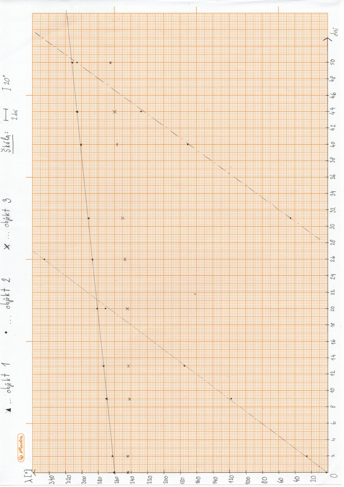
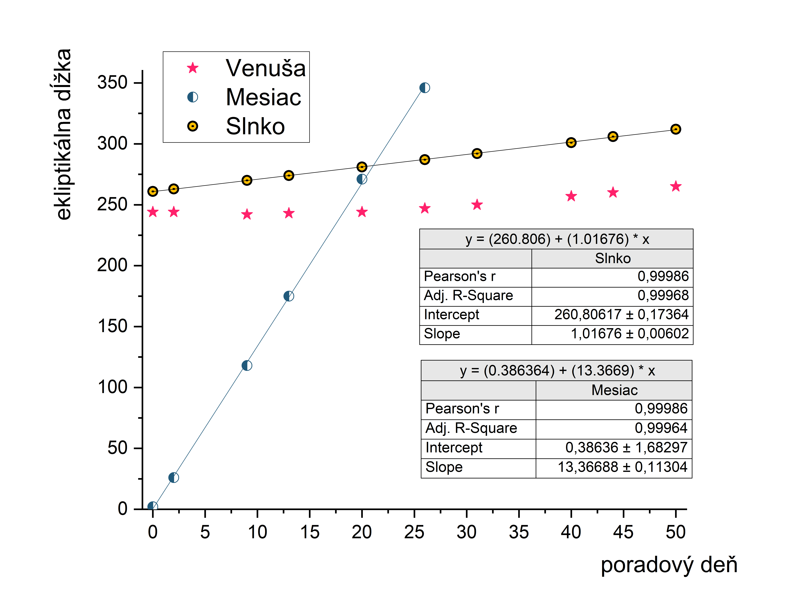

## Zadanie

Hypatia z Alexandrie, novoplatónska filozofka, matematička a astronómka, žijúca na prelome 4. a 5. storočia, sa významne zaslúžila o rozvoj vedy a šírenie vzdelania v starovekom Grécku. Jej najvýznamnejším počinom v astronómii bolo komentovanie a úprava Ptolemaiovho diela Almagest, ako aj práca s astrolábom a mapovanie nebeských objektov s jeho pomocou.

c\|c\|c\|c **poradové číslo** & **ekliptikálna**\
**pozorovania** &\
**v dňoch** & $\lambda_1$ & $\lambda_2$ & $\lambda_3$\
& $261^{\circ}$ & $2^{\circ}$ & $244^{\circ}$\
2 & $263^{\circ}$ & $26^{\circ}$ & $244^{\circ}$\
9 & $270^{\circ}$ & $118^{\circ}$ & $242^{\circ}$\
13 & $274^{\circ}$ & $175^{\circ}$ & $243^{\circ}$\
20 & $281^{\circ}$ & $271^{\circ}$ & $244^{\circ}$\
26 & $287^{\circ}$ & $346^{\circ}$ & $247^{\circ}$\
31 & $292^{\circ}$ & $46^{\circ}$ & $250^{\circ}$\
40 & $301^{\circ}$ & $171^{\circ}$ & $257^{\circ}$\
44 & $306^{\circ}$ & $228^{\circ}$ & $260^{\circ}$\
50 & $312^{\circ}$ & $306^{\circ}$ & $265^{\circ}$\

Predstavte si, že ste žiakom Hypatie z Alexandrie a spoločne spracovávate tabuľky pohybov nebeských objektov, ktoré iní jej žiaci namerali astrolábom. Stala sa však nešťastná udalosť! Tri zvitky sa pomiešali, a tak dostávate za úlohu zistiť, ktorý zvitok patrí ktorému nebeskému telesu. Viete, že to má byť Slnko, Mesiac a blúdiaca planéta Venuša, v starovekom Grécku nazývaná po bohyni Afrodite. V tabuľke 1 je prepis toho, čo ste vyčítali zo zvitku. Sú to hodnoty ekliptikálnych dĺžok troch objektov z pozorovaní astrolábom. V niektorých dňoch nemohlo nastať pozorovanie kvôli nepriaznivým podmienkam alebo bol zvitok na niektorých miestach poškodený. Pozorovania sa uskutočňovali v daný deň vždy v rovnakú hodinu.

<ol type="a">

<li>

[40 b] Na milimetrový papier ručne vyneste grafy závislosti ekliptikálnej dĺžky na čase pre dané tri objekty.

</li>

<li>

[10 b] Všetky grafy, ktoré vykazujú jasnú lineárnu závislosť, preložte ručne pomocou pravítka čo najvhodnejšou priamkou alebo dvojicou priamok. Jeden objekt priamkou (priamkami) preložiť nepôjde.

</li>

</ol>

<ol type="a" start="3">

<li>

[20 b] Určte smernice preložených priamok. Smernica je koeficient $A$ v rovnici priamky $y = Ax + B$. Viete ju zistiť buď pomocou priameho odčítania z grafu, alebo pomocou štatistického módu na kalkulačke. Chybu nájdenej smernice určovať nemusíte.

</li>

<li>

[30 b] Na základe dát a určených smerníc pomôžte Hypatii zistiť, ktorý objekt je ktorý. Komentujte svoj postup a rozhodnutie.

</li>

</ol>

Ak si nie ste istí, ako postupovať pri podobnom type úloh, odporúčame pozrieť sa na odkaz [www.datova-analyza.aosk.eu](https://www.datova-analyza.aosk.eu) či do materiálu Astronomickej olympiády o [Dátovej analýze](https://www.astronomickaolympiada.sk/wp-content/uploads/2025/04/Dodovky_poznamky-1.pdf), ktorú viete nájsť na našej stránke [www.aosk.sk/materialy](https://www.astronomickaolympiada.sk/materialy/). Dátové analýzy so vzorovými riešeniami z minulých rokov taktiež nájdete na stránke Astronomickej olympiády na odkaze [www.aosk.sk/archiv-uloh](https://www.astronomickaolympiada.sk/ulohy/archiv-uloh/).

Riešenie

<ol type="a">

<li>

V tejto úlohe nemusíme spraviť nič iné, ako vziať hodnoty z tabuľky 1 a načrtnúť ich na milimetrový papier. Máme spraviť graf závislosti ekliptikálnej dĺžky na čase, čo znamená, že na vodorovnú os budeme nanášať časy pozorovania a na zvislú os hodnoty ekliptikálnej dĺžky (túto os nazveme $\lambda$, pretože veličina ekliptikálna dĺžka sa zvyčajne takto označuje).

Ako prvé je vhodné si určiť rozpätie, na akom budeme nanášať hodnoty. To je potrebné na to, aby sa nám nestalo to, že sa niektoré hodnoty nezmestia na graf. Z tabuliek 1 vidíme, že najmenšia hodnota ekliptikálnej dĺžky sú $2^{\circ}$ a najväčšia $346^{\circ}$. Čiže zvislá os bude v rozmedzí $\langle 0^{\circ}, 350^{\circ} \rangle$. Obdobne pre vodorovnú os vidíme, že je v rozmedzí $\langle 0\,\mathrm{dní} \,, 50\,\mathrm{dní} \rangle$. [5 b]

Ďalej je potrebné určiť mierku osí. Použili sme štandardný milimetrový papier, zobrazený na obrázku 1. Aby sme využili čo najviac z grafovacej plochy, tak sme pre zvislý smer zvolili mierku jeden dielik = $20^{\circ}$ a pre vodorovný smer jeden dielik = 2 dni. [5 b]

Pri vynášaní hodnôt do grafu treba postupovať čo najpresnejšie a nepomýliť sa, lebo inak by nám to negatívne ovplyvnilo výsledky ďalších podzadaní [30 b]. Hodnoty zo všetkých troch stĺpcov tabuľky 1 sme pre názornosť nakreslili do jednotného grafu 1, no nebolo by chybou ich pre prehľadnosť nanášať aj na tri rozdielne milimetrové papiere.

</li>

<li>

Teraz sme všetky naše tri grafy preložili vhodnou krivkou [5 b]. Vidíme, že pre objekt 1 a 2 to nebolo problematické, lebo sme ich grafy prekladali jednoducho priamkou pre objekt 1 a dvomi priamkami pre objekt 2. To sa robí takpovediac od oka – treba si priložiť pravítko k nameraným hodnotám a čo najpresnejšie sa pokúsiť spraviť priamku tak, aby každý bod bol čo najbližšie k nej. Matematicky sa tento postup nazýva metóda najmenších štvorcov, alebo tiež lineárna regresia.

Pre objekt 3 sme však tento postup aplikovať nemohli, pretože body očividne neležia na priamke – závislosť ekliptikálnej dĺžky $\lambda$ na čase $t$ sa správa podivne – ekliptikálna dĺžka najprv jemne klesá a potom zrazu začne narastať. O správaní tohto objektu sa pozrieme bližšie vo štvrtom podzadaní. Tento graf sme prekladať krivkou nemuseli. [5 b]

<figure>

<figcaption>

**Obrázok 1:** Ručné vynesenie hodnôt z tabuľky 1 na milimetrový papier a fitovanie.
</figcaption>

</figure>

</li>

<li>

Je dôležité nielen nakresliť danú priamku, ale aj určiť jej predpis – rovnicu, ktorá ju popisuje. Takýmto spôsobom vedci prichádzajú na závislosti medzi veličinami z pozorovaní či experimentov a vedia im potom priradiť presne určený vzorec. Na určenie rovnice priamky vo všeobecnom tvare 

$$
y = Ax + B \tag{1}
$$

 si musíme rozmyslieť, čo sme vlastne vynášali do grafu. Bola to závislosť ekliptikálnej dĺžky $\lambda$ na čase $t$. Ako aj máme vyznačené v grafoch, tak zvislá os, všeobecne označovaná ako os y, zobrazuje ekliptikálne dĺžky $\lambda$ a vodorovná os, označovaná ako os $x$, zodpovedá poradovým číslam pozorovania v dňoch, čiže časovým úsekom $t$.

Rovnica priamky nám tým pádom prejde na tvar 

$$
\lambda = At + B \,. \qquad\textit{[2\,b]} \tag{2}
$$

Písmená A a B značia konštanty, ktoré v tejto úlohe máme zistiť: A je sklon danej priamky (smernica) a B posunutie na zvislej osi. Najideálnejšie je ich zistiť pomocou kalkulačky. Tá má totiž v sebe už priamo zabudovaný štatistický mód, v ktorom si vieme vybrať rovnicu priamky ako náš fit a následne do tabuľky, ktorá sa zobrazí, nahádzať hodnoty $\lambda$ a $t$. Kalkulačka sama zvládne vyčísliť hodnoty A a B, a teda určiť výslednú rovnicu priamky.

Pri objekte 2 si však musíme dávať pozor, pretože ten je rozdelený na dve krivky. My však chceme predpis pre jednu priamku. Preto si musíme predstaviť, že v bode, kedy sa z $360^{\circ}$ stáva $0^{\circ}$ priamka pokračuje a od siedmej hodnoty v tabuľke 1 sa k hodnotám ekliptikálnych dĺžok pripočítava $360^{\circ}$.

Dostávame tak rovnice priamok pre objekt 1 a objekt 2 ako 

$$
\begin{align*}
    \lambda_1 &= 1,02 \cdot t + 260,8 \,, \tag{3}\\
    \lambda_2 &= 13,3 \cdot t + 0,4 \,. \tag{4}\end{align*}
$$

 Čiže nám smernice daných telies vyšli ako $\boxed{A_{1} = 1,02}$ a $\boxed{A_{2} = 13,3}$. [18 b]

Ak by sme túto úlohu riešili bez kalkulačky, nedáva veľký zmysel riešiť ju pre všetky hodnoty $\lambda$ a $t$, pretože by to bolo príliš komplikované a zdĺhavé. Rozumnejšie je si zobrať nejaké dva body na našej priamke a následne vypočítať smernicu $A$ ako 

$$
A = \frac{y_2 - y_1}{x_2 - x_1} \,. \tag{5}
$$

 Spravidla sa vyberajú body, ktoré sa nachádzajú na začiatku a konci grafu priamky, čiže by sme si pre objekt 1 mohli zvoliť bod \[$x_1$, $y_1$\] = \[$10\,\mathrm{dní}$, $270^{\circ}$\] a bod \[$x_2$, $y_2$\] = \[$46\,\mathrm{dní}$, $308^{\circ}$\], ktoré na odčítanie z grafu vyzerajú najprijateľnejšie. Po vyčíslení dostávame, že $\boxed{A_1 \doteq 1}$.

Pre objekt 2 máme body \[$x_1$, $y_1$\] = \[$15\,\mathrm{dní}$, $200^{\circ}$\] a \[$x_2$, $y_2$\] = \[$46\,\mathrm{dní}$, $250^{\circ}+360^{\circ} = 610^{\circ}$\], čím nám obdobným postupom vyšla hodnota smernice $\boxed{A_2 \doteq 13}$. [18 b]

Vidíme, že tieto rovnice priamok vychádzajú podobne ako pri prvom postupe, no menej presne. Hoci nám hodnoty A a B vyšli na viac desatinných miest, kvôli veľkej nepresnosti si nemôžeme dovoliť v tomto postupe vyjadriť náš výsledok na viac ako celé číslo. Existuje tu totiž veľká chyba, pretože ak by sme priamku nakreslili len o trochu ináč, vyšiel by nám iný výsledok. Tento postup preto nebol nesprávny, no bolo by hrubou chybou napísať hodnoty A a B príliš presne (na viac ako 2 platné cifry). V praxi platí, že čím viac nameraných dát máme, tým lepšie, pretože tým vieme lepšie preložiť dané dáta teoretickou závislosťou. Preto je lepšie použiť kalkulačku a metódu lineárnej regresie zo všetkých nameraných hodnôt.

Pre objekt 3 tento postup uplatniť nejde, a tak sa vyjadrením závislosti ekliptikálnej dĺžky na čase pre tento objekt nemusíme zaoberať. Až v ďalšom podzadaní okomentujeme, prečo je tento objekt taký špeciálny.

</li>

<li>

Zo zadanie vieme, že dané závislosti by mali odpovedať Slnku, Mesiacu a Venuši. Ako však priradiť tieto telesá slnečnej sústavy k neznámym objektom 1, 2 a 3?

Začnime objektom 3, ktorý bol tak rozdielny ako ostatné dva prípady. Prečo bol odlišný? Nuž, vidíme, že jeho závislosť nebola ani zďaleka lineárna. Zo začiatku sa jeho ekliptikálne dĺžky zmenšovali a následne opäť zväčšovali. Ekliptikálna dĺžka zodpovedá pohybu telesa pozdĺž ekliptiky. Toto zvláštne správanie objektu 3, kedy sa začal na oblohe doslova pohybovať opačným smerom, nemohlo byť nič iné ako retrográdny pohyb. A ten, ako vieme, je z geometrických dôvodov daný len planétam. Vďaka tomuto argumentu vieme s istotou povedať, že zvláštnym objektom 3 bola planéta Venuša. [10 b]

Pre objekty 1 a 2 vyšla ako krivka priamka s vyššie vypočítanými predpismi. Z ostávajúcich telies si musíme vybrať, v ktorom prípade sa jedná o Mesiac a v ktorom o Slnko. Jednou zo zvláštností, ktoré sme si mohli všimnúť pri objekte 2 je to, že v istú dobu prekročí hranicu ekliptikálnej dĺžky $360^{\circ}$, a to práve po niečo vyše 26 dňoch. Opäť, ekliptikálna dĺžka meria uhlovú vzdialenosť objektu pozdĺž roviny ekliptiky, takže sa pýtame, ktoré vesmírne teleso vykoná za niečo vyše 26 dní jednu otočku okolo Zeme? To nám hneď implikuje siderickú dobu obehu Mesiaca okolo Zeme, ktorá je rovná $27{,}32\,\mathrm{dní}$. Tým pádom vieme povedať, že objektom 2 je Mesiac a vylučovacou metódou je zvyšný objekt 1 Slnko. [10 b]

Ak by sme sa však ešte pozreli na sklon v grafoch objektu 1 a 2, všimli by sme si, že objekt 2 má omnoho väčší sklon priamky ako objekt 1, čo znamená, že ekliptikálna dĺžka pre objekt 2 rastie s časom rýchlejšie ako pre objekt 1. Opäť-opäť, ak ekliptikálnu dĺžku berieme ako uhlovú vzdialenosť objektu pozdĺž roviny ekliptiky, tak ktoré teleso sa pohybuje pozdĺž ekliptity rýchlejšie? Mesiac alebo Slnko? Rozhodne Mesiac, pretože sa nachádza bližšie k Zemi a jeho obežná doba (siderická) je omnoho menšia ako jeden celý rok. Zdanlivý pohyb Slnka po ekliptike totiž odráža skutočný pohyb Zeme okolo Slnka. Keďže Zemi trvá celý rok, kým dokončí svoj obeh, jeho uhlová rýchlosť je veľmi pomalá (necelý $1^{\circ}$ za deň). Dostávame tak, že objekt 1 je Slnko, objekt 2 je Mesiac a objekt 3 je Venuša.

Pre Slnko a Mesiac vieme napísať lineárne rovnice pre ekliptikálnu dĺžku v závislosti na čase 

$$
\begin{align*}
    \lambda_{\Sun}  &= 1,02 \cdot t + 260,8 \,, \tag{6}\\
    \lambda_{\Mo} &=  13,3 \cdot t + 0,4 \,. \tag{7}\end{align*}
$$

 Na porovnanie prikladáme aj fit zo softvéru Origin (vedecká alternatíva excelu). Origin má oproti bežnej kalkulačke vyššiu presnosť, používa zložitejšie algoritmy na výpočet (napríklad dokáže vážiť hodnoty podľa ich chýb – odchýlok v meraní) a vie určiť aj chybu fitovaných koeficientov, konkrétne 

$$
\begin{align*}
    \lambda_{\Sun}  &= (1,02 \pm 0,01) t + (260,8 \pm 0,2)\,, \tag{8}\\
    \lambda_{\Mo} &= (13,3 \pm 0,1) t + (0,4 \pm 1,7) \,. \tag{9}\end{align*}
$$

 Najpresnejší je Origin, potom kalkulačka a nakoniec staré dobré ručné odčítanie z grafu.

<figure>

<figcaption>

**Obrázok 2:** Grafy závislostí ekliptikálnej dĺžky na čase v dňoch pre Slnko, Mesiac a Venušu preložené lineárnymi závislosťami v prípade Slnka a Mesiaca. Graf a fity na ňom boli vytvorené v programe Origin.
</figcaption>

</figure>

</li>

</ol>

## Komentár autora

Táto úloha je venovaná Samovi Amrichovi, lebo viem, že ju mal veľmi rád.
