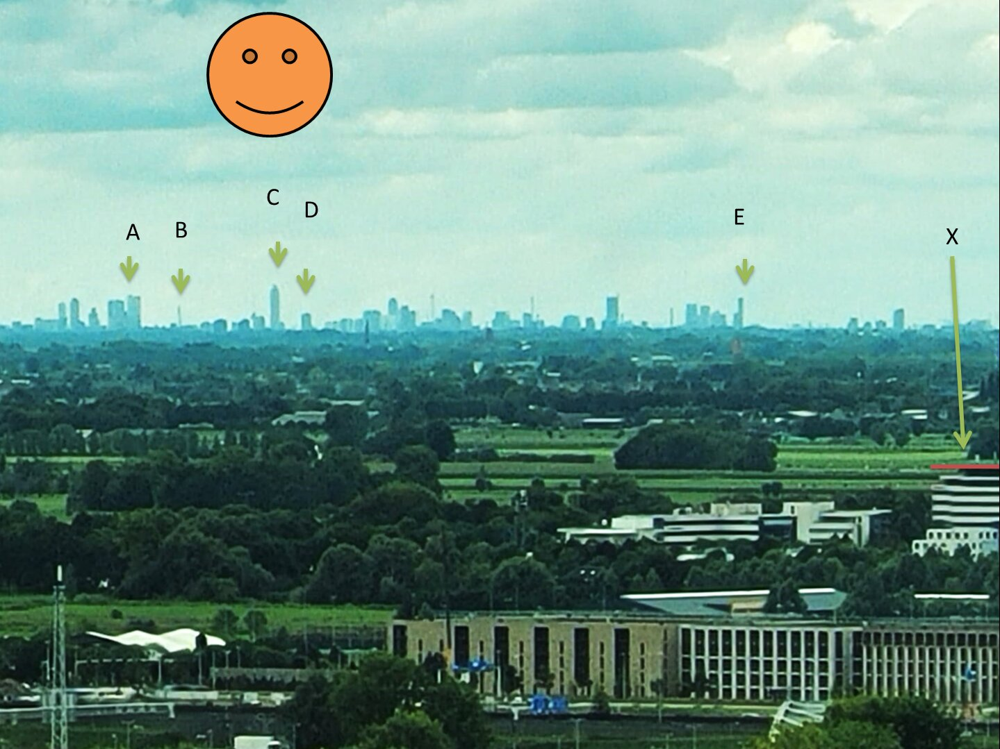
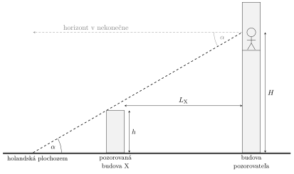

## Zadanie

V tejto úlohe využijete astronómiu a jednoduchú geometriu na záchranu ľudského života. Autor úlohy uviazol v neznámej budove v neznámom meste na Zemi. Kontakt s ním ste stratili popoludní 22. 8. 2025, keď vám poslal správu ”Goededag, ik ben in een groot probleem in mijn werk. SOS” a priloženú fotku (obrázok 1). Podarí sa vám ho na základe tejto fotky nájsť, kým bude príliš neskoro... a dôjde mu zásoba *stroopwafels*?

<figure>

<figcaption>

**Obrázok 1:** Panoráma mesta Rotterdam s vyznačenými budovami a posunutým Slnkom.
</figcaption>

</figure>

Po príchode do vášho tajného laboratória vám váš forenzný expert ťažko vysvetliteľným hollywoodskym spôsobom priblížil fotku (obrázok 1) v nezmenenej kvalite. Vidíte na nej v diaľke panorámu centra mesta Rotterdam. Na obrázku je vyznačených 5 budov, ktoré váš forenzný expert identifikoval ako:

- Budova A: Maastoren, 165 m.

- Budova B: Erazmusbrug, 139 m.

- Budova C: De Zalmhaven, 215 m.

- Budova D: De Hoge Heren, 102 m.

- Budova E: Deelftse Poort, 151 m.

Navyše je na obrázku zaznačená budova X vo vzdialenosti 4370 metrov od pozorovateľa, ktorej strecha (vo výške 42 metrov nad zemou) je zaznačená červenou čiarou. Autor úlohy, uviaznutý v budove, si tieto údaje o budove X len náhodou pamätal a poslal vám ich. Oranžový smajlík nad budovou C je Slnko v reálnej uhlovej veľkosti, v akej by bolo v tomto čase viditeľné na fotografii, iba je presunuté zo svojej skutočnej uhlovej výšky 32,1° nad horizontom podstatne bližšie k horizontu. Jeho azimut je nezmenený.

<ol type="a">

<li>

[50 b] Čo najpresnejšie určte súradnice uviaznutého autora úlohy. Z akého konkrétneho mesta bola vyhotovená snímka?

</li>

<li>

[30 b] Z akej výšky nad (plochou) holandskou zemou bola urobená snímka? Podporte nákresom a výpočtom.

</li>

<li>

[20 b] Určte pravý slnečný čas a občiansky pásmový čas vyhotovenia fotografie. Pamätajte na poznámku o skutočnej výške Slnka. Smelo použite Stellarium alebo podobný astronomický softvér.

</li>

</ol>

**Bonusová úloha:** Dobrovoľne sa môžete pokúsiť z informácií, ktoré ste zistili v tejto úlohe (a vašej detektívnej práce), presne určiť budovu a poschodie, z ktorého bola snímka vyhotove-ná. Za túto podúlohu neudeľujeme body, ale autor najlepšieho riešenia dostane na regionálnom kole suvenírový balík holandských vafieľ *stroopwafels* ako cenu od autora príkladu.

**Poznámka k riešeniam:** Toto je pomerne netradičná úloha. Vo vašom riešení smiete použiť všetky informácie, ktoré nájdete na internete, keďže v zadaní nenájdete všetky potrebné informácie. Odporúčame aj 3D funkcionalitu v Google Earth na zorientovanie sa v priestore.

Riešenie

<ol type="a">

<li>

Presné geografické súradnice budov A, B, C, D a E vieme zistiť z internetu[^1] alebo ich vyčítame z Google Earth. Na určenie polohy pozorovateľa vzhľadom na tieto budovy musíme poznať ich azimut a vzdialenosť. Azimut Slnka (a teda zároveň približne aj budovy C) vieme určiť [7 b] zo Stellária ako 245°, čo približne zodpovedá juhozápadu. Určenie vzdialenosti je zložitejšie. Ukážme si dve možnosti.

<ol type="i">

<li>

**Z výšky budov** (rýchly a hrubý spôsob, nižší počet bodov).

- V Google Earth si overíme, že budovy C a D, tvoriace najbližší pár a zároveň majúce najväčší rozdiel výšok, sú skutočne veľmi blízko seba (špecificky v radiálnom smere). [3 b]

- Na obrázku odmeriame v milimetroch vzdialenosť zodpovedajúcu ich rozdielu výšok (113 m) a porovnáme s veľkosťou v milimetroch zodpovedajúcou uhlovej veľkosti Slnka [4 b] získanej zo Stelária (0,527°).

- Odmeraná vzdialenosť zodpovedá asi $23\%\pm 2$% veľkosti slnečného disku, teda asi $0{,}120^{\circ}\pm0{,}011^{\circ}$ alebo $(2,1\pm0,2)$ miliradiánu. Chybu 10% sme v tomto prípade stanovili ako hrubý odhad. [3 b]

- Vzdialenosť pozorovateľa $L$ už vieme z uhla v radiánoch a vzdialenosti určiť jednoducho: 

$$
L = \frac{113\,\mathrm{m}}{0{,}0021\,\mathrm{rad}} = 53\,800\,\mathrm{m} \,. \qquad\textit{[4\,b]} \tag{1}
$$

. Pamätajúc na relatívnu chybu okolo 10% môžme uzavrieť $L = 54 \pm 5\,\mathrm{km}$.

</li>

<li>

**Z polohy budov** (trochu zložitejší a potenciálne presnejší spôsob). [alt.: b]

- V Google Earth si nájdeme najvzdialenejšie budovy A a E, nakreslíme funkciou pravítko ich spojnicu a odčítame jej dĺžku ako 2300 metrov a azimut 320°, prípadne 140°, v závislosti od orientácie. [4 b]

- Vieme, že azimut Slnka od pozorovateľa je $245^{\circ}$, teda pozorovateľ má od budovy C azimut $245^{\circ} - 180^{\circ} = 65^{\circ}$. Spojnica budov A a E preto zviera voči pohľadu pozorovateľa uhol $140^{\circ} - 65^{\circ} = 75^{\circ}$. [4 b]

- Z obrázku tiež vidíme, že rozostup medzi budovami A až E je menej než 3° (cca 5-6 slnečných diskov), teda z nášho pohľadu je dostatočne malý na to, aby sme si nemuseli lámať hlavu s perspektívou (ktorá budova je k nám bližšie, atď.). [3 b]

- Projekcia vzdialenosti spojnice A – E je fyzická vzdialenosť vynásobená $\cos 75^{\circ}$, čiže 2120 metrov. [4 b]

- Po presnejšom odmeraní je uhlová vzdialenosť medzi A a E rovná [4 b] $2{,}56^{\circ} = 0{,}0447\,\mathrm{rad}$.

- Vzdialenosť je preto 

$$
L = \frac{2300\,\mathrm{m} \cdot \cos 75^{\circ}}{0{,}0447\,\mathrm{rad}} = 47\,400\,\mathrm{m} \,. \qquad\textit{[4\,b]} \tag{2}
$$

</li>

</ol>

Po pozretí na mapu zistíme že v tomto azimute a vzdialenosti leží práve centrum mesta Utrecht.[3 b]

Výsledok druhej metódy je veľmi presný, vzdialenosť k skutočnému miestu pozorovateľa od budovy C je $L = 47{,}4\,\mathrm{km}$. [5 b]

Vypočítajme ešte súradnice. Za základňu určíme budovu C (De Zalmhaven) so súradnicami $\Phi_C = 51,9103$ °N a $\lambda_C = 4,4808$ °E. Polomer Zeme berieme ako $R = 6378\,\mathrm{km}$ a azimut Bludného Holanďana ako $A = 65^{\circ}$. Súradnice Bludného Holanďana sú 

$$
\Phi_{BH} = \Phi_C + \frac{L\cdot\sin(90^{\circ} - A)}{R} \cdot \frac{360^{\circ}}{2\pi} = 51{,}9103^{\circ}\,\text{N} + 0{,}1800^{\circ}\,\text{N} = 52{,}0903^{\circ}\,\text{N}\,,
    \qquad\textit{[5\,b]} \tag{3}
$$

 a 

$$
\lambda_{BH} = \lambda_C + \frac{L\cdot\cos(90^{\circ} - A)}{R \cos\Phi_C}\cdot\frac{360^\circ}{2\pi} = 4{,}4808^{\circ}\, \text{E} + 0{,}6264^{\circ}\, \text{E}= 5{,}1072^{\circ}\, \text{E} \,.
        \qquad\textit{[7\,b]} \tag{4}
$$

Všimnite si, že sme Zem aproximovali dotyčnou plochou v bode C, keďže vzdialenosť je len cca $50\,\mathrm{km}$, takže sférické efekty sú zanedbateľné. Jediný sférický efekt, ktorý uvažujeme, je nahustenie poludníkov o faktor $\cos\Phi_C$. Táto poloha je približne pol kilometra od skutočnej polohy autora úlohy 

$$
\boxed{(52{,}0850^{\circ}\,\text{N}\,;\,5{,}1803^{\circ}\,\text{E})} \,, \tag{5}
$$

 dosiahli sme teda presnosť cca 1%.

*Poznámka: Uhol $1^{\circ}$ v zemepisnej šírke je niečo vyše $100\,\mathrm{km}$, preto vieme jednotlivé desatinné miesta postupne intuitívne interpretovať ako desiatky kilometrov, kilometre, stovky metrov a desiatky metrov. Udávať súradnice budov s väčšou presnosťou nemá veľký zmysel.*

</li>

<li>

Poznáme vzdialenosť budovy X od pozorovateľa $L_X = 4370\,\mathrm{m}$ a výšku budovy $h = 42\,\mathrm{m}$. Situácia je načrtnutá na obrázku 2.

<figure>

<figcaption>

**Obrázok 2:** Geometrický náčrt situácie pozorovateľa [7 b]
</figcaption>

</figure>

Uhol $\alpha$ vieme odčítať z obrázku 1 v zadaní, znovu ako nejaký násobok uhlového priemeru slnečného disku. Najväčší problém pri odčítaní tejto hodnoty je správne určiť horizont. Môžme si pomôcť trikom: vieme že 113 metrov zodpovedajúcich rozdielu výšky budov C a D zodpovedá 0,23 slnečného disku. Budova E je vysoká 151 metrov, a z ľubovoľného miesta v centre Utrechtu (kde sa nám podarilo umiestniť pozorovateľa) je v rámci zlomku percenta vzdialenosť budovy E rovnaká ako vzdialenosť budov C a D. Vieme teda, že skutočný horizont bude $(\linfrac{151}{113})\cdot0,23$ uhlového priemeru slnečného disku pod vrchom tejto budovy, a paralelný so zdanlivým horizontom tvoreným stromami a vrcholkami budov. Uhol $\alpha$ vychádza ako približne 1,07 slnečného disku, teda asi $0{,}566^{\circ}$. [8 b]

Na základe obrázku 2 napíšeme rovnicu 

$$
\tan \alpha = \frac{H - h}{L_X} \,, \qquad\textit{[8\,b]} \tag{6}
$$

 odkiaľ 

$$
H = L_X \,\tan\alpha + h \doteq \boxed{85\,\mathrm{m}} \,. \qquad\textit{[7\,b]} \tag{7}
$$

</li>

<li>

Kľúčové je, že sa jedná o popoludnie 22. 8. 2025, a výška Slnka je $32{,}1^{\circ}$ nad horizontom. Keď nastavíme v Stelláriu čas tak, aby bola táto podmienka splnená, zistíme že občiansky čas je $17\,\mathrm{h}\;12\,\mathrm{min}$. [9 b]

Hodinový uhol Slnka cca $3^{\mathrm{h}}\,27^{\mathrm{min}}$ priamo odčítame zo Stellária, [6 b]

takže pravý slnečný čas je $15\,\mathrm{h}\;27\,\mathrm{min}$. [5 b]

</li>

</ol>

**Bonusová (detektívna) úloha**

V Utrechte sa nachádza niekoľko budov vyšších alebo približne rovnako vysokých ako nájdených 85 metrov. Najvyššou budovou mesta zotrváva s výškou 112 m veža katedrály (Domtoren) z roku 1382, ktorej pozorovacia platforma je ale vo výške až vyše 100 m, výrazne viac než nájdená výška. Za ňou nasleduje budova Rabobank so 105 m. Niekoľko budov v rozmedzí $80\,\mathrm{m}$ až $90\,\mathrm{m}$ sa nachádza severozápadne od vlakovej stanice.

Na pomoc nám príde perspektíva. Budova X (ak ju viete nájsť na mape) sa nachádza na správnom mieste v porovnaní s pozadím Rotterdamu jedine z budovy Rabobank. Budovu X viete nájsť hľadaním v oblasti cca 4 km od centra Utrechtu v smere na Rotterdam. Na obrázku vidíte televíznu vežu a diaľničný nadjazd (asi $2{,}5\,\mathrm{km}$ od centra), za ktorými je pole a priemyselná štvrť s kancelárskymi budovami, vrátane X. Poschodie určíme hrubým odhadom. Budova Rabobank má 25 kancelárskych poschodí, nad ktorými su dve technické (bez okien), ktoré sú výrazne vyššie ako pod nimi ležiace kancelárske. Autor príkladu bude uviaznutý zrejme niekde medzi poschodiami 23 a 25.

[^1]: Napríklad z <https://en.wikipedia.org/wiki/List_of_tallest_buildings_in_Rotterdam>.

