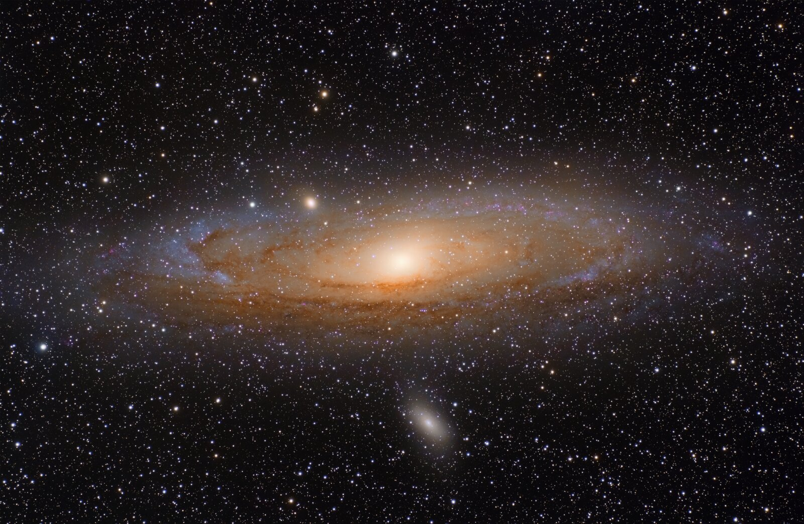

## Zadanie

Je známe, že v dôsledku rozpínania vesmíru sa od nás vzďaľujú objekty všetkými smermi. Svedčí o tom posun ich spektrálnych čiar do červenej oblasti spektra. Jednou z výnimiek je galaxia $\messier{31}$ v súhvezdí Androméda, ktorej spektrum je posunuté opačným smerom.

<figure>

<figcaption>

**Obrázok 1:** Zdroj: Brody Wesner.
</figcaption>

</figure>

Napríklad spektrálnu čiaru H$\alpha$, s laboratórnou vlnovou dĺžkou $\lambda_0 = 656{,}28\,\mathrm{nm}$, pozorujeme na vlnovej dĺžke $\lambda = 655{,}62\,\mathrm{nm}$. Posun spektra do modrej oblasti znamená, že sa k nám galaxia $\messier{31}$ približuje a vedci odhadujú, že sa s Mliečnou cestou zrazí za asi 4 miliardy rokov. Aktuálne sa $\messier{31}$ nachádza vo vzdialenosti $d_0 = 2{,}537\,\mathrm{Mly}$ (miliónov svetelných rokov).

**Úlohy**

<ol type="a">

<li>

[10 b] Vypočítajte červený posun $z$ galaxie $\messier{31}$.

</li>

<li>

[15 b] Vypočítajte rýchlosť $v$, ktorou sa k nám galaxia $\messier{31}$ približuje.

</li>

<li>

[10 b] Vypočítajte rýchlosť $v_H$, akou by sa mala galaxia $\messier{31}$ od nás vzďaľovať podľa Hubblovho-Lemaîtrovho zákona. Porovnajte ju s rýchlosťou $v$. Ktorá z nich je väčšia?

</li>

<li>

[25 b] Na akej vlnovej dĺžke $\lambda'$ by sme pozorovali spektrálnu čiaru H$\alpha$, ak by sa hypoteticky Hubblova konštanta náhle 10-násobne zväčšila?

</li>

</ol>

Riešenie

<ol type="a">

<li>

Červený posun vypočítame použitím jeho definície: 

$$
z = \frac{\lambda - \lambda_0}{\lambda_0} =
    \frac{655{,}62\,\mathrm{nm} - 656{,}28\,\mathrm{nm}}{656{,}28\,\mathrm{nm}} \doteq
    \boxed{-0{,}00101} \,. \qquad\textit{[10\,b]} \tag{1}
$$

 Červený posun je definovaný tak, že je kladný pre objekty, ktoré sa od nás vzďaľujú a záporný pre tie, ktoré sa k nám približujú. Vidíme teda, že sa k nám $\messier{31}$ približuje.

</li>

<li>

Pre zistenie radiálnej rýchlosti vzďaľovania, respektíve v našom prípade približovania, využijeme interpretáciu Dopplerovým vzťahom. Pre rýchlosť vzďaľovania $v_r$ dostaneme 

$$
v_r = cz = c \, \frac{\lambda - \lambda_0}{\lambda_0} \doteq -301\,\mathrm{km}\,{\mathrm{s}}^{-1} \,, \qquad\textit{[10\,b]} \tag{2}
$$

 kde $c$ je rýchlosť svetla vo vákuu. Rýchlosť vzďaľovania $v_r$ je taktiež záporná, čo znamená, že sa $\messier{31}$ k nám približuje. Hľadaná rýchlosť približovania je preto $v = -v_r$, čiže 

$$
\boxed{v = 301\,\mathrm{km}\,{\mathrm{s}}^{-1}} \,. \qquad\textit{[5\,b]} \tag{3}
$$

</li>

<li>

Hubblov-Lemaîtrov zákon je daný rovnicou 

$$
v_H = H_0 \cdot d_0 \,,  \qquad\textit{[3\,b]} \tag{4}
$$

 kde $H_0$ je Hubblova konštanta, ktorej hodnotu vieme nájsť v konštantovníku, a $d_0$ je aktuálna vzdialenosť galaxie $\messier{31}$, ktorá je zadaná v zadaní. Nakoľko sa Hubblova konštanta udáva v megaparsekoch ($\mathrm{Mpc}$), tak potrebujeme premeniť jednotky vzdialenosti z $\mathrm{Mly}$ na $\mathrm{Mpc}$. Pomôžu nám hodnoty $\mathrm{ly}$ a $\mathrm{pc}$ v konštantovníku: 

$$
d_0 = 2{,}537\,\mathrm{Mly} =
    2{,}537 \cdot \frac{1\,\mathrm{ly}}{1\,\mathrm{pc}} \, \mathrm{Mpc} =
    2{,}537 \cdot \frac{9{,}461 \cdot 10^{15}\,\mathrm{m}}{3{,}086 \cdot 10^{16}\,\mathrm{m}} \, \mathrm{Mpc} \doteq
    0{,}7778\,\mathrm{Mpc}  \,. \tag{5}
$$

Po dosadení do Hubblovho-Lemaîtrovho zákona (4) dostávame 

$$
v_H = H_0 \cdot d_0 =
    70\,\mathrm{km}\,{\mathrm{s}}^{-1}\,{\mathrm{Mpc}}^{-1} \cdot 0{,}7778\,\mathrm{Mpc} \doteq
    \boxed{54\,\mathrm{km}\,{\mathrm{s}}^{-1}} \,. \qquad\textit{[7\,b]} \tag{6}
$$

Vidíme, že rýchlosť $v_H$ je menšia ako pozorovaná rýchlosť galaxie $v$.

</li>

<li>

Označme $v_G$ ako vlastnú rýchlosť galaxie $\messier{31}$. Pre pozorovanú rýchlosť $v$, ktorou sa $\messier{31}$ približuje, musí platiť $v = v_G - v_H$, nakoľko vlastná rýchlosť $v_G$ a rýchlosť $v_H$ spôsobená rozpínaním vesmíru smerujú presne opačným smerom. Rýchlosť $v$ je kladná, pretože $v_G>v_H$. Po vyjadrení $v_G$ a presnejšom určení výsledkov podzadaní (b) a (c) máme 

$$
v_G = 301{,}49\,\mathrm{km}\,{\mathrm{s}}^{-1} + 54{,}45\,\mathrm{km}\,{\mathrm{s}}^{-1} = 355{,}94\,\mathrm{km}\,{\mathrm{s}}^{-1} \,. \qquad\textit{[5\,b]} \tag{7}
$$

Zmena Hubblovej konštanty zmení výsledok $v_H$ v podzadaní (c). Dostávame 

$$
v_H' = 10 H_0 \cdot d_0 = 544{,}46\,\mathrm{km}\,{\mathrm{s}}^{-1} \,. \qquad\textit{[5\,b]} \tag{8}
$$

 Pozorovanú rýchlosť $v'$ určíme analogicky k $v= v_G - v_H$, teda 

$$
v' = v_G - v_H' = 355{,}94\,\mathrm{km}\,{\mathrm{s}}^{-1} - 544{,}46\,\mathrm{km}\,{\mathrm{s}}^{-1} = -188{,}52\,\mathrm{km}\,{\mathrm{s}}^{-1} \,. \qquad\textit{[5\,b]} \tag{9}
$$

Keďže nám rýchlosť približovania vychádza ako záporné číslo, tak to znamená, že sa $\messier{31}$ od nás naopak vzďaľuje. Rozpínanie vesmíru v tomto hypotetickom prípade prevládlo nad vlastnou rýchlosťou približovania galaxie $\messier{31}$, a teda nikdy nedôjde k jej zrážke s Mliečnou cestou a vytvoreniu Milkdromédy.

Novú pozorovanú vlnovú dĺžku $\lambda'$ spektrálnej čiary H$\alpha$ určíme analogicky ako v (2). Platí 

$$
v_r' = c \, \frac{\lambda' - \lambda_0}{\lambda_0} = c \left(\frac{\lambda'}{\lambda_0} - 1\right) , \qquad\textit{[6\,b]} \tag{10}
$$

 kde $v_r'$ je rýchlosť vzďaľovania 

$$
v_r' = -v' = 188{,}52\,\mathrm{km}\,{\mathrm{s}}^{-1} \,. \qquad\textit{[2\,b]} \tag{11}
$$

 Vyjadrením $\lambda'$ z (10) dostávame 

$$
\lambda' = \lambda_0 \left( \frac{v_r'}{c} + 1 \right) \doteq
    \boxed{656{,}69\,\mathrm{nm}} \,, \qquad\textit{[2\,b]} \tag{12}
$$

 teda vlnovú dĺžku o čosi väčšiu ako $\lambda_0$.

</li>

</ol>

## Komentár autora

Prvý zo série príkladov zameraných na možnú zrážku našej galaxie s galaxiou v Androméde ($\messier{31}$). Podľa najnovších štúdii je približne 50 percentná šanca na to, že k tejto zrážke naozaj dôjde. Tak či onak, v najbližších miliardách rokov sa bude na čo pozerať.
