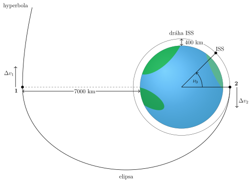

## Zadanie

Vesmírna sonda s celkovou hmotnosťou 300 kg sa vracia z misie v hlbokom vesmíre k Zemi po hyperbolickej dráhe. Najbližšie sa dostane do výšky 7000 km nad povrch Zeme (bod **1** na obrázku 1), pričom bude mať v tomto mieste voči Zemi rýchlosť 9 $\mathrm{km}\,{\mathrm{s}}^{-1}$. V tomto bode v momente spomalí na eliptickú dráhu a následným opätovným zapálením rakiet v bode **2** sa presunie z eliptickej na kruhovú dráhu vo výške 400 km s použitím najmenšieho možného množstva energie. V tejto výške sa v rovnakej rovine nachádza na orbite aj Medzinárodná vesmírna stanica (ISS). Náčrt trajektórie sa nachádza na obrázku 1.

<figure>

<figcaption>

**Obrázok 1:** Zachytenie sondy z hyperbolickej dráhy na kruhovú dráhu okolo Zeme. Sonda a ISS obiehajú v jednej rovine. Obrázok je iba ilustračný.
</figcaption>

</figure>

**Úlohy**

<ol type="a">

<li>

[30 b] Vypočítajte potrebnú $\Delta v_1$ a $\Delta v_2$ na spomalenie sondy v 2 manévroch.

</li>

<li>

[20 b] Vypočítajte celkovú dĺžku manévru, teda čas letu z bodu **1** do bodu **2**.

</li>

</ol>

V momente, kedy sa sonda na hyperbolickej dráhe dostala najbližšie k Zemi (bod **1**), má ISS súradnicu $\nu_0$ znázornenú na obrázku 1. Sonda a ISS sa pohybujú v jednej rovine a obe obiehajú rovnakým smerom.

<ol type="a" start="3">

<li>

[30 b] Určte, kde na svojej dráhe sa nachádza ISS vzhľadom na stred Zeme (teda vypočítajte jej súradnicu $\nu_0$), ak požadujeme, aby sa sonda a ISS stretli v bode **2**.

</li>

</ol>

Riešenie

<ol type="a">

<li>

Na to aby sonda použila najmenšie množstvo energie sa musí zmena energie odohrať v pericentre dráhy. Pericentrum hyperboly je vo výške $h_1=7000$, km kde sonda spomalí prvýkrát (bod **1**) na eliptickú dráhu a v polovici obehu elipsy sa dostane do pericentra eliptickej dráhy $h_2=400$ km nad povrch Zeme, kde sonda spomalí druhýkrát (bod **2**) na kruhovú dráhu s výškou $h_2=400$ km nad povrchom.

Pre rýchlosť na eliptickej dráhe platí rovnica Vis-viva 

$$
v=\sqrt{\mu\bigg(\frac{2}{r}-\frac{1}{a}\bigg)}\,, \qquad\textit{[5\,b]} \tag{1}
$$

 kde $\mu= G\mathcal{M}_\Ea$ je gravitačný parameter, $r$ je vzdialenosť primárneho ohniska elipsy a ľubovoľného miesta na dráhe a $a$ je veľká polos, ktorú vieme určiť na základe geometrie orbity. Veľkú os elipsy ($2a$) vieme určiť ako súčet $2R_\Ea$, $h_1$ a $h_2$. Preto 

$$
a = \frac{2R_\Ea + h_1 + h_2}{2}\,. \tag{2}
$$

Pre rýchlosti v bodoch **1** a **2** platí z rovnice Vis-Viva 

$$
\begin{align*}
    v_1 &= \sqrt{\mu\bigg(\frac{2}{R_\Ea+h_1}-\frac{2}{2R_\Ea + h_1+h_2}\bigg)} \doteq 4{,}48\,\mathrm{km}\,{\mathrm{s}}^{-1}\,,\qquad\textit{[5\,b]} \tag{3}\\
    v_2 &= \sqrt{\mu\bigg(\frac{2}{R_\Ea+h_2}-\frac{2}{2R_\Ea + h_1+h_2}\bigg)} \doteq 8{,}84\,\mathrm{km}\,{\mathrm{s}}^{-1}\,.\qquad\textit{[5\,b]} \tag{4}\end{align*}
$$

Pre kruhovú (prvú kozmickú) rýchlosť, ktorou obieha ISS vo výške $h_2=400$ km platí 

$$
v_I (h_2) = \sqrt{\frac{\mu}{R_\Ea+h_2}} \doteq 7{,}67\,\mathrm{km}\,{\mathrm{s}}^{-1}\,. \qquad\textit{[5\,b]} \tag{5}
$$

 Na spomalenie sondy potrebujeme [5 b] 

$$
\begin{align*}
    \Delta v_1 &= 9\,\mathrm{km}\,{\mathrm{s}}^{-1}-4{,}48\,\mathrm{km}\,{\mathrm{s}}^{-1}= \boxed{4{,}52\,\mathrm{km}\,{\mathrm{s}}^{-1}}\,, \tag{6}\\
    \Delta v_2 &= 8{,}84\,\mathrm{km}\,{\mathrm{s}}^{-1}-7{,}67\,\mathrm{km}\,{\mathrm{s}}^{-1}= \boxed{1{,}17\,\mathrm{km}\,{\mathrm{s}}^{-1}}\,. \tag{7}\end{align*}
$$

 Celkovo pri dvoch brzdných manévroch potrebujeme $\Delta v=\Delta v_1+\Delta v_2=5{,}69\,\mathrm{km}\,{\mathrm{s}}^{-1}$. [5 b]

</li>

<li>

Pomocou tretieho Keplerovho zákona môžeme určiť periódu obehu sondy na eliptickej dráhe, ale aj periódu ISS na kruhovej dráhe. Uvažujeme, že hmotnosť sondy, respektíve ISS, je zanedbateľná voči hmotnosti Zeme. Tretí Keplerov zákon má teda tvar 

$$
\frac{a^3}{P^2}\approx\frac{\mu}{4\pi^2}\,.\qquad\textit{[5\,b]} \tag{8}
$$

 Po dosadení veľkej polosi a vyjadrení 

$$
P_{\textrm{sonda, el.}}= \sqrt{\frac{\pi^2(2R_\Ea + h_1+h_2)^3}{2\mu}}\doteq168\ \textrm{min}\,. \qquad\textit{[10\,b]} \tag{9}
$$

 Sonde potrvá polovicu periódy $P_{\textrm{sonda, el.}}$, čiže $\linfrac{168\,\mathrm{min}}{2}=\boxed{84\textrm{ minút}}$, než sa dostane z hyperbolickej dráhy na kruhovú (z bodu **1** do bodu **2**),[5 b] pretože ide o polovicu celej elipsy.

</li>

<li>

Analogicky pomocou tretieho Keplerovho zákona určíme periódu obehu ISS na kruhovej dráhe vo výške $h_2=400$ km. 

$$
P_{\textrm{ISS, cir.}}= \sqrt{\frac{4\pi^2(R_\Ea + h_2)^3}{\mu}}\doteq 93\ \textrm{min}\,. \qquad\textit{[15\,b]} \tag{10}
$$

 Túto periódu bude mať aj sonda po vstupe na kruhovú dráhu v bode **2**.

Celý obeh ISS trvá 93 minút a musíme určiť kde sa ISS nachádzala 84 minút pred tým ako je v bode **2**. Polohu ISS určíme v polárnych súradniciach (radiálna vzdialenosť $r$ a uhol $\nu$ od osi $x$) s počiatkom v strede Zeme, osou $x$ v smere k bodu **2** a súradnica $\nu$ bude proti smeru hodinových ručičiek z pohľadu obrázka (1), teda v smere obehu ISS.

Uhol $\nu$ obehne $360^{\circ}$ za 93 minút a v bode **2** má ISS uhol $\nu$ rovný $0^{\circ}$. Preto 84 minút pred tým ako bude ISS v bode **2**, bol jej uhol 

$$
\nu_0=360^{\circ} -\ \frac{84 \textrm{ min}}{93\textrm{ min}}\cdot360^{\circ}\doteq \boxed{35^{\circ}}\,.\qquad\textit{[15\,b]} \tag{11}
$$

 Alternatívne môžeme písať, že poloha ISS vzhľadom na stred Zeme bola pri vstupe sondy na eliptickú trajektóriu 

$$
\mathbf{r}_0
    =
    6778\,\mathrm{km}\begin{pmatrix}
    \cos\nu_0 \\
    \sin\nu_0
    \end{pmatrix}
    \,. \tag{12}
$$

</li>

</ol>

