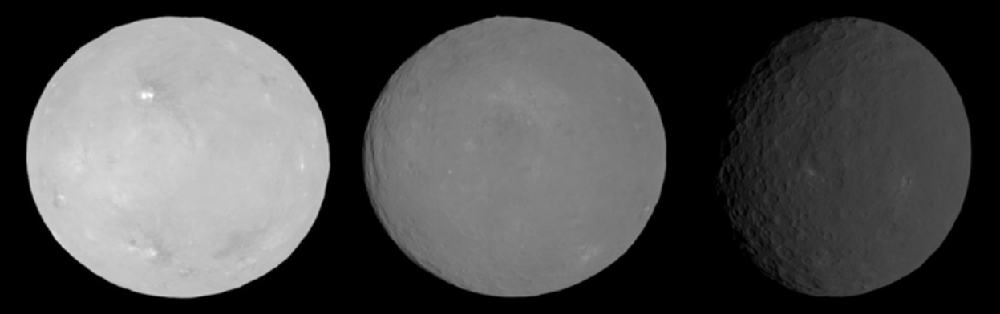

## Zadanie

Terka dostala na domácom kole Astronomickej olympiády za úlohu pozorovať trpasličiu planétu Ceres, ktorá však nie je viditeľná voľným okom a ona nemá k dispozícii lepší ďalekohľad ako refraktor s ohniskovou vzdialenosťou $700\,\mathrm{mm}$ a priemerom objektívu $60\,\mathrm{mm}$. Ceres má polomer dráhy $2{,}77\,\mathrm{au}$, absolútnu magnitúdu $3{,}34$ a albedo $0{,}1$. Absolútnu magnitúdu telies v slnečnej sústave definujeme ako magnitúdu, ktorú by mali, ak by sme ich presunuli do vzdialenosti $1\,\mathrm{au}$ od Slnka a zároveň $1\,\mathrm{au}$ od Zeme.

<ol type="a">

<li>

[50 b] Zistite, či sa Terke podarí uvidieť Ceres v ďalekohľade alebo sa má radšej pozrieť na teoretické úlohy. Uhlová vzdialenosť Ceresu a Slnka na oblohe pri pohľade zo Zeme (elongácia) je $143{,}7^{\circ}$. Uvažujte kruhové dráhy Ceresu aj Zeme, priemer Terkinej očnej pupily $8\,\mathrm{mm}$ a zanedbajte efekt fázy Ceresu.

</li>

</ol>

<ol type="a" start="2">

<li>

[10 b] Ak ste v prvom podzadaní určili, že Ceres uvidí, okomentujte prečo. Mohla by nastať situácia, kedy by aj napriek tomu Ceres nebolo vidieť? Ak vám vyšlo, že Ceres neuvidí, okomentujte prečo. Mohla by nastať situácia, kedy by aj napriek tomu za istých podmienok bol Ceres v jej ďalekohľade viditeľný?

</li>

</ol>

Riešenie

<ol type="a">

<li>

Zo zadania vieme, že Ceres má absolútnu magnitúdu $M = 3{,}34\,\mathrm{mag}$. Jeho zdanlivú magnitúdu $m$ si môžme vypočítať pomocou Pogsonovej rovnice 

$$
m - M = - 2,5 \log \left( \frac{f_1}{f_2} \right) \,, \qquad\textit{[5\,b]} \tag{1}
$$

 kde $f_1, f_2$ sú toky.

Tok $f_1$ prislúchajúci zdanlivej magnitúde $m$ závisí priamoúmerne na zbernej ploche $S$ a nepriamoúmerne na druhej mocnine vzdialenosti $d$ od Zeme. Okrem toho však obdobne závisí aj na druhej mocnine vzdialenosti $r$ od Slnka, pretože Ceres nežiari vlastným svetlom, ale iba odráža to slnečné. Albedo $A$, alebo tiež miera odrazivosti, ktoré je pre Ceres rovné $0,1$ znamená, že Ceres odrazí len $10\%$ dopadajúceho svetla. Dostávame tak úmernosť 

$$
f_1 \enspace\propto\enspace \frac{A \cdot S}{r^2 \cdot d^2} \,, \tag{2}
$$

 kde symbol $\propto$ značí rovnosť až na konštantu (priamu úmeru).

Táto úmernosť platí aj pre tok $f_2$ prislúchajúci absolútnej magnitúde $M$, ak zmeníme hodnotu $r$ a $d$. Ako je uvedené v zadaní, pre telesá slnečnej sústavy je táto absolútna magnitúda $M$ definovaná ako magnitúda, ktorú by mal Ceres, ak by sme ho presunuli do vzdialenosti $r = 1\,\mathrm{au}$ od Slnka a zároveň $d = 1\,\mathrm{au}$ od Zeme. Albedo $A$ a zberná plocha Ceresu $S$ ostávajú rovnaké. Preto 

$$
f_2 \enspace\propto\enspace \frac{A \cdot S}{(1\,\mathrm{au})^2(1\,\mathrm{au})^2} \,. \tag{3}
$$

Pogsonova rovnica nám nadobudne tvar 

$$
m - M = -2,5 \log\left(\frac{\cfrac{A S}{r^2  d^2}}{\cfrac{A S}{(1\,\mathrm{au})^2(1\,\mathrm{au})^2}}\right)\,, \qquad\textit{[10\,b]} \tag{4}
$$

 po úprave platí pre $r$ a $d$ v astronomických jednotkách 

$$
\begin{align*}
    m - M &= -2,5 \log\left(\frac{1}{r^2 d^2}\right)\,, \tag{5}\\
    m - M &= -2,5 \log \big( (rd)^{-2} \big)\,, \tag{6}\\
    m - M &= 5 \log (rd)\,, \tag{7}\\
    m &= M + 5 \log (rd) \,. \qquad\textit{[3\,b]} \tag{8}\end{align*}
$$

 Dostali sme tak vzťah, do ktorého musíme už len dosadiť vzdialenosti $r$ a $d$. Zo zadanie vieme, že $M = 3,34$ je absolútna magnitúda Ceresu a $r = 2{,}77\,\mathrm{au}$ je vzdialenosť Ceresu od Slnka. No vzdialenosť $d$ Ceresu od Zeme v zadaní nemáme, preto si ju musíme určiť jednoduchou úvahou z obrázka 1.

Keďže uvažujeme kruhové dráhy, vieme si označiť uhlovú vzdialenosť Ceresu a Slnka, ktorú pozorujeme zo Zeme $\theta = 143{,}7^{\circ}$, vzdialenosť Ceresu a Slnka $r = 2{,}77\,\mathrm{au}$ a vzdialenosť Zeme od Slnka $a = 1\,\mathrm{au}$. Z vyznačeného trojuholníka vieme určiť vzdialenosť $d$ z kvadratickej rovnice, ktorú získame z kosínusovej vety pre tento trojuholník 

$$
\begin{align*}
    r^2 &= a^2 + d^2 - 2ad \cos\theta\,, \tag{9}\\
    0 &= d^2 + (-2a \cos \theta) d + (a^2 - r^2)\,, \tag{10}\\
    \Rightarrow d_{1,2} &= \frac{2a \cos \theta \pm \sqrt{(-2a \cos \theta)^2 - 4(a^2 - r^2)}}{2}\,. \tag{11}\end{align*}
$$

Po dosadení hodnôt dostávame dva výsledky $d_1 = 1{,}90\,\mathrm{au}$ a $d_2 = -3{,}51\,\mathrm{au}$. Druhý výsledok nedáva zmysel, pretože vzdialenosť môže byť jedine kladná, takže náš výsledok je $d = 1{,}90\,\mathrm{au}\qquad\textit{[10\,b]}$. Máme tak hodnotu $d$, ktorú môžme dosadiť do vzťahu (8). Dostávame tak výsledok 

$$
\boxed{m = 6{,}95\,\mathrm{mag}} \,. \qquad\textit{[2\,b]} \tag{12}
$$

Vidíme, že táto hodnota je väčšia (teda Ceres je menej jasný) ako $6\,\mathrm{mag}$, čo je limitná magnitúda objektov, ktoré môžeme pozorovať priamo len očami. Samozrejme, táto hodnota závisí na podmienkach pri pozorovaní a líši sa človek od človeka, no v zrovnaní s magnitúdou Ceresu môžme predpokladať, že Ceres za väčšiny podmienok neuvidíme.

<figure>

<figcaption>

**Obrázok 1:** Náčrt polohy Ceresu.
</figcaption>

</figure>

Posledným krokom je teraz vypočítať, akú limitnú magnitúdu môžme pozorovať s naším ďalekohľadom a následne tieto dve magnitúdy porovnáme. Zadefinujme si $m'$ ako zdanlivú magnitúdu Ceresu v ďalekohľade a $m$ nech zostane zdanlivou magnitúdou Ceresu, ktorú sme už vypočítali. Dostávame novú Pogsonovu rovnicu 

$$
m' - m = -2,5 \log \left(\frac{P'}{P_o}\right)\,, \qquad\textit{[5\,b]} \tag{13}
$$

 kde $P_o$ je výkon, ktorý dopadá do oka a $P'$ je výkon, ktorý koncentruje ďalekohľad do oka. Oba tieto výkony sú priamoúmerné zbernej ploche oka, resp. objektívu, čiže $P \;\propto\; S$. Oko aj objektív sú kruhové, preto zberná plocha oka $S_0 = \pi r_o^2$, kde $r_o = 4\,\mathrm{mm}$ je polomer očnej pupily a $S' = \pi r'^2$, kde $r' = 30\,\mathrm{mm}$ je polomer objektívu Terkinho ďalekohľadu.

Výkony $P, P'$ dosaďme do Pogsonovej rovnice 

$$
\begin{align*}
    m' - m &= -2,5 \log \left( \frac{\pi r'^2}{\pi r_o^2} \qquad\textit{[10\,b]} \right), \tag{14}\\ 
    m' - m &= -2,5 \log \bigg( \left(\frac{r'}{r_o}\right)^2\bigg), \tag{15}\\ 
    m' &= m - 5 \log \left(\frac{r'}{r_o} \right). \tag{16}\end{align*}
$$

Ak dosadíme za $r_o$ a $r'$, vyjde nám $m' = 2{,}57\,\mathrm{mag}$. [2 b]

Porovnaním vidíme, že $m' < m$, čiže magnitúda, ktorú vidíme v ďalekohľade je menšia ako magnitúda, ktorú má Ceres. To je aj očakávané, nakoľko v ďalekohľade vidíme všetky objekty jasnejšie, ako pri pozorovaní voľným okom. Navyše $m'<6\,\mathrm{mag}$, tým pádom správnou odpoveďou je, že Terka Ceres v ďalekohľade uvidí. [3 b]

Treba však podotknúť, že to, že Ceres v ďalekohľade uvidí, ešte neznamená, že ho uvidí vo vysokej kvalite. Vzdialené či malé objekty sa v amatérskych ďalekohľadoch javia iba ako bodové zdroje svetla.

</li>

<li>

Správnou odpoveďou prvého podzadania bola možnosť, že Terka Ceres uvidí. Dôvodom je práve limitná magnitúda $6\,\mathrm{mag}$, ktorú môže ľudské oko ešte vidieť a keďže nám vyšlo, že Ceres pozorujeme v ďalekohľade s magnitúdou $2{,}57\,\mathrm{mag}$, tak vieme s istotou povedať, že Ceres bude dostatočne jasný, aby sme ho v ďalekohľade mohli pozorovať.

Pozorovanie takto slabých objektov nám často sťažujú podmienky ako sú počasie, svetelné znečistenie, atmosférické podmienky, kvalita ďalekohľadu alebo sa nám môžu horšie pozorovať objekty blízko obzoru (kvôli hrubšej vrstve atmosféry nastáva absorpcia a rozptyl svetla). [5 b]

Taktiež, Ceres pozorujeme pod istým fázovým uhlom, čo znamená, že zo Zeme nevidíme jeho disk plne osvetlený – časť povrchu privráteného k nám zostáva v tieni. Navyše nerovnosti na povrchu Ceresu spôsobujú dodatočné stemnenie, ktoré môže viesť k pomerne výraznej zmene magnitúdy. Pre zadaný uhol elongácie $\theta = 143{,}7^{\circ}$ klesne tok na asi $30\,\%$, čo odpovedá nárastu magnitúdy o $-2,5 \log(0,3) \doteq 1,3$. Pokles jasnosti Ceresu demonštruje obrázok 2.

Druhá ponúkaná možnosť nebola správna, no za istých podmienok by sme mohli teoreticky Ceres nejakým spôsobom vidieť aj ”na vlastné oči”. Takými podmienkami by mohli byť dokonale tmavá obloha (stupeň 1 alebo 2 v Bortlovej stupnici miery svetelného znečistenia), úžasný seeing, výnimočná adaptácia očí na tmu a perfektný zrak [5 b]. V realite sa však takéto podmienky takmer nikdy nenaskytnú, a tak sa Ceres stáva naším očiam neviditeľný.

<figure>

<figcaption>

**Obrázok 2:** Fotografie Ceresu pre elongáciu $180^{\circ}$ (vľavo), $173^{\circ}$ (v strede) a $147^{\circ}$ (vpravo) vykonané s rovnakými nastaveniami fotoaparátu. Zdroj: NASA/JPL.
</figcaption>

</figure>

</li>

</ol>

## Komentár autora

V súčastnosti klasifikovaný ako trpasličia planéta sa svojím objavom v roku 1801 Ceres stal prvým objektom slnečnej sústavy, ktorý nebol planétou.
