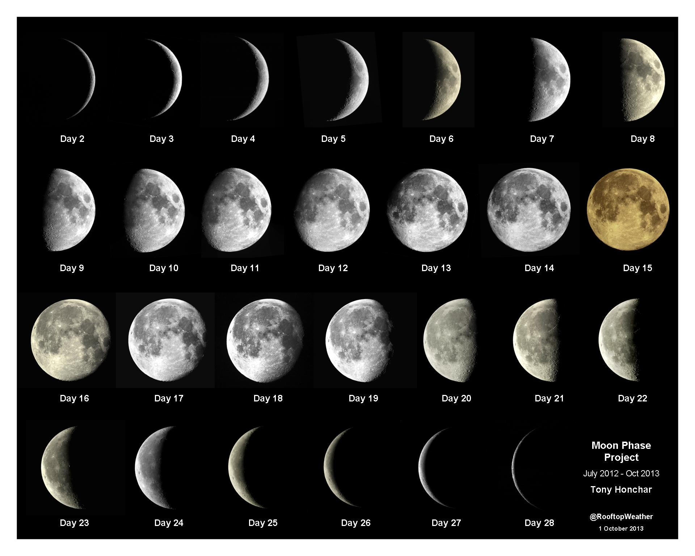
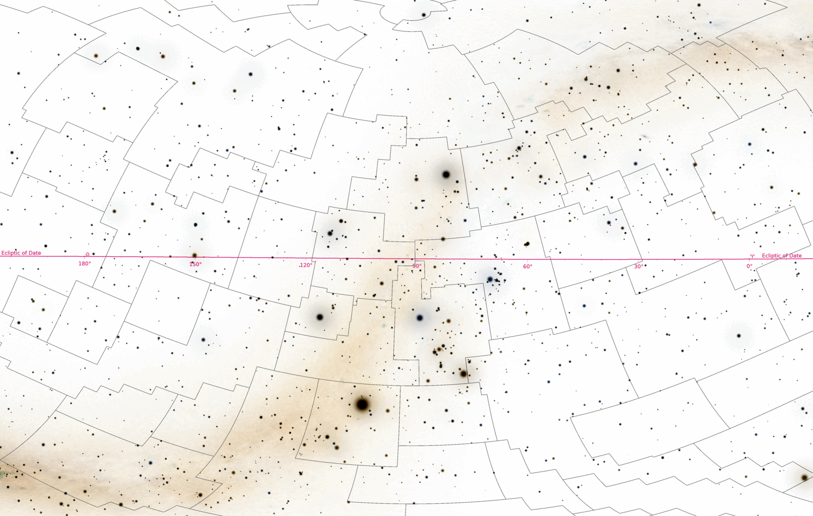
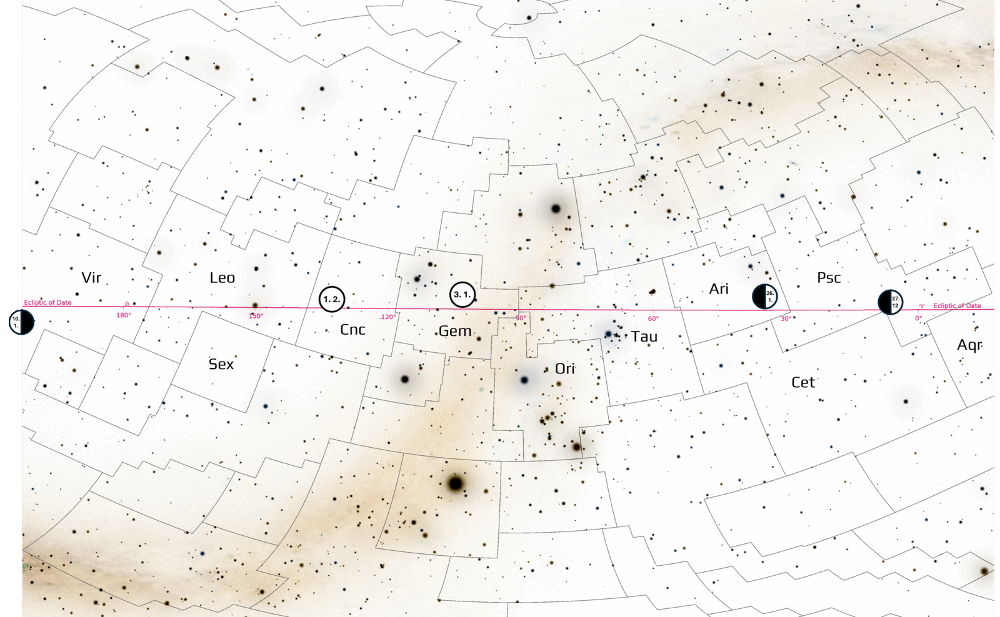

## Zadanie

Počas zimy sa nám naskytujú dobré podmienky na pozorovanie Mesiaca, nakoľko medzi prvou a poslednou štvrťou kulminuje vyššie nad horizontom ako v lete. To zároveň znamená, že vychádza skôr a zapadá neskôr, čiže ho na oblohe vieme zastihnúť dlhšiu dobu. Vašou úlohou je v priebehu domáceho kola vykonať opakované pozorovania Mesiaca, v ktorých:

- zakreslite pozíciu Mesiaca do mapy na obrázku 2,

- napíšte, v akom súhvezdí sa Mesiac nachádza a skratku tohto súhvezdia,

- porovnajte Mesiac s tabuľkou jeho fáz na obrázku 1 a vyberte poradové číslo dňa od novu, ktoré najlepšie zodpovedá aktuálne pozorovanej fáze,

- uveďte dátum, čas a miesto pozorovania,

- popíšte podmienky pozorovania.

Iba pomocou informácií nameraných pri vašich pozorovaniach sa pokúste vypočítať alebo odhadnúť synodickú obežnú dobu Mesiaca, teda dobu od splnu po spln. Konkrétna metóda je na vás. Môžete ich vyskúšať aj viac a porovnať ich presnosť. Môže sa vám hodiť (ale nemusí) doba obehu Zeme okolo Slnka $P_\Ea = 1\,\mathrm{rok} = 365{,}25\,\mathrm{dňa}$. Pozorovania vykonajte minimálne tri, s časovými rozostupmi aspoň 12 hodín. Nepoužívajte aplikácie simulujúce nočnú oblohu a informácie z internetu ani ročeniek. Nehodnotíme iba presnosť ale najmä snahu a nápaditosť. Nezabudnite sa v noci teplo obliecť.

<figure>

<figcaption>

**Obrázok 1:** Tabuľka fáz Mesiaca počas jednotlivých dní počítaných od novu.
</figcaption>

</figure>

<figure>

<figcaption>

**Obrázok 2:** Mapa nočnej oblohy. Ružovou je vyznačená ekliptika a uhlové vzdialenosti od jarného bodu ($\Aries$).
</figcaption>

</figure>

Riešenie

Dráha Mesiaca je sklonená voči rovine ekliptiky iba o približne $5^{\circ}$. To znamená, že sa Mesiac pri svojom pohybe medzi hviezdami nikdy nedostane ďalej ako $5^{\circ}$ od ekliptiky. Preto je mapa v zadaní (obrázok 2) centrovaná okolo ekliptiky. Zákresy Mesiaca vieme jednoducho kontrolovať: ak je Mesiac príliš vysoko nad alebo hlboko pod ružovou čiarou ekliptiky, znamená to, že sme jeho polohu zakreslili zle.

Pri zakresľovaní Mesiaca sa musíme zorientovať na nočnej oblohe. Užitočný je kompas na určenie svetových strán a otáčavá mapka oblohy na určenie aktuálne viditeľných hviezd vzhľadom na polohu horizontu pre daný dátum a čas pozorovania. Následne musíme preniesť polohu Mesiaca na priloženú mapu. Tu si treba dať pozor na rôzne otočenia mapy a nočnej oblohy. Zakresľovanie komplikuje žiara Mesiaca, ktorá presvetľuje hviezdy v jeho okolí. Užitočné je sústrediť sa na relatívne polohy aspoň dvoch jasných hviezd voči Mesiacu a rovnaké geometrické usporiadanie preniesť na mapu na papieri.

Hranice súhvezdí sú zobrazené na priloženej mape, čo uľahčuje rozhodovanie o tom, v ktorom súhvezdí sa Mesiac nachádza. Keďže sa Mesiac musí pohybovať v blízkosti ekliptiky, stačí nám na mape identifikovať súhvezdia blízko ružovej čiary. Na obrázku 3 je mapa polôh Mesiaca v priebehu domáceho kola 20. ročníka Astronomickej olympiády počas prvých štvrtí, splnov a posledných štvrtí. Mapa takisto obsahuje skratky súhvezdí v okolí ekliptiky, v ktorých by sa Mesiac mohol nachádzať.

Na určenie synodickej doby Mesiaca existuje viacero spôsobov. Ako prvé by nás mohlo napadnúť odpozorovať dva po sebe nasledujúce splny a spočítať, koľko dní medzi nimi ubehlo. Takýto prístup je však pomerne nepresný. Odhadnúť, kedy presne nastal spln, je ťažké. Maximálna presnosť, ktorú je možné dosiahnuť, je $1\,\mathrm{deň}$. Alternatívne by sme mohli počítať dni medzi dvoma po sebe idúcimi prvými (alebo poslednými) štvrťami. Tieto fázy sa odhadujú lepšie, nakoľko majú ostrý okraj, na rozdiel od splnu.

Ďalšou alternatívou riešenia je vykonať každé pozorovanie v čase, keď Mesiac práve zapadá alebo vychádza. Treba si dať pozor na to, aby sme pozorovali z rovnakého miesta, a teda mali rovnaký horizont. Ak si zapíšeme čas západu (alebo východu) Mesiaca v dvoch po sebe idúcich dňoch, zistíme, že v druhý deň zapadol (alebo vyšiel) o niečo neskôr. To je spôsobené tým, že sa medzitým presunul na iné miesto medzi hviezdami. Na základe tohto posunu je možné spočítať, koľko takýchto posunov je potrebných na to, aby uplynulo 24 hodín. Vtedy sa Mesiac vráti medzi hviezdami na pôvodné miesto. Počet posunov bude teda zodpovedať počtu dní v siderickom mesiaci. Ten následne vieme prepočítať na synodický mesiac pomocou dĺžky roka. Problém pri tejto metóde je, že sa časový posun medzi dvoma po sebe nasledujúcimi západmi (alebo východmi) Mesiaca môže výrazne líšiť, nakoľko sa deklinácia Mesiaca mení, čo spôsobuje, že zapadá na rôznych miestach horizontu. Najkratší posun je 14 minút, kedy by nám vyšlo, že siderický mesiac má 103 dní, keďže 

$$
\frac{24\cdot 60\,\mathrm{minút}}{14\,\mathrm{minút}} \doteq 103 \,. \tag{1}
$$

 Naopak, pre najdlhší posun, ktorý je 79 minút, dostaneme dĺžku siderického mesiaca iba 18 dní, keďže 

$$
\frac{24\cdot 60\,\mathrm{minút}}{79\,\mathrm{minút}} \doteq 18 \,. \tag{2}
$$

Dobrý prístup pri tejto metóde je pozorovanie opakovať pri rôznych fázach Mesiaca a následne spriemerovať namerané posuny času západu (alebo východu) Mesiaca. Napríklad spriemerovaním najdlhšieho a najkratšieho posunu získame posun o dĺžke $(14+79)/2 = 46,5$ minút, z ktorého vypočítame dĺžku siderického mesiaca na 31 dní, čo je výrazne presnejší odhad. Reálna hodnota siderického mesiaca je podľa konštantovníka $27{,}33\,\mathrm{dňa}$.

Najpresnejší prístup na určenie dĺžky siderického mesiaca je využiť zákresy na mape. Stupňami na ekliptike máme určenú škálu uhlových vzdialeností. To znamená, že môžeme pravítkom odmerať vzdialenosti v centimetroch medzi jednotlivými zákresmi a prepočítať ich na uhlové vzdialenosti na oblohe. Následne, na základe času, ktorý ubehol medzi pozorovaniami, vieme vypočítať, koľko času musí ubehnúť, aby Mesiac prešiel po oblohe $360^{\circ}$. Najväčšia výhoda tejto metódy je, že sa Mesiac hýbe pozdĺž ekliptiky pomerne rovnomerne. Za jeden deň prejde $12^{\circ}$ až $15^{\circ}$. Z toho dostávame dĺžku siderického mesiaca 24 až 30 dní, čo zistíme výpočtami obdobnými ako predtým 

$$
\frac{360^{\circ}}{12^{\circ}} = 30 \a
    \frac{360^{\circ}}{15^{\circ}} = 24 \,. \tag{3}
$$

 V priemere dostávame $27\,\mathrm{dní}$, čo je veľmi dobrý odhad dĺžky siderického mesiaca.

Navyše, nemusíme využívať iba pozorovania presne jeden deň po sebe, čo výrazne zjednodušuje ich plánovanie, a takisto zvyšuje presnosť získaného výsledku. Ilustrujeme si to pomocou mapy na obrázku 3. Zamerajme sa na polohu Mesiaca v prvej štvrti, ktorá nastala 27. 12. o 21:00, a polohu Mesiaca v splne, ktorý nastal 3. 1. o 11:00. Medzi týmito dvoma pozorovaniami uplynulo 7 dní a 14 hodín, teda $7{,}58\,\mathrm{dňa}$. Na základe uhlovej stupnice na ekliptike vieme odhadnúť, že sa Mesiac posunul o približne $100^{\circ}$. Pomocou trojčlenky vieme následne prepočítať, koľko času Mesiac potrebuje na to, aby prešiel $360^{\circ}$. Čas označíme neznámou $t$ a z trojčlenky dostávame rovnicu 

$$
\frac{360^{\circ}}{100^{\circ}} = \frac{t}{7{,}58\,\mathrm{dňa}} \,, \tag{4}
$$

 z ktorej jednoduchou úpravou dostávame hľadaný čas 

$$
t = \frac{360^{\circ}}{100^{\circ}} \cdot 7{,}58\,\mathrm{dňa} =
    3,6 \cdot 7{,}58\,\mathrm{dňa} \doteq 27{,}3\,\mathrm{dňa} \,. \tag{5}
$$

 Čím sme získali ešte presnejší odhad siderickej obežnej doby Mesiaca.

Na záver si ukážeme, ako prepočítať dĺžku siderického mesiaca na dĺžku synodického mesiaca, a to pomocou dĺžky roka $365{,}25\,\mathrm{dňa}$. Počas roka nastane o jeden siderický mesiac viac ako synodický, pretože jeden obeh Mesiaca okolo Zeme je zdanlivo skrytý v obehu Zeme okolo Slnka. Teda musí platiť 

$$
\frac{365{,}25\,\mathrm{dňa}}{P_\Mo} -
    \frac{365{,}25\,\mathrm{dňa}}{S_\Mo} =
    1 \,, \tag{6}
$$

 kde $P_\Mo$ je dĺžka siderického mesiaca a $S_\Mo$ dĺžka synodického mesiaca. Z tejto rovnice vieme vypočítať požadovaný prepočet $P_\Mo \leftrightarrow S_\Mo$. Napríklad pre $P_\Mo = 27{,}3\,\mathrm{dní}$ dostaneme po dosadení 

$$
\frac{365{,}25\,\mathrm{dňa}}{27{,}3\,\mathrm{dní}} -
    \frac{365{,}25\,\mathrm{dňa}}{S_\Mo} =
    1 \,, \tag{7}
$$

 čo po úprave dá 

$$
\frac{365{,}25\,\mathrm{dňa}}{S_\Mo} =
    \frac{365{,}25\,\mathrm{dňa}}{27{,}3\,\mathrm{dní}} - 1 \doteq 
    13,4 - 1 = 12,4 \,. \tag{8}
$$

Finálnou úpravou dostaneme výsledok 

$$
S_\Mo = \frac{365{,}25\,\mathrm{dňa}}{12,4} \doteq
    29{,}5\,\mathrm{dní} \,. \tag{9}
$$

Tento výsledok je veľmi presný, podľa konštantovníka je dĺžka synodického mesiaca $29{,}53\,\mathrm{dňa}$. Presnosť vieme ešte viac zlepšiť opakovaním výpočtu pre rôzne dvojice pozorovaní a následným priemerovaním. Viac meraní prináša presnejšie výsledky, to je všeobecný prístup vo vede.

Pri hodnotení tejto úlohy nerozhodovala iba presnosť získaného výsledku, ale snaha a nápaditosť pri riešení akoukoľvek metódou. Preto v tomto vzorovom riešení nenájdete bodovú schému na pravom okraji.

<figure>

<figcaption>

**Obrázok 3:** Mapa nočnej oblohy s vyznačenými polohami Mesiaca v priebehu domáceho kola, konkrétne počas prvej štvrte (27. 12. a 16. 1.), splnu (3. 1. a 1. 2.) a poslednej štvrte (10. 1.). Na mape sú taktiež vyznačené skratky súhvezdí v okolí ekliptiky, v ktorých by sa Mesiac mohol nachádzať (Panna, Lev, Sextant, Rak, Blíženci, Orión, Býk, Baran, Veľryba, Ryby a Vodnár). Posledná štvrť z 9. 2. sa na mapu nezmestila, pretože nastala v súhvezdí Váhy (Lib).
</figcaption>

</figure>

