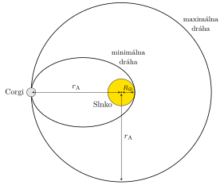

## Zadanie

Organizátori Astronomickej olympiády objavili asteroid a pomenovali ho Corgi. Zistili, že asteroid sa najďalej od stredu Slnka nachádza vo vzdialenosti $2{,}222 \cdot 10^{8}\,\mathrm{km}$. Nevedeli sa však zhodnúť na tom, akú má tento asteroid obežnú periódu. Nájdite všetky možnosti obežnej periódy, akú by asteroid Corgi mohol mať a vysvetlite, prečo nejde iba jednu hodnotu.

*Nápoveda:* Dajte pozor na to, aby sa asteroid nedostal do vnútra Slnka.

Riešenie

Na výpočet obežnej periódy využijeme 3. Keplerov zákon, pričom potrebujeme nájsť veľkú polos asteroidu. Veľkú polos dráhy ($a$) vypočítame ako priemer perihéliovej ($r_p$) a aféliovej vzdialenosti ($r_a$) od Slnka. 

$$
a = \frac{r_p + r_a}{2} \,. \tag{1}
$$

Aféliovú vzdialenosť vieme zo zadania: $r_a=2{,}222 \cdot 10^{8}\,\mathrm{km}$. Perihéliová vzdialenosť však nie je určená a práve v tom spočíva nejednoznačnosť pri hľadaní periódy. [5 b]

Najväčšia možná perihéliová vzdialenosť je rovná aféliovej, teda dráha je kružnica (zobrazená ako kružnica na obr. 1). Ak by bola perihéliová vzdialenosť väčšia, už by z nej bola aféliová. Najmenšia možná perihéliová vzdialenosť je hranične rovná polomeru Slnka (zobrazená ako elipsa na obr. 1). [10 b]

<figure>

<figcaption>

**Obrázok 1:** Schéma dráhy asteroidu Corgi s najmenšou a najväčšou možnou veľkou polosou.
</figcaption>

</figure>

Nastať môžu všetky hodnoty perihéliovej vzdialenosti ohraničené medzi týmito hranicami: 

$$
\begin{align*}
    \text{najmenšia možná perihéliová vzdialenosť:}\quad & r_{p,min} = 6{,}957 \cdot 10^{5}\,\mathrm{km} \,, \tag{2}\\
    \text{najväčšia možná perihéliová vzdialenosť:}\quad & r_{p,max} = 2{,}222 \cdot 10^{8}\,\mathrm{km} \,. \tag{3}\\
    \phantom{x}\qquad\textit{[10\,b]} & 
\end{align*}
$$

Dosadením aféliovej vzdialenosti a najmenšej resp. najväčšej perihéliovej do vzťahu (1) dostaneme najmenšiu resp. najväčšiu možnú veľkú polos: 

$$
\begin{align*}
    \text{najmenšia možná veľká polos:}\quad & a_{min} = 1{,}114 \cdot 10^{8}\,\mathrm{km} = 0{,}745\,\mathrm{au} \,, \tag{4}\\
    \text{najväčšia možná veľká polos:}\quad & a_{max} = 2{,}222 \cdot 10^{8}\,\mathrm{km} = 1{,}485\,\mathrm{au} \,. \tag{5}\\
    \phantom{x}\qquad\textit{[10\,b]} & 
\end{align*}
$$

Na záver vypočítame periódu z 3. Keplerovho zákona v tvare 

$$
a^3 = P^2 \,, \tag{6}
$$

 kde veľká polos $a$ je v astronomických jednotkách a perióda $P$ je v rokoch, pričom vzťah platí len pre slnečnú sústavu. Periódu vyjadríme ako 

$$
P = \sqrt{a^3} \,. \qquad\textit{[5\,b]} \tag{7}
$$

Dosadením najmenšej a najväčšej možnej veľkej polosi v astronomických jednotkách dostaneme výsledok: 

$$
\begin{align*}
    \text{najmenšia možná perióda:}\quad & P_{min} = \sqrt{a_{min}^3} = \sqrt{0{,}745^3} \;\mathrm{roka} = \boxed{0{,}643\,\mathrm{roka}} \,, \tag{8}\\
    \text{najväčšia možná perióda:}\quad & P_{max} = \sqrt{a_{max}^3} = \sqrt{1{,}485^3} \;\mathrm{roka} = \boxed{ 1{,}810\,\mathrm{roka}} \,, \tag{9}\end{align*}
$$

 pričom možné periódy sú všetky hodnoty medzi týmito hranicami. [10 b]

