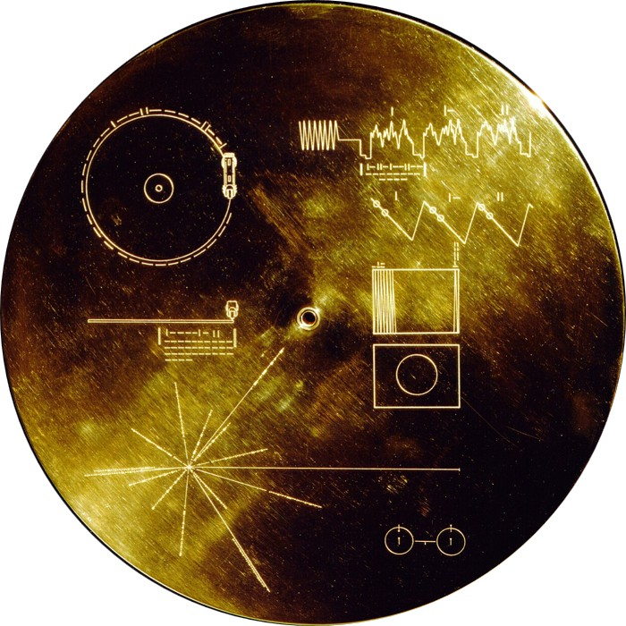

## Zadanie

<figure>

</figure>

Zo Zeme bola dňa 5. 9. 1977 vypustená sonda Voyager 1, ktorá sa v  súčasnosti považuje za najvzdialenejší objekt vo vesmíre vytvorený človekom. Ku dňu 5. 11. 2026 dosiahne míľnik, nakoľko sa bude nachádzať vo vzdialenosti jedného svetelného dňa od Zeme, čiže vo vzdialenosti, ktorú svetlo prejde vo vákuu za jeden deň.

<ol type="a">

<li>

[30 b] Vypočítajte priemernú rýchlosť sondy Voyager 1.

</li>

<li>

[20 b] Odhadnite, kedy sonda Voyager 1 docestuje k najbližším hviezdam. Vzdialenosť najbližších hviezd sa pokúste určiť úvahou. Nechceme presný výpočet, len približnú hodnotu času, ako dlho by to sonde Voyager 1 trvalo. Predpokladajte, že sa sonda pohybuje konštantnou rýchlosťou.

</li>

</ol>

Riešenie

<ol type="a">

<li>

Ako prvé je nutné si vypočítať hodnotu jedného slnečného dňa, teda vzdialenosti, ktorú prejde svetlo za jeden deň. Najjednoduchšie je použiť konštatovník, v ktorom je uvedená hodnota jedného svetelného roka (angl. *light year*) $1\,\mathrm{ly} = 63\,241\,\mathrm{au}$ a jednej astronomickej jednotky (angl. *astronomical unit*) $1\,\mathrm{au} = 149\,597\,870\,700\,\mathrm{m}$, teda 

$$
1\,\mathrm{ly} = 63\,241 \cdot 149\,597\,870\,700\,\mathrm{m} \doteq 9{,}4607 \cdot 10^{15}\,\mathrm{m}\,. \tag{1}
$$

 Keď túto hodnotu predelíme číslom 365,25 (teda počtom dní v roku), dostaneme, že jeden svetelný deň má dĺžku $s=2{,}5902 \cdot 10^{13}\,\mathrm{m}$ [5 b]. Ďalej poznáme vzorec pre rovnomerný pohyb 

$$
s = v \cdot t \,, \qquad\textit{[10\,b]} \tag{2}
$$

 v ktorom $v$ je rýchlosť pohybujúceho sa objektu a $t$ je čas, za ktorý túto vzdialenosť $s$ prejde sonda. Ale musíme uvažovať, že rýchlosť $v$ sa nemení, teda je konštantná. Rýchlosť $v$ z rovnice (2) vyjadríme tak, že ju predelíme časom $t$ na obidvoch stranách, z čoho dostávame 

$$
v = \frac{s}{t} \,. \qquad\textit{[2\,b]} \tag{3}
$$

A práve konštantnú rýchlosť $v$ máme v tomto zadaní vypočítať. Vidíme, že jediná veličina, ktorú z tohto vzťahu ešte nepoznáme, je čas $t$. Ak sa však pozrieme do zadania, vidíme, že jediné časové údaje, ktoré poznáme, sú štart 5. 9. 1977 a čas dosiahnutia jedného svetelného dňa 5. 11. 2026. To znamená, že teraz musíme vypočítať čas, ktorý ubehol medzi týmito dvoma udalosťami. Predpokladáme, že tieto udalosti nastali v rovnakú hodinu daných dní.

Najjednoduchší spôsob bude rozdeliť si tento časový rozdiel na úseky. Medzi 5. 9. 1977 a 5. 9. 2026 je $2026 - 1977 = 49$ rokov. Ale pozor, netreba zabudnúť, že každý rok deliteľný štyrmi, okrem rokov deliteľných 100, ale nedeliteľných 400, je priestupný. Teda oproti zvyčajným 365 dňom je dlhý 366 dní, ktoré nemôžeme zabudnúť zarátať. Najbližší rok po štarte, ktorý nie je deliteľný štyrmi, je rok 1980. Každý ďalší štvrtý rok je potom taktiež priestupný. Čiže priestupné roky sú 1980, 1984, 1988, 1992, 1996, 2000, 2004, 2008, 2012, 2016, 2020 a 2024 (rok 2000 síce je deliteľný číslom 100, no zároveň je deliteľný číslom 400, čo z neho robí priestupný rok), teda 12 rokov má 366 dní namiesto 365 dní. Počet zvyšných nepriestupných rokov vypočítame ako počet celkových mínus počet priestupných, čiže $49 - 12 = 37$. Keď to celé sčítame dokopy, dostaneme, že medzi 5. 9. 1977 a 5. 9. 2026 ubehne 

$$
12 \cdot 366 + 37 \cdot 365 = 17\,897\,\mathrm{dní}\,. \tag{4}
$$

Ďalej potrebujeme nájsť, koľko dní ubehne medzi 5. 9. 2026 a 5. 11. 2026. Vieme, že september je dlhý 30 dní a október 31 dní. Čiže od 5. 9. 2026 musíme pridať ešte 26 dní, aby sme dostali 1. 10. 2026 a o ďalších 31 dní sa dostaneme k 1. 11. 2026. Odtiaľ nám chýbajú už len 4 dni do 5. 11. 2026 a sme tam, kde sme chceli byť. Dokopy nám to k $17\,897$ dňom pridá ešte ďalších $25+31+5 = 61$ dní. Dostávame tak, že čas 

$$
t = 17897 + 61 = 17\,958\,\mathrm{dní}\,. \qquad\textit{[8\,b]} \tag{5}
$$

 Keďže rýchlosť $v$ sa najčastejšie vyjadruje v jej základnej jednotke meter za sekundu, je rozumné si tento počet dní vyjadriť ešte v sekundách ako $17 958 \cdot 24 \cdot 60 \cdot 60\,\mathrm{s} = 1{,}5516 \cdot 10^{9}\,\mathrm{s}$.

Keď už máme vypočítaný čas, nič nám nebráni dosadiť túto hodnotu $t$ a vyššie vypočítanú vzdialenosť $s$ do vzorca (3). Dostávame tak 

$$
v = \frac{s}{t} = \frac{2{,}5902 \cdot 10^{13}\,\mathrm{m}}{1{,}5516 \cdot 10^{9}\,\mathrm{s}} = \boxed{ 16\,694\,\mathrm{m}\,{\mathrm{s}}^{-1}} \,. \qquad\textit{[5\,b]} \tag{6}
$$

*Poznámka: Môžeme si všimnúť, že táto hodnota je pomerne blízka k hodnote tretej kozmickej rýchlosti, teda rýchlosti potrebnej na prekonanie gravitačných síl Slnka a únik zo slnečnej sústavy. Ak by sa sonda Voyager 1 pohybovala menšou rýchlosťou, nebola by schopná opustiť slnečnú sústavu.*

</li>

<li>

Základnou znalosťou je, že najbližšia hviezda od Zeme (ak nepočítame Slnko), resp. od slnečnej sústavy je Proxima Centauri, ktorej vzdialenosť je niečo vyše 4 svetelné roky. Čas $t$ si vieme vyjadriť z pôvodnej rovnice (2) ako 

$$
t = \frac{s}{v} \,, \qquad\textit{[5\,b]} \tag{7}
$$

 kde za $s$ dosadíme vzdialenosť hviezdy Proxima Centauri a za $v$ rýchlosť sondy. Počítame s tým, že jej veľkosť sa nemení, čiže použijeme náš výsledok $v = 16\,694\,\mathrm{m}\,{\mathrm{s}}^{-1}$.

Ako príklad uvedieme výsledok s dosadenou hodnotou vzdialenosti $s = 5\,\mathrm{ly}$, [5 b] teda pod premene jednotiek: $s = 5 \cdot 63241 \cdot 149\,597\,870\,700\,\mathrm{m} \doteq 4{,}7304 \cdot 10^{16}\,\mathrm{m}$. Keďže rýchlosť $v$ je v metroch za sekundu, výsledný čas $t$ dostaneme v sekundách: 

$$
t = \frac{s}{v} = \frac{4{,}7304 \cdot 10^{16}\,\mathrm{m}}{16\,694\,\mathrm{m}\,{\mathrm{s}}^{-1}} =  2{,}8336 \cdot 10^{12}\,\mathrm{s} \,. \tag{8}
$$

Po prepočte na roky dostávame, že 

$$
t = \frac{2{,}8336 \cdot 10^{12}}{60 \cdot 60 \cdot 24 \cdot 365,25} \,\mathrm{rokov} = 89\,791\,\mathrm{rokov} \doteq 90\,000\,\mathrm{rokov} \,. \qquad\textit{[10\,b]} \tag{9}
$$

Je nutné podotknúť, že konečný výsledok sa môže líšiť od zvolenej vzdialenosti $s$, no rozumným uvážením by sme sa mali dostať k hodnotám $80\,000$ až $120\,000\,\mathrm{rokov}$.

V realite sa Voyager 1 priblíži k hviezde Gliese 445 v súhvezdí Žirafa už o $40\,000\,\mathrm{rokov}$. Výsledok sa líši preto, lebo my sme počítali so zjednodušením (konštantnou rýchlosťou) a zanedbali vzájomný pohyb hviezdy a sondy, ako aj gravitačné interakcie, ktoré menia ich trajektóriu a relatívnu rýchlosť v čase. Cieľom misie Voyager 1 však nie je cesta k žiadnej konkrétnej hviezde, a preto bude väčšinu svojho života iba letieť medzihviezdnym priestorom.

</li>

</ol>

## Komentár autora

Skúmala planéty Jupiter, Saturn či mesiac Titan a momentálne sa nachádza za hranicou heliopauzy - hranice slnečnej sústavy.
