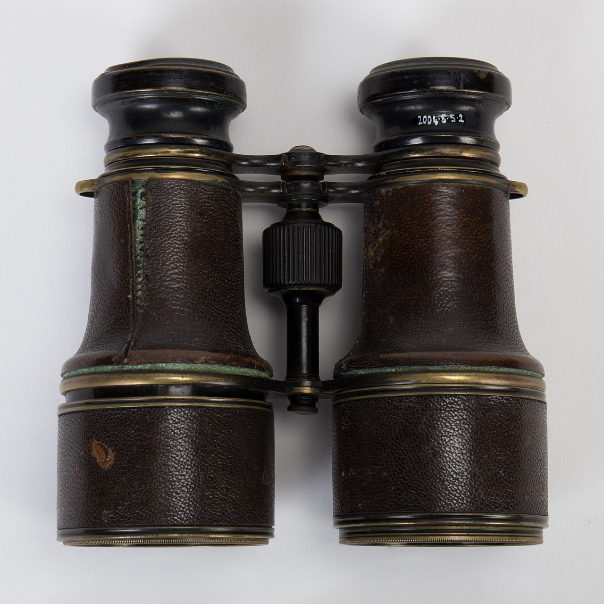

## Zadanie

<figure>

</figure>

Pre bežné pozorovania vzdialených objektov je často používaným typom ďalekohľadu takzvaný binokulárny ďalekohľad. Ide o spojenie dvoch rovnakých ďalekohľadov, čo umožňuje pozorovanie oboma očami naraz. V úlohe budeme pracovať s binokulárnym ďalekohľadom s parametrami $6\times33$, čo znamená 6-násobné zväčšenie a priemer obidvoch objektívov $d = 33\,\mathrm{mm}$.

<ol type="a">

<li>

[25 b] Vypočítajte, aký monokulár vie nahradiť spomínaný binokulár, teda, aký priemer $D$ musí mať objektív monokuláru, aby zozbieral rovnaké množstvo svetla na vstupe.

</li>

</ol>

V ďalšej časti úlohy sa pozrieme na parametre monokuláru nájdeného v úlohe (a). Jedným z hlavných parametrov ďalekohľadu je rozlišovacia schopnosť. V praxi sa najlepšie testuje na tesných dvojhviezdach.

<ol type="a" start="2">

<li>

[25 b] Overte, či je možné daným monokulárom rozlíšiť dvojhviezdu Izar s uhlovou vzdialenosťou zložiek $2{,}852''$. Dvojhviezdu pozorujeme vo viditeľnom svetle, teda na vlnovej dĺžke $\lambda = 550\,\mathrm{nm}$.

</li>

</ol>

Riešenie

<ol type="a">

<li>

Aby monokulár zozbieral rovnaké množstvo svetla ako binokulár, musí byť plocha objektívu monokuláru rovnaká ako plocha oboch objektívov binokuláru dokopy. Na výpočet plochy objektívu využijeme vzťah pre obsah kruhu [5 b] 

$$
S = \pi r^2 \,, \tag{1}
$$

 kde $r$ je polomer kruhu, ktorý môžeme prepísať pomocou priemeru: $r = \frac{d}{2}$. Aby sme mohli dosadzovať priemer objektívu $d$ prepíšeme plochu kruhu ako [5 b] 

$$
S = \pi \frac{d^2}{4} \,. \tag{2}
$$

 Pre plochu objektívu monokuláru platí $S_m = \pi \frac{D^2}{4}$ a pre vstupnú plochu binokuláru platí $S_b = 2 \pi \frac{d^2}{4}$. Obe plochy dáme do rovnosti 

$$
\pi \frac{D^2}{4} = 2 \pi \frac{d^2}{4} \qquad\textit{[10\,b]}\,, \tag{3}
$$

 po skrátení dostaneme 

$$
D^2 = 2 d^2 \,, \tag{4}
$$

 odkiaľ po odmocnení dostaneme priemer monokuláru 

$$
D = \sqrt{2} \, d \doteq \boxed{47\,\mathrm{mm}} \qquad\textit{[5\,b]}\,. \tag{5}
$$

</li>

<li>

Rozlišovacia schopnosť teleskopu je závislá na priemere objektívu a daná vzťahom 

$$
\theta = 206\,265\, \cdot 1,22 \, \frac{\lambda}{D} \qquad\textit{[15\,b]}\,, \tag{6}
$$

 kde $\lambda$ je vlnová dĺžka na ktorej ďalekohľad pozoruje a pre viditeľné svetlo je rovná $550\,\mathrm{nm}$, $D$ je priemer objektívu a $\theta$ je rozlišovacia schopnosť ďalekohľadu v uhlových sekundách. Do vzťahu dosadíme vlnovú dĺžku a priemer v rovnakých jednotkách (v metroch) a dostaneme rozlišovaciu schopnosť ďalekohľadu 

$$
\theta = 206\,265\, \cdot 1,22 \, \frac{5,50\cdot10^{-7}}{47\cdot10^{-2}} \doteq 2{,}966'' \qquad\textit{[5\,b]}\,, \tag{7}
$$

 čo predstavuje najmenšiu možnú uhlovú vzdialenosť hviezd, ktoré ešte ďalekohľadom rozlíšime. Podľa zadanie sú zložky dvojhviezdy Izar k sebe bližšie, takže by sme ich nerozlíšili[5 b].

</li>

</ol>

**Doplňujúca poznámka**

Základná verzia vzťahu pre rozlišovaciu schopnosť v tvare $\theta = 1,22 \, \frac{\lambda}{D}$ udáva uhol v radiánoch a číslo $206\,265\,\ $slúži k prevodu radiánov na oblúkové sekundy. Na prevod radiánov a stupňov využijeme fakt, že kruh má $360^{\circ}$ a zároveň $2 \pi \, \mathrm{rad}$. Túto rovnosť môžeme zapísať ako 

$$
360^{\circ} = 2 \pi \, \mathrm{rad} \,, \tag{8}
$$

 kde ľavú stranu vynásobíme 3600 (premeníme na oblúkové sekundy), 

$$
1\,296\,000'' = 2 \pi \, \mathrm{rad} \,, \tag{9}
$$

 a na záver rovnicu podelíme $2 \pi$ a dostaneme hodnotu jedného radiánu 

$$
1\,\mathrm{rad} \doteq 206\,265'' \,. \tag{10}
$$

