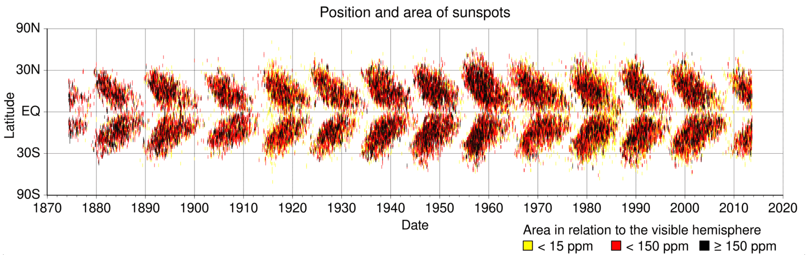
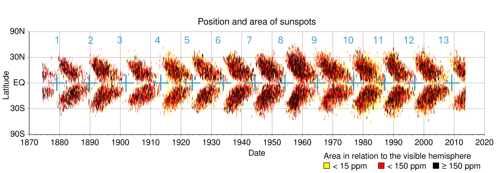
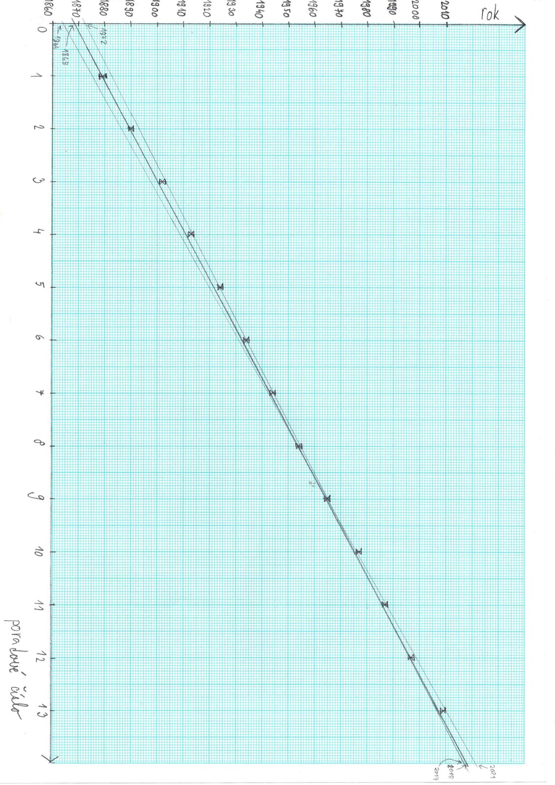
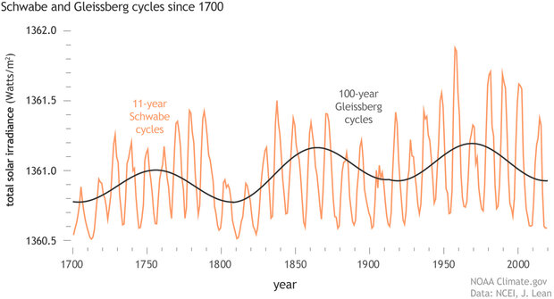
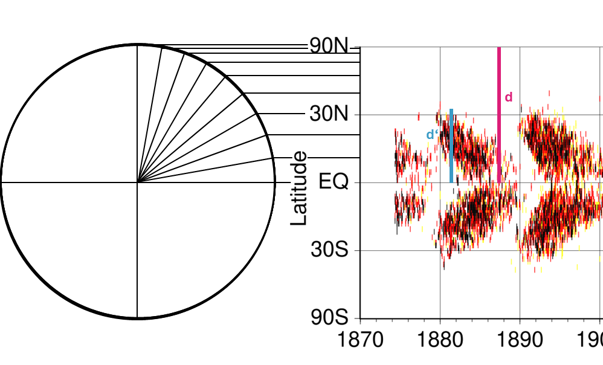

## Zadanie

Zmenou rozloženia magnetického poľa Slnka sa mení jeho povrchová aktivita, ktorej najznámejším prejavom je výskyt slnečných škvŕn. Ich aktivitu v čase popisuje tzv. *motýlikový diagram*, zobrazený na priloženom grafe. V úlohe predpokladajte, že Slnko je dokonalá guľa.

<ol type="a">

<li>

[50 b] Odhadnite roky, v ktorých nastali slnečné minimá, a zhrňte ich do prehľadnej tabuľky. Uveďte poradové číslo daného minima na diagrame v smere zľava doprava. Začnite minimom prvého celého zaznamenaného slnečného cyklu.

</li>

<li>

[70 b] Vyneste hodnoty z tabuľky, ktorú ste vyrobili v podzadaní (a), do grafu závislosti roku minima od jeho poradového čísla.

</li>

<li>

[50 b] Graf z podúlohy (b) preložte priamkou a na základe fitu určte smernicu danej priamky. Táto hodnota sa nazýva *Schwabeho slnečný cyklus*.

</li>

<li>

[30 b] Z motýlikového diagramu určte rozpätie heliografických šírok, na ktorých sa nachádzali slnečné škvrny od roku 1870 po rok 2020.

</li>

</ol>

<figure>

<figcaption>

**Obrázok 1:**\
Motýlikový diagram, t. j. závislosť heliografickej šírky od času. Môžete si všimnúť, že slnečné škvrny sú na začiatku cyklu viditeľné ďalej od slnečného rovníka a postupne sa presúvajú bližšie k rovníku, pričom graficky tvoria tvar podobný krídlam motýľa. Farby na diagrame znázorňujú početnosť slnečných škvŕn, pričom najhustejší výskyt zobrazuje čierna farba.\
Zdroj: Royal Observatory, Greenwich, NOAA.
</figcaption>

</figure>

Riešenie

<ol type="a">

<li>

V tejto úlohe budeme pracovať s motýlikovým diagramom na obr. 1. Ako bolo vysvetlené v zadaní, motýlikový diagram je graf závislosti heliografickej šírky od času (konkrétne od roku 1874 po rok 2014). Slnečné minimá budeme zaznamenávať do tabuľky 1, konkrétne určíme ich poradové číslo v smere zľava doprava a príslušný rok. Vidíme, že v motýlikovom diagrame je dokopy $13$ miním. Polohy miním sú vykreslené na obrázku 2.

**Tabuľka 1:** Rok miním a ich poradové číslo. [50 b]

| Poradové číslo minima | Rok minima |
|:---------------------:|:----------:|
|           1           |    1879    |
|           2           |    1890    |
|           3           |    1902    |
|           4           |    1913    |
|           5           |    1924    |
|           6           |    1934    |
|           7           |    1944    |
|           8           |    1954    |
|           9           |    1965    |
|          10           |    1977    |
|          11           |    1987    |
|          12           |    1997    |
|          13           |    2009    |

<figure>

<figcaption>

**Obrázok 2:** Polohy slnečných miním na motýlikovom diagrame.
</figcaption>

</figure>

Ako vidíme v tabuľke 1, rok minima sme uvádzali s presnosťou na celé roky. V dôsledku komplikovanejšieho odhadu polohy miním z motýlikového diagramu predpokladáme, že rok minima vieme určiť s presnosťou na jeden celý rok, čiže s odchýlkou jedného roku.

</li>

<li>

V nasledujúcej podúlohe vynesieme hodnoty z tabuľky 1 do grafu[70 b], teda vytvoríme graf závislosti roku minima od jeho poradového čísla. To je vyobrazené na grafe 3. Vidíme, že závislosť má jasný lineárny priebeh.

<figure>

<figcaption>

**Obrázok 3:** Vynesenie bodov z tabuľky 1 do grafu a preloženie priamkou.
</figcaption>

</figure>

</li>

<li>

Všetky body z grafu 3 vieme preložiť priamkou pomocou pravítka a následne určiť jej predpis v tvare $y = Ax + B$. Priamka prechádza bodmi $[0, 1868]$ a $[14, 2018]$. Dosadením prvého bodu do rovnice priamky dostaneme priamo $B = 1868$. Smernicu $A$ vypočítame ako podiel rodielu y-ových súradníc bodov a rozdielu x-ových súradníc bodov, teda 

$$
A = \frac{2018 - 1868}{14 - 0} = 10,71 \,. \tag{1}
$$

 Do grafu sme takisto zakreslili náš odhad minimálnej a maximálnej priamky fitu, z čoho vieme určiť nepresnosti vypočítaných koeficientov. Pre $B$ dostávame minimálnu hodnotu 1864 a maximálnu hodnotu 1872. Nepresnosť je teda približne $\pm 4$. Pre $A$ je minimálna hodnota $(2017-1872)/14 = 10,36$ a maximálna hodnota $(2021-1868)/14 = 10,93$. Nepresnosť zaokrúhlená na jednu platnú cifru je $\pm 0{,}3$. Ako finálny výsledok predpisu priamky dostávame 

$$
\boxed{y = (10{,}7 \pm 0{,}3) \, x + (1868 \pm 4)} \qquad\textit{[50\,b]} \,. \tag{2}
$$

 Nesmieme zabudnúť, že v tomto predpise musíme koeficienty $A$ a $B$ zaokrúhliť na taký počet miest, ako zodpovedá chybe merania. Prílišná presnosť by bola nerealistická.

*Poznámka: Smernica priamky z tohto predpisu nám udáva tzv. Schwabeho periódu (alebo tiež Schwabeho cyklus) – periódu, s ktorou sa mení počet slnečných škvŕn na povrchu Slnka. Na jej začiatku sa na povrchu Slnka nachádza minimum škvŕn. Postupne ich počet pribúda, pričom slnečné škvrny sa začínajú vytvárať ďalej od slnečného rovníka a po približne 11 rokoch ich počet dosiahne maximum a ich výskyt sa postupne presunie smerom k nižším heliografickým šírkam. Táto Schwabeho perióda má úzku súvislosť s tzv. Haleovým cyklom. Haleov cyklus v sebe integruje dva po sebe idúce Schwabeho cykly (čiže trvá približne 22 rokov), pričom na vrchole každého maxima dochádza k zmene magnetickej polarity slnečných pólov a až po uplynutí ďalšej 11-ročnej periódy, počas ktorej majú magnetické polia v aktívnych oblastiach opačnú orientáciu, sa magnetický dipól Slnka vráti do svojej pôvodnej konfigurácie. Okrem týchto cyklov existuje ešte tzv. Gleissbergov cyklus, ktorý predstavuje dlhodobú variáciu slnečnej aktivity, ktorá moduluje amplitúdu jednotlivých 11-ročných Schwabeho cyklov v priebehu približne 80 až 100 rokov. Tento cyklus spolu so Schwabeho cyklom sú znázornené na obrázku 4.*

<figure>

<figcaption>

**Obrázok 4:** Schwabeho a Gleissbergov slnečný cyklus. Zdroj: NOAA.
</figcaption>

</figure>

</li>

<li>

Ako poslednú úlohu máme určiť rozpätie heliografických šírok, na ktorých sa slnečné škvrny nachádzali. Tým pádom sa vraciame späť na obrázok 1 a pozeráme sa na zvislú os, na ktorej sú hodnoty heliografických šírok. V prvom rade si treba uvedomiť, že táto os je v sínusovej stupnici, čo znamená, že na zistenie uhla, ktorý reprezentuje heliografickú šírku $\beta$, si musíme definovať škálu pomocou priamej úmery 

$$
\frac{d'}{d} = \frac{\sin \beta}{\sin 90^{\circ}} \,, \tag{3}
$$

 kde $d$ je hodnota nameraná pravítkom (v centimetroch) od hodnoty $\beta = 0^{\circ}$ (EQ) po $\beta = 90^{\circ}$ (90N) a $d'$ je pravítkom nameraná hodnota (opäť od hodnoty $\beta = 0^{\circ}$) nášho maxima, resp. minima, ktoré hľadáme. Hodnoty $\sin 90^{\circ} = 1$ a $\sin \beta$ reprezentujú naškálovanie na sínusové hodnoty. Z rovnice (3) vieme následne jednoducho vyjadriť heliografickú šírku 

$$
\beta = \arcsin \left( \frac{d'}{d} \right) .
    \qquad\textit{[15\,b]} \tag{4}
$$

 Pre ozrejmenie prikladáme obrázok 5.

<figure>

<figcaption>

**Obrázok 5:** Sínusová os a znázornenie veľkostí $d$ a $d'$.
</figcaption>

</figure>

Ďalej je riešenie jednoduché. Stačí nám len nájsť najmenšiu a najväčšiu heliografickú šírku, určiť si pravítkom, ako ďaleko sa nachádza od hodnoty $\beta = 0^{\circ}$ (EQ) a následne pomocou odvodeného vzorca (4) určiť príslušnú heliografickú šírku $\beta$. Rozpätie heliografických šírok nám bude určovať práve táto nájdená maximálna $\beta_{\max}$ a minimálna $\beta_{\min}$ heliografická šírka.

Z motýlikového diagramu vieme odmerať $d = 26 \pm 0{,}5\,\mathrm{mm}$, $d'_{max} = 22 \pm 0{,}5\,\mathrm{mm}$, $d'_{min} = -22 \pm 0{,}5\,\mathrm{mm}$. Konkrétne vzdialenosti samozrejme závisia od tlače. Prepočtom na heliografickú šírku pomocou vzorca (4) dostaneme rozpätie 

$$
\boxed{\beta \in \langle-60^{\circ}\pm4^{\circ} \;;\; 60^{\circ} \pm 4^{\circ} \rangle} \qquad\textit{[15\,b]}. \tag{5}
$$

</li>

</ol>

## Komentár autora

Motýlikový diagram, ktorému je venovaná táto úloha, je veľmi užitočným a názorným nástrojom na skúmanie vzniku a zániku slnečných škvŕn.
